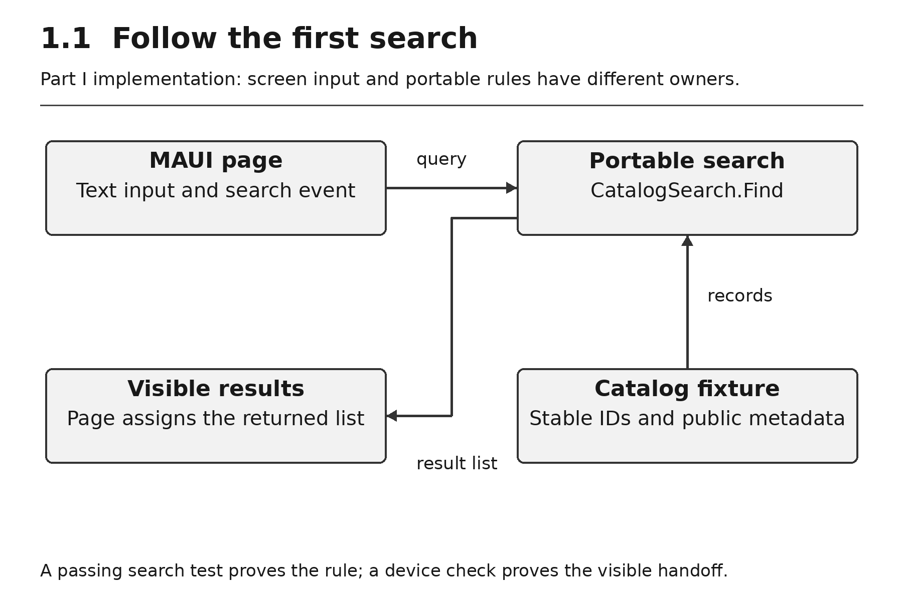

# Chapter 1
# Understanding the Mobile Development Landscape

## What You'll Learn

By the end of this chapter, you will be able to:

- Choose a mobile delivery approach from a concrete user journey.
- Separate portable C# rules from platform and service responsibilities.
- Decide which state must survive interruption and process restart.
- Turn assumptions about networking, permissions and accessibility into checks.
- Build an evidence matrix that distinguishes source, compilation and real behavior.

**Prerequisites:** basic C# and experience using desktop or web applications. No mobile tools are needed for the planning exercises. **What you will produce:** a small capability/evidence matrix for Gnazzo's World. The runnable starter begins in Chapters 3–5; this chapter establishes the decisions it must respect.

A customer has spent several minutes describing an anniversary song. They switch to their photos to check a date, answer a message, and return to your application. If the description has disappeared, it makes little difference that the first screen looked polished or that the application shares most of its C# with another platform. A basic expectation has failed.

This is a useful place to begin mobile development. The difficult questions often arise from ordinary interruptions rather than complicated algorithms. A phone is a personal, portable device whose operating system manages limited resources on behalf of many applications. Your code shares the user's attention, screen, network, storage, and battery with everything else the device does.

## 1.1 Choosing an approach by the work it must support

The word mobile can describe several different delivery models. A responsive website adapts browser content to a small screen. A browser-based application may add installation and offline behavior using the facilities supported by its browser and operating system. A native application is packaged for the platform and participates in its application model. A cross-platform framework shares substantial implementation while still producing platform-specific applications.

These approaches overlap, and the labels alone do not tell you whether a particular requirement is supported. Ask about the actual journey. Does the application need reliable background audio with system controls? Does it need store distribution? Which local data must remain available after a restart? What does the chosen platform support for notifications, file access, or authentication callbacks? Verify those requirements against the technology and OS versions you intend to ship.

| Approach | Useful starting point | Question to investigate |
|---|---|---|
| Responsive website | Existing browser content and links | Is the browser experience sufficient for the intended journeys? |
| Progressive web application | Web experience with supported installation/offline features | Which required capabilities work on each target browser/OS? |
| Platform-specific native application | Deep platform integration and platform-specific design | How will separate implementations stay consistent? |
| Cross-platform native UI framework | Shared application logic and much of the UI | Which behaviors require platform adapters and device checks? |
| Hybrid application | Web UI reused inside a native host | Where do web/native boundaries affect accessibility and lifecycle? |

For this book, C# and MAUI provide the main development path. That fits the reader's existing knowledge and lets us make the boundary between shared code and native behavior explicit. It does not mean that the website's HTML becomes XAML automatically, nor that every platform-specific feature can be configured once.

### Choose MAUI deliberately

For this book, MAUI is a practical choice because the intended reader already works in C# and .NET. The catalog, pricing and validation rules can remain in that environment while XAML and native adapters introduce mobile UI work. Reuse reduces the amount of new language and infrastructure to learn at once. It does not establish that MAUI is the best choice for every team or product.

| Candidate | Reason to consider it | Decision to investigate |
|---|---|---|
| .NET MAUI | Existing C#/.NET skills, shared application rules and cross-platform UI | Can required controls, libraries and platform adapters meet the actual journeys? |
| Flutter | A Dart-based widget and rendering model for a shared interface | Is the team prepared for Dart and the required platform integrations? |
| React Native | React-based application development with native component integration | Do the team's React skills and required native modules fit the supported architecture? |
| Native Android and iOS | Direct platform UI and SDK integration | Can the team maintain separate UI implementations and platform expertise? |
| Responsive web or PWA | Existing browser journeys already satisfy the need | Do target browsers support the required offline, media and device behavior? |

Flutter is a credible alternative when a team wants its widget/rendering approach and can support the Dart toolchain. React Native is a credible alternative when React experience and native component/module availability fit the product. Those are architectural differences to investigate, not evidence that either framework always renders faster or costs less. Compare the exact dependencies and devices the product needs.

MAUI also has costs. XAML expertise does not replace learning mobile lifecycle, signing and native behavior. A specialized platform feature may require an adapter or handler customization. A required third-party SDK may lack an appropriate maintained binding. Shared UI can need platform adjustments, and a workload upgrade can affect more than one target. Rich lists, large images and startup behavior need measurement in a release-like build; C# reuse is not a performance benchmark.

**When not to choose MAUI:** Do not make it the default when an essential target or capability lacks a supported, maintainable path; when a product depends on a platform-specific interaction the team cannot implement well; or when the existing browser experience already meets the need. A team deeply invested in another stack should include retraining and maintenance in the comparison. These are reasons to run a small spike or choose another approach, not challenges to overcome by adding abstractions.

For Gnazzo's World, the decision spike should exercise three journeys: find Northern Lights in a representative catalog, complete an anniversary-song form with the keyboard visible, and pause/resume an authorized sample during interruption. Add the required native integration, large-text behavior and a measured release-like startup. Record what the spike proves and what remains unresolved. The manuscript's current portable tests and Android compilation do not substitute for that missing device evidence.

Use the official architecture references below as a starting point and recheck supported targets, package maintenance and toolchain compatibility when making a real product decision.

## 1.2 What MAUI shares, and what it does not erase

A useful way to understand the application is to follow a request from a screen to the work it asks for. A search field produces text. A view model or small controller coordinates the interaction. Portable code searches catalog records. The view presents the result. Nothing in the search algorithm needs to know whether the device is an Android phone or an iPad.

Playing a file follows a different path. The application can define operations such as play, pause, seek, and stop. The platform still controls audio focus, interruptions, background capabilities, and system media controls. Sharing an interface does not make these details disappear; it makes the application logic less dependent on their implementation.

We will keep the project structure proportionate to that distinction. The initial core library holds catalog models and rules. The mobile project holds the first views and platform setup. A supporting API arrives when a feature needs a server. Additional abstractions must have a purpose that can be explained through a feature or a test.



Trace Northern Lights through Figure 1.1: a visitor supplies a title fragment, portable code identifies matching records, and the page renders the returned list. The diagram describes the first teaching milestone; later view models change the coordination without changing the catalog identity rule.

The companion scaffold begins with this simplified record shape. Required JSON attributes and later optional metadata are omitted from this introductory listing; use the actual milestone file when compiling:

```csharp
public sealed record CatalogItem(
    string Id, string Title, string Creator, ContentKind Kind,
    string Description, Uri? ExternalUrl = null);
```

The identifier is separate from the title because titles can change or be shared by different works. A saved favorite must refer to the intended record after a spelling correction. The URL is optional because a demonstration episode or an unavailable release may have no destination yet. These are application decisions rather than widget decisions.

## 1.3 Lifecycle is part of feature design

A desktop application can often remain visible and active while a user works elsewhere on a large display. A web application also has lifecycle concerns, but its server-side state may survive independently of a browser tab. A mobile application must plan for moving out of the foreground, being suspended, and potentially being terminated.

Do not build a feature on the assumption that one final callback will always run before the process disappears. Save valuable work at suitable points while the application is operating. For a request draft, a future design might save at step boundaries or after meaningful edits. Those are proposed strategies, not promises about the starter. The later Chapter 15 example saves only when the customer chooses Save draft. Any automatic-save strategy must define when a write has succeeded and be tested under interruption.

Consider the difference between three pieces of state. The current search term may be convenient to restore. A customer story that took ten minutes to compose is valuable to preserve. A transient loading spinner is usually something to recompute when work restarts. Treating all three as one page's in-memory fields produces unclear recovery behavior.

Our lifecycle questions will therefore be specific: What must survive? Where is it stored? When is the last dependable save? What should happen when the app starts with incomplete work? These questions connect directly to storage and synchronization chapters later in the book.

## 1.4 Connectivity is an observation, not a promise

A device may report a network connection even when the catalog server cannot be reached. A hotel login page, an expired connection, a slow service, or a timeout can affect one operation while another succeeds. Connectivity information can improve the interface, but it cannot replace handling the actual request result.

The catalog is a forgiving first example. We can bundle a small dataset, cache later results, and tell the user when the displayed data was last refreshed. A refresh failure should not necessarily remove useful cached content. An order submission is more demanding: if the server processed a request but the response was lost, an immediate retry must not create a second order.

This distinction leads to different retry policies. Reading public catalog data can often tolerate a bounded retry. Creating an order requires an idempotency design that identifies the operation across retries. Authentication failures, validation failures, and transient transport failures should not all enter the same retry loop.

In our examples, cancellation is also a normal outcome. If a user types a new search term or leaves a page, work may no longer be relevant. The interface should stop waiting for that work without reporting an alarming failure that the user did not cause.

## 1.5 A small screen changes the interaction

A mobile interface is affected by touch targets, the on-screen keyboard, available width, safe areas, orientation, and user text settings. A form that fits a desktop browser can become unusable when the keyboard covers its confirmation controls. A fixed-height row can clip a song title when the system font size increases.

We will design for the information and action rather than shrink the website. A phone may show an artist list followed by a separate detail page. A tablet may show both in a coordinated layout. The meaning of the selection remains the same while the presentation changes with the space available.

Accessibility begins with those first decisions. Headings should communicate structure. Buttons need meaningful names. An error should explain what needs attention. A person using a screen reader should be able to complete the same request without depending on a decorative image or a color change alone.

A useful early review combines narrow width, large text, a visible keyboard, and a long translated label. That combination reveals layout assumptions quickly. Later, real accessibility and platform testing will assess complete journeys and the way native controls behave.

## 1.6 Permissions must serve understandable features

A catalog does not need access to the user's location just because a mobile framework offers a location API. Permissions should correspond to a clear action or benefit. If a customer chooses to attach a photo to a request, explain the operation and use an appropriate picker rather than requesting broad access by habit.

A refusal is a supported state of the application. A canceled file picker should return to the form with its other data intact. Notification permission should not become an accidental prerequisite for reading a book description. If a feature truly depends on a capability, describe the limitation and offer a meaningful next step.

Permissions can change after initial setup. Test the application with access granted, refused, and later changed in system settings. Keep those checks separate from a unit test of the code that decides which explanatory message to show.

## 1.7 Public content and personal data need different boundaries

Artist biographies and song titles are public content. An order, a personal occasion, or a delivered file belongs to a particular customer. The application should express that difference in its models, local storage, and server requests.

Signing in is one part of the boundary. The server must also verify that the identity is allowed to access the requested resource. A list filtered on the client can improve the interface while providing no protection against a modified request. We will exercise those ownership checks with integration tests when the API gains personal data.

MFA adds protection to an account journey, but it does not fix unrelated authorization or data-handling mistakes. Its coverage includes recovery and lost-device behavior because those are the cases in which a legitimate user may be most likely to lose access. A fingerprint used to unlock a local screen should not be described as equivalent to provider-enforced account MFA.

Early sample data avoids real customer information. This allows readers to clone the repository, run the examples, and investigate failures without needing a production account or access to someone else's private request.

## 1.8 Distribution changes the meaning of complete

A development build running from an IDE is an important milestone. It is not the same artifact or evidence as a signed release package that installs and upgrades through the intended distribution path. Release builds can differ in optimization, packaging, and available diagnostic information.

The book therefore covers application identifiers, signing, platform requirements, store metadata, privacy declarations, and testing tracks. We will verify current rules at implementation and before release rather than treating a printed screenshot as a permanent policy statement.

The development workflow remains Windows-centered. iOS build and signing work still requires access to a compatible Mac and Apple's tools. Explain this requirement at the planning stage, not after a reader has completed thirty chapters expecting a Windows machine alone to produce every final package.

Maintenance belongs in the same picture. If a database schema changes, an existing user's data must still be handled deliberately. If an identity provider changes a configuration requirement, the sign-in flow must be retested. The repository and book edition need a documented relationship so readers can retrieve an appropriate code milestone later.

## 1.9 Build an evidence matrix

Before adding features, define the evidence you will accept. The following is a starting matrix, not a report of completed tests.

| Behavior | Portable automated evidence | Platform or service evidence |
|---|---|---|
| Catalog search | Matching, filtering, deterministic ordering | Keyboard and large-text usability |
| Request pricing | Price/discount cases and invalid inputs | Form labels and displayed totals |
| Draft recovery | Persistence and restart rules | Background/termination interruption |
| Sign-in and MFA | Application state and API rejection cases | Real-provider enrollment and recovery |
| Audio playback | Queue/progress state transitions | Focus, interruptions, background controls |
| Order submission | Validation and duplicate-operation handling | Sandbox payment reconciliation |

An honest matrix has pending entries. The recorded Part I foundation passed 37 portable cases and Android compilation. Actual device execution and iOS compilation remain pending. Later source revisions have different test totals and must be assessed against their own verification record. Environment restrictions or a pending hardware check should appear in the verification record rather than disappear behind a broad statement that the application works.

## Guided Lab: turn an interruption into a requirement

No SDK is needed for this lab. Use a document or notebook and keep the same scenario for the next chapter: a customer is writing an anniversary-song request, leaves the app, and later returns. The purpose is to make a promise precise enough that implementation and verification can follow it.

1. Identify the valuable input: the occasion, story, contact details and selected song options. Keep a search term and a loading indicator on a separate list. They have different recovery value.
2. Describe two returns: the original process is still alive, and the operating system has ended it. A field retained by a page object can help only in the first case.
3. Choose an explicit save promise. For this exercise, the customer selects Save draft and receives confirmation only after the local write succeeds. This is a requirement to implement later, not a feature of the first catalog page.
4. Write a failed-save outcome. Keep the customer's current edits visible, report that saving failed and allow another attempt. Do not show the same confirmation as a successful save.
5. Decide what reopening should do. Load the last confirmed saved draft, identify it as saved state and allow editing. An unsaved later change must not be described as safely persisted.
6. Assign evidence to each claim: portable storage behavior, actual local-file behavior and native process interruption. Record any claim for which you have no observation as pending.

A useful completion criterion is: another developer can read your description and tell whether an implementation lost data, reported a false save or restored an older confirmed draft. “Make the app reliable” cannot answer those questions by itself.

## Worked Example: choose the right evidence

Suppose the customer types “Anniversary at Long Lake,” saves it, changes the text to “Anniversary at the cabin” without saving, then the process ends. Under the exercise's explicit-save contract, reopening should recover the Long Lake text. Recovering the cabin text might be a welcome result of a future automatic-save feature, but it is not evidence that the explicit-save promise was broken. The interface must explain what it actually saved.

| Claim | First useful check | Evidence still needed |
|---|---|---|
| Save stores the supplied draft | Portable store contract with a controlled value | Actual platform file write and restart |
| A failed write does not erase current input | Simulated write failure while editing | Device UI message and retry reachability |
| Reopening restores the confirmed value | New editing model using the saved store | New native process reading the same storage |
| The customer can complete recovery with a screen reader | Accessible journey definition | Real platform focus, labels and announcements |

Notice how a successful fake-store test leaves other cells unresolved. That is useful information. The fake isolates the logic of what should be saved; it cannot establish that the device's storage adapter or screen reader behaved correctly.

Now apply the same reasoning to a public catalog refresh. Keeping a known valid catalog after a refresh failure protects a different kind of value. An empty successful response, a malformed response and a canceled refresh need distinct outcomes. In Chapter 17, those distinctions become an executable transport boundary. Here you are defining the promises that make its tests meaningful.

## Troubleshooting your design assumptions

| Symptom in the plan | Question to ask | Revision to make |
|---|---|---|
| “State survives because the page is a singleton” | Does the process still exist? | Specify a storage boundary for required restart recovery |
| “The connection is available, so submission succeeded” | Was an authoritative result received? | Represent uncertainty and reconcile one operation |
| “The unit tests passed, so the form is accessible” | Were native focus and announcements observed? | Add a device journey with an explicit pending status |
| “Denied permission blocks the entire app” | Which feature actually requires it? | Preserve unrelated public journeys and explain the limited action |
| “Shared code means one platform check” | Which OS behavior is being claimed? | Record each platform-dependent observation separately |

These questions preserve the sophistication of the design while giving a reader a way to reason about it. The objective is a small set of clear promises, with enough explanation that the reader can apply the method to another application.

## Chapter Summary

Mobile development asks familiar C# code to operate amid interruption, changing connectivity, limited space and platform-controlled resources. MAUI shares substantial implementation while leaving native behavior to verify deliberately. A useful design names the value to preserve, the owner of each state transition and the evidence needed to support its promises.

Your interruption scenario and evidence matrix are the chapter's concrete outputs. They distinguish a saved draft from an in-memory field, a response from a connectivity hint, and a portable rule from a device interaction. Chapter 2 turns those boundaries into the application's first journeys, stable record identities and acceptance scenarios.

## Exercises

1. Describe what a customer should see after leaving a half-completed custom-song request and returning after the process has restarted. Identify which values must persist.
2. Choose a catalog feature and an order feature. For each, distinguish a safe retry from a retry that needs an idempotency design.
3. Sketch a song-detail page for a narrow phone and a wide tablet. Repeat the sketch with much larger text and identify which assumptions change.
4. Add a notification permission refusal and an expired sign-in session to the evidence matrix. Specify an automated check and a real-device or provider check for each.

## Sources to consult during implementation

- Microsoft, .NET MAUI supported platforms: https://learn.microsoft.com/en-us/dotnet/maui/supported-platforms
- Microsoft, application lifecycle: https://learn.microsoft.com/en-us/dotnet/maui/fundamentals/app-lifecycle
- Microsoft, accessibility: https://learn.microsoft.com/en-us/dotnet/maui/fundamentals/accessibility
- Microsoft, Pair to Mac: https://learn.microsoft.com/en-us/dotnet/maui/ios/pair-to-mac

- Microsoft, MAUI handlers and native controls: https://learn.microsoft.com/dotnet/maui/user-interface/handlers/
- Flutter, architectural overview: https://docs.flutter.dev/resources/architectural-overview
- React Native, native platform integration: https://reactnative.dev/docs/native-platform

## Editorial index terms

Application lifecycle; cross-platform development; native applications; XAML; stable identifiers; interruption; offline operation; retries; idempotency; cancellation; accessibility; permissions; authentication; authorization; MFA; signing; verification matrix.

