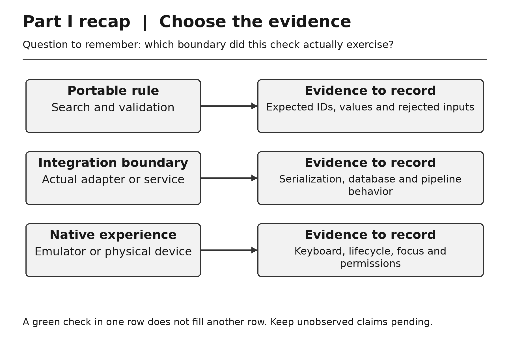

# Chapter 5
# Establishing Testable Application Foundations

## What You'll Learn

By the end of this chapter, you will be able to:

- Select observable rules that can be exercised without a mobile runtime.
- Read and run the repository's executable xUnit test project.
- Derive expected search and pricing results from requirements.
- Distinguish malformed input, invalid metadata and a legitimate empty catalog.
- Use a deliberate local defect to understand a failing assertion and restore a baseline.

**Prerequisites:** the Part I source and passing portable build from Chapter 3, plus the startup/data trace from Chapter 4. No emulator is required for the guided test exercise. **What you will produce:** a repeatable test run and a written explanation of a meaningful regression. The supplied test suite is complete for this milestone's stated cases; native and service evidence remain separately recorded.

A useful test identifies a broken promise. A second copy of a method's algorithm may simply reproduce its mistake. An expected result grounded in the application's requirements is a stronger check.

Our first promises are concrete: catalog IDs are unique, an unaccented query can match an accented title, and discounts apply to separate songs. These behaviors need no emulator. This chapter explains their portable boundary, tests, and automated execution, while keeping native verification distinct.

## 5.1 Choose an observable boundary

The core targets net11.0 without referencing MAUI controls. A test supplies values and inspects results without constructing a page. The application references core and adds startup, views, and platform configuration.

A separate assembly helps because portable tests do not require mobile tooling and cannot accidentally depend on a page's fields. More projects are not automatically better: add infrastructure and service boundaries when features need them.

Initially, application depends on core and tests depend on core. The core neither resolves global application services nor asks Android objects for state. That keeps its requirements and failures understandable.

## 5.2 Configure the runner intentionally

The executable test project uses the xUnit v3 framework family with package version 4.0.0. Version-family and package-version names are different.

```xml
<ItemGroup>
  <PackageReference Include="xunit.v3" Version="4.0.0" />
  <ProjectReference
    Include="../../src/GnazzosWorld.Core/GnazzosWorld.Core.csproj" />
</ItemGroup>
```

The project targets net11.0 and sets OutputType to Exe. Test tooling generates the runner entry point. Our command invokes that executable rather than relying on an unconfigured VSTest adapter:

```powershell
$tests = "tests/GnazzosWorld.Core.Tests/GnazzosWorld.Core.Tests.csproj"
dotnet build $tests -c Release
dotnet run --project $tests -c Release --no-build
```

Use --no-build only after a successful matching build. An old binary is not evidence for new source. CI stops at a failing build instead of continuing silently.

## 5.3 Test observable search behavior

A parameterized example supplies meaningful input and checks the identity of a single result:

```csharp
[Theory]
[InlineData(" beret VIOLET ",
    "song-minnesota-bob-beret-violet")]
[InlineData("KAI", "book-kai-01")]
public void Search_handles_case_whitespace_and_accents(
    string term, string id)
    => Assert.Equal(id, Assert.Single(
        CatalogSearch.Find(
            CatalogLoader.LoadBundled(), term)).Id);
```

The theory covers whitespace, case, and diacritics. Assert.Single also catches unexpected extra matches. The expected ID is not computed by repeating the production comparison.

Use the bundled fixture for a contract check of sample content. For a focused sorting test, supply two handmade records with equal titles and reversed IDs. An already sorted fixture could conceal missing tie-breaking.

A test should allow a correct implementation change. Replacing LINQ with a loop should not fail tests when observable results remain the same.

## 5.4 Distinguish blank, filtered, and empty results

The core combines optional kind filtering with title/creator matching. Test the interaction: “Minnesota Bob” restricted to Song returns matching songs, while restricted to Book returns none.

Blank query means all records within the filter. A valid nonmatching query means an empty result. Neither means a failed network source, because this function performs no I/O.

Later view models distinguish loading, empty, error, and success. Keep the search function's contract simpler instead of inventing transport states it cannot experience.

Also consider whether search mutates its source. Producing a separately ordered result should preserve the supplied collection. Test meaningful source state rather than prescribing a particular internal method.

## 5.5 Validate at the serialization boundary

Deserialization does not make incoming data valid. An entry can have blank required values, duplicate IDs, or a non-HTTPS external link.

CatalogLoader distinguishes parser/serialization failures from semantic metadata errors. Malformed JSON must not become a silent empty list. An empty but valid array can remain a legitimate empty catalog.

An omitted enum field illustrates a subtle bug. If Book is numeric zero, a missing kind can otherwise default to Book. Checking Enum.IsDefined after deserialization cannot distinguish omission from intention.

The updated model marks required JSON properties explicitly. The serializer now rejects an otherwise complete entry with no kind field. Compile-time nullable analysis still helps, but it does not validate untrusted JSON.

The regression suite covers omitted kind, undefined enum, null entry, blank metadata, duplicate ID, malformed document, and unsupported link scheme. Each case protects a specific assumption. Do not claim that it proves every conceivable input is safe.

We did not observe a local red/green test cycle for the omission fix. The new regression case is verified in CI against the changed model. Record that actual sequence rather than inventing evidence.

## 5.6 Respect stream ownership

LoadBundled opens and disposes its resource. Load(Stream) accepts the caller's stream and does not silently take ownership. Tests use MemoryStream with an explicit using declaration.

A future HTTP adapter remains responsible for its response lifetime. This convention avoids a loader unexpectedly closing a resource another component owns.

Null stream, malformed bytes, and a valid empty array deserve different outcomes. A broad catch that returns an empty result hides those distinctions and prevents useful recovery by the caller.

The mobile boundary can later translate a known load failure into a retryable state while retaining diagnostics. That does not require erasing the cause inside the core.

## 5.7 Ground price tests in customer rules

The archived pricing example uses decimal money and explicit allowed lengths/quantities. It is a snapshot, not a live offer.

For three identical-style/length songs, the factors are 1.0, 0.9, and 0.8. A three-minute vocal song at 179 dollars therefore totals 483.30 dollars:

```csharp
[Fact]
public void Third_song_gets_twenty_percent_discount_in_addition_to_second()
    => Assert.Equal(
        483.30m, SongPricing.Calculate(3, true, 3));
```

This expected amount comes from the stated rule. Calling another copy of the same factor calculation to obtain it would weaken the test.

The suite checks all snapshot base prices and rejects unsupported lengths and quantities. A version identifier makes future changes deliberate. Do not rewrite historical order prices merely because the current table changes.

Taxes, fees, mixed-length bundles, refunds, and revision charges are outside this calculator. Production quoting remains server-authoritative. A correct client total cannot establish payment.

## 5.8 Introduce doubles when dependencies arrive

Pure search/pricing functions need no mocking library. Later, fake clocks, controlled HTTP handlers, and test stores can isolate meaningful behavior.

Choose the double for the question. A fake clock makes expiration deterministic. A temporary real database checks migration behavior. A fake repository can support view-model state tests, but cannot prove a database rollback.

Likewise, a mocked sign-in response cannot prove provider-enforced MFA, and a fake payment callback cannot prove signature verification. Test at the boundary where a requirement actually operates.

Small interfaces should describe feature needs. Do not wrap an entire platform SDK merely to mock it.

## 5.9 Keep the suite understandable

Behavioral names communicate intent. Second_song_gets_ten_percent_discount is more useful than Calculate_test_2. Keep inputs and expected outcomes visible even when helpers remove repeated setup.

Add cases for relevant interactions and failure paths. Avoid tests that mirror generated properties or enforce incidental implementation structure. A useful suite protects freedom to improve the internals.

When practical, observe a failing regression before the fix. If tooling or environment prevents that sequence, state what was actually run. Truthful evidence is part of a technical book's reliability.

## 5.10 Automate the same sequence

The portable workflow checks out source, installs SDK 11.0.100, records the environment, restores, builds Release, and runs the executable tests. It uses read-only repository permissions and no project secrets.

A green result belongs to its commit SHA. Compare it with the version you intend to use. A passing run from before a logic change does not verify that change.

Keep mobile packaging separate so a missing Android dependency does not hide a pricing regression. Conversely, portable tests do not replace Android/iOS build checks, screen-reader journeys, or provider recovery tests.

Coverage can reveal gaps, but its percentage is not the goal. Protect concrete risks: incorrect totals, lost drafts, cross-account records, duplicate orders, and invalid updates.

## 5.11 Record the Part I checkpoint

Editorial draft, compilation, tests, device checks, and artwork are different dimensions of progress. Five chapter files alone do not establish a verified application.

A reader should be able to retrieve the source, run portable checks, explain startup, and attempt the documented launch. Identify remaining platform work precisely. Use docs/verification.md and docs/device-checks.md to show what happened and what remains.

## Guided Walkthrough: read one test as an executable requirement

Use tests/GnazzosWorld.Core.Tests/CatalogTests.cs at the Part I checkpoint. Its Search_handles_case_whitespace_and_accents theory is short enough to read completely. Identify four parts before changing anything: the fixture source, supplied query, expected identity and assertion about result count.

1. The fixture loader supplies known catalog records. Its validation is part of the sample contract, not a network or native UI operation.
2. Each InlineData row supplies a query and independently stated expected ID. The test does not call a second search algorithm to compute its answer.
3. CatalogSearch.Find performs the action under test. The supplied string exercises the normalization policy the application promises.
4. Assert.Single checks cardinality. If a buggy implementation returns the correct song plus another item, a check of only the first title could miss that defect.
5. Assert.Equal checks identity. This avoids coupling the expected result to incidental display punctuation.
6. The build and runner exit status determine whether the suite can be used as evidence. Reading an assertion is not the same as executing it.

Now read Blank_search_returns_all_and_unknown_search_returns_none. It establishes two different valid outcomes. A blank query restores the supplied dataset; a nonmatching query produces no matches. A malformed JSON document belongs to a separate loader test, where failure is expected rather than translated into an empty list.

When you add a test, write its promise first. “Searching an unaccented title should find one stable ID” suggests both the input and the assertion. “Cover this line of code” does not tell you whether the right application behavior was protected.

## Guided Regression Exercise: remove one discount deliberately

The Part I fixture prices a three-minute vocal song at USD 179.00. The second song receives ten percent off its own price, so the two-song total is USD 340.10. Work out that answer before opening the implementation: 179.00 plus 161.10 equals 340.10.

1. Run the unchanged Release build and the executable suite from section 5.2. Record the source, actual total and passing result. The Part I baseline is 37 cases.
2. In Orders/SongPricing.cs, find the quantity-two cumulative factor of 1.9m. On your local exercise branch, change only that factor to 2m. Leave the base unit price and quantity-three rule unchanged.
3. Predict the incorrect result: USD 358.00. Predict which requirement detects it: Second_song_gets_ten_percent_discount in PricingTests.cs.
4. Build Release again. A successful compile is expected because the modified decimal expression is still valid C#. Then run the suite without rebuilding only after that build succeeds.
5. Read the failed assertion. Its expected 340.10 and actual 358.00 identify the lost discount. Other passing cases do not repair this broken requirement.
6. Restore the original factor, rebuild and rerun. Confirm your baseline again and inspect git diff to preserve unrelated edits.

The test's worked answer is the customer rule, not the number currently produced by the method. Changing the expected value to 358.00 would hide the defect. A new approved commercial rule would be a different change with its own version and requirement; this exercise deliberately changes only an implementation of the historical fixture.

This is a reproducible reader experiment, not a claim that the editorial environment observed its local failing run. The historical suite's CI evidence and current source record remain the evidence actually available. Your own before/failure/restored results belong in your learning notes.

## Worked Boundary Exercise: choose the exception

Use the loader tests to predict three results before execution:

| Input | Expected result | Reason |
|---|---|---|
| A valid empty JSON array | Empty catalog | The shape and meaning are valid even with no records |
| Malformed JSON such as an unfinished array | JsonException | The input cannot be parsed as the required document |
| Two valid-looking records with the same ID | InvalidDataException | Parsing succeeds but the catalog identity rule fails |

The missing-kind case is more subtle. Required JSON metadata lets the serializer reject an omitted property instead of accepting a default enum value as if it had been supplied. Nullability annotations help compile-time C# analysis but do not turn missing external JSON into valid domain data.

Stream ownership adds another observable promise. The loader accepts a stream supplied by a caller; its test can confirm that the stream remains readable afterward. The outer adapter still owns the HTTP response or file that produced that stream. A test that merely checks a returned list cannot establish correct resource lifetime.

The worked method is to name the boundary first: parse, semantic validation, ownership or presentation. Then choose an input and assertion capable of detecting a violation there. Do not make one broad test so vague that any thrown exception counts as success.

## Troubleshooting a test run

| Symptom | Diagnostic question | Correct response |
|---|---|---|
| Compilation fails before the runner | Was an executable produced for this source? | Fix the first build error; do not interpret old test output as current evidence |
| Runner reports 245 instead of 37 cases | Which source checkpoint is selected? | Match the total to the recorded milestone |
| A deliberate defect seems to pass | Was Release rebuilt after the edit? | Build the matching configuration before --no-build |
| A test passes after copying implementation arithmetic into its expectation | Is the answer independent of the algorithm? | Derive the expected amount from the requirement |
| Portable search passes but the page stays stale | Was the native handoff exercised? | Use Chapter 4's page/event/assignment trace |
| A fake service passes but real integration is unknown | Which dependency was simulated? | Add evidence at the actual storage, service or device boundary |

Record unexpected output without immediately changing assertions. A failure can reveal a stale executable, wrong revision, incorrect requirement or real implementation defect. A useful learning tool helps you distinguish those cases instead of treating every red result as something to silence.

## Visual pause: what to carry forward



Carry three questions into Part II: which state is valuable, who owns its transition, and which check can establish the promised result? Search results use stable IDs; a saved draft requires a successful storage operation; a usable screen requires native observation. Keep the evidence matrix beside the implementation rather than replacing it with one broad works label.

## Chapter Summary

Portable tests give catalog search, validation, stream ownership and pricing rules a repeatable execution boundary. Their expected outcomes come from application promises: a stable result ID, a deliberately valid empty array, a rejected duplicate or an independently calculated discount. A passing assertion is useful only when the source, build configuration and actual executed binary are known.

The guided regression exercise demonstrates why valid C# and a successful build can still implement the wrong rule. Other boundaries need different evidence: a simulated store cannot prove native persistence, and a pure search test cannot prove a screen update. Part II extends the interface while preserving that separation between rules, coordination and platform behavior.

## Exercises

1. Test duplicate IDs with different titles.
2. Compare malformed JSON with a valid object missing kind.
3. Change the second-song discount locally, confirm failure, then restore it.
4. Design a fake clock for quote expiration and state what still needs integration testing.
5. Specify a device check that portable tests can never establish.

## References and index terms

xUnit runner: https://xunit.net/docs/getting-started/v3/getting-started  
Required JSON properties: https://learn.microsoft.com/en-us/dotnet/standard/serialization/system-text-json/required-properties

Index: portable core; unit tests; xUnit; theory; fact; serialization; required properties; nullability; stream ownership; decimal; regression; test double; CI.

