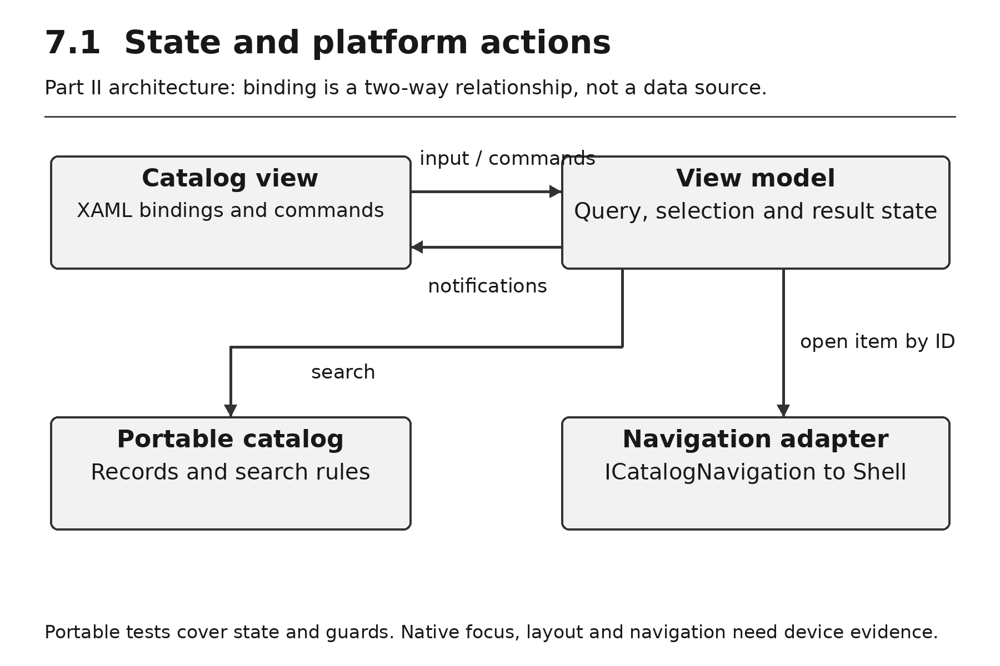

# Chapter 7
# Data Binding, Commands, and MVVM

The first screen sent a search result directly to a collection. That made the data path easy to trace. Now search interacts with filtering, selection, details, result counts, and navigation. Those relationships deserve a home we can test without constructing a native page.

CatalogBrowserViewModel owns the presentation decisions. The view renders its values. A navigation interface supplies the platform action. This chapter explains each boundary and the tests that protect it.

## What You'll Learn

By the end of this chapter, you will be able to trace a binding from XAML to its view model; choose an appropriate binding mode; explain property-change notifications; separate selection state from list state; and test asynchronous commands and navigation errors without instantiating a page.

**Prerequisites:** Complete the preceding chapters and use the matching Part II source revision from `docs/milestones.md`. **Deliverable:** A testable improvement or diagnostic exercise in the Gnazzo's World application, without assuming native-device verification.

### Guided lab: trace one state change

1. At the Part II milestone, locate `CatalogBrowserViewModel`, the catalog page XAML, and the view-model tests.
2. Starting with `Query`, follow the user input through filtering to `Items`, `ResultSummary`, and `SelectedItem`. Make a dependency diagram showing which displayed values must be notified when the query changes.
3. In a temporary working copy, remove the notification for a derived value such as `ResultSummary`. Run its relevant notification test and inspect the failure. Restore the notification and rerun.
4. Select a book, then apply a songs-only filter. Predict the selected ID and detail state before reading the assertion. The previous selection cannot remain active if it is no longer in the result set.
5. Use the fake navigation dependency to leave an `OpenDetails` operation unfinished. Attempt a second activation and verify that command state prevents an unintended duplicate.
6. Inject a navigation failure and inspect the reported error and command recovery. Do not treat this portable test as proof of native button focus or accessibility announcements.

**Expected result:** Derived properties refresh correctly, incompatible selection is cleared, an in-flight command respects its guard, and failures do not leave the command permanently disabled.

### Troubleshooting the walkthrough

If a value changes internally but not on screen, inspect `BindingContext`, the XAML path, its mode, compiled binding type and property-change notifications. If a command never runs, inspect its guard and whether the page uses the intended command instance. If a command runs twice, locate where the in-flight ownership state is set and reset.

## 7.1 Define the view model's responsibility

A view model represents the state and behavior a view needs. It does not need a control reference to count results, preserve a matching selection, or decide whether an action is enabled.

Our model exposes Query, FilterIndex, Items, SelectedItem, ResultSummary, Detail, NavigationError, and OpenDetails. It receives the catalog and an ICatalogNavigation dependency. The catalog is still bundled; there is no remote loading operation in this milestone.

Keeping that last point explicit prevents invented states. We can discuss how a future connected feature will model loading and retry, without presenting a spinner as evidence that a real asynchronous data pipeline exists.



A reader selects Kai the Ninja, then switches to a songs-only filter. The view model must clear the incompatible selection and notify the displayed detail state. Figure 7.1 names the owner of that decision. It does not insert an HTTP service into the bundled Part II milestone.

## 7.2 Understand binding context and binding mode

BindingContext identifies the source object used by ordinary bindings. A page receives its view model through constructor injection and assigns that object after InitializeComponent.

```csharp
public CatalogPage(CatalogBrowserViewModel viewModel)
{
    InitializeComponent();
    BindingContext = viewModel;
}
```

A OneWay binding reflects source changes in the target. A TwoWay binding also sends target edits back to the source. **At the Part II milestone used in this chapter**, SearchBar text and picker selection use TwoWay because the user changes those values. A result summary is computed by the view model and does not need to be edited.

**Source progression:** Chapter 13 deliberately changes the SearchBar to `Text="{Binding Query, Mode=OneWay}"` and handles `TextChanged` in `CatalogPage.xaml.cs`. A page-owned `DebouncedQuery` delays nonempty typing updates while preserving the latest text when navigation interrupts the pending delay. Its filter pickers still use TwoWay selection. When reproducing the direct TwoWay example here, use the pinned Part II commit in `docs/milestones.md`, not the later review branch. Otherwise the reader may reasonably mistake an intentional evolution for a binding error.

The binding source and x:DataType have separate roles. BindingContext supplies the runtime instance. x:DataType describes the expected type for compiled binding validation. Declaring a type does not create an instance of that type.

## 7.3 Notify all affected values

INotifyPropertyChanged lets the view know that a property should be read again. ObservableObject provides an event and a small Notify helper. The setter for Query changes the field, notifies Query, then rebuilds results.

Rebuild also notifies Items and ResultSummary. Changing one input can affect several displayed values. A notification only for Query would leave a result-count label stale even if search itself is correct.

```csharp
Items = CatalogSearch.Find(catalog, query, kind);
Notify(nameof(Items));
Notify(nameof(ResultSummary));
SelectedItem = selectedItem;
```

The final assignment intentionally reconciles the old selection against the new result collection. If the selected item is filtered out, the setter clears it and its inline detail. If it still matches, the same record remains selected.

A computed property is not automatically observable. The test suite listens for ResultSummary notifications after a query change, exercising the connection between input and derived presentation values.

## 7.4 Choose collection notification deliberately

The model replaces Items with a newly computed result list. PropertyChanged announces that replacement. An ObservableCollection is useful when individual additions/removals must update an existing collection, but is not required for every list property.

For this small in-memory catalog, replacing a result list keeps the rule clear. For large or incremental data, we will evaluate the cost, selection behavior, and batching strategy before changing the design.

Do not assume a collection type solves all synchronization problems. An observable collection does not make background-thread modifications safe for a UI consumer and does not cancel a stale request.

## 7.5 Make filters and selection explicit

FilterIndex maps four visible options to all content, books, songs, and podcasts. The picker can briefly report -1 during initialization; the model normalizes that to the all-content option. Other invalid indices are rejected.

The mapping is a small teaching contract. A larger product should avoid scattered numeric assumptions by introducing typed filter options. Here it remains centralized and covered by tests.

SelectedItem is reconciled by stable ID against the current result set. That prevents a caller from assigning unrelated data as the current result. Selection also updates the inline DetailViewModel and the command's enabled state.

Separate the selected object from its visual highlight. Selection can be correct in a unit test while a native control fails to announce it clearly. The latter requires device verification.

## 7.6 Model an asynchronous action as a command

OpenDetails implements ICommand so the Button can ask whether it is available and execute it. Our small AsyncCommand also exposes ExecuteAsync for direct tests.

CanExecute is false without a selected record or while an execution is running. Execution snapshots the selected ID before awaiting navigation. A second activation while the first is pending does not launch another operation.

```csharp
OpenDetails = new AsyncCommand(
    async () =>
    {
        NavigationError = "";
        var id = SelectedItem!.Id;
        await navigation.OpenItemAsync(id);
    },
    () => SelectedItem is not null,
    _ => NavigationError = UiText.NavigationError);
```

The command catches navigation failures, reports a localized message, and resets its busy flag in finally. It is intended for UI-thread use, not arbitrary concurrent callers from several worker threads. The test supplies a pending Task to verify overlap prevention and re-enabling.

The ICommand entry point has an async void signature because of the interface. Testable work remains in ExecuteAsync, and the implementation handles the delegated operation's failure. Do not generalize that into approval for unobserved asynchronous work elsewhere.

## 7.7 Use a maintained toolkit when it earns its place

For this foundation we wrote the small observable and command mechanics explicitly to show their behavior without adding a package. This is a teaching choice, not a proposal to grow a private MVVM framework.

Maintained MVVM libraries can supply generated observable properties and asynchronous commands. Before adopting one, verify its supported versions, generated semantics, error handling, and trimming/platform requirements. Readers should still understand which notifications and command states the generated code provides.

A generated setter cannot decide the application's selection policy for us. Whether implemented manually or through tooling, derived state and failure behavior remain design responsibilities.

## 7.8 Separate empty, unavailable, and failed operations

A no-match query produces an empty result and localized EmptyView. An unknown detail ID produces an unavailable message and clears previous detail content. A failed navigation operation produces NavigationError.

These are distinct conditions. Treating all of them as exceptions would make normal search unpleasant; treating every failure as an empty catalog would conceal useful diagnostics.

Future API loading will add explicit states such as initial, loading, ready, and failed, plus refresh with cached data. That transition should be modeled and tested when real asynchronous catalog retrieval is introduced. The bundled implementation does not claim those states today.

## 7.9 Test the state relationships

Presentation tests combine query and kind changes, verify selection survives matching queries, clear selection when hidden, and check the stable ID passed to navigation. A fake navigation service records requests without loading Shell.

Other tests hold a command pending, reject overlap, complete it, and observe re-enabling. A failing action verifies error reporting and recovery. Notification tests ensure derived labels can refresh.

These tests leave XAML binding wiring, native disabled appearance, keyboard behavior, and spoken feedback unverified. Their value comes from identifying the boundary they actually exercise.

## Checkpoint and exercises

The browser's state and action rules now live outside the page. Binding expresses their relationship to controls; platform navigation remains behind an interface.

1. Remove a ResultSummary notification locally and observe the notification test.
2. Select a book, filter to songs, and specify the expected selection and detail state.
3. Hold the fake navigation Task open and attempt a second execution.
4. Design the states for a future refresh that fails while cached data remains visible.

## Chapter Summary

MVVM is useful when it gives presentation decisions a testable owner. The view model controls query, filter, results, selection, derived labels, and navigation intent; the view renders them, while a navigation dependency owns platform behavior. Bindings connect these parts, but property notifications must cover every derived state that changed. Asynchronous commands require guarded execution, visible failure handling and recovery. The guided lab introduces a deliberate notification defect, an invalidated selection, and a controlled pending navigation task. Passing portable tests establish view-model behavior; they do not replace inspection of actual XAML wiring, disabled visuals, keyboard interactions or spoken accessibility feedback.

## References and index terms

Bindings: https://learn.microsoft.com/en-us/dotnet/maui/fundamentals/data-binding/  
Compiled bindings: https://learn.microsoft.com/en-us/dotnet/maui/fundamentals/data-binding/compiled-bindings  
MVVM Toolkit: https://learn.microsoft.com/en-us/dotnet/communitytoolkit/mvvm/

Index: MVVM; BindingContext; x:DataType; TwoWay; INotifyPropertyChanged; derived state; collection replacement; ICommand; async command; test double.

