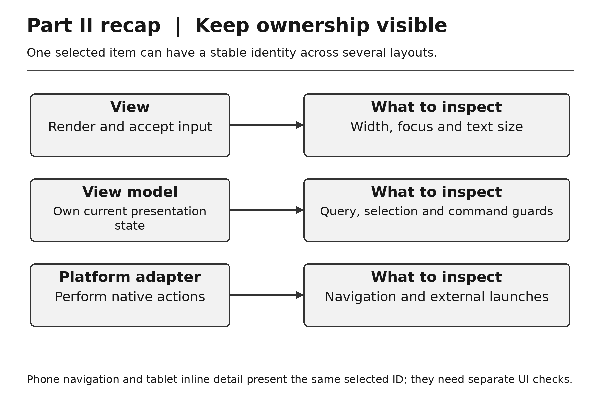

# Chapter 11
# Phone, Tablet, and Foldable Layouts

A device label is an unreliable layout decision. A tablet can share its display with another app, a phone can rotate, and a foldable can expose different usable regions. The interface needs to respond to the space and constraints actually available.

Our first adaptive rule is modest: at a measured width of 900 device-independent units, show list and details beside one another. At narrower widths, keep the list and use the explicit detail destination. This chapter explains that rule, its tests, and its limits.

## What You'll Learn

By the end of this chapter, you will be able to use available viewport width rather than device labels; explain the 900-unit teaching breakpoint; preserve selection while switching between compact and wide presentations; distinguish resize behavior from multiwindow state; and plan device checks for keyboards, safe areas and foldable postures.

**Prerequisites:** Chapters 1–10 and the Part II interface checkpoint linked in the companion repository’s `docs/milestones.md`. All application paths below are relative to `src/GnazzosWorld.App`; core paths are relative to `src/GnazzosWorld.Core`.

**Deliverable:** A compact/wide catalog layout that changes presentation while preserving the selected record and query.

## 11.1 Adapt to the viewport

CatalogPage receives SizeChanged and evaluates its current Width. It does not ask whether the hardware is called a tablet.

A viewport-based rule also helps with window resizing on platforms that support it. It still does not reveal every relevant condition: safe areas, keyboard height, a hinge, and text scaling can affect usability independently of width.

Start with a clear useful rule, then test the combinations it does not model. A breakpoint should be a justified design choice rather than a number copied from another application's screenshot.

## 11.2 Put a small policy in portable code

AdaptiveLayout centralizes the threshold and rejects nonfinite values:

```csharp
public const double WideBreakpoint = 900;
public static bool IsWide(double width)
    => double.IsFinite(width) && width >= WideBreakpoint;
```

Tests exercise just below the threshold, exactly at it, above it, negative input, NaN, and infinity. These establish deterministic policy behavior.

They do not establish that 900 is the right usability threshold. That requires observing the content at realistic widths, text settings, and languages.

Keeping the policy portable lets us change a decision deliberately and identify affected expectations. It does not require every layout calculation to be extracted into a general-purpose geometry library.

### Read and run the boundary test

The existing test makes the policy concrete:

```csharp
    [Theory]
    [InlineData(899.9, false)] [InlineData(900, true)]
    [InlineData(1200, true)] [InlineData(-1, false)]
    public void Adaptive_layout_uses_available_width(double width, bool wide)
        => Assert.Equal(wide, AdaptiveLayout.IsWide(width));
```

At 899.9 the layout is compact; at 900 it is wide. Change the breakpoint in `Presentation/AdaptiveLayout.cs` only after deciding how much room the real list and detail content need. Update the cases to match that decision and retain tests immediately on both sides of the boundary.

## 11.3 Keep the measured layout update small

The page changes two column widths, column spacing, and detail visibility. The shared presentation state is unchanged.

```csharp
var wide = AdaptiveLayout.IsWide(Width);
ContentGrid.ColumnDefinitions[0].Width =
    new GridLength(wide ? 2 : 1, GridUnitType.Star);
ContentGrid.ColumnDefinitions[1].Width =
    new GridLength(wide ? 3 : 0, GridUnitType.Star);
ContentGrid.ColumnSpacing = wide ? 20 : 0;
DetailPane.IsVisible = wide;
```

The initial grid has a zero-width second column. In wide mode, the list receives two shares and details three shares of the available region. These ratios are starting values to evaluate with actual content.

A SizeChanged event can occur during initialization, so the handler checks that named views exist. Avoid starting network retrieval or navigation from every size notification.

Visual State Manager and adaptive triggers offer another way to express layout states. The measured code here keeps the exact policy shared with tests. For a more complex design, choose one clear owner for adaptive changes rather than mixing triggers and handlers that set the same property unpredictably.

### Put the handler in the page that owns the regions

The complete `Pages/CatalogPage.xaml.cs` adapter connects the portable decision to named XAML controls:

```csharp
using GnazzosWorld.Core.Presentation;
namespace GnazzosWorld.App.Pages;
public partial class CatalogPage : ContentPage
{
    public CatalogPage(CatalogBrowserViewModel viewModel)
    {
        InitializeComponent();
        BindingContext = viewModel;
    }
    private void OnSizeChanged(object? sender, EventArgs e)
    {
        if (ContentGrid is null || DetailPane is null) return;
        var wide = AdaptiveLayout.IsWide(Width);
        ContentGrid.ColumnDefinitions[0].Width =
            new GridLength(wide ? 2 : 1, GridUnitType.Star);
        ContentGrid.ColumnDefinitions[1].Width =
            new GridLength(wide ? 3 : 0, GridUnitType.Star);
        ContentGrid.ColumnSpacing = wide ? 20 : 0;
        DetailPane.IsVisible = wide;
    }
}
```

The XAML root supplies `SizeChanged="OnSizeChanged"`. Its outer grid supplies `x:Name="ContentGrid"` and `ColumnDefinitions="*,0"`; the second child supplies `x:Name="DetailPane"` and `Grid.Column="1"`. Keep these names aligned with the fields used by the handler.

In wide mode the columns receive two and three shares of the available space after spacing and padding. In compact mode the first column receives the available space and the second receives zero. Hiding the detail pane removes an unnecessary presentation region while the browser’s `Detail` model stays alive.

| Change | Browser model | Page layout |
|---|---|---|
| Narrow to wide | Keep query and selection | Allocate a visible second column |
| Wide to narrow | Keep query and selection | Hide inline details; retain Open selection |
| Filter removes selected item | Clear incompatible selection | Render the cleared model in either layout |
| Open selection | Snapshot selected ID | Navigate to full details |

The handler makes no network request and does not navigate. That keeps a resize from turning into a surprise action.

## 11.4 Preserve selection across a presentation change

The browser owns selection independently of column visibility. A width change does not clear the query or selected record. If a wide view shrinks, the explicit Open selection command can still show the detail page.

We intentionally avoid automatic navigation merely because the window crossed the threshold. A rotation should not unexpectedly add a page to the stack.

Filtering is a different event: if a record no longer belongs in the results, selection clears and inline detail resets. A layout change preserves meaning; a result-set change reconciles meaning.

This distinction can be tested at the state level and then verified through actual control behavior. Native selection restoration is still part of the device check.

## 11.5 Reuse the detail contract, not a visual instance

The wide pane and full detail page both use DetailsView, each with its own visual tree. The browser owns one DetailViewModel for inline selection; DetailsPage receives a separate model resolved for its route.

Do not move the same native ContentView object between parents as a shortcut. Reusing a view type is safer and makes lifecycle ownership clearer.

The receiving detail model resolves by ID and handles missing content. That same contract remains useful whether the destination occupies half a tablet or an entire phone.

If future editing state must be shared between these presentations, define an explicit state owner. Do not rely on two unrelated page instances accidentally holding the same mutable object.

## 11.6 Account for height and keyboard space

Width alone does not guarantee a usable screen. A wide landscape phone can have little height once the keyboard appears. Our automatic toolbar rows may leave an inadequate collection region at large text sizes.

Test the keyboard open and closed, short and long content, both themes, and both sample languages. Consider collapsing less-used filter controls or placing actions differently if the real viewport demands it.

Avoid “solving” the issue by shrinking all text or disabling user scaling. Change the hierarchy and interaction while preserving access to essential actions.

Focus visibility also matters. A selected record hidden beneath a keyboard may be logically correct but hard to use. Device observation should describe where the content and action actually appear.

## 11.7 Respect safe areas and system affordances

Screens can contain notches, status/navigation regions, rounded corners, or platform overlays. Use the platform-supported safe-area behavior and inspect the actual result.

Our simple page padding is not a proof of correct inset handling on every iPhone/iPad or Android configuration. Do not hardcode one device's measured status-bar height as a universal value.

System navigation and edge gestures also constrain placement. A button too close to an edge can be awkward even when every pixel is technically inside the page.

Record OS navigation mode and orientation when reviewing defects. Reproducing the conditions matters more than calling a layout “responsive” in general terms.

## 11.8 Treat foldable support as a separate evidence question

The current application responds to available width. It does not detect fold posture, exclude a hinge region, or claim device-specific dual-screen support.

A spanning layout may need a platform capability that reports usable regions. A single width value cannot tell us whether a physical separation interrupts the content.

For a foldable test, check folded and expanded states, transitions while a record is selected, keyboard behavior, and any display feature that divides the usable region. Record the device and native configuration.

If a platform adapter is required, place it behind a specific capability contract. Do not make a generic tablet Boolean carry unrelated hinge semantics.

## 11.9 Distinguish resizing from multiwindow ownership

App creates a fresh Shell for a window, but navigation currently uses the active global Shell. That is a single-active-window teaching design, not a complete two-window coordination system.

True simultaneous windows need window-scoped navigation, state ownership, event cleanup, and rules for shared data. A page should navigate within the window that owns it.

We can test resizing the current window without claiming the broader feature. This keeps the book's scope honest and gives advanced readers a concrete extension problem.

## 11.10 Build a useful verification matrix

Choose cases that stress different assumptions rather than many near-identical screenshots.

| Case | Conditions | Observe |
|---|---|---|
| Narrow phone | Portrait, keyboard closed/open | List region and action reachability |
| Short landscape | Large text, Spanish | Wrapping and vertical pressure |
| Tablet | Below/above 900 width units | Selection, inline details, scroll ownership |
| Resizing | Selected item and active query | Stable state without surprise navigation |
| Foldable | Folded/expanded, hinge if present | Usable regions and continuity |
| Assistive technology | Each layout and theme | Reading order, selection, action focus |

Attach build revision, OS, dimensions, language, text setting, and result. A unit test at width 900 proves a branch decision; a device journey proves a different set of behaviors.

## Guided Lab

1. Open `Presentation/AdaptiveLayout.cs`, its test and `Pages/CatalogPage.xaml.cs`. Predict the policy for 899.9, 900 and 1200 before running the test.
2. In a resizable host or suitable emulator configuration, open Discover and select Kai. Record its ID and current query in the debugger.
3. Cross below the 900-unit threshold. The inline pane should disappear while selection remains. Use Open selection to reach the full detail screen and return.
4. Cross back above the threshold. Inline details should again show the same selected record. A size change should add no page to the navigation stack.
5. Choose a filter that removes the record and repeat the resize. The previous details should remain cleared at both widths.
6. With enlarged text, inspect a short landscape viewport and the open search keyboard. Separate a width decision from a height problem. Use the review matrix for safe areas and foldable hardware where available.

**Expected result:** layout changes affect columns and visibility; query and selected identity remain owned by the browser model.

## Worked Example

A reader selects Kai on a tablet, then enters split-screen mode. The available width falls from 1100 to 760 units. `IsWide` returns false, the second column collapses, and the same selection remains in the browser. Open selection still reaches Kai’s full detail screen.

Now filter to Songs before restoring full width. Kai no longer belongs in the result set, so the selection and inline detail clear. Expanding the window must not bring the book back. The distinction is practical: resizing preserves a valid selection; filtering can invalidate it.

## Troubleshooting

| Symptom | First correction |
|---|---|
| The detail pane never appears | Check measured page Width, the SizeChanged connection and named controls. |
| The pane disappears but leaves a gap | Collapse both its column width and its visibility. |
| Resizing loses the selected record | Keep selection in the browser model; do not reset it in the size handler. |
| A wide screen still hides results behind the keyboard | Inspect available height and toolbar rows rather than lowering the width breakpoint. |

## Chapter Summary

Adaptive layout decisions should respond to actual space, not to labels such as phone or tablet. The chapter's 900-unit teaching breakpoint separates a compact browsing flow from a wide list/detail view, while portable policy tests establish exact boundary behavior. The selected catalog record belongs to persistent view-model state rather than a particular visual tree, allowing changes in presentation without changing identity. Height, keyboard pressure, system insets, fold hinges and multiple windows introduce constraints that a width test cannot fully capture. The guided lab checks the breakpoint and selection continuity, then specifies native verification scenarios. The complete resize adapter and boundary test connect the layout policy to code you can inspect and exercise.

## Exercises

The implementation now has a tested width policy and a reusable list/detail presentation. It preserves presentation state when the layout changes and handles filtered-out selections explicitly.

Use the native review matrix above for safe areas, keyboard pressure, accessibility and fold-specific behavior.

1. Change the breakpoint locally and update its boundary tests.
2. Resize while an item is selected; verify no unexpected navigation occurs.
3. Design a compact short-height layout without reducing text size.
4. Specify a hinge-aware capability contract and the platform evidence it needs.
5. Explain the difference between a resizable window and complete multiwindow navigation.

## Visual pause: what to carry forward



Before continuing, trace Kai the Ninja from a selected ID to a phone detail page and a tablet inline detail. The layout changes; the selected identity and ownership rules do not. Bindings must notify derived values, commands must recover after failure, and the device must still support large text, focus and navigation. Those are the anchors to remember when the catalog becomes richer.

## References and index terms

Visual states: https://learn.microsoft.com/en-us/dotnet/maui/user-interface/visual-states  
Adaptive layouts: https://learn.microsoft.com/en-us/dotnet/maui/user-interface/layouts/  
Device information: https://learn.microsoft.com/en-us/dotnet/maui/platform-integration/device/information

Index: adaptive layout; viewport; breakpoint; device-independent units; list/detail; selection continuity; keyboard; safe area; fold posture; window scope; verification matrix.

