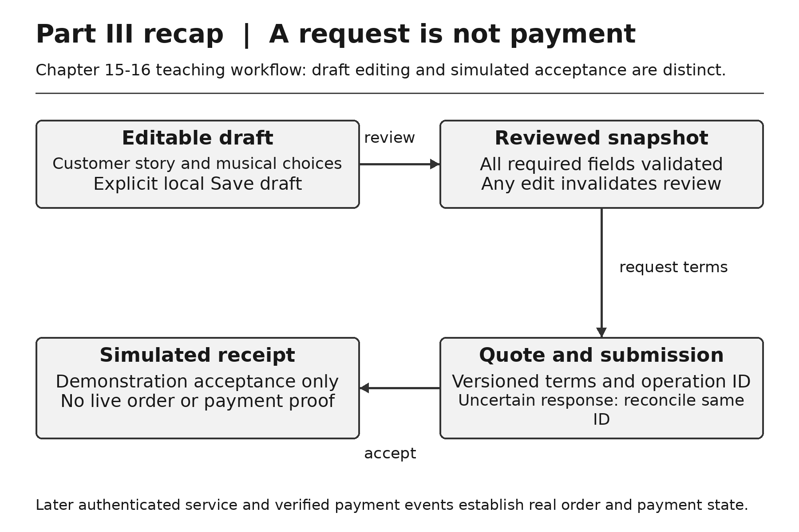

# Chapter 16
# Pricing Rules and Reliable Submission

A customer reviews a request for three songs and taps Submit. The phone pauses, the customer taps again, and the application reports a timeout. Has the service received nothing, one request, or two? A reassuring animation cannot answer that question. The answer depends on the agreement between the application and the service.

Chapter 15 preserved a customer's writing and produced a reviewed request. This chapter adds a versioned example price, a short-lived quote, and a simulated acceptance boundary. The service is an in-process fixture: it never contacts a customer, sends an email, creates a live order, or takes payment. That makes uncertain outcomes inexpensive to investigate before a real transaction is involved.

**Prerequisites:** the request model, validation rules, explicit draft storage, and review screen from Chapter 15; familiarity with async methods, records, interfaces, and portable tests. **Learning goals:** calculate archived prices with decimal arithmetic, bind a quote to an immutable request, distinguish rejection from uncertainty, and reuse an operation identity safely. **Delivered capability:** the reviewed form can display a demo quote and simulate submission, including controlled duplicate and lost-response scenarios.

## What You'll Learn

You will learn to calculate versioned sample prices with decimal arithmetic; distinguish an estimate from an expiring server-authoritative quote; model stable operation IDs; prevent duplicate submissions; and explain why a timeout is not evidence of either acceptance or rejection.

**Prerequisites:** Chapter 15's validated request snapshot and the companion portable tests. **Deliverable:** A fully local simulated quote-and-submit flow with testable duplicate and uncertain-result behavior.

### Guided lab: reproduce a lost response

1. Choose one validated request and record its content and operation ID. Obtain an example quote and identify its price-table version and expiry.
2. Compute a multi-song total by hand before inspecting the pricing tests. Verify each discount rule on decimal values, then check the displayed currency formatting separately.
3. Submit through the simulated service's lost-response fixture. The service accepts the operation but the first caller receives an exception.
4. Repeat the same logical operation with its original ID. Verify that the simulator returns the existing receipt rather than accepting another request.
5. Change the request after review. Confirm that the previous quote and reviewed snapshot are no longer valid for the changed input.
6. Try an expired quote with controlled time. Confirm rejection at the service boundary rather than trusting the phone clock.

**Expected result:** The service fixture recognizes a replay of one operation, while a changed request requires a new review and quote. The simulator's state disappears on restart; no live payment, order or customer transmission occurs.

### Worked reasoning: cancellation is not reversal

The caller can cancel waiting for a response after a server has already accepted an operation. Retrying with a new ID may therefore create a duplicate, even when the original request appeared to fail. Idempotency works only when the same logical operation retains its identity and the service stores acceptance durably enough for the real deployment's recovery requirements.

## Give the price a source and a version

The companion application already contains SongPricing from the early foundation tests. Its values came from the supplied website archive. Retain that provenance as the constant website-snapshot-2026-11-14. These are historical teaching fixtures, not a claim about today's prices or a recommendation for John's business. Changing an archived value silently would make the earlier tests and later quote snapshots harder to interpret.

The supported lengths are discrete products. Five minutes is not a missing interpolation between four and six. Reject it. The archived schedule distinguishes instrumental songs from songs with vocals:

| Minutes per song | Instrumental, USD | With vocals, USD |
|---|---:|---:|
| 1 | 49.00 | 79.00 |
| 2 | 79.00 | 129.00 |
| 3 | 109.00 | 179.00 |
| 4 | 139.00 | 229.00 |
| 6 | 199.00 | 319.00 |
| 8 | 259.00 | 399.00 |

The example supports one through three songs with the same specification. The first is full price, the second receives a ten-percent discount, and the third receives a twenty-percent discount. Those are marginal discounts on individual songs. Three songs do not receive twenty percent off the entire basket. The customer story applies to the shared specification; separately described songs need a future basket model with distinct line items.

SongRequest now has a Quantity property defaulting to one. That default also preserves the intended meaning of earlier saved JSON drafts without a quantity member. Add quantity validation to SongRequestRules and expose a picker with one, two, and three. Do not allow the UI's picker to become the only validation: the portable service checks the request again.

For a three-minute vocal song the unit price is USD 179.00. Two songs cost 179.00 plus 161.10, or USD 340.10. Three add 143.20, producing USD 483.30. The equivalent cumulative factors are 1.0, 1.9, and 2.7. A discount calculation must explain which amount it discounts; otherwise two plausible implementations can disagree while both appear reasonable.

## Calculate amounts before formatting them

Use decimal values for the fixture's monetary arithmetic. Decimal literals have an m suffix. Keep the amount numeric until presentation; a displayed string such as USD 340.10 is not a suitable input to a later calculation. Keep currency separately as USD so the device's regional format cannot change the business currency.

The existing SongPricing.Calculate implementation validates quantity and selects the unit price through an exhaustive switch. Its final calculation is:

```csharp
// unit is the selected archived decimal price.
decimal factor = quantity switch
{
    1 => 1m,
    2 => 1.9m,
    _ => 2.7m
};
return decimal.Round(
    unit * factor, 2, MidpointRounding.AwayFromZero);
```

This excerpt follows the one-through-three quantity guard in the complete file, src/GnazzosWorld.Core/Orders/SongPricing.cs. Copying the excerpt without the guard would incorrectly price every other quantity as three. A code sample's surrounding preconditions are part of its behavior.

Rounding to two decimal places with AwayFromZero is this fixture's explicit policy. Decimal arithmetic does not choose a currency's rules, discount order, tax treatment, or rounding stage for you. If future prices contain cents, line-by-line rounding and final-total rounding can diverge. Decide the policy, document it, and test an example where they differ before introducing those prices. Do not assume this USD rule generalizes to every currency.

The demo total covers only the archived song service amount and its illustrated discounts. Tax, fees, refund policy, delivery promises, and commercial rights are outside this pricing implementation. The native quote labels that limitation. Later checkout work must present the authoritative amount and its components under the actual service rules.

## Separate the estimate from the quote

A local estimate answers what the installed example schedule would calculate. A quote answers what a particular service is willing to accept for a particular reviewed request within a defined interval. The records live in src/GnazzosWorld.Core/Orders/SongSubmission.cs:

```csharp
public sealed record SongQuote(
    Guid Id, SongRequest Request, string PricingVersion,
    string Currency, decimal Total,
    DateTimeOffset ExpiresAt);

public sealed record SubmissionAttempt(
    Guid Key, Guid QuoteId, SongRequest Request);
```

The quote carries the canonical request, pricing version, currency, amount, and expiry. The submission attempt carries an operation key, quote identity, and request snapshot. It has no client-supplied trusted total and no Paid property. A caller cannot obtain a discount by editing a displayed amount because the service retrieves its own stored quote.

DemoSongSubmissionService validates every field through the final form step, then calls ForReview to trim outer whitespace and remove hidden vocal notes from an instrumental request. It calculates the amount and stores that exact snapshot. The client uses the returned canonical request for its submission attempt. This avoids quoting a trimmed request and later comparing it with a different, untrimmed payload.

An immutable record is useful here because value equality lets the fixture compare the expected and submitted request. It is also a shallow immutability mechanism: introducing mutable lists inside a record would require deliberate copying and equality rules. The current SongRequest contains scalar values and strings. Preserve that assumption or revise the comparison when the model expands.

## Let service time decide expiration

The fixture accepts a TimeProvider through its constructor and creates a quote valid for fifteen minutes. This is a teaching choice. The expiry is an absolute DateTimeOffset, and the service checks its own clock at acceptance. A phone may show time remaining, but its local clock is not the authority for a future remote quote.

The boundary is now greater than or equal to ExpiresAt. At the exact expiry instant, a new acceptance is rejected. One tick before that instant, an otherwise valid attempt is accepted. Those tests use a controlled clock; they do not wait fifteen real minutes or depend on the computer's time zone.

Editing the request invalidates an unsent quote, including edits that do not affect its price. A changed email address still changes the submitted request. The UI should require another review and another quote rather than claiming that the customer approved a snapshot they never saw. Changes to length, vocal choice, quantity, story, and contact information all follow the same ownership rule.

After a service reports ExpiredQuote, retain the form and ask the customer to obtain another quote. Present the replacement total before they submit again. Do not replace an expired quote and accept a possibly different amount as one hidden retry action.

## Identify one intended operation

A quote identity and an operation key solve different problems. The quote identifies the offered terms. The key identifies one intended acceptance attempt, including later retries. Generate the key when a reviewed quote is prepared for submission, keep it alongside the exact request, and reuse it if the response is lost.

SongSubmissionViewModel owns that pending tuple in memory. It prevents overlapping calls through IsBusy and exposes CanSubmit for controls. Those checks help a single active UI flow, but they do not protect a service from another device, another process, or a replayed message. The service must recognize repeated operations independently.

The simulator stores accepted attempts and their receipts under an object lock. On submission it follows this order:

1. Look up an already accepted operation key. If the stored attempt matches, return its original receipt. If the payload or quote differs, reject KeyConflict.
2. Validate the new key and request, then resolve the quote from service-owned state.
3. Require the submitted canonical request to match the quoted snapshot.
4. Reject a quote already accepted under another key.
5. Reject a new acceptance at or after expiry.
6. Create one demo receipt and record acceptance plus quote use in the same locked section.

Returning an existing receipt before checking expiry is intentional. A request accepted at 10:00 remains accepted when a response retry arrives at 10:20. Expiration restricts new acceptance; it does not erase completed history. Reversing these checks can cause a customer to believe a previously accepted operation failed.

Reusing a key with a new story is not an ordinary retry. It is a conflict. Likewise, generating a new key for a second tap defeats key-based deduplication. The additional quote-use check protects this fixture from accepting the same quote twice even when a caller supplies another key.

## Treat a lost response as uncertainty

There are three useful categories for the client:

| Outcome | Meaning in the fixture | Client behavior |
|---|---|---|
| Accepted receipt | The simulator recorded acceptance | Show the receipt; disable repeat submission |
| Explicit rejection | The service returned a known rule failure | Preserve the draft; explain review or requote |
| No trustworthy response | An I/O failure, timeout, or cancellation interrupted the call | Preserve the same operation and retry it |

A timeout does not establish that the service performed no work. The service might have recorded acceptance just before the connection failed. Cancellation has the same ambiguity when it crosses an acceptance boundary. Preserve the operation identity rather than turning a transport failure into a new intended request.

The client sets RequiresResolution after an uncertain result. It retains the key, quote, and canonical request; it blocks new quoting and invalidation until that operation is reconciled. The native page then shows the uncertainty message and a Retry the same demo submission action. It hides editing controls while that unresolved operation is active. Once a receipt arrives, it shows the accepted demo receipt and keeps submission disabled.

This is deliberately conservative. The fixture offers no abandon-and-start-over button after uncertainty. A production design needs authenticated status lookup, a durable pending-operation record, and a clear recovery flow if the customer cannot reconnect. Silent abandonment can create duplicates if the first operation succeeded.

## Wire the native review screen

The existing request page remains a three-step form. After Review request produces a snapshot, Get demo quote calls PrepareAsync. The page displays the version, explicit USD total, and expiry. Simulate submission calls SubmitAsync. Both operations disable the panel while awaiting completion and restore it in a finally block. The core guard remains necessary even when a control appears disabled.

The page listens for Review becoming null while it is visible. That notification invalidates an unsent quote immediately. Quote controls also bind their visibility to the presence of a reviewed snapshot, so typing into a contact field cannot leave an apparently current quote beside changed information. On departure, the page unsubscribes from the shared form model to avoid retaining obsolete page instances.

Register the process-shared demo service and submission model in MauiProgram. The form model, submission model, and service must retain compatible lifetimes. Recreating the service on every page appearance would discard accepted keys and quotes while the client still believes they exist. The current singleton registration supports the book's single-window teaching flow; it is not a general account or multiwindow design.

The simulator normally completes immediately. A fast demo does not prove the disabled state is visible or that native accessibility announcements are sufficient. The portable delayed-service test holds a completion source open so a second SubmitAsync call arrives during the first. It verifies only one service call. Device work must separately inspect reachability, focus, large text, keyboard dismissal, navigation, and announcements.

## Exercise failure deliberately

SubmissionTests.cs extends the original pricing tests with quote and workflow cases. The table-driven quote cases cover all six supported lengths and both vocal choices across discounted quantities. Existing tests retain every single-song price and unsupported values. New cases cover service validation, canonicalization, exact expiry, quote ownership, key conflicts, concurrent duplicates, cancellation, and the client retry contract.

The most revealing test wraps the simulator with LostResponse. That wrapper first lets the inner service accept the request, then throws an IOException instead of returning its receipt. On the next call it returns the inner service's result. The wrapper records both SubmissionAttempt values.

```csharp
await vm.PrepareAsync(Valid());
await vm.SubmitAsync(); // Accepted, but response is lost.
Assert.True(vm.RequiresResolution);

await vm.SubmitAsync(); // Replays the same operation.
Assert.NotNull(vm.Receipt);
Assert.Equal(adapter.Calls[0], adapter.Calls[1]);
```

The full test also attempts to change the pending quote after uncertainty, verifies that it is preserved, and checks that a third SubmitAsync call does not reach the service after acceptance. A test that throws before the inner service runs cannot establish this behavior: it exercises failure before acceptance, which is a different boundary.

Run the executable portable suite using the repository's pinned SDK and instructions in docs/verification.md. Record the source revision with the actual output. Compilation, test execution, Android compilation, and native runtime observations remain separate evidence. A passing simulation cannot prove real transport or database behavior.

## Understand the simulator's limits

The lock makes acceptance atomic only inside one service instance in one running process. All dictionaries and the client's pending operation disappear on restart. The fixture has no account identity, durable journal, retention policy, rate limit, transaction recovery, or cross-server coordination. It retains quote/request content in process memory for the demo lifetime; use fictitious inputs. Do not expose this service as a public customer API.

A production service needs a unique constraint scoped to the authenticated customer and operation key, with request comparison and order creation inside a database transaction. It needs persisted quote terms, authoritative expiration, and a defined retention/reconciliation policy. A process lock cannot coordinate several API instances. Chapters 18–21 introduce connected and stored data; Chapters 22–26 establish identity and authorization; Chapter 32 returns to quotes and customer ownership with those prerequisites in place.

The demo receipt is also not proof of payment. Payment state will depend on the later service's verified payment events, not a browser return, a button press, or this receipt. Keeping that boundary explicit allows the teaching application to grow without treating an early simulation as a finished checkout.

## Troubleshooting the guided lab

- **Displayed totals differ from tests:** Check the archived price-table version, decimal arithmetic and whether discounts are applied marginally rather than as a flat basket rate.
- **A timeout appears to create a second order:** Reuse the original operation ID when reconciling an uncertain outcome. The process-local simulator is not proof of durable deduplication across restarts.
- **An old quote remains after changes:** Compare the request snapshot and quote expiry using the service's controlled clock; invalidate stale terms before accepting.

## Visual pause: what to carry forward



An anniversary-song customer can revise a story without losing the draft, but that edit invalidates the old review and terms. A missing submission response leaves uncertainty about one operation, so recovery retains its identity. The teaching receipt remains simulated. Keep draft persistence, accepted requests and verified payment as separate promises when the next Part introduces networking.

## Chapter Summary

The application now turns a reviewed draft into versioned example terms and one identifiable simulated acceptance. Pricing stays separate from display, service-owned quote state determines the accepted amount, and repeated delivery can return the same result. A missing response leaves a question to resolve rather than permission to create another request.

## Exercises and Review Questions

1. For a two-minute instrumental request, calculate one, two, and three songs by hand. Verify the expected amounts are USD 79.00, USD 150.10, and USD 213.30. Explain why a flat twenty-percent basket discount gives a different third result.
2. Change quantity after obtaining a quote. Confirm that the reviewed snapshot and quote controls disappear, while the written story remains. Repeat with only the email field changed.
3. Trace the lost-response test and move the injected exception before acceptance. Explain which uncertainty scenario the modified test no longer covers.
4. Draw a small state diagram for unquoted, quoted, submitting, unresolved, accepted, and rejected states. Identify the transition that would become unsafe if a retry generated a new key.
5. Design, without implementing live orders, a durable pending-operation record for Chapter 20. Specify what must survive restart, how an account owns it, and what information must stay out of diagnostic logs.

**Review questions:** Why does replay precede expiry checking? Why do a disabled button and a service lock address different scopes? What evidence would establish that a process restart cannot duplicate a real order? Which parts of a quote may a client display but never authoritatively set?

## References

- Microsoft, Floating-point numeric types: decimal representation, literal suffixes, and numeric precision. https://learn.microsoft.com/en-us/dotnet/csharp/language-reference/builtin-types/floating-point-numeric-types
- Microsoft, Asynchronous Request-Reply pattern: operation acceptance, status reconciliation, and idempotency considerations. https://learn.microsoft.com/en-us/azure/architecture/patterns/asynchronous-request-reply
- Companion implementation: src/GnazzosWorld.Core/Orders/SongPricing.cs; Orders/SongSubmission.cs; Presentation/SongSubmissionViewModel.cs; tests/GnazzosWorld.Core.Tests/SubmissionTests.cs. Price-table provenance is the supplied website archive identified by SongPricing.Version; it is not a live commercial offer.

## Editorial index terms

Decimal arithmetic; marginal discount; quantity; price version; quote; canonical request; quote expiry; TimeProvider; idempotency key; duplicate submission; lost response; uncertain outcome; cancellation; atomic acceptance; demo receipt; server authority; payment boundary.

