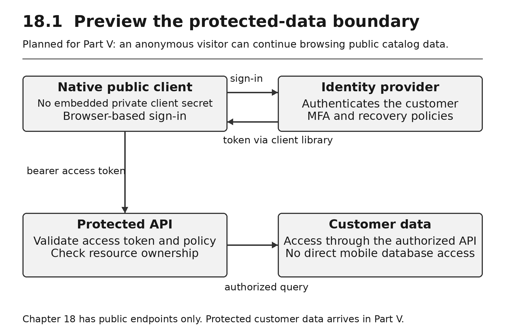

# Chapter 18
# Building the Companion ASP.NET Core API

The Chapter 17 client knows how to ask for a catalog and reject an unusable response. It does not yet have a service that promises what those bytes mean. This chapter supplies that service and tests the two sides together.

We will build a small ASP.NET Core Minimal API over the same public teaching fixtures already bundled with the application. It returns a versioned catalog document, retains the earlier items-array contract, demonstrates bounded pagination, and describes its development endpoints through OpenAPI. It has no customer order or request-writing endpoints. Keeping that boundary small lets us establish service behavior before adding identity, storage and transactions.

## What You'll Learn

You will learn to expose a versioned public catalog through ASP.NET Core Minimal APIs; keep transport documents distinct from internal models; use explicit pagination and validation errors; run an API locally; and distinguish in-memory pipeline tests from real-socket and device tests.

**Prerequisites:** Chapters 12 and 17, an SDK matching the companion repository, and a Windows terminal. **Deliverable:** A development catalog API with documented contracts and reproducible integration checks.

## Introduce the service project

The new src/GnazzosWorld.Api project uses Microsoft.NET.Sdk.Web and targets net11.0. It references GnazzosWorld.Core and pins Microsoft.AspNetCore.OpenApi to 11.0.0. The portable core remains free of ASP.NET Core types. An API test project references the service and pins Microsoft.AspNetCore.Mvc.Testing to the matching 11.0.0 family.

The companion solution contains Core and Api to make the service projects discoverable. The existing MAUI project and executable test projects remain runnable by their documented paths. Opening this solution does not install mobile workloads or transform a backend build into an Android build.

The service's entry point follows the familiar build/register/map/run sequence:

```csharp
var builder = WebApplication.CreateBuilder(args);
builder.Services.AddProblemDetails();
builder.Services.AddOpenApi();
// Register public catalog and JSON options here.
var app = builder.Build();
// Configure the error pipeline and map read routes.
app.Run();
```

The complete Program.cs registers string-enum JSON serialization, the public catalog fixture and predictable error handling before mapping the routes. It explicitly resolves the fixture during startup. Invalid catalog metadata or revision configuration therefore stops startup instead of allowing a broken service to report that it is healthy.

PublicCatalog is a singleton because this fixture is a validated immutable snapshot. It sorts items and creators by ordinal stable ID, constructs the document and validates its relationships. This lifetime would need reconsideration for a mutable database context, a per-customer service or a periodically refreshed provider. Registering one object globally does not make every future dependency thread-safe.

## Define a document, not an accidental serialization

Chapter 17's array is a useful compatibility contract, but it cannot carry the creator set or identify the meaning of a refreshed snapshot. The new CatalogDocument is an explicit public response DTO. Its header distinguishes format compatibility from the identity of the content:

| Field | Meaning |
|---|---|
| schemaVersion | Supported document structure; this implementation accepts 1 |
| revision | Identity of this particular fixture snapshot |
| items | Complete public catalog item collection |
| creators | Creator records needed to validate item relationships |

The core Contracts folder owns CatalogDocument and CatalogPageDto so the server and companion client agree on their wire shapes. Version 1 deliberately shares the existing immutable CatalogItem and CatalogCreator record shapes within that envelope. This keeps the teaching example small, but those records are now part of a public wire contract. Renaming a serialized member or changing its meaning can break an older client even if the new server compiles.

A separate domain and DTO mapping layer becomes useful when the internal model needs to change independently. Introduce it for that reason; do not treat an extra class with identical fields as a guarantee of compatibility. Contract tests and deliberate version decisions still matter.

CatalogDocument.Read requires the header and collections, accepts only schemaVersion 1, validates a bounded revision identifier, and limits each collection to 1,000 records. It then calls CatalogSnapshot.Create to validate items, creators, duplicate identities and relationships together. That factory copies collection ownership, so later mutation of a caller's input list does not alter the validated snapshot.

The byte limit from Chapter 17 still applies before deserialization. A record-count limit and a transfer limit protect different resources. A few unusually long records can exhaust a byte budget before reaching a count limit. The API's shipped fixture contains five items; the bounds are ceilings for this example, not promises that the native UI can render every larger dataset without measurement.

## Reuse the transport boundary

Both response contracts need the same GET, deadline, body limit, disposal and retry behavior. Duplicating the Chapter 17 loop would create two places to repair when a transport bug appears. This milestone moves that behavior into BoundedJsonClient and keeps HttpCatalogSource as the earlier array adapter.

BoundedJsonClient accepts a parser function for a complete bounded stream. HttpCatalogSource supplies CatalogLoader.Load. The new HttpCatalogDocumentSource supplies CatalogDocument.Read. Existing Chapter 17 handler tests continue to exercise the same transport through the compatibility adapter, while new document tests establish the envelope and relationship rules.

```csharp
public Task<CatalogDocument> LoadAsync(
    CancellationToken cancellationToken = default)
    => transport.GetAsync(
        CatalogDocument.Read, cancellationToken);
```

The deadline still includes headers, body reads and retry waits. The client still rejects HTTP endpoints, embedded credentials, unexpected statuses and invalid payloads. Adding a server project does not justify loosening those checks to make a demonstration appear connected.

The main MAUI catalog continues to use its bundled source, and the native networking lab continues to identify its in-process handler. This chapter connects the actual client and actual server pipeline in integration tests and supplies an executable workstation probe. Moving the main browser to remote refresh requires the explicit freshness and storage behavior developed in the following chapters.

## Keep the routes understandable

The public fixture service exposes four GET routes:

| Route | Purpose |
|---|---|
| /health | Return a minimal service status object |
| /api/v1/catalog | Return the versioned complete document |
| /api/v1/catalog/items | Retain the Chapter 17 complete-array contract |
| /api/v1/catalog/pages | Demonstrate bounded, revision-aware pagination |

The unpaged routes serve a bounded teaching snapshot. They are not a recommendation to export an unlimited production database in one response. The paged endpoint illustrates the separate agreement a growing catalog needs, without forcing the first compatible array client to understand a new envelope unexpectedly.

There are no quote, order or request POST handlers. A POST to the existing catalog route returns method-not-allowed, and a request to an absent customer route returns not-found. Those are useful contract tests, not a completed authorization design. Protected customer operations will require the later identity and ownership work before they exist.

Health returns only an ok status. It does not expose configuration, contact data or dependency details. It also does not verify a future database, provider or payment service that this fixture never contacts. Broaden readiness checks only when those dependencies are part of the actual runtime design.

### Map the document and compatibility routes

Inside the service’s `Program.cs`, these routes follow registration of `IPublicCatalog` and the error pipeline:

```csharp
app.MapGet("/api/v1/catalog", (IPublicCatalog catalog) =>
    TypedResults.Ok(catalog.Document))
    .WithName("GetCatalog").ProducesProblem(500);
```

The compatibility endpoint returns the earlier items-only array:

```csharp
app.MapGet("/api/v1/catalog/items", (IPublicCatalog catalog) =>
    TypedResults.Ok(catalog.Document.Items))
    .WithName("GetCatalogItems").ProducesProblem(500);
```

Choose the endpoint to match the client contract. `/api/v1/catalog` returns the envelope containing schema, revision, items and creators. `/api/v1/catalog/items` retains Chapter 17’s array-shaped response for the earlier client. A successful response from the wrong route can still fail deserialization.

The document adapter in `src/GnazzosWorld.Core/Contracts/CatalogDocument.cs` makes the new parser explicit:

```csharp
public sealed class HttpCatalogDocumentSource(HttpClient client, Uri
    endpoint, TimeProvider clock)
{
    private readonly BoundedJsonClient transport = new(client, endpoint, clock);
    public Task<CatalogDocument> LoadAsync(CancellationToken
        cancellationToken = default)
        => transport.GetAsync(CatalogDocument.Read, cancellationToken);
}
```

Use an absolute trusted HTTPS endpoint and the reusable client configuration described earlier. `BoundedJsonClient` performs the bounded HTTP read; `CatalogDocument.Read` validates the envelope and creator relationships. Swapping only the URL without changing the expected shape is not a complete client migration.

## Page one snapshot at a time

The pages endpoint accepts offset, limit and revision. Defaults are offset zero and limit twenty. Limit must be between one and one hundred. Numeric input must be one nonnegative integer; duplicate values, unexpected query names, malformed digits, negative values and overflow are rejected as validation problems.

The route declares the three query parameters in its handler signature so OpenAPI can describe them. It also examines the raw query collection to reject ambiguous duplication. A route that silently chooses one of two limit values gives intermediaries and clients unnecessary opportunities to disagree.

The first page can omit revision. The returned CatalogPageDto identifies the fixture revision, total item count, current offset and limit, page items and nextOffset. A null nextOffset marks the final page. When continuing with an offset above zero, supply the returned revision. If the current service revision differs, the endpoint returns 409 Conflict and asks the caller to restart paging.

For the five-item fixture, limit two produces offsets zero, two and four. The last response contains one item and a null continuation. Requesting offset equal to total produces an empty terminal page. Requesting a greater offset is rejected instead of pretending that an arbitrary position is meaningful.

The arithmetic uses the validated offset and actual returned item count. A maliciously large number cannot overflow into a plausible negative continuation. The integration suite also reconstructs the complete ID sequence from all pages and compares it with the unpaged document, detecting duplicates and ordering inconsistencies.

A revision check works only if the content owner changes the revision whenever the snapshot changes. This in-memory fixture does not retain historical snapshots or coordinate several independently updated servers. A production paging design may need a durable snapshot token, stable keyset cursor or database consistency policy. The example establishes the problem; it does not disguise offset paging as a universal solution.

## Return problems without exception details

Program.cs registers Problem Details support, installs an exception handler and supplies status-code responses for otherwise empty errors. Invalid page inputs produce a 400 validation problem with field names and concise guidance. A changed revision produces a 409 problem. An unexpected service exception becomes a generic 500 problem.

The exception response is deliberately generic even in Development. The API has no need to send a stack trace, file path or exception message to a phone. A failing-catalog test double throws an exception containing a private marker. Integration tests verify that the marker does not appear in the response in either Development or Production.

Server diagnostics are a separate boundary. Exception middleware can still log the original failure for the host operator. Review log contents and retention before customer workflows are added; response sanitization alone is not a logging policy. This chapter handles public fixtures and returns no customer details because none are accepted.

The client does not treat a Problem Details document as a successful catalog. Status handling occurs before catalog parsing. A 400 should lead the developer to fix a request, while a revision conflict should lead a paging client to restart its collection. The bounded public-GET retry rules still apply only to the selected temporary statuses from Chapter 17.

## Describe development behavior with OpenAPI

AddOpenApi registers document generation, and MapOpenApi exposes the development document at /openapi/v1.json. The service maps that endpoint only when its environment is Development. The generated document describes read routes, query parameters, response schemas and declared problem outcomes.

This is a machine-readable description, not an installed interactive documentation website. Swagger UI or Scalar would be a separate dependency and configuration decision. A browser displaying JSON is sufficient for inspecting this milestone's contract.

The integration suite requests the document and checks that the catalog routes, paging parameters and selected 400/409 responses are present. It also verifies that the document endpoint is absent in Production. Those checks keep the description connected to the executable API rather than allowing a manually maintained example to drift unnoticed.

Use OpenAPI to inspect the published route shapes. Keep explicit tests for revision changes, duplicate query values and creator relationships.

## Run the service on Windows

Use the pinned SDK. From the repository root, trust the local development certificate and start the supplied profile:

```powershell
dotnet dev-certs https --trust
dotnet run --project src/GnazzosWorld.Api `
    --launch-profile https
```

The profile binds HTTPS localhost port 7443 and HTTP localhost port 5080, sets Development and leaves the browser launch under your control. Keep that terminal open. A second terminal can inspect a public page:

```powershell
Invoke-RestMethod `
    'https://localhost:7443/api/v1/catalog/pages?limit=2'
```

The included tools/GnazzosWorld.CatalogProbe project provides an executable consumer of the full document:

```powershell
dotnet run --project tools/GnazzosWorld.CatalogProbe -- `
    https://localhost:7443/api/v1/catalog
```

It constructs an HttpClient with redirects and cookies disabled, retains certificate validation, uses the shared bounded document source, and prints the schema, revision and counts. Ctrl+C cancels the operation. It does not print complete response bodies or reconfigure the MAUI application.

The HTTP loopback listener supports a host-side startup check. For the HTTPS-only mobile client, continue with certificate trust and device addressing rather than substituting the HTTP health URL.

Configuration follows the service's ordinary application configuration sources. Catalog:Revision has a fixed public-fixture value in appsettings.json and can be overridden with Catalog__Revision or a deliberate command-line setting. Revision identifiers contain one to eighty ASCII letters, digits, dots, underscores or hyphens. They are public content identifiers, never secrets.

AllowedHosts initially permits localhost and 127.0.0.1. Host filtering does not create a reachable listener, open a firewall or authenticate a user. Keep each of those decisions explicit when moving beyond a workstation. The supplied profile performs no public deployment.

## Understand where the client is running

A phone's localhost refers to the phone. An Android emulator's localhost refers to that emulated environment. An iOS simulator shown on Windows can still be running on the paired Mac. These distinctions explain many apparently mysterious connection failures.

| Client location | Route to the Windows service |
|---|---|
| Windows browser or probe | localhost with the configured port and trusted certificate |
| Standard Android emulator | Host-loopback alias 10.0.2.2, with TLS name/trust solved explicitly |
| iOS simulator on a paired Mac | A Windows hostname reachable from that Mac, or a chosen HTTPS development tunnel |
| Physical Android or iPhone | A reachable workstation hostname with matching trusted TLS, or a chosen HTTPS development tunnel |

Trusting the Windows development certificate does not install trust on Android or iOS. Changing an address to 10.0.2.2 also does not make a certificate issued for localhost valid for that IP. A device connection needs both reachability and a certificate valid for the chosen name.

One optional route for public fixture data is a temporary HTTPS development tunnel. It requires the reader's account setup, has its own access policy, and can expose the chosen local port beyond the workstation. docs/local-api.md gives the current documented command pattern and explains how to use the exact printed hostname, preserve host filtering and stop hosting afterward. No tunnel is created as part of this milestone.

An access-controlled tunnel may return a browser login redirect to a direct API client. The probe refuses redirects, so that response is not mistaken for a catalog. Choose an access policy deliberately; do not solve it by weakening certificate validation or copying an interactive browser session into mobile code. Public-fixture-only anonymous access is different from the protected customer API that later chapters will build.

Before a native integration, prove the selected endpoint works from the device browser, then configure the client with the same HTTPS host and validate the actual platform handler. Keep local-PC addressing, firewall rules, certificates, redirects and application state as separate troubleshooting steps. Do not add a global trust-all callback to make several unrelated failures disappear at once.

## Verify three different boundaries

Run the same public-read journey at three progressively wider boundaries:

| Check | How to exercise it | What to inspect |
|---|---|---|
| Route integration | Run `CatalogApiTests` with the in-process host | Status, content type, envelope and paging validation |
| Real local HTTP | Start Kestrel and request its bound address | Listener address, route and actual response document |
| App-to-service connection | Use the emulator/device’s correct host address and trusted HTTPS setup | Routing, TLS trust, cancellation and the displayed result |

Start with the smallest failing check. If route tests pass but the phone cannot connect, changing the catalog’s JSON fields is unlikely to repair addressing or trust. Keep customer write routes out of this public fixture API.

## Guided Lab

Validate the service boundary.

1. Find the companion API project and read the local run instructions and exact test commands in `docs/local-api.md`. Start with a verified checkout rather than assuming every branch has the same endpoints.
2. Run the API's integration suite. Compare a successful catalog response with its published wire-contract fixture and version field.
3. Request a malformed query or out-of-range page. Inspect the structured problem response and verify that it does not leak stack traces or sensitive internals.
4. Request two pages from one catalog revision. Confirm the continuation logic and the behavior when a revision changes between requests.
5. Run the temporary-loopback HTTP smoke check to distinguish actual socket startup from an in-memory `TestServer` test.
6. For native-device integration, determine whether the service can be reached from the emulator or phone and whether development HTTPS trust is configured. Check the actual device connection before diagnosing the document.

**Expected result:** The route tests validate the response contract, a local request reaches the running listener, and the device exercise checks its own addressing and HTTPS trust.

### Before you begin: three levels of confidence

Follow the sequence in the verification table near the end of this chapter: route tests, local listener, then the actual app-to-service connection. Each step narrows the next troubleshooting question.



### Preview: from public catalog to protected customer data

A reader browsing Kai the Ninja needs no account merely to see a public description. A customer returning to an anniversary-song request needs access to that customer's own records. These journeys follow different paths. Figure 18.1 previews the second path; the endpoints built in this chapter remain public-fixture reads.

The native app is a public client. Its compiled package cannot keep a private client secret from everyone who installs it. Part V will use a supported browser-based native sign-in flow and maintained client library. The identity provider authenticates the person and applies its account/MFA policy. The client uses an access token for the intended API; an identity token is not a general API credential.

At the API boundary, token validation checks the issuer, audience, signature and applicable lifetime through supported middleware. Authorization then evaluates policies and the ownership of the requested record. A valid sign-in is not permission to retrieve any order ID. The service uses its own controlled data-access configuration; the phone does not connect directly to the customer database or receive backend secrets.

A later customer switching accounts must not see another account's cached stories or files. Sign-out, local cleanup, token expiration and recovery need explicit journeys and rejection tests. Local biometric unlocking and provider-enforced MFA serve different boundaries. Chapters 22–26 develop these account journeys and their server checks.

The useful question to carry forward is: **which component is authorized to make this decision?** The view can hide an action, but the API must still reject an unauthorized request. The preview helps you locate that future responsibility without treating it as an implemented security system.

## Worked Example

The document client receives an array from `/api/v1/catalog/items` and rejects it. The server is reachable and the HTTP response can be valid for its route, yet the envelope parser has nothing to read as `SchemaVersion` and `Revision`.

Select `/api/v1/catalog` for the document adapter, then inspect one complete envelope. When paging, retain the first page’s revision for every continuation. If the service returns 409 because the revision changed, restart the page sequence rather than combine records from different snapshots.

## Troubleshooting

| Symptom | First check |
|---|---|
| Document parser rejects a successful response | Match the envelope client to `/api/v1/catalog`, not the items array route |
| First page works but continuation returns 409 | Restart paging against the new revision |
| PC request works but emulator fails | Use the emulator’s correct host address and inspect firewall/listener binding |
| HTTPS fails while HTTP health succeeds | Configure the selected platform’s certificate trust; keep validation enabled |

## Chapter Summary

The application now has a small executable service contract and a consumer that can validate it. The API makes format, content revision, paging and errors explicit; the client preserves its time, size and retry budgets. The verification separates portable rules, the ASP.NET Core pipeline and a real local listener before native networking is introduced.

## Exercises

1. Start the API and inspect its first two-item page. Use the returned revision and nextOffset to retrieve every ID. Compare the sequence with the complete document and explain when nextOffset becomes null.
2. Send limit=0, duplicate limit values and a stale revision. Identify which responses are 400 and which is 409. Explain why a changed revision needs a different recovery action from a malformed number.
3. Run the HTTPS probe on the Windows workstation. Record its source revision, schema and counts. State which certificate and device facts that result still cannot establish.
4. Inspect the generated OpenAPI document in Development and run the Production-environment test. Find the declared paging parameters and problem responses. Identify one business rule that still requires prose or an executable test.
5. Plan the first native connection using the table in this chapter. Choose a reachable hostname and TLS approach, list the checks to perform, and keep the main bundled catalog available until remote freshness and persistence behavior are defined.

**Review questions:** Why are schemaVersion and revision separate? What makes an explicit DTO a compatibility contract? Why does copied collection ownership matter for a singleton snapshot? Which failure can TestServer miss that the Kestrel startup check detects, and which failures can both still miss?

## References

- Microsoft, Generate OpenAPI documents: AddOpenApi, MapOpenApi and development document routing. https://learn.microsoft.com/en-us/aspnet/core/fundamentals/minimal-apis/openapi
- Microsoft, Integration tests in ASP.NET Core: WebApplicationFactory and TestServer. https://learn.microsoft.com/en-us/aspnet/core/testing/integration-testing
- Microsoft, Handle errors in ASP.NET Core APIs: Problem Details and error middleware. https://learn.microsoft.com/en-us/aspnet/core/fundamentals/error-handling-api
- Microsoft, Connect to local web services from Android emulators and iOS simulators: host addressing and certificate boundaries. https://learn.microsoft.com/en-us/dotnet/maui/data-cloud/local-web-services
- Microsoft, Dev tunnels command-line reference: optional reader-controlled development hosting and access. https://learn.microsoft.com/en-us/azure/developer/dev-tunnels/cli-commands
- Companion source: src/GnazzosWorld.Api; Core/Contracts/CatalogDocument.cs; Core/Networking/BoundedJsonClient.cs; tests/GnazzosWorld.Api.Tests; tools/GnazzosWorld.CatalogProbe; eng/Smoke-Api.ps1; docs/local-api.md. Exact verification results are recorded in docs/verification.md.

## Editorial index terms

ASP.NET Core; Minimal API; dependency injection; DTO; wire contract; schema version; catalog revision; pagination; offset; continuation; Problem Details; OpenAPI; WebApplicationFactory; TestServer; Kestrel; HTTPS probe; development certificate; Android host alias; iOS simulator; local networking; host filtering; development tunnel.

