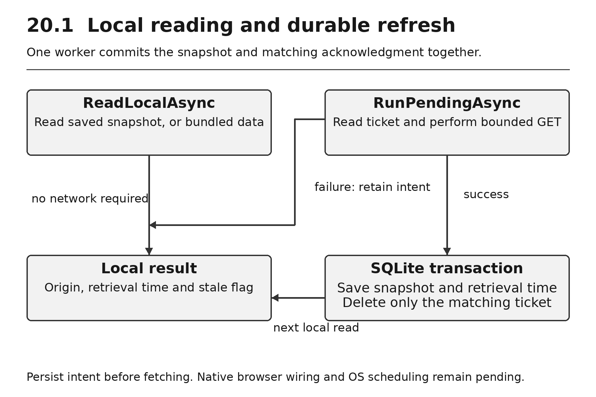
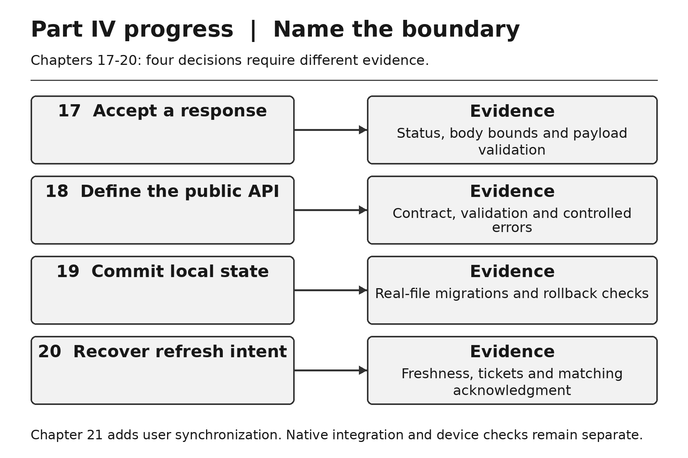

# Chapter 20
# Offline Operation and Background Work

A visitor opens Gnazzo's World on an airplane. The catalog appeared yesterday, so an empty screen today would be a disappointing surprise. A different visitor taps Refresh just before a phone call interrupts the application. When the app starts again, it should remember that useful work remains. Neither journey requires a permanently running process. Both require explicit durable state.

Chapter 19 gave us a real SQLite store. This chapter adds a policy around that store: read locally first, label what was saved, refresh only when requested, and commit a successful replacement together with acknowledgment of its pending work. We deliberately begin with public catalog reads. A refresh can safely be repeated after interruption because it does not create a customer order.

## What You'll Learn

By the end of this chapter, you will be able to:

1. Return a bundled or saved catalog without waiting for a network request.
2. Explain freshness using an injected clock and a documented expiration boundary.
3. Persist a bounded refresh intent that survives service and process reconstruction.
4. Commit a snapshot and its acknowledgment atomically without losing a newer request.
5. Separate portable background-work logic from operating-system scheduling and native verification.

**Prerequisites:** Chapters 17–19, the SDK in `global.json`, and the Chapter 19 companion checkpoint `12c9ad41d761a34619a404f803833daa44931448`. The Chapter 20 implementation is commit `74d2df5ade5b1d69b306bdb1a406722d08057ed1` on `work/chapter16-pricing`. Use the same revision for the source and tests.

**What you will build:** A portable `OfflineCatalogService`, a schema-3 upgrade, a one-row durable public-refresh queue, and real-file regression tests. These are complete companion components and a runnable portable lab. The main MAUI browser still uses its earlier bundled source; native screen integration and OS job registration require their own verification.

## 20.1 Define the offline promise

Offline operation does not mean that every feature works without a connection. Browsing a saved public title is different from streaming a song that has never been downloaded. Opening an external store still depends on that store. A custom-song request also needs a server acknowledgment before the app can claim receipt.

For this chapter, the promise is narrow and testable:

- A valid saved catalog is available without a network request.
- With no saved catalog, the bundled fixture supplies a useful starting point.
- Every result identifies its origin and the time of the last successful refresh, when known.
- A failed refresh retains the earlier document and the request to refresh it.
- An interrupted refresh can be attempted again after reopening the database.
- A later refresh request is not erased when an earlier request completes.

These rules also identify exclusions. We do not download artwork or audio, submit customer details, collect money, or synchronize account state. A public catalog refresh is a repeatable GET, not a generic offline transaction engine.

| Situation | Catalog result | Pending work |
|---|---|---|
| First launch with no saved document | Bundled fixture, unknown age | None until requested |
| Saved document available | Saved document and freshness | Existing intent retained |
| Requested refresh succeeds | Validated refreshed document | Matching intent removed |
| Classified HTTP/transport failure | Local document plus failure classification | Retained |
| Caller cancels | Cancellation propagates | Retained unless commit already completed |
| Local database fails | Storage error propagates | No false success |

Do not convert a database failure into an empty catalog. An empty successful result would hide the difference between no records and unreadable saved data. The presentation layer should show a recoverable storage problem and preserve the file for diagnosis where appropriate.

## 20.2 Keep content and freshness together

The existing `public_catalog` table stores one complete validated document. Schema 3 adds a nullable `fetched_utc` column. The timestamp records successful retrieval and local commit, not the document's release date or the last time a screen opened.

Existing version-2 documents acquire a null timestamp. We do not invent a retrieval time during migration. A catalog can be usable while its age is unknown.

The additional schema is:

```sql
ALTER TABLE public_catalog
    ADD COLUMN fetched_utc TEXT NULL;
CREATE TABLE pending_refresh (
    singleton INTEGER PRIMARY KEY CHECK(singleton=1),
    ticket TEXT NOT NULL
);
PRAGMA user_version=3;
```

This excerpt belongs inside the migration transaction in `src/GnazzosWorld.Core/Storage/LocalCatalogDatabase.cs`. The implementation advances versions 0, 1 and 2 to 3 while retaining favorites and reading progress. It still refuses an unsupported future version. Keep the same database filename when upgrading; changing the filename would create a different empty store rather than migrate the existing one.

The original `ReplaceCatalogAsync` remains available for the Chapter 19 exercise. It now clears `fetched_utc` when replacing a document without a trustworthy retrieval timestamp. Otherwise, a newly imported document could inherit the previous document's age and appear fresh incorrectly.

The new reader returns both values in one query:

```csharp
public sealed record CachedCatalog(
    CatalogDocument Document,
    DateTimeOffset? FetchedUtc);
```

The complete database extension is `src/GnazzosWorld.Core/Storage/LocalCatalogDatabase.Offline.cs`. The original class becomes `partial` so the new operations can share its gate, connection lifetime, JSON options and transaction helpers. This is a source-organization choice, not a second database or a new ownership boundary.

The reader validates the document using the Chapter 18 contract. It parses a known timestamp using the invariant round-trip format. Malformed stored metadata is an error; it does not silently become a successful current response.

## 20.3 Make freshness a reproducible rule

A green network icon does not tell us how old the catalog is. Freshness comes from the last successful retrieval and an explicit policy. Our teaching policy uses a 24-hour window:

```csharp
public static readonly TimeSpan FreshFor =
    TimeSpan.FromHours(24);
```

At exactly 24 hours, the document is stale. A missing timestamp is stale. A timestamp in the future is also stale because the device clock may have changed. None of those conditions deletes the catalog.

| Recorded age | Result |
|---|---|
| Unknown | Stale, last update unknown |
| Negative after clock correction | Stale, timestamp untrusted |
| Zero through less than 24 hours | Fresh under this policy |
| Exactly 24 hours or older | Stale, still available |

`OfflineCatalogService` receives a `TimeProvider`. The tests advance a controlled clock rather than waiting a day or relying on the machine's current date. A production app would format the returned timestamp in the user's locale and could apply a different freshness window after considering how often the catalog changes.

Fresh does not mean the service guarantees the document is the latest possible revision. It means the last successful retrieval falls inside the selected local window. A creator could publish an update immediately after that retrieval. If a workflow needs stronger guarantees, its server contract must provide them.

## 20.4 Read locally before considering refresh

The service is in `src/GnazzosWorld.Core/Offline/OfflineCatalogService.cs`. Its result carries a validated document, an origin, a nullable retrieval time, a stale flag and an optional refresh-problem classification.

```csharp
public enum CatalogOrigin
{
    Bundled, Saved, Refreshed
}
```

`ReadLocalAsync` first calls `ReadCachedCatalogAsync`. With a saved document, it computes freshness and returns immediately after the database read. With no document, it loads the bundled items and creators through `CatalogSnapshot.LoadBundled` and builds a version-1 document with revision `bundled`.

This method never contacts the network. The boundary makes the first visible state predictable: a page can show useful material, then offer Refresh as a separate command. It also prevents reopening a page from silently consuming metered data.

A useful presentation might display these messages:

- Bundled: "Included catalog. No downloaded update yet."
- Saved and fresh: "Saved catalog. Updated today."
- Saved and stale: "Saved catalog. An update may be available."
- Refresh failed: "Could not refresh. Showing your saved catalog."

These are suggested presentation strings, not observed native screenshots. A screen should combine them with a formatted date when one is known, maintain accessibility announcements, and avoid claiming the device is offline from a single failed request. A server problem and an internet problem can look similar to the customer.



The listener looking for Northern Lights on an airplane follows the local path. The worker path becomes relevant when that listener requests an update. This is the portable Chapter 20 design, with native browser integration still pending; the arrows are not a claim that the current MAUI screen already uses it.

## 20.5 Persist intent before starting work

A `Task` is not durable. If the operating system ends the process, its stack, cancellation token and in-memory queue disappear. Saving a small intent before starting the GET makes recovery independent of that process.

The queue intentionally contains at most one row. Repeated refresh taps coalesce into one latest request. Each request creates a new random ticket and upserts the singleton row:

```sql
INSERT INTO pending_refresh(singleton, ticket)
VALUES(1, $ticket)
ON CONFLICT(singleton) DO UPDATE SET
    ticket=excluded.ticket;
```

`RequestCatalogRefreshAsync` generates the ticket internally. It stores no URL, personal story or arbitrary executable payload. The configured fetch delegate decides which public endpoint the application contacts.

Why use a ticket if there is only one row? Consider this event order:

1. A worker reads ticket A and begins fetching.
2. The customer requests another refresh, storing ticket B.
3. The first worker finishes and saves its document.
4. The acknowledgment deletes only ticket A.
5. Ticket B remains available for the next attempt.

An unconditional delete in step 4 would lose the newer request. Matching the ticket is a small form of conditional acknowledgment. It protects intent without introducing a general message broker.

The ticket is not a customer idempotency key and is never sent to the public API. It identifies one local request generation. Chapter 16's order-submission questions remain separate.

## 20.6 Commit the document and acknowledgment together

`CommitCatalogRefreshAsync` validates and serializes the incoming document before entering the database operation. Inside one SQLite transaction it saves the payload, revision and UTC timestamp, then deletes the matching pending ticket.

The important completion condition is:

```sql
DELETE FROM pending_refresh
WHERE singleton=1 AND ticket=$ticket;
```

If a newer ticket exists, the delete affects no row and the new request remains. Saving the downloaded public document is still useful. If a database error occurs during acknowledgment, disposing the uncommitted transaction rolls back the preceding snapshot write too.

This avoids a dangerous split: a queue row must not disappear before the corresponding document is durable. It also avoids claiming that a request succeeded merely because an HTTP response arrived. Validation and local persistence are part of this particular success contract.

A process can stop before the commit. On restart the pending row remains and the GET runs again. It can stop after the commit. On restart the saved snapshot and matching acknowledgment agree. Repeating the GET is acceptable here because it reads public data and does not charge a customer.

The tests simulate a failure between save and acknowledgment with a SQLite trigger that rejects the delete. They establish transaction rollback on a real file. They are not a physical power-loss or filesystem durability certification.

## 20.7 Run one bounded attempt

`RunPendingAsync` acquires an instance-owned semaphore, reads the pending ticket and returns local data if there is no work. Otherwise, it calls the configured fetch delegate. The real adapter can be the `LoadAsync` method of Chapter 18's `HttpCatalogDocumentSource`, which already uses the bounded Chapter 17 transport.

A shortened control-flow excerpt is:

```csharp
var ticket = await database.ReadPendingRefreshAsync(ct);
if (ticket is null)
    return await ReadLocalAsync(ct);

var document = await fetch(ct);
ct.ThrowIfCancellationRequested();
await database.CommitCatalogRefreshAsync(
    ticket, document, clock.GetUtcNow(), ct);
```

The surrounding implementation owns the gate and its `finally` release. It catches `CatalogFetchException` to return local data with an explicit failure classification. It lets cancellation, invalid arbitrary delegate output, programming errors and SQLite errors propagate. In the real HTTP adapter, transport and parsing problems are translated by the bounded client; a custom delegate must honor that contract.

A classified failure retains intent but does not start an infinite retry loop. The next attempt belongs to a later explicit refresh, foreground retry or deliberately registered scheduler opportunity. Do not immediately rerun a persistent invalid-payload or permanent-status failure because a row still exists. The presentation should offer an explanation and manual retry; a later scheduler policy must classify eligible failures and apply a persistent cooldown.

The semaphore prevents overlapping workers through one coordinator. The application must own one coordinator per database and must not create independent workers in several windows or processes. A multiworker scheduler would need database-backed leasing or generation-aware write arbitration. We do not claim that the local semaphore provides distributed exclusion.

## 20.8 Work through the portable lab

The complete lab is also recorded in `docs/labs/ch20-offline.md` in the companion repository.

1. Start with the Chapter 19 source revision named in the opening and inspect the schema-2 migration. Compare it with the Chapter 20 revision to see the added column, queue and partial class.
2. Open the offline database extension and follow `RequestCatalogRefreshAsync`, `ReadPendingRefreshAsync`, `ReadCachedCatalogAsync` and `CommitCatalogRefreshAsync`. All SQL values use parameters.
3. Open `OfflineCatalogService`. Follow local-first reading before tracing the worker. Identify which method persists intent; the worker does not create it implicitly.
4. Open `tests/GnazzosWorld.Core.Tests/OfflineCatalogTests.cs`. Run the full portable suite from the repository root with the commands below.
5. Review the restart test. It disposes one database instance and opens another against the same path before running the worker. Follow the failure and cancellation cases, which leave the pending row intact.

```powershell
$p = 'tests/GnazzosWorld.Core.Tests/'
$p += 'GnazzosWorld.Core.Tests.csproj'
dotnet build $p -c Release
dotnet run --project $p -c Release --no-build
```

The expected result is a passing executable xUnit run. The final verification log records the observed count and exact CI revision. Passing tests establish the portable policy and actual temporary-file SQLite operations on the runner. They do not show an Android screen, trusted TLS on a phone or a scheduled iOS background launch.

For an adapter composition, a portable host can use the following complete construction when `path`, `httpClient` and the trusted absolute HTTPS `endpoint` have already been selected:

```csharp
using var database = new LocalCatalogDatabase(path);
var source = new HttpCatalogDocumentSource(
    httpClient, endpoint, TimeProvider.System);
var offline = new OfflineCatalogService(
    database, source.LoadAsync, TimeProvider.System);

var initial = await offline.ReadLocalAsync(ct);
await database.RequestCatalogRefreshAsync(ct);
var updated = await offline.RunPendingAsync(ct);
```

This is an integration excerpt with explicit host-owned dependencies, not a standalone program. The surrounding test fixtures are runnable without a public endpoint. In a MAUI screen, observe the async command, provide page-lifetime cancellation and marshal visible property updates to the UI thread. Do not dispose the shared database when only one page disappears.

## 20.9 Respect mobile execution and resource limits

Background work has two meanings. A worker can run off the UI thread while the app is active. An operating-system scheduler can also grant a later execution opportunity. The second is subject to platform rules, battery conditions, quotas and user settings. Neither `Task.Run` nor a recurring timer registers an Android or iOS background job.

Use foreground startup or resume as a recovery opportunity: read local content, inspect pending intent and, if policy permits, run one bounded worker. Persist the intent when the user requests it rather than depending on a shutdown callback. A terminated process may never receive a useful final callback.

Microsoft.Data.Sqlite's async ADO.NET methods execute synchronously. An async method name therefore does not guarantee that SQLite cannot block a MAUI UI thread. A native adapter should move the bounded database/worker activity to an owned background execution path, await it, and marshal only presentation changes back to the main thread. Cancellation remains cooperative; it cannot guarantee interruption halfway through every native SQLite call.

Connectivity information is a scheduling hint. Wi-Fi may lead to a captive portal, and reported internet access may disappear before the request. Keep HTTP failure handling even after a favorable hint. For metered connections, make Refresh explicit and explain the policy before adding automatic fetching. This implementation fetches bounded public metadata only; it does not silently download media.

Low storage can make a commit fail after a successful download. Preserve the previous database and report the storage problem. Do not delete favorites or a private draft to make room for a catalog. A later media cache needs explicit byte quotas, eviction order and ownership checks; those are not supplied by this one-document store.

No native OS job registration is included in this milestone. Before adding it, document its allowed triggers, time budget, cancellation, network constraints, retry cooldown and how it shares the single worker owner. Test stop/resume, process termination and device reboot on each target platform.

## 20.10 Troubleshooting

| Symptom | Likely cause and diagnostic | Corrective action |
|---|---|---|
| A catalog appears but no request occurs | `ReadLocalAsync` deliberately performs no GET | Persist intent, then call the worker |
| An older document is marked stale | Unknown age, future clock or age at least 24 hours | Inspect timestamp and clock; refresh explicitly |
| Restart leaves work pending | Previous attempt failed or stopped before commit | Run one eligible recovery attempt |
| Work remains after a successful refresh | A newer ticket arrived during the fetch | Run that later request when policy permits |
| Old content remains after a storage error | Transaction rollback preserved earlier snapshot | Diagnose storage; do not report completion |
| UI freezes during a database read | SQLite async APIs still perform synchronous work | Use an owned background adapter and measure on device |
| Pending work creates repeated requests | Caller added an unconditional drain loop | Remove loop; classify failures and add cooldown policy |
| Several workers fetch at once | Several coordinator instances share a file | Establish one owner or implement database leasing |

## Chapter Summary

Offline reliability begins with a precise promise about available data and unfinished work. The catalog service reads a validated saved document before using the bundled fixture, and neither path requires a network request. Freshness is a documented 24-hour policy based on an injected clock; unknown and future timestamps remain usable but stale. Schema 3 preserves earlier local state while adding retrieval metadata and a bounded refresh intent. A ticket protects requests made during an active fetch, and one SQLite transaction commits the replacement and matching acknowledgment. Failure and cancellation preserve recovery opportunities. These portable rules do not grant unlimited mobile background execution. Native scheduling, UI responsiveness and device lifecycle behavior still need platform checks. Chapter 21 extends the discussion from public replacement to synchronization of user changes and conflicts.

### Visual recap: four separate acceptance decisions



A listener finding Northern Lights in a saved catalog has received a useful local result. That observation does not establish that a network request ran, a newer revision exists, or another device has the same favorites. Ask which of the four decisions the evidence establishes before describing the feature as complete. Chapter 21 adds a different problem: reconciling user changes rather than replacing public metadata.

## Exercises

### Guided exercise: the lost refresh request

Replace the conditional acknowledgment with an unconditional delete in a disposable branch. Run `Request_arriving_during_fetch_is_not_erased_by_older_acknowledgment`. Explain why the test fails before restoring the implementation.

**Worked answer:** The worker reads ticket A. Its controlled fetch stores ticket B before returning a document. An unconditional delete removes B even though the worker never began work for B. Matching ticket A affects no row, so the newer request remains. The next worker completes B. The check tests request ownership, not merely the presence of SQL syntax.

### Guided exercise: freshness at the boundary

Inspect the clock theory. Predict the results at 1,439 and 1,440 minutes and for a negative age. Then run the cases.

**Worked answer:** At 1,439 minutes the document is fresh under the local policy. At 1,440 it is stale because the comparison uses greater-than-or-equal. Negative age is stale because a future timestamp is not trustworthy evidence of freshness. The catalog remains readable in all three cases.

### Independent extension

Design a persistent retry cooldown for transient refresh failures. Record the next eligible UTC time, inject the clock, and distinguish permanent payload/status failures from eligible transport failures. Add tests for restart, clock correction and a user-requested override. Keep the one-attempt worker bounded and avoid storing customer transactions in this queue.

## Native verification worksheet

Use this worksheet after a native host wires the portable service into a screen. These are acceptance checks to perform, not device observations from this milestone. Record the source commit, OS version, device model, database path policy and endpoint configuration with each result. Use public fixtures and a disposable test installation.

1. Launch with a fresh installation and no connection. Confirm that bundled records appear and the screen identifies their origin. Check that the empty cache causes no hidden repeated requests. Turn on a connection, request Refresh and record the resulting revision and displayed retrieval time.
2. Close and reopen the app with connectivity disabled. Confirm that the downloaded revision remains available and has a saved origin. Search and open a detail page without replacing the saved document with an empty result. Distinguish an unavailable external website from an unavailable local title.
3. Begin a deliberately delayed fixture refresh, then background the app. Confirm that page cancellation produces no false completion message. Terminate and restart the test process. Inspect the retained refresh intent and run one explicit recovery attempt. Reboot testing requires its own recorded result.
4. Repeat with large system text, a screen reader and a slow database fixture. Verify that status changes are announced, Refresh remains reachable and the UI stays responsive. A portable test cannot establish those observations.
5. Exercise a controlled storage-write failure in a test build. Verify that the earlier document remains readable, intent remains pending and the customer receives an actionable storage error. Restore the fixture and confirm that a later successful attempt clears only the matching intent.

For scheduler integration, add separate Android and iOS entries. Document when the OS actually granted execution and how cancellation was signaled. A successful foreground recovery does not prove that a native scheduler ran. Preserve a pending result when equipment or a platform adapter is unavailable.

## Official references

- .NET MAUI app lifecycle: https://learn.microsoft.com/dotnet/maui/fundamentals/app-lifecycle
- .NET MAUI connectivity: https://learn.microsoft.com/dotnet/maui/platform-integration/communication/networking
- Main-thread dispatch: https://learn.microsoft.com/dotnet/maui/platform-integration/appmodel/main-thread
- Microsoft.Data.Sqlite async limitations: https://learn.microsoft.com/dotnet/standard/data/sqlite/async
- SQLite transactions: https://www.sqlite.org/lang_transaction.html

## Editorial index terms

Offline catalog; freshness; TimeProvider; cached snapshot; pending work; conditional acknowledgment; durable intent; schema migration; SQLite transaction; cancellation; metered connection; mobile lifecycle; background scheduling.
