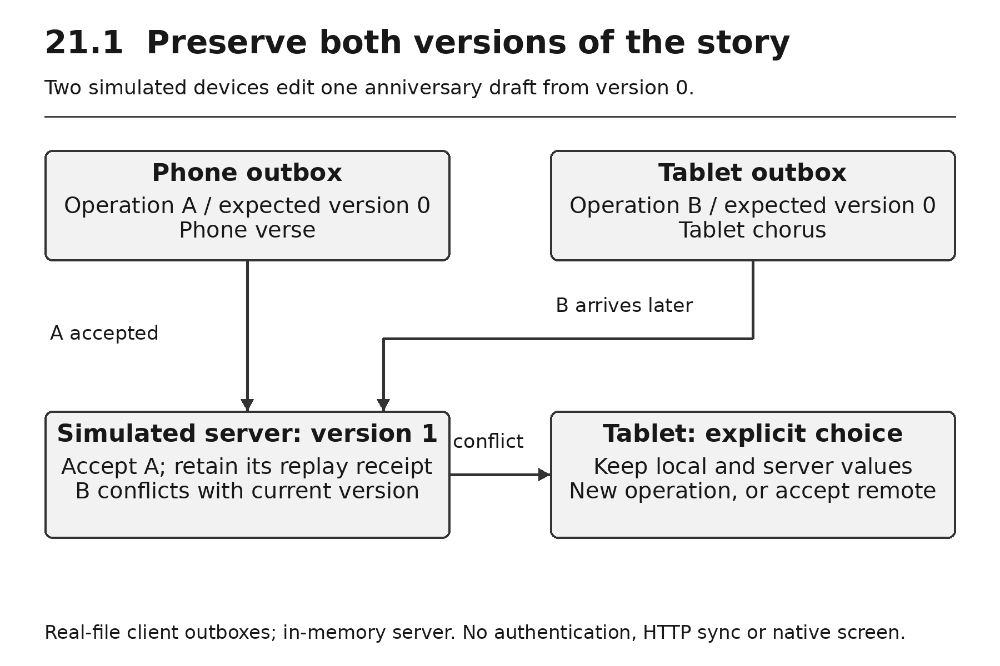

# Chapter 21
# Synchronization and Conflict Resolution

A reader saves Northern Lights as a favorite on a phone, then removes it on a tablet. A second reader pauses a Kai the Ninja sample at a particular location. A customer starts a fictitious anniversary-song idea on two devices, editing the verse on one and the chorus on the other. Each device can preserve its own state perfectly and still disagree with the other device.

Chapter 20 replaced public catalog metadata after validating a downloaded snapshot. User synchronization has a different responsibility: preserve intentions while deciding which changes can safely become shared state. A successful request does not establish that an edit was accepted. An accepted edit does not establish that its reply reached the device. A missing favorite does not establish whether the user deleted it or the device has never seen it.

This chapter develops a small protocol that makes those distinctions executable. Two real SQLite files represent two devices. An explicitly simulated user context selects an in-memory server partition. We use expected versions, durable operation IDs, versioned deletions, bounded change pages and explicit conflict decisions. We do not add an unauthenticated customer-data endpoint to the Chapter 18 API.

## What You'll Learn

By the end of this chapter, you will be able to:

1. Distinguish public snapshot replacement from synchronization of user-owned changes.
2. Detect stale writes using expected versions and preserve both local and server values when a conflict occurs.
3. Replay an uncertain operation safely, and apply downloaded rows and a cursor in one transaction.
4. Carry deletions to another device without automatically resurrecting older state.
5. Run two-replica and failure-injection exercises while keeping simulated account isolation separate from real authentication.

**Prerequisites:** Chapters 17–20, SQLite transactions, cancellation and the .NET 11 SDK selected by `global.json`. Start from the Chapter 20 companion revision `02fb4b385dd0ed14193d97e7df67c9a46a4d7f9c`. The complete Chapter 21 implementation and lab are in companion revision `84a3278e5d00b64699ccf8cee963a657da9fdec8`; later verification corrections, if required, are recorded in `docs/verification.md`. Use matching source and tests, rather than assuming `main` contains the newest teaching milestone.

**What you will build:** `UserSyncReplica`, an account-bound SQLite teaching replica with a durable outbox; `SimulatedSyncServer`, an in-memory protocol fixture; and a portable console lab that demonstrates a draft conflict and a favorite deletion. These components do not migrate the app's existing favorites or request drafts. Native integration, HTTP synchronization, durable server hosting and real identity remain separate work.

## 21.1 Begin with the user's intention

A catalog revision tells us which public metadata was downloaded. It says nothing about whether a particular reader wanted to save a song. Separate the public catalog's authority from the user's state before choosing a synchronization library or database schema.

Our user-data key consists of a kind and an item ID. A favorite and reading progress can refer to the same catalog ID while representing different records. A draft has its own stable ID, independent of a book or song title. Renaming Northern Lights must not create a new favorite or erase its saved state.

| Kind | Demonstration value | Meaning of deletion |
|---|---|---|
| Favorite | `saved` | Remove this saved item |
| Bookmark | An opaque location such as `sample-section-3` | Remove this bookmark |
| Progress | An integer from 0 through 100 | Remove this saved position |
| Draft | Bounded fictitious plain text | Remove this demonstration draft |

The draft value is deliberately smaller than the Chapter 15 request model. It is sufficient to demonstrate competing edits without copying customer contact details, pricing or an order into a synchronization example. A synchronized draft is still editable material; it is not an accepted order, a quote or proof of payment.

Reading progress requires a domain decision. Here it means an explicitly saved position. A reader can intentionally return to an earlier section. Taking the maximum percentage would silently change that meaning to "furthest completed." Similarly, unioning two favorite sets would make removal difficult to represent. We begin with strict version comparison for all four kinds so that disagreements become visible before we introduce automatic merge rules.

## 21.2 Give versions and operation IDs different jobs

The protocol has two identities that must not be confused. A row version identifies accepted server state. An operation ID identifies one attempted change, including retries after an uncertain response.

```csharp
public sealed record UserEdit(
    Guid OperationId,
    UserDataKey Key,
    long ExpectedVersion,
    string? Value);
```

This listing is a complete record declaration from `src/GnazzosWorld.Core/Sync/SyncProtocol.cs`. The surrounding file defines the key, row, reply, page and transport types. Version 0 means that the fixture has not previously accepted a record for that key. A null value means deletion. Once a deletion has been accepted, it has a positive version and remains distinguishable from a key that never existed.

The server compares `ExpectedVersion` with the current row's version under one lock. If they match, the edit is accepted and produces the next event in that account's change history. If the server is ahead, it returns a conflict with the current row. If its history is behind the version the client expects, the fixture refuses to guess and asks for explicit rebootstrap. Device wall clocks do not choose a winner.

An operation ID is created when the edit is written to the local outbox. Retrying that edit preserves the same ID, expected version and payload. The server stores the original edit and reply together. Repeating the same operation returns its original reply; reusing the ID for different content is rejected. The receipt lookup occurs before the version check, because a previously accepted operation may now have an older expected version than the server.

**Worked trace:** The phone sends operation A at expected version 0. The server accepts it as version 1, but the reply is lost. A different operation based on version 1 later creates version 2. Replaying A must return A's version-1 receipt, not create version 3 or reinterpret A as a new conflict. Downloading the change feed subsequently brings the replica to version 2.

## 21.3 Trace the two-device conflict



Imagine the anniversary-song draft begins with no server row. The phone saves "Phone verse" and the tablet saves "Tablet chorus" before either observes an accepted version. Both operations therefore expect version 0. The phone reaches the server first and becomes version 1. The tablet's request cannot replace it using an expectation that is no longer true.

The tablet retains its own text in the outbox and stores the current server row separately. `View` exposes `Value`, `ServerValue`, `ServerVersion`, `Pending` and `Conflict`. This is enough for a future native screen to show both alternatives instead of presenting an unexplained save failure. The diagram is a protocol illustration, not a runtime screenshot.

The fixture does not attempt to combine words into a new song request. A generic text merge can make a grammatical result while changing the customer's intention. Choosing the remote value discards only the conflicting local operation. Choosing the local value creates a **new** operation ID based on the latest locally known server version. That operation can conflict again if another device changes the row first. An explicit choice authorizes a new attempt; it does not lock the remote record indefinitely.

## 21.4 Preserve pending edits in a durable outbox

`src/GnazzosWorld.Core/Sync/UserSyncReplica.cs` owns three tables in a separate teaching file:

- `replica_meta` records the simulated account and last applied cursor.
- `user_rows` records accepted server values and versions, including tombstones.
- `outbox` records operation ID, key, expected version, proposed value and conflict state.

The existing public-catalog database remains unchanged. The constructor binds a replica file to one simulated account and refuses to reopen it for another account. This reduces accidental mixing in the lab; it does not encrypt the file or authenticate its owner.

A call to `Queue` reads the accepted version and inserts a durable operation. `View` overlays an unsettled operation on the last accepted row, allowing the local interface to show the user's intention immediately while retaining a separate server value. The outbox's primary key permits one unsettled operation per item. A second edit for that same item is rejected until the first is accepted or its conflict resolved.

That restriction is intentional. A more advanced editor might let someone continue typing while an older operation is in flight. It would then need separate identities for the sent operation and newer local content, plus conditional acknowledgment rules. This lab keeps those generations out of the first synchronization implementation. A native adapter must preserve any unsaved editor buffer and explain that the earlier operation needs attention; it must not throw away text because `Queue` rejects a second operation.

Edits to different keys can remain pending together. Downloading a newer server row does not delete any outbox entry. The projection continues to show the local value until the corresponding operation is settled. This matters when a user creates a new edit after the worker has captured its push batch but before the download returns.

## 21.5 Complete a bounded synchronization pass

`SyncAsync` uses an instance-owned semaphore to serialize workers. It captures at most 32 nonconflicted edits, sends them in order, processes their replies, then downloads at most 100 change events. One pass is bounded; no permanent background loop is installed.

The transport is bound to one account context. The replica checks that account before making a call and validates the account on replies and downloaded pages. In this chapter the binding is created by `ForSimulatedUser`, which simply selects a fixture partition. Part V must replace this testing convenience with a context derived from validated authentication. A production server cannot trust an account label supplied by the mobile client.

The acknowledgment path stores the returned server row and settles the matching operation in one local transaction. An accepted reply deletes that operation. A conflict marks it for explicit resolution. Cancellation after the server has accepted an operation but before local acknowledgment leaves it queued with the same ID. The next pass can replay it safely against the fixture's retained receipt.

**Important limit:** The worker semaphore belongs to one replica instance, not the database file or operating system. Use one owning instance per file. Two processes or separately constructed owners require a lease or another coordination protocol before they can safely share the same outbox. Reopening after an earlier owner has stopped is the restart scenario covered by the tests.

The pass returns accepted, conflicted and downloaded counts, plus `MoreRemoteChanges`. That last flag describes the remote page only. It does not promise the local outbox is empty: a pass captures at most 32 operations and can also encounter conflicts. A host should inspect the state it needs, offer explicit retry or recovery, and respect foreground and background execution limits.

## 21.6 Apply a page and its cursor together

The simulated server assigns an increasing event version within each account. The cursor is the last event the replica has applied. It is not a timestamp and not the most recent version of whichever item happens to be visible.

Before beginning a local transaction, the replica validates the page's account, starting cursor, maximum row count, contiguous event order and ending cursor. The transaction then checks that the stored cursor still equals the requested starting point, applies the rows and advances the cursor. If any write fails, the rows and cursor roll back together.

```csharp
foreach (var row in page.Rows)
    SaveRow(db, tx, row);
advance.Transaction = tx;
advance.ExecuteNonQuery();
tx.Commit();
```

This is an excerpt from `ApplyPage`, not a standalone function. `db`, `tx`, `page` and `advance` are created and validated by the complete method. `SaveRow` updates only when the incoming version is greater than the stored row's version. This prevents an older feed event from overwriting a newer row already received in a push reply. It does not remove an unsettled local overlay.

Suppose version 8 is applied to the table but the cursor remains at 7 because the app stops. Repeating event 8 is manageable. The opposite mismatch is dangerous: if the cursor advances to 8 while the row remains at 7, the next request can skip the missing change. Committing them together avoids either partially published page. The regression suite injects a SQLite failure during cursor advancement and verifies that reopening can retry from the old cursor.

A production feed also needs a retention and bootstrap design. This fixture keeps all events and receipts in memory for its process lifetime. It has no durable server restart, compaction, cursor epoch, snapshot bootstrap or retention window. If that server disappears, preserve the disposable files for diagnosis or explicitly recreate the lab. Do not silently reset real customer data to version 0 to make an error disappear.

## 21.7 Carry deletions as versioned facts

Deleting a row outright loses evidence that something changed. If the tablet still holds an older favorite, it may send that value later and appear to recreate the item. A tombstone carries the deletion through the same version checks as any other change.

In the console lab, the phone saves Northern Lights, and both replicas observe that version. The tablet queues a stale save. Before it sends that operation, the phone deletes the favorite and the server accepts the null value as a newer version. The tablet's older expected version now conflicts. The remote value is null, but its positive server version proves that this is a deletion, not an unseen record.

Choosing the remote value removes the stale local operation. Choosing the local value would deliberately attempt to save the favorite again using a new ID and current base version. This distinction respects a later user decision without allowing an unseen stale write to resurrect content automatically.

Tombstones cannot remain forever without cost, but removing them safely requires knowledge about clients that may have been offline. A production service can introduce a retention horizon and force old cursors through an explicit bootstrap procedure. Removing tombstones merely because the current phone has synchronized is insufficient: the other device may not have connected for months.

## 21.8 Guided lab: resolve a draft and preserve a deletion

The complete console project is `samples/GnazzosWorld.SyncLab`. Its project file references the existing portable core and adds no authentication or networking package. Run the following from the companion repository root:

```powershell
$tests = "tests/GnazzosWorld.Core.Tests"
dotnet build $tests -c Release
dotnet run --project $tests -c Release --no-build
dotnet run --project samples/GnazzosWorld.SyncLab -c Release
```

The first commands compile and execute the portable suite. The last creates unique temporary SQLite files and one in-memory server, runs the scenario and removes the files at exit. No live API, customer account or MAUI installation is involved.

1. Open `SyncProtocol.cs`. Match each record to one decision: key identity, server state, attempted edit, receipt or downloaded page. Find the bounds on IDs, draft text and progress values.
2. Open `SimulatedSyncServer.cs`. Trace duplicate-receipt lookup before version comparison. Find the one lock protecting both state and fixture event history. Identify everything that would disappear if this process stopped.
3. Open `UserSyncReplica.cs`. Trace `Queue`, `View`, `SyncAsync`, `Acknowledge`, `ApplyPage` and `ResolveAsync`. Note where an operation is kept after failure and where rows and cursor share a transaction.
4. Run the console project unchanged. Find the local and remote texts in the first output line. Explain why the tablet cannot replace the phone's accepted version using base version 0.
5. Change the draft's `keepLocal: true` to `false`. Predict which text the phone will retain, run the lab, then restore the original scenario.
6. Run the suite and inspect the lost-reply, cancellation, failed-cursor-commit, pagination and second-worker cases. Explain what each one exercises that the happy console transcript cannot establish.

Expected output from the unchanged console scenario is:

```text
Conflict: True; local=Tablet chorus; remote=Phone verse
Resolved draft on phone: Tablet chorus
Stale favorite conflicts with deletion: True
Favorite remains deleted: True
Local protocol fixture only; native and authenticated synchronization remain pending.
```

At companion revision `84a3278e5d00b64699ccf8cee963a657da9fdec8`, Windows CI executed this transcript and passed all 284 portable cases, including 18 new synchronization cases. The existing 26 API cases and Android compilation also passed. See `docs/verification.md` for the linked runs and toolchain details. A passing portable run establishes protocol and real-file behavior on its recorded host; it does not establish phone storage performance, native conflict presentation, TLS or provider authorization.

## 21.9 Diagnose the boundary that failed

| Symptom | Diagnostic check | Corrective action |
|---|---|---|
| Same request appears twice | Compare operation IDs across retries | Persist one ID; do not generate a new one for an uncertain outcome |
| Draft seems to revert after download | Inspect outbox and accepted row separately | Preserve the local overlay; offer an explicit conflict decision |
| Deleted favorite reappears | Check tombstone version and stale base version | Carry deletion in the feed; reject unseen stale writes |
| Update is missing after restart | Compare stored rows with cursor transaction | Apply both atomically and retry from the committed cursor |
| Different user's transport is selected | Check the replica's account before the first call | Stop; select the matching context without relabeling the file |
| Fixture history moved backward | Compare server history with saved cursor or expected version | Diagnose server reset; rebootstrap disposable fixtures explicitly |
| Second edit to one item fails | Inspect its unsettled outbox row | Preserve the editor buffer and settle the earlier operation |
| Scrolling stalls during a future integration | Profile the native database and UI path | Add an owned scheduling adapter; do not infer responsiveness from `Async` |

Diagnostics should record a bounded operation name, outcome category and approved correlation identifier. Avoid logging draft text, tokens or contact details. The sample console prints fictitious teaching text so readers can follow the conflict; a production telemetry stream should not copy that pattern for customer content.

## 21.10 Prepare the transition to real identity

The fixture demonstrates separation by simulated account, including identical keys and operation IDs in different partitions. Those tests can catch accidental dictionary or file-scope mixing. They cannot prove that a caller is entitled to select a partition.

The next Part adds managed identity, native sign-in, secure token handling, MFA and server-side authorization. A real API must derive the subject from validated credentials and enforce resource ownership independently of any client account selection. It also needs durable server transactions that commit accepted rows, change events and replay receipts together. The in-memory lock explains the atomic decision but is not a substitute for that database design.

The native conflict screen is another explicit deliverable. It should make the two alternatives understandable, preserve local input, label retry and cancellation, and remain usable with large text and a screen reader. Capture screenshots only after that interface exists and is run on a recorded platform. Figure 21.1 must not stand in for an observed phone result.

## Chapter Summary

User synchronization protects intentions that can outlive a network request or device session. Stable keys identify records, expected versions detect stale writes, and durable operation IDs make uncertain delivery replayable. A local outbox keeps proposed values separate from accepted server state. Conflicts preserve both alternatives until an explicit choice produces a new operation or accepts the remote value. Tombstones carry deletion history to older replicas. Downloaded rows and their cursor commit together so recovery cannot skip an unapplied change. The bounded two-device lab exercises these rules with real SQLite files and a simulated server. It does not authenticate users, host durable server state or integrate a native screen. Part V supplies the identity and authorization boundaries needed before this protocol can carry real customer data.

## Exercises

### Guided exercise: a reply lost after acceptance

Inspect `Lost_acknowledgment_reopens_and_replays_one_operation` in `UserSyncTests.cs`. Predict the outbox and event-history state after the injected exception, then explain why the reopened replica reaches cursor 1 rather than creating a second event.

**Worked answer:** The server has already stored the row, event and receipt. The device has not processed the reply, so its durable outbox still contains the original operation ID. Reopening and replaying that identical edit returns the earlier receipt. Local acknowledgment removes the matching outbox row, and the subsequent pull applies the first event. A new operation ID would describe a different attempt and lose this replay relationship.

### Guided exercise: change the progress policy

A reader intentionally moves from 70 percent to 30 percent. Another device has saved 80 percent. Would selecting the greatest percentage preserve the contract in this chapter?

**Worked answer:** No. The value represents a chosen position, not a maximum-completed score. A maximum rule would erase the intentional move backward. Retain version conflict detection until the product deliberately defines separate current-position and furthest-completed fields, with separate merge policies and tests.

### Independent extension

Design a real bootstrap and retention protocol. Introduce a server epoch, a consistent snapshot cursor and a rule for an expired device cursor. Explain how pending edits survive bootstrap without being silently rebased over unseen deletions. Add failure cases for interrupted snapshot installation and a server restart. Keep account authorization separate from the client-supplied cursor and operation ID.

## Native acceptance and screenshot worksheet

The following checks become actionable after a native adapter and conflict screen exist. They remain pending at this checkpoint. Record the source revision, platform, device, OS, text size and simulated or real-provider context with every observation.

1. Show the anniversary draft conflict on a phone. Confirm that both versions remain available, each choice has a clear consequence, and Back does not silently discard the local text. Capture this actual state for the chapter after it is verified.
2. Repeat with large text and a screen reader. Read both alternatives and reach both decision controls without relying on color. Verify focus after resolution and after another conflict arrives.
3. Interrupt a send after acceptance but before acknowledgment. Restart the app and confirm that its durable outbox replays the same operation. Record native lifecycle behavior separately from the portable exception-injection case.
4. Display a stale favorite that conflicts with a newer deletion. Confirm that accepting the remote deletion removes the favorite, while saving it again requires an explicit choice. Capture the explanation shown to the reader.
5. Change accounts while work is pending. Stop the previous account's worker and preserve or remove local state according to the declared account policy. Verify that no old draft or conflict appears under the new account. A fixture partition test alone does not satisfy this check.

Do not use Figure 21.1 or console output as a substitute for these screenshots. Network, identity-provider and native scheduler integration each need their own recorded evidence.

## Official references

- Microsoft, optimistic concurrency concepts: https://learn.microsoft.com/en-us/ef/core/saving/concurrency
- SQLite, transaction control and error behavior: https://www.sqlite.org/lang_transaction.html
- Microsoft.Data.Sqlite asynchronous limitations: https://learn.microsoft.com/dotnet/standard/data/sqlite/async
- Microsoft, claims and identity mapping: https://learn.microsoft.com/en-us/aspnet/core/security/authentication/claims

The concurrency reference explains the general expected-version pattern; this chapter does not use Entity Framework. Identity documentation supports the later security boundary, not a claim that the fixture performs sign-in. Version-specific provider and native setup belongs in its implemented chapter and verification record.

## Editorial index terms

Synchronization; optimistic concurrency; expected version; operation ID; replay receipt; outbox; local projection; tombstone; change feed; cursor; atomic page application; explicit conflict resolution; simulated identity; bootstrap; retention; account partition.
