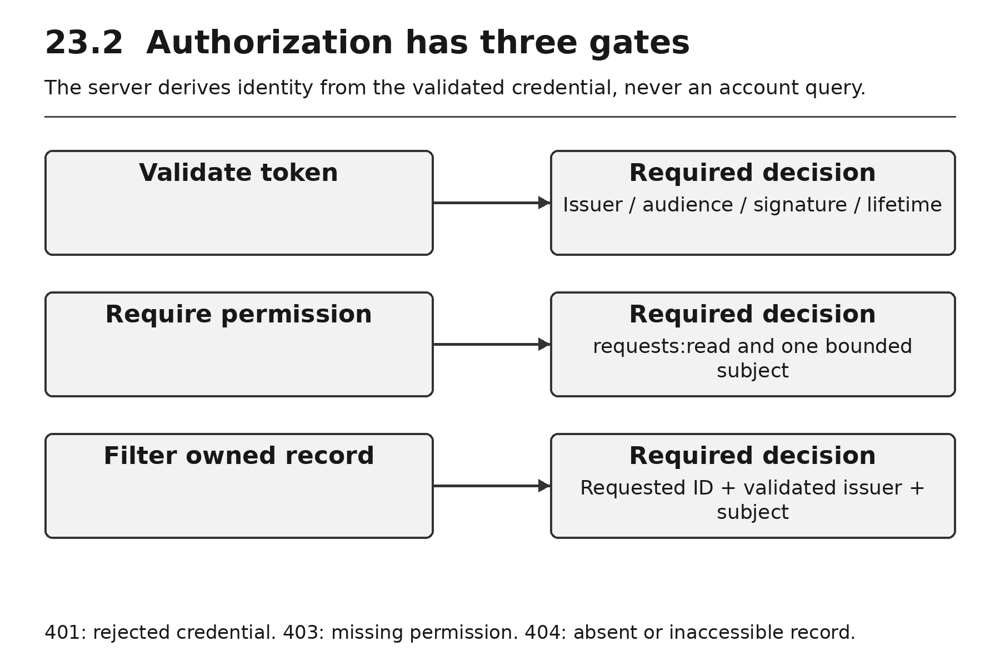

# Chapter 23
# Sessions, Secure Storage, and API Authorization

A customer signs in to Gnazzo's World, opens a private anniversary-song request, and returns later after the access credential has expired. The app should recover deliberately: obtain an appropriate credential when possible, ask for sign-in when necessary, and preserve the distinction between a local session and permission to read that request.

Chapter 22 introduced hosted sign-in and a process-local reader identity. This chapter adds a separate API session lab: SDK-backed access and refresh credentials, one platform-secured envelope, a bounded read client and an independently protected API route. The API does not trust a display name, an account label from a query string, or a client-side "signed in" flag.

The executable server starts with no customer records. Integration tests inject two fictitious requests and signed test credentials through the real JWT bearer middleware. That gives us repeatable evidence about token rejection, scopes and ownership without pretending that a test issuer is a live Auth0 tenant. Native storage, live renewal and provider revocation remain separate observations to complete.

## What You'll Learn

By the end of this chapter, you will be able to:

1. Acquire and restore API credentials without treating stored metadata as proof of authorization.
2. Serialize renewal, save rotated credentials before publication, and recover conservatively from an uncertain refresh.
3. Distinguish local clearing, browser logout, token revocation and account deletion.
4. Protect an API read with independent token validation, a required scope and issuer/subject ownership.
5. Verify failure paths with signed-token integration tests and explicit native/provider acceptance records.

**Prerequisites:** Chapters 17–22, the .NET 11 SDK selected by `global.json`, and familiarity with the existing API and test projects. The previous companion checkpoint is `9bba4ff0acaf7c7bdafee6c9541b1d2e733bdefe`. The Chapter 23 implementation begins at `50a5abf391e37fef04866c0528af4da195954354`; use the corrected source and executed results recorded in `docs/verification.md` if follow-up changes are listed. Native exercises additionally require the Chapter 22 development tenant and a trusted HTTPS API reachable from the device.

**What you will build:** `ApiSession`, a portable session coordinator; `MauiSessionVault`, a SecureStorage adapter; `Auth0SessionProvider`, an SDK adapter; `ProtectedRequestClient`, a bounded owned-read client; and `/api/v1/requests/{id}`, an authorized server read. The Session lab is separate from Chapter 22's process-only Account example. Existing favorites, request drafts and synchronization fixtures are not silently attached to the new identity.

## 23.1 Name the state and its owner

The word "session" can conceal several independent states. A reader may have an active browser cookie, an expired API access token, a valid refresh credential and no current in-memory identity projection. Clearing one layer does not automatically clear the others.

| State | Owner in this example | Relevant boundary |
|---|---|---|
| Hosted browser session | Identity provider and browser | Whether another login prompts for credentials |
| Access credential | Provider issues; client holds temporarily | Whether this API accepts its audience and claims |
| Refresh credential | Provider issues; secure envelope retains | Whether renewal is permitted and rotation succeeds |
| Local credential envelope | Platform storage adapter | Whether this installation can read or overwrite it |
| Request record | API's data boundary | Whether validated issuer and subject own this ID |
| Anonymous favorites and drafts | Earlier local teaching stores | No automatic account migration in this chapter |

The client treats access credentials as opaque. It uses the expiry returned by the SDK to decide when to attempt renewal; it does not decode a JWT to decide who may read a request. The API performs its own validation every time a protected read arrives.

A refresh credential has a different purpose from an access credential. It is sent only to the configured provider's SDK renewal path, not to the request-preview endpoint. The native session configuration binds the issuer, resource identifier and HTTPS API origin. A shared link or request ID cannot replace those addresses.

## 23.2 Introduce the session contract

The portable source is under `src/GnazzosWorld.Core/Identity`. `ApiSessionSettings` connects the Chapter 22 native identity settings to one API audience and one HTTPS origin. The teaching configuration accepts an HTTPS resource identifier and an origin with no path, query, user information or fragment.

`SessionGrant` contains the issuer, subject, audience, opaque access credential, optional refresh credential and expiry. Its `ToString` deliberately redacts credentials. The same is true of the access lease returned to the request client. This avoids an easy accidental disclosure through diagnostic interpolation, but does not make logging individual credential properties safe.

Two interfaces isolate the boundaries that differ between a portable test and a phone:

```csharp
public interface ISessionVault
{
    Task<SessionGrant?> ReadAsync(CancellationToken ct);
    Task WriteAsync(SessionGrant? grant, CancellationToken ct);
}
```

This is the complete storage contract from `ApiSessionSettings.cs`. A null write means a signed-out envelope. `ISessionProvider` beside it supplies interactive sign-in and refresh through the maintained provider SDK. Portable tests replace these interfaces explicitly; the application registers native storage and Auth0 adapters.

A returned lease carries both the access credential and the local session generation. The credential authenticates the request to the API. The generation decides whether the eventual result still belongs to the local session that initiated it. Neither replaces the other.

## 23.3 Store one bounded credential envelope

`SessionEnvelopeCodec.cs` serializes one versioned envelope with an 8,192-byte UTF-8 limit. It checks the schema and bounded fields before reconstruction. The envelope includes all credential fields needed by this small session, rather than writing access and refresh values under independent keys.

The native implementation, `src/GnazzosWorld.App/Identity/MauiSessionVault.cs`, uses MAUI SecureStorage. It never falls back to Preferences or an ordinary file when storage fails. Preferences holds only a nonsecret installation marker. The credential value belongs in the platform-backed entry.

Storing a whole envelope gives the application one write to await before exposing a renewed credential. It does not create a distributed transaction with the provider. A provider can accept renewal while the phone loses the reply, or the platform write can fail after the provider rotates the refresh credential. Those boundaries require an explicit recovery policy.

The adapter overwrites its session entry with a small signed-out marker for local clearing. It does not use a broad removal operation that could erase unrelated application secrets. If the write fails, the coordinator blocks current-process use and reports that cleanup needs attention. It does not claim that persistence was cleared.

### Installation and recovery are separate tests

On its first observed installation, the adapter overwrites this app's secure session entry before setting the nonsecret installation flag. That addresses the possibility of Keychain data remaining after an iOS reinstall. The existing Android manifest disables backup. These choices still need actual reinstall, restore and device tests; a Preferences flag is a lifecycle aid, not an authentication proof.

SecureStorage behavior differs by platform, including backup, retained Keychain entries and storage errors. Treat a portable memory vault as a contract double, not an encryption implementation. Keep the envelope small, handle unreadable values, and record native behavior on each target rather than copying one platform's result into another platform's row.

**Worked reasoning:** If overwriting a credential fails during sign-out, an older encrypted value may still exist. Blocking its use in the current process is useful, but a later process could encounter that value again. The truthful result is "local use blocked; stored cleanup incomplete," followed by a retry path. Neither successful encryption nor a redacted log message proves deletion.

## 23.4 Renew once and publish only after persistence


`ApiSession` uses an instance-owned semaphore around credential loading, sign-in, refresh and local persistence. Concurrent reads that find an expiring credential do not independently rotate the same refresh value. One performs renewal; the next sees the new saved state.

The example refreshes when the SDK expiry is within 60 seconds. That margin is a client policy, not a promise that the API accepts a credential until a particular instant. Device clocks can be wrong, and the API remains authoritative about acceptance.

A successful refresh must match the configured issuer and audience and retain the previous subject. Its expiry must be in the future. If the provider supplies a replacement refresh credential, the adapter uses it. A nonrotating configuration may return no replacement, in which case the existing refresh value is retained. Configure and verify the desired provider policy; do not infer that rotation occurred merely because the app asked for offline access.

The coordinator saves the replacement envelope before returning its access credential. If persistence fails, it does not publish the new credential and continue using the old refresh value. It enters a blocked recovery state. This is particularly important after rotation, because replaying an older refresh credential can have consequences at the provider.

The core of the ordering is visible in the complete `AcquireAsync` method:

```csharp
await PersistAsync(next, ct);
Check(attempt);
grant = next;
```

This is an excerpt. The surrounding method owns the semaphore, expected generation, SDK call, validation and failure handling. `Check` prevents a renewal that became obsolete during local sign-out from restoring the session after its storage operation completes.

### An uncertain refresh is not an ordinary GET retry

If the refresh attempt fails ambiguously, the provider may already have consumed or rotated the old credential. The example clears its local envelope and requires interactive recovery rather than automatically resending that credential. It applies this conservative policy to renewal failures and cancellation after an attempted exchange.

That policy trades convenience for a small, explainable state machine. A more elaborate implementation could use provider-documented recovery or reuse windows, but it must test those semantics explicitly. Chapter 17's bounded public GET retries do not justify blindly replaying a credential exchange or a customer transaction.

## 23.5 Keep sign-out and late results consistent

Local sign-out increments the session generation and blocks current leases before waiting for the renewal worker. Once the worker releases its gate, sign-out clears the in-memory grant and writes the signed-out marker. Successful cleanup permits a later interactive sign-in; failed cleanup remains actionable and blocked.

This does not guarantee that an SDK request or browser operation stops instantly. It guarantees that an obsolete completion cannot become a new lease or publish a request preview through the checked client. A credential already delivered to a server cannot be pulled back by changing a local integer.

`ProtectedRequestClient` checks the lease before sending, after receiving the response and before returning the validated preview. Thus a delayed response for an earlier account is not shown after local sign-out. A 401 rejection is also tied to its lease so that an older response cannot clear a newer session.

| Action | Implemented effect here | Separate effect not implied |
|---|---|---|
| Sign out locally | Invalidate leases and overwrite this app's credential entry | End the browser's hosted session |
| Browser/provider logout | Not implemented by this lab | Revoke every issued credential |
| Refresh-token revocation | Tested later with provider controls | Erase all local data or terminate every access token immediately |
| Account deletion | Not implemented here | Follow automatically from deleting a local envelope |

The Session lab's button says Sign out locally for that reason. Do not tell the customer they are signed out everywhere when the observed action affected only one installation. Chapter 25 develops the broader account lifecycle and data policy.

## 23.6 Attach a bearer credential to one bounded read

`src/GnazzosWorld.Core/Networking/ProtectedRequestClient.cs` exposes one operation: read a request preview by a bounded ID. It constructs the route from the configured HTTPS origin and an ID containing only the allowed characters. It does not accept an arbitrary download or redirect URL.

The native registration supplies an `HttpClientHandler` with automatic redirects disabled and a 20-second timeout. Authorization is attached to the individual `HttpRequestMessage`, never to shared default headers. Refresh credentials do not enter this path.

The response must be successful JSON, fit within 16,384 bytes, contain the requested ID and supply a bounded summary. A current-generation check occurs again before publication. These restrictions adapt the networking lessons from Chapter 17 to a private read; adding a bearer header is not a reason to remove body limits or stale-result ownership.

A 401 ends the corresponding current session and asks for sign-in. It does not assume that expiry was the cause or create an automatic retry loop. A 403 indicates a permission failure, while a 404 covers absent or inaccessible records under this API's ownership policy. Neither causes blind renewal. A redirect is treated as an unexpected status rather than followed with a credential.

The lab does not submit or retry a customer write. Later workflows must establish idempotency and authoritative state before deciding whether any operation can be retried. A read-only demonstration should not quietly become an order client.

## 23.7 Validate independently in the API



The API adds **Microsoft.AspNetCore.Authentication.JwtBearer 11.0.0**. Its configuration is in `src/GnazzosWorld.Api/Identity/ApiIdentity.cs`; middleware registration and the read route are in `Program.cs`. The provider authority and API audience are configuration values, not client secrets.

The validation parameters require a signed RS256 token with the expected issuer, audience, expiry and signing key. HTTPS discovery remains enabled for a configured authority. Claim mapping is disabled so policy code uses the original `sub`, `iss` and `scope` names. The sample uses a 30-second server clock tolerance and suppresses detailed authentication errors in responses.

The policy requires an authenticated principal, exactly one bounded nonempty subject and the `requests:read` scope. The request handler then queries its store using the validated issuer and subject along with the requested record ID. An account label supplied by the client does not replace those claims.

```csharp
var row = requests.ForOwner(id, context.User);
return row is null
    ? Results.NotFound()
    : Results.Ok(new RequestPreview(row.Id, row.Summary));
```

This route-body excerpt relies on `.RequireAuthorization(ApiIdentity.ReadPolicy)` in the complete mapping. Removing that requirement would change the boundary. Likewise, retaining the policy but looking up a record solely by ID would lose resource ownership enforcement. Both decisions need their own tests.

The running store is empty. Integration tests inject fictitious rows for reader A and reader B. There is no public customer-write endpoint, no test signing key registered in production, and no assumption that a development account's subject matches a fabricated customer. Future authenticated request creation will establish those ownership records through a controlled workflow.

## 23.8 Configure the provider and resource as a pair

Complete Chapter 22's live native-app setup before attempting the provider exercise. Add a development API registration with an HTTPS identifier and the `requests:read` scope. Enable offline access and the intended refresh policy only when needed, following current provider instructions. A requested scope is not automatically a granted permission.

Configure the API from the repository root using your real public registration values:

```powershell
$env:Identity__Authority = "https://YOUR-TENANT.us.auth0.com/"
$env:Identity__Audience = "https://YOUR-API-IDENTIFIER"
dotnet run --project src/GnazzosWorld.Api
```

The source requires both values or neither. Partial configuration fails startup instead of silently accepting another trust model. Without provider validation configuration, private reads do not accept the test suite's credentials; the public catalog remains independent.

In `AuthenticationConfiguration.cs`, opt into `ApiSession` using the native identity settings, the same audience and the trusted HTTPS API origin. `Current` remains the Chapter 22 process-only example. Signing into that older Account page does not populate the Session lab, and local clearing in one example does not claim to clear the other. They are teaching checkpoints with explicit boundaries; a later account UX must consolidate them deliberately.

Phone reachability and HTTPS trust require the device setup from Chapter 18 and later deployment work. Do not disable certificate validation to make a development endpoint appear reachable. The existing loopback HTTP smoke tests the public local listener, not a live phone-to-provider-to-API TLS journey.

A properly authenticated real reader will still receive 404 from the default empty request store. That is expected until an authorized fixture or actual customer workflow supplies a record for that validated issuer and subject. Do not add a public seeding endpoint that trusts an account ID merely to make a screenshot look successful.

## 23.9 Guided lab: verify sessions and ownership

The complete instructions are in `docs/labs/ch23-sessions-api.md`. Run portable and API checks from the companion root:

```powershell
$core = "tests/GnazzosWorld.Core.Tests"
$api = "tests/GnazzosWorld.Api.Tests"
dotnet build $core -c Release
dotnet run --project $core -c Release --no-build
dotnet build $api -c Release
dotnet run --project $api -c Release --no-build
```

1. Open `ApiSessionTests.cs`. Trace the memory vault through sign-in, expiry and reopen. Identify which tests check storage contracts and why they do not establish native encryption.
2. Read the concurrent-renewal case. Two callers encounter expiry; a controlled provider blocks the first. Predict the refresh count and the saved replacement before releasing it. Then run the test.
3. Inspect the rotation-write-failure and uncertain-refresh cases. Confirm that the first blocks credential use and that the second does not resend an ambiguous old credential after reopening.
4. Trace local sign-out while a refresh or request is delayed. Verify which generation owns the completion and when the signed-out marker reaches storage.
5. Open `RequestAuthorizationTests.cs`. Find the ephemeral RSA key and static metadata in the test factory. Confirm that requests still use the actual bearer handler, not a fake handler that simply asserts an identity.
6. Run the token-rejection and ownership cases. A valid reader-A credential can read A's fixture, but the same credential cannot read B's fixture. Changing a query-string account label cannot change that result.
7. Build the Android target separately. After configuring the live development environment, run the Session lab and complete the native matrix. Leave unobserved provider, device and TLS rows pending.

The test private key is generated in memory for each factory and exists only to exercise the server's real signature validation. It is not distributed as API signing material and cannot authenticate to the default unconfigured server. Passing these tests is stronger than mocking the authorization decision, but it remains a controlled issuer test rather than proof of real Auth0 discovery or issuance.

At this chapter's recorded source revision, Windows CI passed all 321 portable tests and 37 API integration tests. Android compilation completed with zero final compiler warnings or errors. See `docs/verification.md` for the linked runs and the unverified native/provider boundary.

## 23.10 Diagnose the correct failure

| Symptom | Inspect | Action under this contract |
|---|---|---|
| Several callers renew at once | Coordinator lifetime and semaphore ownership | Use one session coordinator per vault |
| Old refresh is reused after a lost reply | Whether a retry invented certainty about rotation | Clear locally and require interactive recovery |
| New access works until restart, then renewal fails | Rotation and persistence ordering | Save the whole replacement before publication |
| Sign-out reports storage failure | Whether the secure overwrite completed | Keep local use blocked; retry cleanup |
| Private read returns 401 | Token validation and current lease | End that current lease; ask for sign-in |
| Private read returns 403 | Granted scope and subject policy | Correct authorization; do not blindly renew |
| Private read returns 404 | Record ownership or empty store | Do not infer another customer's record exists |
| Older account content appears after switching | Lease generation at response publication | Reject obsolete results and review all other caches |

Use bounded diagnostic categories and appropriate correlation identifiers. Do not log access credentials, refresh values, raw envelopes or customer summaries. A fictitious fixture is useful in a worked example, but its logging pattern must not become a production stream of customer stories.

## 23.11 Record native and provider evidence separately

The native worksheet in the companion lab requires successful hosted acquisition, restart, renewal, cancellation, local clearing, restore/reinstall and provider-controlled revocation. Record source, packages, public tenant/API references, device, OS and sanitized observations. It must not contain passwords, tokens, OTPs or recovery codes.

Capture only actual native states using approved fictitious data: unconfigured Session lab, denied read, successful owned read and actionable storage recovery. Neither of this chapter's authored diagrams establishes native behavior. The default empty store also means a successful real login alone cannot supply an owned-request screenshot.

| Verification layer | Evidence supplied by this chapter | Remaining boundary |
|---|---|---|
| Portable session tests | Controlled rotation, storage failure and result ownership | Actual SecureStorage and provider behavior |
| Signed-token API tests | Bearer validation, scopes and resource ownership | Live issuer discovery and provider-issued credentials |
| Android compilation | Selected native SDK and adapter source compile | Installed-app secure storage and TLS behavior |
| Public listener smoke | Existing loopback catalog contract | Authenticated device-to-API end-to-end journey |
| Provider revocation exercise | Documented acceptance plan | Actual observed revocation and recovery |

The full customer journey remains pending until the live setup and device observations are recorded. That limit does not reduce the usefulness of the controlled tests; it tells the reader exactly which evidence is still needed.

## Chapter Summary

A dependable API session connects credential lifetime, storage and request ownership without treating any local label as server authorization. One coordinator serializes refresh, saves replacement credentials before publication and requires recovery when rotation becomes uncertain. Platform storage failures have explicit outcomes, including incomplete persistent cleanup. Generation-bearing leases prevent old completions from restoring a signed-out session or publishing another account's preview. The API independently validates signed credentials, requires a scope and filters records by validated issuer and subject. Signed-token integration cases exercise those decisions through real middleware; native storage and live provider behavior remain separate checks. The Session lab is read-only and does not migrate earlier favorites or drafts. Chapter 24 adds provider-supported MFA and recovery without confusing a locally stored session with a verified second factor.

## Exercises

### Guided exercise: the rotated credential was not saved

Read `Rotation_write_failure_blocks_use_until_cleanup_is_successful`. The provider has returned a new access and refresh value, but the vault throws. Should the caller receive the new access credential while the old refresh remains stored?

**Worked answer:** No. That would create a session whose next process may restore a consumed refresh value. The coordinator blocks use, exposes no replacement lease and requires successful local cleanup before interactive recovery. The test confirms no repeat refresh.

### Guided exercise: authentication is not ownership

Reader A has a correctly signed, unexpired credential with `requests:read`. They change the route from their anniversary request to reader B's birthday request. Which checks pass, and which decision still denies the read?

**Worked answer:** Token validation and the scope policy can pass. The store lookup still requires the requested ID to belong to the validated issuer and subject. B's record does not match A's identity and returns 404, just as a missing record does. A client-supplied account label cannot replace those claims.

### Independent extension

Design an account-transition policy for existing local favorites and unsent drafts. Specify consent, migration, cleanup failure, cached responses and in-flight operations. Add a reauthentication requirement for a sensitive action without interpreting an ordinary locally restored session as recent MFA. Keep remote revocation, browser logout and account deletion as distinct operations with separate observable outcomes.

## Native verification record

Use a disposable provider account and controlled request data. Record a real renewal and restart result for each target platform; a portable vault double cannot fill either row. Repeat local sign-out with an intentionally delayed read and an unavailable secure store. Document whether cleanup persisted, what the reader saw and whether old content remained inaccessible in the current process.

For provider revocation, use the provider's supported development controls and record the subsequent renewal failure and sign-in recovery. Do not claim that an access token vanished immediately simply because a refresh grant was revoked. Confirm provider policy and actual resource behavior before making a broader promise.

## Official references

- JWT bearer configuration: https://learn.microsoft.com/aspnet/core/security/authentication/configure-jwt-bearer-authentication
- Resource authorization: https://learn.microsoft.com/aspnet/core/security/authorization/resource-based
- MAUI SecureStorage: https://learn.microsoft.com/dotnet/maui/platform-integration/storage/secure-storage
- Refresh rotation: https://auth0.com/docs/secure/tokens/refresh-tokens/refresh-token-rotation
- Refresh revocation: https://auth0.com/docs/secure/tokens/refresh-tokens/revoke-refresh-tokens
- API scopes: https://auth0.com/docs/get-started/apis/scopes/api-scopes
- OAuth security practice: https://www.rfc-editor.org/rfc/rfc9700.html

The provider SDK remains the Chapter 22 pinned version. Consult the exact verification record for .NET 11 builds, test counts and limitations. Current provider documentation and earlier-target framework examples do not substitute for device or live-tenant observations.

## Editorial index terms

API session; access token; refresh token; rotation; uncertain renewal; SecureStorage; credential envelope; local sign-out; revocation; issuer; audience; subject; JWT bearer; RS256; scope; resource ownership; access lease; generation fence; signed-token integration test.
