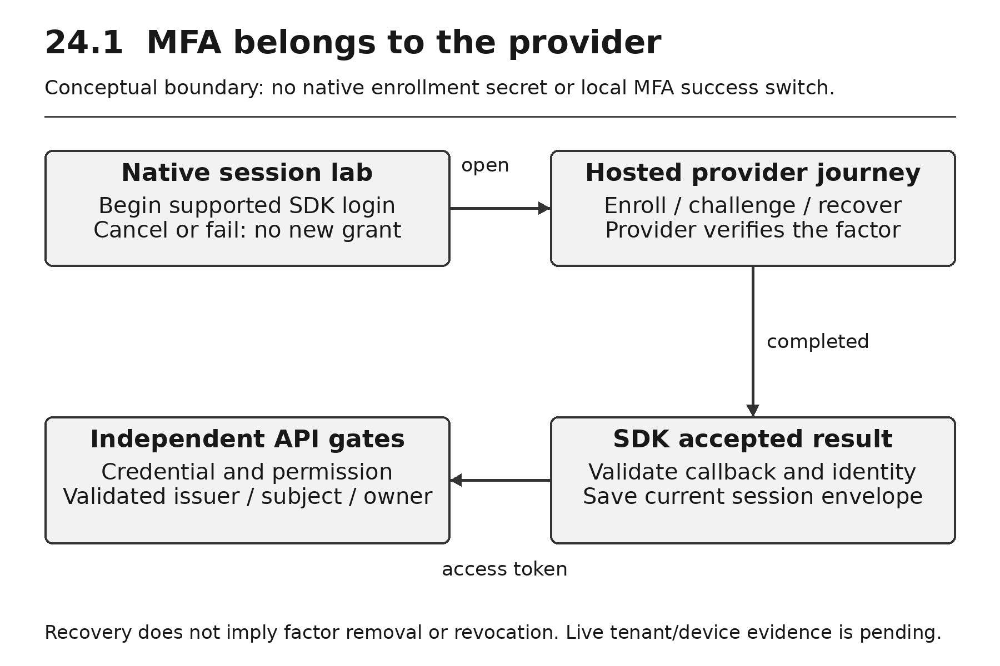

# Chapter 24
# Multifactor Authentication and Recovery

## What You'll Learn

- Keep enrollment, challenge and recovery inside the managed identity boundary.
- Configure a development MFA policy and distinguish it from factor availability.
- Plan lost-device recovery without confusing it with password reset or sign-out.
- Verify interruptions, recovery-code replacement and renewed sessions separately.
- Recognize the additional server work required for sensitive-operation step-up.

Prerequisites: Chapters 22 and 23, the supported Windows/Android toolchain and a disposable Auth0 development tenant. Start from companion implementation `50a5abf391e37fef04866c0528af4da195954354`; its verification record documents 321 portable cases, 37 API cases and Android compilation. This chapter adds a provider-configuration lab and acceptance worksheet at `docs/labs/ch24-mfa-recovery.md`. It does not introduce a custom authenticator or change the existing session implementation. No live tenant is configured in the distributable sample. All provider/device outcomes below are expected results to observe, not completed author observations.

## 24.1 Follow the customer beyond the successful login

A customer returns to Gnazzo's World to review an anniversary-song request. Yesterday the customer signed in successfully. Today the authenticator is on a phone that was lost during a trip. The request still belongs to the same account, but the customer cannot satisfy the usual challenge.

Three tempting shortcuts would damage the design. Changing a local account ID cannot establish identity. Resetting a password cannot establish possession of an independent factor. Copying an earlier token from a diagnostic log would turn an observation channel into a credential store. We need a supported recovery journey that restores access to the same provider identity while leaving the API's ownership check intact.

MFA is therefore a lifecycle feature. Decide how the customer enrolls, how later challenges work, how an interruption ends, how a replacement authenticator is established and how lost credentials are handled. A successful enrollment is only the first observation in that sequence. The customer also needs understandable help before reaching a dead end.

For this draft, public browsing remains available. The account-dependent request preview requires a valid session and the Chapter 23 API checks. Existing anonymous drafts and favorites are not silently attached to whichever account finishes recovery. Chapter 25 will address account data and lifecycle decisions.

## 24.2 Name the proof being requested

MFA combines different kinds of proof. A second password or a second question does not automatically add an independent factor. An authenticator-generated code demonstrates access to a shared authenticator secret; the provider verifies it. Our mobile application should not create that secret, compare codes or decide that a screenshot proves enrollment.

An operating-system biometric prompt can unlock a local application resource without authenticating an account to the server. WebAuthn is a different case: a supported authenticator participates in a relying-party-bound cryptographic ceremony. A biometric or PIN can activate that authenticator. Document the actual ceremony and provider policy before describing the resulting assurance. The mere appearance of Face ID in a journey does not answer that question.

| Mechanism | Useful distinction for this application |
|---|---|
| Authenticator code | Provider verifies the code; native code must not collect its seed |
| WebAuthn security key | Browser/provider compatibility and user-verification settings need testing |
| Local biometric unlock | Can protect device access; does not by itself grant API permission |
| Recovery code | Emergency account credential; keep it outside app diagnostics and fixtures |

Phishing resistance concerns whether a proof can be relayed to an impostor. Typing a short code into a convincing false page is different from an origin-bound WebAuthn ceremony. Factor choice also involves accessibility, hardware availability and loss recovery. A stronger primary factor with an unexamined recovery shortcut leaves an incomplete security story. Record the enabled alternatives as well as the preferred factor.

## 24.3 Keep the managed boundary visible



The existing `src/GnazzosWorld.App/Identity/Auth0SessionProvider.cs` calls the provider SDK. Its interactive path supplies the configured API audience. The SDK/browser path handles the hosted journey; the application does not receive each intermediate MFA screen as a successful login.

```csharp
var result = await Client.LoginAsync(
    new { audience = options.Audience }, ct);
ct.ThrowIfCancellationRequested();
if (result.IsError)
    throw new InteractiveSignInRequiredException();
```

This excerpt is from the complete Chapter 23 adapter, not a new MFA implementation. The surrounding method checks the subject and returns the grant. `ApiSession` coordinates persistence and generation ownership before callers use an access credential. `ProviderBrowser` and the SDK retain the native callback responsibilities explained in Chapter 22. Do not replace those pieces with a browser URL assembled from an error message.

Changing the tenant's hosted MFA policy can change what the customer sees during this existing interactive call. It does not add a native factor-management page, enrollment-complete flag or recovery-code store. The application still receives an accepted result, cancellation or failure. Its public catalog should remain usable after the latter two outcomes.

## 24.4 Configure a disposable MFA experiment

Complete the Chapter 22 callback setup and the Chapter 23 resource configuration first. Keep tenant administrators' own access and recovery separate from the disposable customer being tested. Do not use a production tenant for this exercise.

1. Open the development tenant's Security > Multi-factor Auth configuration. Record the application, connection, enabled factors and existing policy. Availability varies by subscription and tenant capability; mark unavailable features explicitly.
2. Enable an independent factor supported by the test equipment, such as the documented OTP factor. Enable recovery codes separately. Current provider documentation identifies recovery codes as disabled by default; verify the actual tenant setting rather than assuming the prompt will appear.
3. For an isolated interactive-login experiment, select the documented Always policy and save it. Record remembered-browser behavior. This makes the intended enrollment/challenge journey easier to inspect; it is not a production policy recommendation or a guarantee of a new challenge during every session operation.
4. Keep `AuthenticationConfiguration.Current` and `AuthenticationConfiguration.ApiSession` configured only with your development public identifiers as described in the preceding labs. No client secret or management credential belongs in the native application.
5. Use a disposable, previously unenrolled customer. Open the Session lab and start interactive sign-in. Complete the provider's enrollment and save the displayed recovery credential in a secure location independent of the test phone. Never put it in this repository, the worksheet or a screenshot.
6. Finish the hosted flow and observe the native return. Record which evidence proves enrollment, which proves SDK completion and which proves an API decision. The default API customer store is empty: a 404 can be expected after valid authentication and authorization when no owned record exists. It does not prove that a customer preview was displayed.

The lab is blocked at provider execution until a real development tenant is available. A reader can still inspect code ownership, prepare the worksheet and run existing portable/API regressions. Those activities are useful preparation; they do not establish MFA enrollment.

## 24.5 Repeat the challenge under controlled conditions

Enrollment is not a reliable substitute for a later challenge test. Begin a fresh hosted transaction and record whether an existing browser session or remembered-device setting changes the prompts. Local Session lab sign-out clears the app's credentials according to Chapter 23; it does not necessarily end the provider's browser session.

Use the provider's documented session controls or a controlled fresh browser context when isolating a new login. Do not claim that an application reinstall forces a new provider session. Test the configured browser return on each native platform, including the Back action, a canceled challenge and leaving the app while the authenticator is open.

Refresh is another separate experiment. The Chapter 23 background renewal path cannot present an interactive MFA screen. If the configured policy causes renewal to fail or demand interaction, the sample's recovery contract asks for interactive sign-in; it must not open repeated hidden challenges or silently weaken the policy. Record the real provider result. Retain that observation when deciding the production relationship between MFA policy, session lifetime and refresh behavior.

For the anniversary request, an interruption must not cause an old preview to appear under a new account. Use the existing session-generation checks and repeat the late-result scenarios after hosted recovery. A provider challenge does not replace those client data-ownership rules.

## 24.6 Recover when the authenticator is unavailable

Use the provider-hosted recovery option for the disposable account. The recovery credential is entered into that hosted journey, not a new MAUI form. Auth0 documents a replacement recovery code after successful use in its supported flow. Save the replacement securely and test that the consumed credential cannot be reused in a fresh recovery transaction. Record the actual behavior of this tenant and factor combination.

Recovery restores an authentication opportunity. It does not prove that the lost authenticator was removed, that every refresh token was revoked or that a previously issued access token has stopped working. Treat these as separate operations with separate observations. A short-lived access token may remain usable until expiry unless the resource server implements another revocation mechanism.

Next plan factor replacement. If a supported authenticated factor-management experience is configured, add and verify the replacement before removing the old factor, where the provider permits that sequence. This sample does not ship such a page. For the bounded development lab, use the documented administrator reset for the disposable customer and then repeat hosted enrollment. Reset removes MFA registration; it is a privileged operation, not a public recovery endpoint.

When both authenticator and recovery credential are unavailable, route to a defined support procedure. An email address typed into a form is insufficient authority to reset another person's factors. A production procedure must define identity verification, least-privilege operator access, audit events and notifications. Do not let the mobile client call the Management API using an embedded administrative token. Do not delete and recreate the customer to simulate recovery: doing so can change the stable identity that owns the anniversary request.

## 24.7 Separate ordinary MFA from sensitive-operation step-up

Suppose a later feature allows changing the delivery destination for a finished custom song. A valid session may be adequate for reading a request while policy requires recent stronger authentication for that change. This is a server authorization requirement, even when the interface starts the challenge.

Auth0 documents an API step-up pattern using sensitive scopes, access tokens and Actions. An ID token displayed by the mobile client is not an API access credential. A client-side `MfaComplete` flag, an `acr_values` request or a new token issue time alone cannot establish the server's required assurance. Define which trusted evidence the server accepts, how freshness is measured, and how a refreshed token relates to the original authentication event.

Before implementing a sensitive write, specify four decisions: the resource and owner, the required permission, the provider-guaranteed assurance/freshness signal and the operation's replay policy. If any required signal is absent or untrusted, deny the operation. If the product requires one approval per change, the API must persist and atomically consume an operation-bound authorization; an ordinary bearer token is not inherently single use.

This chapter does not add that write route or claim step-up enforcement. Chapter 23's signed-token tests prove its existing read authorization contract only. A future implementation needs both denied and allowed API cases plus observed provider issuance. This boundary lets us teach the design without quietly granting new customer powers.

## Guided Lab: record a lost-device journey

Use `docs/labs/ch24-mfa-recovery.md` in the companion repository. Keep one source revision, one tenant policy revision and one disposable account throughout the first run.

1. Record the source, package versions, device/OS, callback and enabled factors. Use a nonsecret account alias in the worksheet; never record recovery codes or raw tokens.
2. Enroll the disposable user through the Session lab's hosted flow. Observe return, local persistence and the independent API result.
3. Repeat from a fresh hosted transaction with an incorrect factor response. Stop after a bounded attempt. Confirm no new session is accepted from the failed transaction.
4. Cancel a new challenge, return to public browsing and start a deliberate retry. Observe native focus and whether the action is reachable with larger text and a screen reader.
5. Simulate authenticator loss by choosing hosted recovery without using that authenticator. Save the replacement recovery credential outside the worksheet. In a fresh transaction, verify rejection of the consumed credential.
6. Follow the development administrator reset/re-enrollment procedure for the same disposable account. Record whether its validated issuer/subject is unchanged. Investigate a change before allowing access to earlier owned records.
7. Test renewal and local sign-out independently. Record which remote credentials remain valid; do not infer revocation from a local confirmation message.

Stop on a subject mismatch, unexplained bypass or failure to return safely to browsing. Retain sanitized evidence and the failing scenario. Do not repeatedly change multiple policies until something appears to work; that destroys the experiment's explanatory value.

## Troubleshooting

| Symptom | Diagnostic check and corrective action |
|---|---|
| Factor enabled but no challenge | Inspect enforcement policy and hosted browser session; enabling a factor alone is insufficient |
| Recovery option absent | Verify recovery-code setting and supported factor/flow; do not invent a local bypass |
| Code repeatedly rejected | Check selected account and device clock; start a fresh bounded transaction and inspect sanitized provider events |
| Browser finishes but app stays busy | Compare exact callback registration and platform return; use Chapter 22 native checks |
| Renewal fails after policy change | Observe SDK/provider outcome; require deliberate interactive sign-in rather than relaxing policy |
| API denies after successful MFA | Check issuer, audience, scope and owner independently; MFA does not grant every permission |
| Lost factor still works after recovery | Recovery and factor removal are different; use supported replacement/reset and test again |

Keep diagnostic messages actionable without echoing the submitted factor response. Record a scenario identifier, result category and a safe correlation reference under restricted access. Authentication URLs, tokens, QR provisioning material and recovery credentials do not belong in routine telemetry. Capture native screenshots only after verifying that the page contains no secret or personal account data.

## Verification record

| Evidence | Status at this chapter draft |
|---|---|
| Existing session and API regression results | Historical Chapter 23 evidence; application source unchanged here |
| Current provider documentation | Reviewed for configuration, recovery, reset and step-up boundaries |
| Real enrollment, later challenge and recovery | Pending development tenant and native observations |
| Replacement factor and consumed-code rejection | Pending; no result inferred from documentation |
| iOS return, accessibility and screenshots | Pending platform/device work |
| Sensitive-operation step-up endpoint | Design discussion; not implemented |

## Chapter Summary

MFA adds a managed authentication journey whose recovery path matters as much as its first challenge. The provider owns enrollment, factor verification and recovery credentials; the native application owns safe interruption and session publication; the API owns permission and record access. Factor availability differs from enforcement policy, local biometric unlock differs from an account ceremony, and recovery differs from factor removal or token revocation. The guided lab follows one disposable customer through enrollment, cancellation, lost-device recovery and re-enrollment while preserving stable identity. Its worksheet records expected and observed outcomes separately. The existing session and API code remains the integration point, with live MFA and native behavior still pending. Chapter 25 continues into profiles, privacy and the lifecycle of account-owned application data.

## Exercises

### Worked exercise: the misleading success message

A customer recovers through the hosted flow and sees an empty request preview. A developer proposes showing “MFA complete; your requests are restored.” What evidence is missing?

**Worked answer:** An accepted provider result can establish authentication under the configured policy, but a 404 from the empty teaching store does not establish request restoration. Confirm current session ownership and the API's authorized record response before describing data as restored. The app should explain the actual absence of a request without exposing another account's records. Repeat this check after switching accounts while an earlier read is delayed.

### Worked exercise: the lost phone still has access

A user saves a replacement recovery code, but an earlier API credential remains accepted. Does this prove recovery failed?

**Worked answer:** No. Recovery-code consumption and access-token validity are distinct contracts. Determine whether the old factor, browser session, refresh grant and access credential were each invalidated under the intended policy. If immediate cutoff is required, design and test that server capability explicitly; a local sign-out or successful recovery cannot establish it.

### Independent extension

Write acceptance scenarios for changing a song's delivery destination. Include a stolen ordinary token, missing permission, expired assurance, replayed operation, another owner's request and canceled challenge. Identify which cases need server enforcement and which require real provider/device observation. Do not implement the privileged route until its trusted evidence contract is specified.

## Official references

- Auth0, MFA overview and factor availability: https://auth0.com/docs/secure/multi-factor-authentication
- Auth0, tenant factor and enforcement setup: https://auth0.com/docs/secure/multi-factor-authentication/enable-mfa
- Auth0, recovery-code configuration: https://auth0.com/docs/secure/multi-factor-authentication/configure-recovery-codes-for-mfa
- Auth0, customer MFA reset and recovery: https://auth0.com/docs/secure/multi-factor-authentication/reset-user-mfa
- Auth0, WebAuthn as MFA: https://auth0.com/docs/secure/multi-factor-authentication/webauthn-as-mfa
- Auth0, API step-up architecture: https://auth0.com/docs/secure/multi-factor-authentication/step-up-authentication

Index: MFA; recovery code; enrollment; factor replacement; WebAuthn; local biometrics; step-up; authentication assurance; refresh; lost device.
