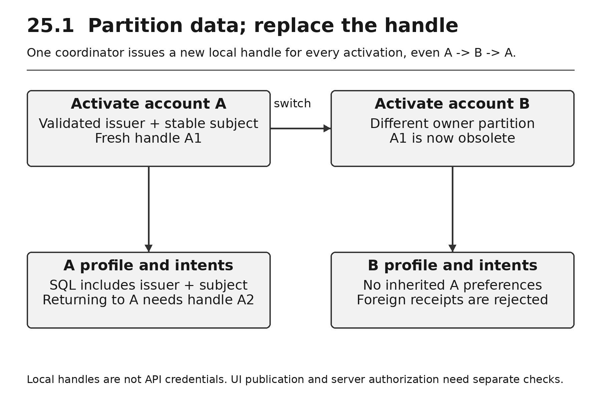

# Chapter 25
# Profiles, Privacy, and Account Lifecycle

A customer finishes recovering access to Gnazzo's World and changes the display name used in account settings. Later, another family member signs in on the same tablet. The second person must not inherit the first person's synchronization choice, export document or unfinished removal request. Identity is useful only when the data surrounding it has equally clear ownership.

This chapter builds a portable account-workspace lab with real SQLite persistence. It saves profile preferences by issuer and subject, invalidates obsolete workspace handles, creates a deliberately limited local export and records durable export/deletion intent. Explicit simulated receipts let us examine reauthentication, delayed acceptance, retry and local cleanup. No real account is deleted by this lab. That boundary gives us executable recovery behavior while the managed-provider and production-service integration remains pending.

## What You'll Learn

1. Partition preferences by stable account identity rather than display name or email.
2. Preserve explicit synchronization choices and protect them against stale editors.
3. Distinguish local export, service export, local sign-out and full account deletion.
4. Persist a request identity across timeout/restart and reconcile monotonic status.
5. Verify account switching, failure rollback and local removal without claiming remote erasure.

**Prerequisites:** Chapters 19–24 and the pinned .NET 11 toolchain. Start with companion checkpoint `d1d4ec6d209778d775d6489efc9474be10100285`; the Chapter 25 executable implementation is `3309637a8abc06ecf1e65fafd1bec32afbbe315b`. Read `docs/verification.md` for any corrective revision and its actual results. Portable work does not require a mobile workload. Native/provider acceptance additionally requires the earlier development tenant, trusted device-facing API and real device checks.

**What you will build:** `AccountWorkspace` in the portable core, `AccountWorkspaceTests`, the `GnazzosWorld.AccountLab` console sample and `docs/labs/ch25-account-lifecycle.md`. The lab uses its own database and fictitious owners. It does not attach existing anonymous favorites, song-request drafts or synchronization replicas to a signed-in account. There is no new native settings page or public lifecycle API in this milestone.

## 25.1 Decide which information belongs to which system

A provider profile and an application profile serve different purposes. The provider establishes an identity and manages its supported credentials. Our application can let the customer choose a display name and product preferences without turning that editable text into authentication evidence. A renamed customer remains the same owner of the anniversary-song request.

The local partition key is the validated issuer and stable subject together. Email can change, be shared in a demonstration or differ across identity systems. A subject is meaningful within its issuer. Two providers returning the same subject text do not thereby identify the same customer.

| Information | Owner and meaning in this chapter |
|---|---|
| Issuer and subject | Local partition derived from trusted authentication in a future integration |
| Display name | Editable presentation text; grants no permission |
| Synchronization choice | This account's optional product preference |
| Order-notification choice | Product setting; separate from OS permission and delivery registration |
| Access/refresh credentials | Chapter 23 session vault; absent from the workspace database |
| Export/removal operation | Durable intent and receipt for one owner and operation kind |

`AccountOwner` validates the shape of its input and redacts its diagnostic string. It does not authenticate anyone. The console creates fictitious owners directly to make the experiment repeatable. A production composition must construct the owner from a validated current session and retain independent server authorization. Accepting arbitrary account text from a route or form would undo the boundary.

## 25.2 Partition storage and invalidate old work



`WorkspaceLease` is an instance-local object with an internal constructor. `Activate` returns a new object every time; `Check` accepts only the object that the coordinator currently owns. Equality of owner text does not make an older object current again. This protects against an old operation returning after A-to-B-to-A switching.

```csharp
public WorkspaceLease Activate(AccountOwner owner)
{
    ArgumentNullException.ThrowIfNull(owner);
    lock (gate)
    {
        ObjectDisposedException.ThrowIf(disposed, this);
        return current = new(owner);
    }
}
```

The complete implementation serializes local operations through one lock and one SQLite connection. SQL reads, updates and removal predicates use both issuer and subject as parameters. A handle from another coordinator is rejected even when its owner text matches. `Detach` invalidates the active handle without deleting saved preferences.

This is one in-process coordinator, not a multi-process lock protocol. The file has an initial lab schema and does not migrate the earlier application database. SQL partitioning protects correct application access; it is not encryption against a person who can read the database file. Use fictitious data in the lab. Native file protection, backup behavior, migrations and key management require their own implementation and observations.

An immutable snapshot can still be published too late by a careless interface. After asynchronous work, a future native page must check `IsCurrent` and publish on its owning UI dispatcher in the same serialized UI action. Do not check before an `await` and assume the result still belongs to the visible account. This lab tests store access and receipt application; it has no native dispatcher to verify.

## 25.3 Save a preference with its expected revision

`ProfilePreferences` contains a display name, a synchronization choice and an order-notification choice. A new account begins with both optional choices off. `ProfileSnapshot` adds a revision and the synchronization notice/version timestamp. The UI should explain what enabling the choice will do before saving it.

```csharp
var lease = workspace.Activate(ownerA);
var before = workspace.ReadProfile(lease);
var after = workspace.SaveProfile(lease,
    new("Anniversary reader", true, false),
    before.Revision);
```

This is a lab call; `ownerA` is a fictitious partition. In the application, derive the owner from the accepted session. `SaveProfile` validates bounded display text and compares the expected revision with the persisted row before writing. A stale editor is refused instead of overwriting a newer privacy choice. Ask the reader to reload and make a deliberate choice; do not automatically retry an old preference with the newest revision.

The row write is one SQLite statement. The implementation increments its revision only when that statement succeeds, so a failed write cannot publish a success snapshot. One-coordinator serialization makes the preceding revision comparison meaningful for this lab. A backend or multiple independent writers would need an atomic compare-and-update contract; copying this lock into each process would not provide it.

The display-name bound prevents unbounded storage and control-character diagnostics. It does not make arbitrary text safe for every destination. Native labels, HTML, log messages and export formats have different rendering rules. The JSON serializer owns JSON escaping; the name remains personal content that should not be copied into routine logs.

## 25.4 Record a synchronization choice without overstating it

The draft notice identifier is `sync-draft-2026-11`. Enabling synchronization records that identifier and an injected UTC clock value. Renaming the profile while leaving synchronization enabled preserves the original timestamp. Turning it off clears the current enabled-choice evidence. Enabling it again records the new choice time.

`CanSynchronize` requires an enabled preference, the current notice identifier, a recorded timestamp and no deletion intent for that account. It is a decision for whether new work may start. It does not send data, delete earlier uploads or cancel an already accepted request. The existing Chapter 21 replica lab remains separate.

When a future worker uses this gate, check it at dispatch rather than only when constructing a job. A customer may withdraw the choice while the job is waiting. For already-sent work, coordinate the service's data policy and an explicit cancellation/reconciliation contract. A local Boolean cannot reach back through the network and reverse a committed server write.

The stored choice is also not a complete legal consent history. This chapter does not decide the legal basis for every business record or prescribe retention periods. It demonstrates a product preference with a versioned explanation. A production design must identify which processing is optional, which records serve other purposes and what changes when the explanation is revised.

## 25.5 Keep notification choices distinct from permission

Order notifications in this lab are only a saved product preference. They do not register a push token or call an OS permission API. A customer can want an order update while the operating system denies notification delivery. Conversely, granted platform permission does not establish that the customer requested every kind of message.

For the future delivery feature, define separate decisions: the account's category preference, the device's current permission, the device-registration owner and the server's sending policy. Switching accounts on a shared tablet must not silently leave the previous account associated with the device registration. Signing out must stop inappropriate delivery and visible previews under the chosen policy.

A provider may deliver a push already queued before a preference change. Avoid promising instantaneous recall of every message. Explain which new sends stop, how registrations are removed and what the platform can still display. Chapter 30 will supply the native integration; no notification delivery is established by these profile tests.

## 25.6 Export exactly the scope you advertise

`ExportLocalProfile` serializes a small envelope with schema 1, scope `chapter25-local-profile` and the current profile snapshot. It excludes other accounts, issuer/subject identifiers and session credentials. Its scope label is part of the contract: the output is a local profile document, not all data associated with an account.

```csharp
var json = workspace.ExportLocalProfile(lease);
```

The console verifies the result without printing it. A saved export would contain the display name and preferences; treat it as personal data. Do not automatically send it to a log, analytics service or shared folder. The native save/share destination, cancellation and cleanup behavior are still pending.

A real service export has a broader inventory. It may need request drafts, completed requests, deliveries, favorites, progress and declared retained records. Its API must authenticate the requester, authorize the owner, bound the generated artifact and protect later retrieval. If asynchronous delivery uses a link, define expiry and access controls. A hard-to-guess URL alone should not become an undocumented account credential.

The lab can also queue an `Export` intent to teach durable operation identity. It does not generate a remote download or implement a server export worker. Keep the two actions visibly distinct when mapping a future settings page.

## 25.7 Persist intent before an uncertain network call

The deletion button begins a workflow. It does not prove that every system has already removed the account. First persist a local intent with an operation ID. The lab stores one row for each issuer/subject/kind combination, so queueing the same kind again returns the same operation ID, including after closing and reopening the file.

```csharp
var operation = workspace.QueueRequest(
    lease, LifecycleKind.Deletion);
// A future authenticated transport sends operation.Id.
// No transport or remote mutation is performed here.
```

If a future transport loses the reply after the service accepted the request, retry or query status using that same ID. The server must independently bind the ID to the authenticated owner, kind and canonical request. Client persistence alone does not provide server idempotency.

The bounded lab keeps one operation per owner/kind. It deliberately does not support repeated exports after completion, deleting a deletion request, scheduling removal or recreating the same local account after completion. Those need additional state transitions and retention decisions. Identify the limit before extending the schema rather than overwriting a receipt and losing the ability to reconcile the old operation.

Deletion intent immediately freezes local profile edits, new local exports and synchronization eligibility. That protects this workspace while the result is uncertain. It does not freeze remote writes or other devices. A production service must enforce an account lifecycle state on its write paths and synchronization ingestion to prevent later resurrection.

## 25.8 Reauthenticate at the authority that accepts the request

The service may require recent authentication before accepting export or deletion. Chapter 24 explains provider-supported step-up and assurance. In this lab, `ReauthenticationRequired` is an explicit simulated receipt that drives local status; setting the enum does not authenticate the customer.

A future client must run the supported hosted flow, preserve the intended operation ID and send a credential satisfying the service policy. The service validates ownership, permission and any required freshness/assurance independently. A recent token issue time is not automatically a recent interactive authentication. A local success flag cannot authorize an administrative user-deletion call.

If the customer cancels the challenge, keep the request in an actionable state and preserve public browsing. Do not loop hidden authentication or manufacture a fresh operation whenever the customer retries. If recovery returns another identity, refuse to apply that result to the earlier account's request. The customer must deliberately resume the appropriate account workflow.

The lab has no reauthentication adapter and no privileged server mutation. Its tests establish local state handling and receipt ownership. Real provider proof and server enforcement remain acceptance work, not deductions from the enum.

## 25.9 Separate accepted processing from completed removal


`ApplyReceipt` first checks the current handle, operation kind and exact operation ID in the current owner's partition. A delayed receipt for A cannot be applied while B is active. Returning to A requires a fresh handle and reconciliation of the persisted operation. Older or duplicate receipt states cannot regress an accepted/completed result.

The stages are `Queued`, `ReauthenticationRequired`, `Accepted` and `Completed`. Their order is a deliberately small local model. Real services may need retryable failure, rejection, scheduled work or partial downstream completion; do not force those conditions into an inaccurate “completed” label. Here, a missing reply leaves intent queued and a local exception leaves the prior committed state intact.

For deletion completion, a SQLite transaction removes that owner's profile and export-intent row while advancing the deletion receipt. If the local purge fails, the transaction rolls back. The profile and earlier receipt survive so the same operation can retry. The rollback test injects an aborting SQLite trigger to verify this behavior with a real file.

The deletion receipt retains issuer, subject, operation ID and status. That marker prevents this lab from recreating a removed profile on a late write, but it is still retained account-linked information. The sample has no receipt-expiry policy, encrypted database or physical-erasure mechanism. Do not describe it as complete privacy deletion. A production receipt must have a defined purpose, protected access and an explicit retention/removal policy.

## 25.10 State what sign-out and deletion each promise

| Action | Effect established here | Separate work |
|---|---|---|
| Detach workspace | Old local handle stops accessing this coordinator | Session-vault clearing and native UI reset |
| Chapter 23 local sign-out | Its credential-envelope contract | Provider SSO, remote grant revocation and this workspace composition |
| Queue deletion | Durable local intent; local edit/sync freeze | Service acceptance and other-device enforcement |
| Apply accepted receipt | Pending status; profile retained | Worker completion and downstream cleanup |
| Apply completed deletion receipt | Transactional local row removal and retained marker | Provider identity, remote data, backups and physical storage |

Deletion spans systems that cannot share one SQLite transaction. A service worker needs durable progress and idempotent steps for its databases, identity-provider actions and external processors. If one step fails after another succeeds, resume from recorded progress rather than restoring an account merely to make the operation appear atomic.

Deleting a provider user does not establish removal of application records that live elsewhere. Clearing a local profile does not establish revocation of an access credential. Backups can reintroduce data unless restore procedures reapply removal policy. Billing/subscriptions require their own handling and accurate explanation. Publish a completion message only for the scope actually verified, including any disclosed retention.

Current Apple guidance calls for account-deletion initiation within apps that support account creation, with clear handling of delays. Google Play guidance includes an in-app path and an external deletion resource for applicable account-creation flows. These are release requirements to review against the final product; this portable lab supplies neither a finished native path nor a production web resource.

## Guided Lab: switch, interrupt and reconcile

Follow `docs/labs/ch25-account-lifecycle.md` from the companion root. The commands use the SDK in `global.json` and leave live accounts untouched.

```powershell
dotnet build tests/GnazzosWorld.Core.Tests -c Release
dotnet run --project tests/GnazzosWorld.Core.Tests `
    -c Release --no-build
dotnet run --project samples/GnazzosWorld.AccountLab `
    -c Release
```

1. Inspect the sample's unique temporary directory and fictitious owner A/B definitions. It removes the directory on normal completion. After process termination, remove only that sample-created directory if one remains.
2. Save A's profile with synchronization enabled. Confirm eligibility; export only A's local profile without printing personal content.
3. Activate B. Confirm an empty profile and rejection of A's obsolete handle. Return to A with a fresh handle and confirm the saved profile remains.
4. Queue deletion, then repeat the queue call. Confirm the same ID and blocked synchronization. In the restart test, reopen the file before repeating the call.
5. Observe the explicitly SIMULATED reauthentication and accepted receipts. The local profile remains; no remote account has been touched.
6. Observe simulated completion and B's unaffected profile. Examine the rollback test to see why completion and purge commit together.
7. Read the final scope message. Record portable behavior separately from provider, native or full-erasure observations.

Expected console checks report `True` for A eligibility, empty B, obsolete-handle rejection, pending-removal blocking, stable retry and unaffected B. The final simulated local receipt is `Completed`. These are assertions about this fixture, not screenshots of a mobile settings page.

## Troubleshooting and diagnostics

| Symptom | Diagnostic check and correction |
|---|---|
| Another account's name appears | Inspect owner predicates and stale UI publication; never use a global last-profile cache |
| Choice changes disappear | Compare editor revision; reload rather than retrying an obsolete save blindly |
| New request ID after restart | Inspect durable operation lookup; retry the existing owner/kind operation |
| UI says deleted after acceptance | Map accepted to pending; reserve completed text for verified scope |
| Old callback restores data | Reject obsolete handle and mismatched receipt; enforce lifecycle state at the server too |
| Purge fails locally | Preserve committed receipt and retry; do not overwrite the failure with success |
| Profile export omits requests | The local scope is intentional; build and verify a separate complete service export |

Log operation category, safe status and a restricted correlation reference. Do not log profile exports, customer song stories or authentication material. Issuer/subject and operation IDs can be linkable identifiers; use them only under an explicit diagnostic access/retention policy. Exceptions shown to the customer should name the recovery action without leaking SQL, paths or raw provider replies.

## Verification and native follow-through

At source `3309637a8abc06ecf1e65fafd1bec32afbbe315b`, the Windows portable Release build has zero warnings/errors and all 345 cases pass, including 24 new workspace cases. The API/probe builds are also clean, with 37 API cases and the public loopback smoke passing. Android Debug compilation succeeds, with zero final compiler warnings/errors and the earlier documented SDK dependency-setup warning. Both console labs execute successfully. The portable tests exercise real SQLite files, restart persistence, partition isolation, stale handles/revisions, choice withdrawal, scoped export, stable retries, foreign receipts, delayed acceptance, completion ordering and purge rollback. `docs/verification.md` records the executed revision and totals. API and Android checks establish their own compilation/regression boundaries; they cannot certify a settings journey that is not wired into the native app.

Native completion still needs composition with the accepted session and vault sign-out, accessible settings controls, interruption handling and account-switch clearing. Server completion needs authenticated lifecycle endpoints, real assurance enforcement, status reconciliation, complete export delivery, multi-device write blocking and verified downstream deletion. Provider, OS notification, backup and store-submission evidence remain separate. The chapter's worksheet names these pending checks so the portable lab does not become an accidental production claim.

## Chapter Summary

Account lifecycle design joins stable identity, owned data and precise promises about unfinished work. The workspace partitions preferences by issuer and subject, issues a fresh handle for each activation and refuses stale editors before they overwrite newer choices. Synchronization eligibility records an explicit current preference while leaving already-sent work to a separate service contract. Local export advertises its limited scope. Durable operation IDs support retries after uncertainty, and receipts distinguish reauthentication, acceptance and completion. A transaction commits local profile removal with its receipt, while rollback preserves a recoverable state. The retained marker and untouched remote systems limit the deletion claim. Chapter 26 uses these ownership, transport and storage boundaries to build a focused threat model and security-verification plan.

## Exercises

### Worked exercise: A returns after B

A starts deletion, B signs in, and A's delayed completed receipt arrives. The interface passes B's current handle with A's operation ID. What should happen?

**Worked answer:** Receipt lookup uses B's partition and requires the exact matching operation. The call is rejected and B remains unchanged. A's durable request remains available for later reconciliation after A is deliberately activated with a fresh handle. Merely returning to the same subject text does not validate the original handle. The service must apply the equivalent owner check independently.

### Worked exercise: remote removal succeeded, local purge failed

The service reports completion, but deleting local profile rows raises a storage error. Should the client create another deletion job?

**Worked answer:** No. Keep the same operation ID and retry local reconciliation. The transaction must not mark the local receipt completed while retaining a profile that the interface reports as removed. The injected-trigger test verifies rollback and successful retry. Explain local cleanup failure without suggesting that a new server request is necessary or that remote data was restored.

### Independent extensions

1. Design a repeat-export feature. Specify which fields distinguish a new request from a retry, how a previous export expires and how deletion invalidates delivery. Keep operation ownership explicit.
2. Design a native account-switch journey at large text size. Include a delayed profile load, failed secure sign-out, a pending removal receipt and an OS notification arriving for the prior account. Identify the observation required for each promise.
3. Inventory the data for a custom-song order across local stores, API tables, file storage, payment records and provider identity. Define which owner completes each removal step and which retention decisions need review. Do not invent a universal retention duration.

## Official references

- Apple, account-deletion guidance: https://developer.apple.com/support/offering-account-deletion-in-your-app/
- Google Play, account-deletion requirements: https://support.google.com/googleplay/android-developer/answer/13327111
- Auth0, step-up architecture: https://auth0.com/docs/secure/multi-factor-authentication/step-up-authentication
- Microsoft, SQLite transactions: https://learn.microsoft.com/dotnet/standard/data/sqlite/transactions

Index: profile; issuer and subject; account switching; synchronization consent; notification preference; export; deletion request; reauthentication; idempotency; lifecycle receipt; rollback; retention.
