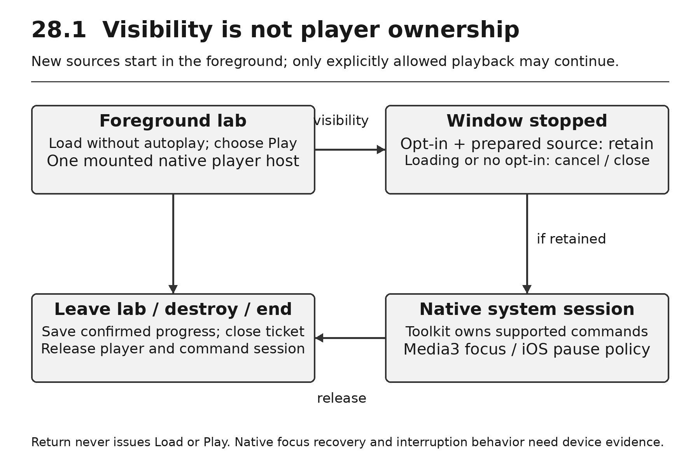

# Chapter 28
# Background Playback and System Controls

A Minnesota Bob listener starts an episode in Gnazzo's World, puts the phone in a pocket and opens another application. The listener expects the sound to continue only after choosing that behavior. When headphones disconnect, the episode should not suddenly speak through the phone's loudspeaker. When a call interrupts listening, returning to the application should not surprise the listener with an automatic restart.

Chapter 27 established source tickets, observed positions and local checkpoints. This chapter adds another boundary: the operating system can control a native player while our visible buttons are unavailable. A page timer cannot grant background execution, and a notification is not proof that the application will survive termination. We will make ownership explicit, delegate supported remote commands to the existing native session and keep the promises small enough to verify.

## What You'll Learn

1. Distinguish foreground application visibility from an Android foreground service.
2. Retain a mounted native player during an explicitly permitted background interval.
3. Route audio focus and output disconnection through the native player rather than competing application handlers.
4. Publish appropriate metadata and observe system play, pause and seek operations.
5. Design interruption, cancellation and device acceptance checks without assuming automatic recovery.

**Prerequisites:** Chapter 27 and its corrected source checkpoint, listed in `docs/verification.md`. The sample retains .NET 11, MAUI 11 and `CommunityToolkit.Maui.MediaElement` 12.0.0, with Android API 26 as the minimum. iOS work requires a compatible Mac and device; this chapter does not claim an iOS build or a native listening result.

**What you will build:** a separate background audio lab, `BackgroundPlaybackOwner`, a Media3 focus-aware handler, an iOS pause-only interruption monitor and a longer original timing fixture. The lab owns one mounted player and its system session. Its internal browse panel can appear without replacing the player host. Leaving the lab through Shell navigation or destroying its window releases playback. This is a deliberate teaching scope, not application-wide playback across arbitrary pages.

## 28.1 Give continuation an owner

The word foreground has two different meanings here. Our application is in the foreground when the listener is using its visible window. An Android foreground service is a platform component with a declared purpose and system-visible treatment. A media playback service can support an existing playback session while the application window is stopped. Calling something a foreground service does not make every operation legal from every background state.

The lab therefore begins new media only from an explicit foreground action. Load prepares the resource without autoplay; Play is a separate action. A checkbox allows an existing, prepared source to continue when the window stops. It defaults to off. A window stop during loading cancels preparation even if continuation was enabled. Returning to the foreground changes visibility state; it does not issue Load or Play.

The owner is a portable policy object. It knows an `IAudioPlayer`, an `IAudioCheckpointStore` and a `PlaybackSession`. It has no Android service, iOS session or visible control reference. Native ownership belongs to the adapter and toolkit, while the owner determines when that ownership may remain active.



The application page stays mounted when its internal browse panel toggles. This detail matters: detaching a native media view can release its underlying player. Making the page visually disappear and hoping a service will rescue its decoder is an unsupported ownership assumption. For a production application with playback across all navigation, design a stable application-level host and lifetime. Do not obtain that result by retaining arbitrary pages indefinitely or reaching into private toolkit fields.

## 28.2 Implement the visibility policy

`BackgroundPlaybackOwner.SetForeground` records visibility and applies the configured policy. Read it beside `Stop`, `LoadAsync` and the source-ticket checks rather than treating it as an isolated lifecycle callback.

```csharp
public void SetForeground(bool foreground)
{
    Check(); InForeground = foreground;
    if (!foreground)
    {
        CapturePosition(); Save();
        if (!AllowBackground ||
            Session.State == PlaybackState.Loading)
            Stop();
    }
    Notify();
}
```

`CapturePosition` reads the adapter's current position and submits it as an observation for the current ticket. Saving uses the same item/revision checkpoint rules as Chapter 27. If persistence fails, `SaveUnconfirmed` remains visible; a later launch may restore an earlier confirmed position. A lifecycle event is an opportunity to save, not a guarantee that the OS will give the application time before every process death.

`Stop` first cancels a pending operation, captures and saves useful progress, closes the portable session and requests native cleanup. Closing invalidates the old source ticket. A cancellation-ignoring decoder can still complete its task, but the token check prevents that result from publishing Ready. New operations remain blocked while the earlier operation is finishing.

Cleanup failures are recorded independently in `CleanupUnconfirmed`. A friendly message such as “Stopped” describes policy state; it must not erase uncertainty about native release. This is the same evidence discipline used for durable writes: requesting a transition and confirming its external effect are different facts.

The owner is single-window and UI-thread-affine. The MAUI page, native adapter dispatcher and interruption monitor marshal calls accordingly. The portable tests simulate serialized observations. They are not evidence that callbacks on every platform arrive on a particular thread without marshaling.

## 28.3 Register Android capability without enabling every player

The builder enables the toolkit's Android foreground-service capability, and the manifest declares both `FOREGROUND_SERVICE` and `FOREGROUND_SERVICE_MEDIA_PLAYBACK`. The toolkit contributes the actual service declaration during manifest merging. The Android workflow checks that the merged service named `communityToolkit.maui.media.services` has the `mediaPlayback` type and that both permissions exist.

That check proves a generated configuration property. It does not launch the service, inspect a notification, grant permission at runtime or prove acceptance on a specific Android release. Inspect the merged manifest rather than assuming the source manifest contains the whole application configuration.

The Chapter 27 foreground adapter now explicitly creates `MediaElement` with `IsAndroidForegroundServiceEnabled = false`. The background adapter creates `BackgroundMediaElement` with the property set to true. The distinction is per instance because the builder's default changes globally. Keep the original foreground lesson's lifecycle behavior intact while introducing a separate experiment.

The toolkit owns the native service and media session used by its element. We do not create a second media session or register parallel lock-screen command handlers. Android's Media3 documentation describes a service-owned player/session architecture for production background playback. The current toolkit service and view lifetime should not be relabeled as that full architecture: its implementation is a toolkit Android service, with its own task-removal and teardown behavior. Process restart, task removal and long-running restoration need their own design and device evidence.

Starting a source can start native service work, so the policy rejects new loads while backgrounded. The project does not request a general exemption from platform restrictions, use a background polling loop to restart playback or promise that an OS service is immortal.

## 28.4 Delegate audio focus to Media3

Application buttons are only one source of playback intent. Another application can acquire audio focus; a route can disappear; system controls can pause playback. Competing handlers make these events harder to reason about. If Media3 manages audio focus, Android's guidance says not to add a separate competing focus-management implementation.

The background element uses a custom handler that extends the toolkit's public handler. After the base creates its platform view and player, it locates the public native `PlayerView` within the host and configures that existing `IExoPlayer`:

```csharp
using var attributesBuilder =
    new AndroidX.Media3.Common.AudioAttributes.Builder();
attributesBuilder.SetUsage(1);
attributesBuilder.SetContentType(1);
var attributes = attributesBuilder.Build()
    ?? throw new InvalidOperationException(
        "Audio attributes could not be created.");
native.SetAudioAttributes(attributes, true);
native.SetHandleAudioBecomingNoisy(true);
```

The public Android constants represented here are `USAGE_MEDIA = 1` and `CONTENT_TYPE_SPEECH = 1`. Speech semantics suit an episode listener who needs intelligible words rather than music quietly playing under another sound. The `true` argument delegates focus handling to ExoPlayer. The becoming-noisy setting asks it to pause when output changes in a way that could expose private listening, such as unplugging wired headphones.

Toolkit 12.0.0 does not expose `MediaManager.Player` to this application. The handler walks the public native view hierarchy instead; it throws visibly if the expected view or player is absent. This is a pinned-version compatibility dependency, not a universal toolkit extension contract. Recheck it when upgrading, and do not replace it with private reflection.

These are native requests, not portable proofs of how every Bluetooth route, call application or vendor implementation behaves. Media3 owns its focus-driven suppression and any native recovery according to its implementation and user intent. Our application adds no automatic Play on window resume. Do not turn that statement into a claim that all native focus transitions are permanently pause-only; verify the exact focus-loss and gain scenarios on target devices.

A foreground service and correct attributes are prerequisites, not a listening test. Modern Android versions constrain when focus can be acquired and when services can start. Begin the experiment from the visible app, then record the OS release, target SDK, route and actual observed behavior.

## 28.5 Configure iOS and choose interruption behavior

The iOS project declares `UIBackgroundModes` with `audio`. The inspected toolkit implementation selects the playback audio-session category and activates the audio session; it also owns supported remote-command targets and now-playing metadata. A second application-created command center would introduce duplicate commands and cleanup problems.

`NativeAudioInterruptionMonitor` adds a small policy: on an interruption beginning, request Pause; on `OldDeviceUnavailable`, request Pause. Both callbacks dispatch to the MAUI main thread. The monitor never issues Play when the interruption ends. Disposing the lab removes the observers along with its playback owner.

The background mode belongs in a real playback application. It is not a license to execute unrelated work after the app disappears, and silence in the timing file is not intended as a keep-alive technique. The file is a short, finite diagnostic resource, ending after 60 seconds.

A compatible Mac build and physical iPhone checks remain required. Check the actual bindings for interruption arguments, audio category behavior, silent switch expectations, headphone and Bluetooth disconnection, call interruptions and lock-screen actions. The Android compile job cannot validate code inside an `IOS` conditional block. Treat that difference as an explicit unresolved platform gate.

## 28.6 Let native controls report what happened

The adapter supplies `MetadataTitle` from the bounded public fixture title and a neutral `MetadataArtist`, “Original teaching fixture.” The player should never publish a customer's private song request, dedication or delivery filename to the lock screen merely because it is available in memory. System-visible metadata is another data destination.

The toolkit maps supported native play, pause and seek commands to the current player. The owner observes those effects through the same port used for visible buttons. For example, a native Paused observation saves its observed position without requiring the page's Pause button to have run. A native seek may produce a position observation; foreground checkpointing, pause and lifecycle boundaries provide save opportunities. The five-second UI timer is best effort and is not a background scheduling guarantee.

This lab does not advertise next/previous system commands or maintain a system queue. A single loaded item is its control surface. Completion saves a completed checkpoint, closes the session and releases the native source. Native failure also closes and releases the session, with an incomplete checkpoint where one is available. Delayed observations carrying the former ticket cannot restart it. Replaying requires another foreground Load and Play.

The longer `background_timing.wav` uses the same original generator as Chapter 27: mono, 16-bit PCM at 8000 Hz, with quiet tapered tones two seconds apart. The manifest records its 60-second duration and hash. This makes background transitions easier to observe than a ten-second sample while keeping content provenance explicit. Hash and header checks prove the distributed fixture's identity and structure; a device must still locate, decode and play it.

## 28.7 Guided Lab: leave the window, retain the contract

Begin with portable checks and compilation before using a phone. The workflow must pass its core tests, API regression tests and Android compile, followed by merged-manifest assertions. Keep the exact tested source revision in `docs/verification.md`.

1. Open Home, then Background audio lab. Keep continuation off. Select the original timing fixture, Load and verify Ready without sound. Choose Play, then background the window. On return, expect an empty policy session and no automatic restart.
2. Reload, enable continuation and Play. Toggle the internal browse panel. Confirm the same source continues without a second open. This action does not leave the Shell route.
3. Background the window before the finite fixture ends. Inspect available native system controls. Exercise Pause, Play and a supported seek, recording the title, timeline, audible result and returning application state. Do not infer correctness solely from a notification's existence.
4. Pause around a known position. Return and inspect the saved checkpoint. Stop, then reload. Confirm restoration occurs without autoplay. Account switching should not be presented as changing this anonymous installation-local progress.
5. Repeat while unplugging headphones, disconnecting Bluetooth and introducing a supported interruption. Record focus loss and gain separately. The application should issue no automatic Load or Play on window resume; native focus recovery needs its own observation.
6. Begin a load and immediately background the app. Verify it does not become an unexpected background start. Test leaving the lab through Shell navigation and destroying the window: both relinquish its owner.
7. Run task removal, force-stop, process termination and power-management experiments separately. Record whether the native service stops and which earlier checkpoint returns. Do not describe any of these as equivalent to a normal window stop.

Use a quiet volume and an appropriate test environment. For each row, record device model, OS version, app revision, output route, reproduction steps, expected behavior, actual behavior and evidence. “Pending” is an acceptable result until the experiment is executed; compilation is not a substitute.

## 28.8 Troubleshooting by ownership boundary

**Sound stops when browsing.** Determine whether the native host was detached. The supplied browse action toggles a sibling panel; actual Shell departure deliberately stops playback. An app-wide player requires a different host lifetime.

**A service declaration is missing.** Inspect the merged manifest and toolkit version. Both media playback permissions and the contributed service type matter. A source manifest edit alone does not prove the packaged application is correct.

**Lock-screen actions disagree with the page.** Check current element identity, source ticket and native observations. Avoid registering duplicate sessions. Check whether the item ended and its session was deliberately released before the action arrived.

**A call or route change restarts sound unexpectedly.** Separate application resume commands from native focus/session behavior. Inspect actual Media3 configuration or iOS observers and record the exact event order. Do not patch the symptom with an unconditional Play or a competing focus owner.

**Progress is older after termination.** Inspect save confirmation and the last lifecycle opportunity. No managed timer is guaranteed to run indefinitely in the background. A durable checkpoint records a confirmed past position, not a promise of continuous persistence.

**Android builds but iOS behavior is unknown.** That is a genuine evidence boundary. Compile on a compatible Mac and execute the iPhone worksheet before claiming cross-platform completion.

## Chapter Summary

Background listening requires an owner whose lifetime matches the native player and a policy that distinguishes window visibility from platform service capability. The lab allows existing playback to continue only after opt-in, starts new media in the foreground and never issues automatic playback on return. It keeps one native host mounted, delegates supported system commands to the toolkit and configures Media3 to manage focus and becoming-noisy events. The iOS path declares audio background mode and adds pause-only interruption observers, with Mac and device validation still required. Source tickets reject obsolete events, checkpoints preserve confirmed progress, and independent flags expose save or cleanup uncertainty. Compilation, merged manifests and portable tests establish useful properties; lock-screen behavior, interruptions and power constraints require observations on actual target devices.

## Exercises

**Worked exercise — late preparation.** A decoder ignores cancellation. While Load awaits it, the window stops with continuation enabled. Should it publish Ready when it finally returns? No. Loading is not established playback: the owner cancels the operation, closes the session and checks the token after the awaited result. The test `Cancellation_ignoring_decoder_cannot_publish_ready_after_stop` verifies the portable outcome without claiming anything about a physical decoder.

**Independent exercise — broader navigation.** Design an application-level host that survives catalog/detail navigation. Identify who owns the player, how route changes affect metadata, when cleanup happens and which native views remain mounted. Do not implement the design by suppressing all disposal.

**Independent exercise — device evidence.** Complete separate Android and iPhone matrices for lock-screen seek, wired unplug, Bluetooth loss, interruption begin/end, task removal and termination. Explain any difference between application-issued commands and native focus recovery. Mark every unexecuted case pending.

**Independent exercise — sensitive metadata.** Add a hypothetical private delivery to a design document. Specify which title, artwork and description may appear on the lock screen, how access expires and how metadata is cleared on sign-out. Do not put real customer media into this public lab.

## References and Source Walkthrough

Read `Media/BackgroundPlaybackOwner.cs` with `BackgroundPlaybackTests.cs`, then the native `BackgroundAudioLabPage`, `BackgroundMediaElement`, `NativeAudioInterruptionMonitor` and `ToolkitAudioPlayer`. Inspect both platform configuration files and `.github/workflows/android.yml`. The repository's `docs/background-audio-lab.md` contains the repeatable acceptance worksheet and current limits.

Primary platform references: Android background playback at https://developer.android.com/media/media3/session/background-playback; audio focus at https://developer.android.com/media/optimize/audio-focus; foreground-service declarations at https://developer.android.com/develop/background-work/services/fgs/declare; Apple audio interruptions at https://developer.apple.com/documentation/avfaudio/handling-audio-interruptions and route changes at https://developer.apple.com/documentation/avfaudio/responding-to-audio-route-changes. Consult the pinned toolkit package and its source when applying examples: public documentation and a repository's main branch can differ from an installed version.
