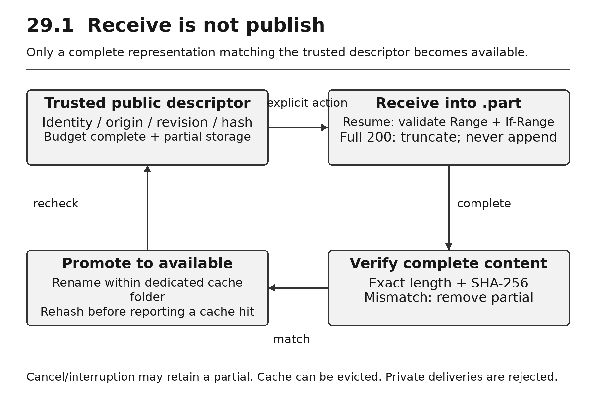

# Chapter 29
# Downloads and Media Storage

A Minnesota Bob listener wants an episode available before a trip north. The transfer reaches 70 percent when the connection disappears. On the next launch, Gnazzo's World should distinguish a useful partial file from a complete download, resume only the same representation and avoid advertising corrupt audio as ready to play.

A different customer is waiting for a private anniversary song. That file has different access, storage and deletion requirements. Putting both files in a folder named Downloads would not establish authorization. We will implement the public case completely within a bounded teaching lab, then identify the additional boundaries a private delivery needs.

Chapter 28 separated native playback lifetime from window visibility. Download lifetime needs the same discipline: bytes arriving, bytes stored, bytes verified and media available are different states. An HTTP success code or a progress bar reaching 100 percent cannot substitute for a verified local file.

## What You'll Learn

1. Build a foreground download that supports cancellation and explicit restart.
2. Resume a matching representation with Range and If-Range, validating the response before appending.
3. Derive safe storage names and verify exact length and SHA-256 before promotion.
4. Apply a public-cache quota, available-space reserve and explicit deletion policy.
5. Separate anonymous public samples from authenticated, account-owned customer deliveries.

**Prerequisites:** Chapters 17–20 and 27–28. Use the SDK and source revision recorded in `docs/verification.md`. Native HTTPS reachability and certificate trust require device setup; no certificate-validation bypass is included. iOS compilation remains a separate Mac task.

**What you will build:** `PublicMediaAsset`, `PublicMediaDownloader`, a native `DownloadLabPage`, a range-capable public API route and portable/API tests. Home opens the download lab. The original ten-second chime WAV is its only distribution fixture. The sample performs explicit foreground transfers, stores public cache files and reports verified availability. It does not automatically feed downloaded paths into the Chapter 27 player, implement OS background transfers or deliver private customer files.

## 29.1 Decide what a download promises

The public lab stores data beneath `FileSystem.Current.CacheDirectory`, in its own `public-media-v1` folder. This is replaceable data. The operating system may clear it, so every availability check handles absence and revalidates content. A future “keep this episode offline” product promise may require a different durable storage location, user-visible retention policy and backup decisions.

`AppDataDirectory` and cache storage are not interchangeable product requirements. Moving bytes to a more durable folder does not supply encryption, cross-account isolation or reliable recovery. Likewise, a playback foreground service does not become an arbitrary download scheduler. This chapter cancels transfers when the native lab disappears or its window stops. Returning does not restart them; the listener chooses Download again.

The central invariant is small: only an exact-length, hash-verified file may be returned as available. A `.part` file can be useful for restart, but it is never returned as playable media. The client also rehashes an existing final file before reporting a cache hit, rather than trusting a filename left by an earlier process.



The diagram describes this library's publication rule, not a filesystem power-loss guarantee. Renaming within one directory prevents normal readers from seeing an in-progress final file. Storage hardware, filesystem recovery and OS cache eviction can still change what survives. Revalidation is part of the promise.

## 29.2 Start with a trusted descriptor

`PublicMediaAsset` accepts a bounded ID and revision, one fixed HTTPS URI, a length up to 8 MiB and a lowercase SHA-256 value. It rejects credentials, query strings and fragments. The teaching composition supplies this descriptor from code; it does not fetch a manifest from an untrusted location and call its contents trusted.

For this fixture, `PublicDownloadFixture.At` combines the configured origin with the fixed `/api/v1/media/timing` path. The length is 160044 bytes and the expected hash comes from the original resource manifest. The native UI asks for a trusted development origin, not a customer file URL. The HTTP client sends no account credential and production transport disables redirects and automatic decompression.

A hash detects content that differs from the trusted descriptor. It does not establish who authorized a download. If an attacker can replace both a file and its expected hash, a successful hash comparison does not restore trust. For a real catalog, establish how descriptors are delivered, versioned and authorized before adding transfer code.

The local filename is another boundary. Neither the URL's filename nor `Content-Disposition` determines it. `StorageKey` hashes the complete descriptor identity: ID, revision, source URI, expected length and expected content hash. The library adds only a fixed `.part` or `.wav` extension beneath its own folder. Names such as `../delivery.wav` never become filesystem paths.

Including origin and revision also prevents accidental reuse of one server's partial when the developer changes environments. This is identity separation, not encryption. Someone with access to this public cache can read its original timing file; private deliveries must not enter it.

## 29.3 Understand resume before writing the append

A request for bytes starting at offset N can receive several meaningful responses. The client must inspect them before opening the output file for append.

| Response | Required client decision |
| --- | --- |
| 206 Partial Content | Append only if range start/end/total, length, strong ETag, encoding and media type match the trusted representation |
| 200 OK | A supported full representation replaces/truncates the partial; never append its complete body |
| 416 Range Not Satisfiable | Discard the unusable partial and require an explicit fresh retry |
| Redirect or other error | Fail visibly; do not reinterpret it as audio |

On resume, the client sends `Range: bytes=N-` and `If-Range` with the descriptor's strong ETag. If the server cannot satisfy that validator, it may return the complete representation. Our client still requires the response ETag to equal the trusted descriptor. A genuinely changed representation therefore needs a new trusted descriptor; the response cannot silently rewrite our expected identity.

For an accepted 206, `Content-Range` must begin at the existing partial length, end at expected length minus one and report that same expected total. `Content-Length` must equal the remaining bytes. The sample requires `audio/wav` and identity encoding, keeping byte offsets tied to the actual stored representation.

```csharp
if (offset > 0)
{
    request.Headers.Range = new RangeHeaderValue(offset, null);
    request.Headers.IfRange = new RangeConditionHeaderValue(
        new EntityTagHeaderValue(asset.ETag));
}
```

These headers request a condition; they do not prove that it was honored. Read the validation branch in `PublicMediaDownloader.DownloadAsync` beside this excerpt. An unexpected range or validator causes an integrity/protocol failure and removes the partial. There is no automatic retry loop that repeatedly consumes bandwidth or hides a changed server representation.

## 29.4 Serve one real range-capable resource

The companion API embeds the original WAV as `PublicTiming.wav`. The route accepts GET and HEAD at one fixed path and returns `Results.File` with `enableRangeProcessing: true` and the fixture's strong ETag. ASP.NET Core owns HTTP range processing; the application does not hand-parse arbitrary Range syntax into file offsets.

```csharp
return Results.File(stream, "audio/wav",
    enableRangeProcessing: true,
    entityTag: new EntityTagHeaderValue(
        "\"" + PublicDownloadFixture.Hash + "\""));
```

The stream comes from an assembly resource, not a path supplied by the requester. There is no private-delivery identifier, upload route or customer file lookup. The server ETag is tied to the expected fixture hash; API tests read the served body and independently verify that its actual hash and length agree.

Integration tests exercise a real 206 slice, a changed If-Range yielding full 200, an unsatisfiable range yielding 416 and a HEAD response without a media body. Another test runs the actual downloader against the ASP.NET server pipeline, cancels after receiving bytes, creates a new downloader over the same folder and verifies a successful range resume.

The Kestrel smoke adds a separate layer: real loopback HTTP transport, a full-body hash and a byte-for-byte comparison of a selected slice. That evidence does not prove HTTPS certificate trust or native networking. A test server, loopback socket and physical phone answer different questions.

## 29.5 Keep partials useful without treating them as complete

At the start of an explicit transfer, the downloader checks a final file first. A valid final needs no network request. A corrupt final is not reported as available and can be replaced by a fresh verified transfer.

Next it examines the partial for this descriptor. An oversized partial is discarded. A partial exactly as long as the expected representation is rehashed: if correct, it can be promoted without another request. This covers interruption after the last write but before publication. If its hash is wrong, it is discarded and this explicit operation starts from zero.

For a shorter partial, the file length is the restart offset. No separate saved percentage can disagree with it. The deterministic descriptor key supplies the representation identity; there is no mutable sidecar manifest to update after every buffer. A prefix corrupted on disk can still receive a matching suffix, but the final complete-file hash will reject the combination.

The streaming loop counts actual bytes. A lying `Content-Length` cannot make it write indefinitely: if the next buffer would exceed the trusted total, the operation fails and removes the partial. An early end or a transport exception can leave a useful prefix. Cancellation also retains whatever useful bytes reached the file; none is advertised as available until verification succeeds.

The transfer deadline covers the response and streaming body through a linked token. The native Cancel button, page departure and window stop use cancellation too. A status message says a partial *may* remain because exact timing affects whether any bytes were written. Restart is always an explicit action.

After output closes, the client verifies the complete hash, checks cancellation again and renames the partial to its final name. Reading progress and verifying integrity are separate phases. The UI's received-byte display deliberately says that integrity verification is still required.

## 29.6 Budget storage before asking for more bytes

The default folder quota is 4 MiB. It includes both complete and partial files; abandoned transfers are not free. The lab refuses another operation when it cannot fit the expected completed representation alongside the other retained entries. It does not silently evict a listener's previous download to make the new request appear successful.

For a current partial of N bytes, the projected logical usage is existing folder usage minus N plus the asset's expected length. Available disk space must cover the remaining bytes plus a 64 KiB reserve. The complete representation's 8 MiB descriptor limit and the 4 MiB default folder quota are separate limits: a syntactically valid larger descriptor can still be rejected by the configured storage budget.

A free-space check is not a reservation. Another application can consume storage immediately after it passes, and a write can still fail. Such failure must not create a verified availability claim. The portable low-space tests inject an available-byte result to exercise the policy deterministically; physical filesystem behavior remains a device acceptance case.

One downloader instance serializes transfer, verification and deletion with a semaphore. Native dependency injection registers that instance once for the dedicated cache folder. Deletion requested during a transfer waits for the operation rather than removing a file that is still being written. The class does not provide cross-process or multiple-instance locking for the same folder. Composition must stop and await operations before disposing it.

Delete removes only the final and partial derived from the selected descriptor. Changing origins or revisions creates different keys, so a production library needs an inventory and explicit cleanup policy for old entries. This lab intentionally has one selected fixture and no general cache browser. The quota failure message tells the reader to delete an entry or partial explicitly; it does not imply that all orphan management is already implemented.

## 29.7 Keep private delivery access out of the public cache

The public descriptor constructor rejects `MediaAccess.PrivateDelivery`. This is a useful implemented boundary: no account token is accidentally attached to a public fixture request, and a private descriptor cannot select this anonymous storage path. It is not a completed private-download feature.

For the anniversary-song customer, a future server must authorize the validated account's access to that specific delivery. A signed or expiring URL may represent a temporary capability, but it does not decide local retention, account switching or what happens when a late transfer completes after sign-out.

Carry forward the account-operation lessons from Chapters 23–26. A private transfer needs owner-scoped storage, an operation lease checked before publication, bounded credential renewal, cancellation and late-result fencing, revocation/deletion behavior and a deliberate backup/encryption policy. Lock-screen metadata and sharing introduce additional exposure. A public cache key containing a hash supplies none of those protections.

Do not “test” this future design by pasting real customer links into the public lab. Its query-free descriptor rejects common signed-URL shapes deliberately. Use synthetic records in a separately authorized integration when implementing private delivery later.

## 29.8 Guided Lab: interrupt, restart and verify

1. Run the portable tests and the API tests using the pinned SDK. Read the exact executed revision in `docs/verification.md`; test names distinguish simulated transport/space conditions from the actual ASP.NET range pipeline.
2. Start the API with its documented HTTPS development profile. Fetch the public timing resource and inspect its length, type and strong ETag. Issue a bounded Range request with matching If-Range and verify the returned slice, not just status 206.
3. Open Home, then Public media download lab. Configure a trusted reachable HTTPS origin. On a device, localhost refers to that device. Configure networking and supported certificate trust; never disable certificate validation to turn a failure into a pass.
4. Download and verify the stored fixture again. No automatic playback should occur. Repeat Download and confirm a verified cache hit needs no second transfer.
5. Cancel during a transfer, leave the page and stop the window in separate experiments. On return, choose Download explicitly. Inspect the requested Range/If-Range and confirm final verification. The small fixture may finish too quickly for manual cancellation; use the deterministic interrupted-transfer tests and appropriate development network throttling rather than claiming an unobserved interruption.
6. Delete the selected final and partial, then retry. Corrupt a file only in a disposable development cache and verify it is not reported as available. Test quota rejection and low-space policy; do not fill a personal device to exhaustion merely to create a screenshot.
7. Record cache eviction, process restart, TLS failure, wrong origin and actual filesystem failures on Android and iPhone separately. Mark unexecuted rows pending in `docs/download-lab.md`.

For each native observation, record source revision, model/OS, API origin and TLS setup, free-space conditions, steps, expected result, actual result and evidence. A body hash on a workstation does not establish decoder compatibility or audible playback on the phone.

## 29.9 Troubleshooting by transfer phase

**Resume doubles the file.** Inspect the status branch. A full 200 response must truncate; only a validated matching 206 can append. Percentage arithmetic cannot fix a framing error.

**The progress bar reaches 100 percent, but no download is available.** Read the hash/promotion outcome. All bytes may have arrived while the content was wrong, cancellation occurred or the local rename failed.

**Every retry receives 416.** Check the partial length and representation identity. This implementation discards that partial and requires an explicit fresh attempt. Repeated automatic retries would conceal the boundary.

**Quota fails although the complete file would fit alone.** Count partials and other retained descriptors. Logical quota covers the folder, not just the selected item. Explicit cleanup is a user decision.

**The phone cannot reach the API.** Separate device address resolution, HTTPS certificate trust and API behavior. A successful loopback HTTP smoke does not configure a phone's trust store.

**A private link is rejected.** The public fixture client is enforcing its scope. Implement a separately authenticated delivery boundary; do not remove descriptor checks or attach account tokens to arbitrary origins.

## Chapter Summary

A reliable download distinguishes received bytes from verified available media. The lab uses a trusted public descriptor, safe derived filenames and a separate partial file. Resume requests carry Range and a strong If-Range validator; append is permitted only after exact response validation, while a supported full response truncates. The client bounds actual reads, verifies complete length and hash, and promotes only verified content. Cancellation and transport interruption can retain a useful prefix for explicit restart. Storage policy counts partials, applies a quota and reserves free space without promising physical capacity. The public cache remains replaceable and anonymous; private delivery descriptors are rejected. Portable files, simulated failures, API range processing and loopback transport provide complementary evidence, with native TLS, filesystem and eviction checks still pending.

## Exercises

**Worked exercise — a server ignores Range.** A 12000-byte partial exists, and the server returns a matching full 200 representation. Which file mode is correct? Create/truncate, because the body starts at byte zero. Appending would produce an oversized corrupt file. The test `Full_200_response_to_resume_truncates_instead_of_appending` verifies the correct behavior with actual temporary files.

**Independent exercise — storage inventory.** Design an inventory that exposes retained public revisions and partials, supports explicit cleanup and coordinates with the same single writer. Specify recovery when a file disappears before deletion. Do not infer verified availability from the inventory row alone.

**Independent exercise — durable offline promise.** Design “keep this episode offline” separately from this cache. Explain location, quotas, backup behavior, removal, migration and what the UI says when OS or storage failure removes it.

**Independent exercise — private customer delivery.** Trace authorization, transfer and publication for account A followed by sign-out and activation of B. Identify the server decision, local partition and lease that prevent A's late completion from appearing in B's library. Use synthetic data and leave unimplemented service/device gates explicit.

## References and Source Walkthrough

Read `Downloads/PublicMediaDownload.cs` with `DownloadTests.cs`, then `DownloadLabPage`, the fixed API route and `MediaDownloadApiTests.cs`. `eng/Smoke-Api.ps1` verifies the real loopback representation and slice. `docs/download-lab.md` contains the protocol contract and pending device worksheet.

Primary references: HTTP semantics and byte ranges at https://www.rfc-editor.org/rfc/rfc9110; ASP.NET Core file results at https://learn.microsoft.com/en-us/dotnet/api/microsoft.aspnetcore.http.results.file; MAUI storage locations at https://learn.microsoft.com/en-us/dotnet/maui/platform-integration/storage/file-system-helpers. Consult the installed SDK's signatures and current platform requirements when applying these APIs.
