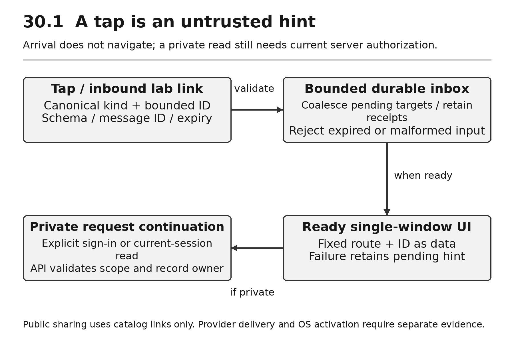

# Chapter 30
# Notifications, Deep Links, and Sharing

A listener sees a Gnazzo's World notification about a public Minnesota Bob item and taps it. The application may already be visible, waiting in the background or starting from a stopped process. The destination should be the same public item, without a second copy of the page appearing because the operating system delivered the action twice.

Now consider an anniversary-song customer who receives a request-status hint. The hint should not display a private dedication on the lock screen, choose an account from a query string or grant access merely because the customer tapped it. If sign-in is needed, the customer should deliberately continue, and the server must still authorize the requested record.

Notifications, links and sharing meet at an untrusted input boundary. This chapter builds native local-notification adapters, a bounded routing inbox, explicit private-read continuation, public-link sharing and an optional authenticated push-registration pipeline. The implementations and their evidence remain separate: registration is not push delivery, and opening a share sheet is not proof that anyone received a link.

## What You'll Learn

1. Request notification permission in context and recheck availability before posting.
2. Validate typed link destinations and defer navigation until the application is ready.
3. Preserve bounded routing hints across startup, reject duplicates and expire stale work.
4. Continue a request link through sign-in and independent server authorization.
5. Manage the registration boundary for push tokens while separating provider/device delivery work.
6. Share public content through the native sheet without claiming a recipient or delivery result.

**Prerequisites:** Chapters 8, 22–26 and 28–29. Use the pinned SDK and executed source recorded in `docs/verification.md`. The optional API registration path needs the dedicated `notifications:manage` scope. No FCM/APNs project, credential or native token SDK is configured in the distributable build; iOS compilation and actual notification/share behavior require separate platform work.

**What you will build:** typed links, a bounded SQLite inbox, native notification adapters, public sharing and explicit private-read continuation. The optional push pipeline adds a coordinator, authenticated HTTP sink and volatile bounded registry. Live provider delivery and verified HTTPS domain association remain separate work.

## 30.1 Separate an event from permission to act

A notification can arrive without a visible page. It can also be presented while the listener is reading another item. Neither situation justifies immediate navigation. The local adapter therefore presents a public alert, while the default tap action supplies a routing hint to the inbox.

The body is generic: a public item is ready to explore. The payload contains a version, a message ID, a bounded link and a short expiry. It contains no access token, customer name, dedication, delivery URL or account selector. These omissions follow from the exposure boundary: notification content may appear outside the application, including on a lock screen.

Notification permission and API authorization answer different questions. The operating system decides whether the app may present notifications; an API decides whether a validated account may access a private record. A permission grant supplies no API credential, and a notification tap supplies no ownership claim.



The diagram's private-read branch is intentional. Public catalog navigation can open an item page, but a request destination opens a continuation page that fetches nothing automatically. Its buttons let the customer sign in and continue, or use the current API session for an authorized read.

## 30.2 Ask for permission when the user chooses the feature

Home opens Notifications, links and sharing lab. Its Choose notification permission button explains the context by putting the request beside the feature. Posting a sample is a separate action. Denial leaves public browsing available and does not trigger repeated prompts on every launch.

On Android, the project declares `POST_NOTIFICATIONS`; the permission adapter requests the runtime permission on releases that require it. Before posting, the service checks current permission, overall notification availability and whether its named channel is disabled. The channel has a stable identifier, and the sample uses one replaceable notification ID rather than creating an unbounded stack of alerts.

The Android content action is an immutable `PendingIntent` targeting the existing activity. `OnCreate` handles a cold activation and `OnNewIntent` handles delivery to an existing activity. The application retains its established single-task activity choice; different activity architectures need their own launch-mode reasoning.

On iOS, the application retains a `UNUserNotificationCenterDelegate`, requests alert permission only through the explicit button and rechecks current settings before scheduling a local request. Foreground arrival asks for banner presentation without routing; the default tap response queues the payload. The response completion callback runs even if processing fails.

A successful post or scheduling call means the request was accepted at that API boundary. It does not prove actual presentation, sound, a tap or background execution. Focus settings, channel choices and platform behavior remain device observations. This lab does not add exact alarms, repeating schedules or a boot-rescheduling mechanism.

## 30.3 Parse a small language, not arbitrary navigation

The teaching link grammar is deliberately narrow:

```text
gnazzosworld://open/catalog/{id}
gnazzosworld://open/request/{id}
```

The parser accepts only those exact destination names and a one-to-64-character ASCII identifier containing letters, digits, dash or underscore. It rejects query strings, fragments, credentials, percent encoding, extra path segments and alternate schemes or hosts. It validates the original text rather than normalizing an unexpected URL into something that looks acceptable afterward.

`LinkTarget` produces a typed kind and ID. The router then selects a fixed internal route name and passes the ID as data. No inbound string becomes a raw Shell navigation expression, filesystem path or authenticated account selection.

```csharp
var route = next.Target.Kind == LinkKind.Catalog
    ? "details" : "linked-request";
await shell.GoToAsync(route,
    new ShellNavigationQueryParameters
    { ["id"] = next.Target.Id });
```

This custom scheme is a teaching integration, not a verified association with a website. It requires an installed app, can collide with another handler and has no browser fallback. Production Android app links and Apple universal links require a real controlled HTTPS domain, association documents and platform configuration. Do not describe a manifest filter or URL scheme alone as proof of domain ownership.

The link scheme is separate from the existing identity callback scheme. Android's custom filter targets the lab host, and the iOS delegate forwards other schemes to its base implementation. Broadly intercepting every callback would risk breaking the identity SDK introduced earlier.

## 30.4 Queue before navigating

A native callback can occur before the root Shell is ready. The callback bridge marshals work to the main thread and supplies the raw input to the router. Notification payloads must satisfy schema 1, the bounded message ID/link shape and an expiry no more than ten minutes ahead. The decoder also rejects oversized JSON, unknown fields and duplicate members.

The SQLite inbox stores untrusted routing metadata, not private content or credentials. It allows at most eight pending hints and 128 retained rows. Expired rows are removed before acceptance or selection. Different deliveries for the same still-pending target coalesce, while a completed notification ID retains a receipt until its expiry.

These bounds serve different purposes. The pending limit prevents an input burst from creating unlimited deferred work. Receipt retention prevents the same notification action from repeatedly navigating after a process restart. Expiry prevents an old hint from becoming a permanent command. Clearing the inbox also clears its receipts, so it intentionally ends that local duplicate protection.

The router waits for a loaded/active window with a Shell. Window stop disables navigation; activation or explicit Retry offers another opportunity. A failed navigation leaves its hint pending, while a completed navigation marks the receipt done. Operating-system callback ordering and actual cold-launch behavior still need device validation; portable SQLite tests establish storage policy rather than a native launch sequence.

There is no global exactly-once guarantee. A process could end after navigation but before the receipt is committed, causing a later retry. Direct user-entered links may also open again after completion. The useful contract is bounded, expiring, duplicate-aware routing with safe destinations, not a distributed transaction between a database and a visual page.

The inbox is unencrypted installation-local metadata. Even an opaque request ID can be sensitive in context. Use synthetic private IDs for this lab and review backup/shared-device behavior before storing real routing history. An expiry for a queued hint is not an expiration time for API authorization.

## 30.5 Continue private access deliberately

The linked-request page validates the ID again and initially explains that no private data has been fetched. Sign in then continue uses `ApiSession.SignInAsync`, followed by `ProtectedRequestClient`. Read using current API session skips the interactive attempt but still acquires the current session lease and calls the protected endpoint.

The server independently validates the credential, required permission and record owner. It derives identity from validated claims; a link does not supply a subject. Requesting another customer's ID must not make that record visible. Missing, expired or insufficient credentials remain failures even when the notification itself was well formed.

Leaving the page or choosing its local sign-out cancels the page operation. Sign-out also invalidates API leases and discards pending hints through this page's cleanup action. The private read checks cancellation before displaying its result. These are cooperating fences: a current route alone cannot establish a current account operation.

The chapter does not silently retrofit every earlier sign-out surface into a complete account-wide notification lifecycle. Production composition must centralize pending private intents, push cleanup, account activation and cancellation. Keep that remaining work visible instead of implying that a successful public notification test proves account switching safe.

## 30.6 Add a bounded push-registration boundary

Local notification code does not acquire a remote push token. The optional pipeline begins when a future platform SDK provides one after consent. `PushRegistrationCoordinator` handles the policy boundary and calls `HttpPushRegistrationSink`, which uses the configured HTTPS API origin and a current API-session lease.

The API exposes protected PUT and DELETE operations for a canonical installation ID. The dedicated permission is `notifications:manage`; `requests:read` alone cannot register a device. The server derives the owner from validated issuer and subject, never a client-supplied owner field. Successful operations return no token body and use no-store response policy.

A binding includes installation ID, provider kind, a bounded token and a monotonic generation. Token shape validation is not proof that a provider issued it or that the caller controls the device. Real provider integration needs its own validation and operational design; the teaching registry has no outbound sender.

The coordinator receives a persisted starting generation and a persistence callback. It persists the next generation before sending the registration, so a lost reply does not require reuse of an older generation after restart. Confirmation remains false if persistence, transport or removal fails.

```csharp
persistGeneration(next);
generation = next;
await sink.UpsertAsync(binding, ct);
ct.ThrowIfCancellationRequested();
RegistrationConfirmed = true;
```

The server rejects stale generations and prevents another owner from replacing an active installation. It also prevents one token from being attached to a second installation until the prior binding is removed or expires. Within the teaching process, a lock serializes registry changes.

The registry is explicitly volatile and bounded: four installations per owner, 100 total, a separate eight-operation-per-minute process budget, a 4096-byte request-body limit and a 24-hour expiry. These are demonstration limits, not production capacity planning or per-customer fairness. A restarted API loses the registry; no successful registration implies durable subscription or eventual delivery.

## 30.7 Treat token rotation and consent as lifecycle work

FCM/APNs tokens can change; a device token is a delivery endpoint, not a stable user identity. An application must observe the platform SDK's token changes and reconcile registration with current permission and account state. It should not place a provider server key in the native bundle.

The portable coordinator requests removal when permission is unknown/denied or a token is missing. An actual native integration must recheck permission on resume, obtain current provider state, persist its generation, and invoke the sink with the correct authenticated owner. Stop and await an old account's coordinator before switching to another account's registration work.

On sign-out, unregister while the old credential can still authorize cleanup. If that request fails, the application must not describe server unregistration as complete. Production needs durable cleanup intent, bounded retry and expiry policy; this chapter leaves those native/account-composition hooks unimplemented. The current lab page acquires and submits no push token.

Live FCM/APNs delivery additionally needs provider setup, server credentials, appropriate platform configuration and real device acceptance. A synthetic token accepted by our registry is evidence about policy and middleware only. It is not evidence of provider registration, APNs entitlement, a received message or lock-screen presentation.

## 30.8 Share only what the user selected

The Share button opens the native sheet with a public catalog lab link. Its builder creates only catalog destinations, and the sample does not offer private request links, signed deliveries or credentials for sharing.

The method's return means the share sheet interaction returned. It does not establish a recipient, transmission or successful opening by another person. Cancellation is a normal outcome. The UI says this plainly rather than displaying “Link sent.”

A recipient needs the app installed to use the custom scheme. A real public sharing experience should usually have a useful HTTPS destination and an associated installed-app route. Establish that actual destination before adding a marketing promise or testing it as if it already exists.

## 30.9 Guided Lab: follow the event across boundaries

1. Run portable and API checks at the recorded revision. Read link/inbox tests before native adapters: they establish grammar, persistence, expiry and registration policy without displaying a notification.
2. Open the native lab. Request permission explicitly, then post the public sample. Test denied and revoked permission separately, including channel changes on Android. Confirm no forced prompt appears merely from opening the page or returning to the app.
3. While the application is foregrounded, inspect presentation and verify that arrival does not navigate. Tap the default action and confirm the public item destination. Repeat from background and cold launch, recording device, OS and exact app revision.
4. Supply malformed, expired and duplicate payloads in a disposable lab. Confirm fixed destinations and bounded queue behavior. A failed navigation should leave a retryable hint rather than claim completion.
5. Open a synthetic request link while signed out. Choose explicit sign-in continuation after configuring the provider. Test cancellation, server denial, wrong owner, sign-out during read and leaving the page. Never use a real customer's dedication as a notification body.
6. Open the public share sheet, then cancel. Confirm the application does not report a recipient or successful transmission. Test a second installed development app/device separately from a browser without the app.
7. Exercise the optional registration pipeline with synthetic tokens and signed test credentials. Verify scope denial, token rotation, stale generations, owner isolation, body limits, caps, expiry and failed cleanup. Keep real provider acquisition/delivery rows pending until configured and executed.

Use `docs/notification-link-lab.md` as the acceptance worksheet. Record permission/channel state, launch state, steps, expected and observed results, source revision and evidence. Mark unexecuted Android/iPhone cases pending; neither middleware tests nor an Android compile can tap a notification for us.

## 30.10 Troubleshooting by boundary

**Posting succeeds but nothing appears.** Inspect OS permission, channel settings, foreground presentation and focus behavior. Post acceptance is not a display observation.

**The app opens twice or reaches an unexpected page.** Inspect launch callbacks, canonical parsing, inbox receipts and fixed route selection. Do not solve duplicate delivery by trusting a raw navigation URI.

**A cold tap is lost.** Check callback timing, storage failure and root-window readiness. SQLite reopen tests do not establish the actual OS activation sequence.

**A request link opens but its content is denied.** That can be the correct authorization result. Inspect current API session, scope and server ownership rather than treating the link as a credential.

**A rotated token conflicts.** Verify persisted generation, installation identity and prior owner binding. A new account must not overwrite an old registration merely by claiming the same installation ID.

**Sign-out cleared local state but server cleanup failed.** Preserve that uncertainty. A durable cleanup/outbox design and bounded provider expiry are remaining integration work, not a reason to report unregistration success.

## Chapter Summary

Notifications, links and sharing cross boundaries outside the visible page. The lab requests permission explicitly, rechecks availability and separates local presentation from a user tap. Canonical typed links enter a bounded SQLite inbox with expiry, pending-target coalescing and retained duplicate receipts. Navigation waits for ready UI; a private request still needs explicit continuation and independent API authorization. Public sharing opens the native sheet without claiming a recipient or delivery result. The optional push-registration pipeline adds scoped owner binding, persisted generations, token rotation policy and bounded server state. Its synthetic integration tests establish neither provider delivery nor native behavior. FCM/APNs acquisition, durable cleanup, verified HTTPS association, iOS compilation and actual Android/iPhone acceptance remain separate work.

## Exercises

**Worked exercise — duplicate cold tap.** A notification is handled, its navigation completes and its ID remains in the inbox as a receipt. The process ends and receives the same valid ID again. Should it navigate? No, while that receipt remains retained. `Completed_receipt_deduplicates_notification_after_process_restart` verifies this with real SQLite reopen. It does not cover a crash between navigation and committing the receipt, which is why the design makes no exactly-once claim.

**Independent exercise — verified web links.** Choose a real controlled HTTPS origin and design Android/Apple association documents, web fallback, link grammar and revocation tests.

**Independent exercise — durable push cleanup.** Design an account-scoped outbox for failed unregistration. Specify what happens before credential removal, after account switching, during process restart and when the provider invalidates a token.

**Independent exercise — device evidence.** Complete separate Android/iPhone rows for permission denial/revocation, warm/cold/default tap, duplicate delivery, private-read cancellation and share-sheet cancellation. Explain which results came from an actual device and which remain proposed.

## References and Source Walkthrough

Read `Notifications/InboundRoutes.cs` with `NotificationTests.cs`, then the native callback/router, `LocalNotificationService` and both lab/continuation pages. Follow the optional coordinator and HTTP sink into `PushRegistrationEndpoints.cs` and `PushRegistrationApiTests.cs`. The worksheet records current scope and every pending native/provider gate.

Primary references: Android notification permission at https://developer.android.com/develop/ui/views/notifications/notification-permission; MAUI local adapters at https://learn.microsoft.com/en-us/dotnet/maui/platform-integration/local-notifications; app/universal-link setup at https://learn.microsoft.com/en-us/dotnet/maui/android/app-links and https://learn.microsoft.com/en-us/dotnet/maui/macios/universal-links; sharing at https://learn.microsoft.com/en-us/dotnet/maui/platform-integration/data/share; FCM token management at https://firebase.google.com/docs/cloud-messaging/manage-tokens. Confirm bindings and platform requirements against the installed SDK before making production claims.
