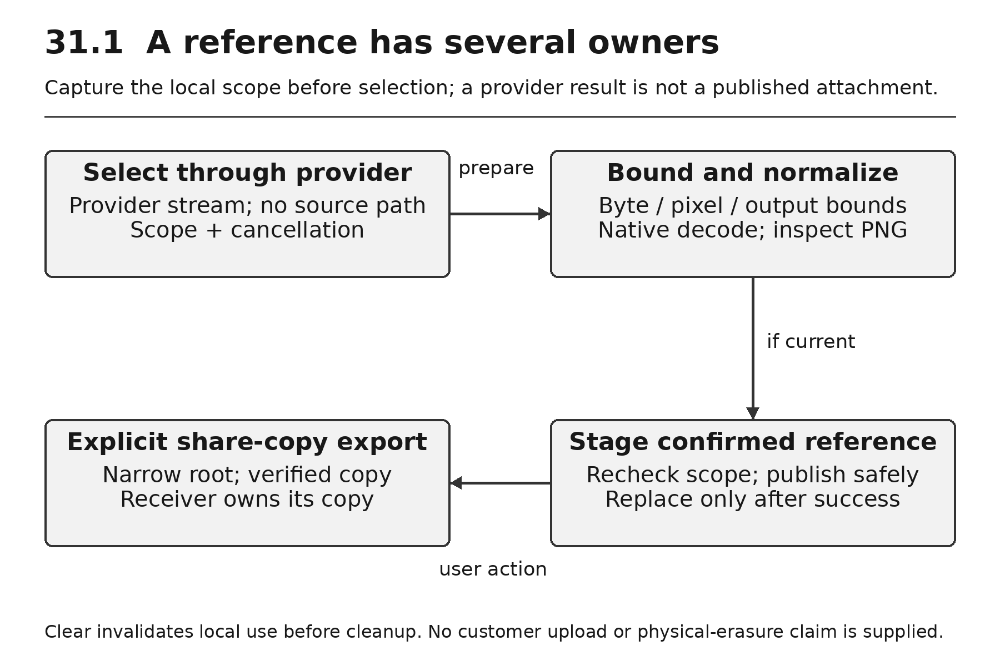

# Chapter 31
# Native Capabilities, Attachments, and Platform Extensions

An anniversary-song customer has a short written reference and a photograph that might help explain the occasion. The reference is optional. Canceling the picker should not erase the draft, an unavailable photo provider should not prevent submission without a photo, and a filename from another application should never become a storage path inside Gnazzo's World.

The customer may also decide to share a prepared reference with another app. That action crosses a second boundary: a local staging file, an exported copy and a receiver's copy have different lifetimes. Closing a share sheet does not prove delivery, and clearing our local selection cannot revoke a copy already retained elsewhere.

This chapter finishes Part VI by bringing native capability calls into the same ownership model used for playback, downloads and notifications. We will build a local attachment lab, add optional feedback and connectivity information, and make platform-specific configuration inspectable. Customer uploads and account-authorized attachment records remain separate integration work.

## What You'll Learn

1. Read selected file/photo content through provider streams and treat filters as hints.
2. Bound text, image input, declared dimensions and normalized output independently.
3. Preserve the last confirmed attachment when a replacement fails or is canceled.
4. Fence late picker/processing results with a captured local-scope generation.
5. Share verified copies through a narrow export root with explicit retention and cleanup.
6. Use connectivity and haptics as optional capabilities, and choose an adapter or handler deliberately.

**Prerequisites:** Chapters 15, 19, 25 and 29–30. Use the pinned SDK and executed source in `docs/verification.md`. The native lab uses .NET MAUI's file/media pickers, graphics, sharing, connectivity and haptic APIs. Actual provider access, decoding, metadata/orientation results and sharing require device checks; iOS compilation remains separate Mac work.

**What you will build:** a bounded attachment workspace, native image adapter, export store and capability lab. A fresh local scope stages one synthetic reference, previews normalized photos and supports explicit sharing. Customer uploads, durable request attachment records and account-storage migration are separate work.

## 31.1 Choose the capability boundary

A file picker grants access to a selected resource through a provider. That resource may be on the device, in another app or backed by cloud storage. A returned name, media type or path is not proof of the bytes we will receive.

The lab reads `FileResult.OpenReadAsync`. It never opens `FullPath` as an ordinary local filename and never derives a destination from the user's original filename. Provider access can fail after selection, and the returned stream may not support seeking or a reliable Length property. Our reader counts actual bytes while copying into a bounded buffer.

For text, the picker filter offers `text/plain` on Android and `public.plain-text` on iOS. For photos, the media picker requests one result. The application checks the result count again because a platform/provider can behave differently from the requested limit. An empty selection means cancellation; it preserves the previous staged entry.

The selected resource is not itself a durable attachment. Copying, validating, normalizing and publishing a local receipt are later decisions. Likewise, a local receipt does not become an account authorization grant merely because the reference originated while an account page was visible.



This is a synthetic local lab. Real request integration needs an authenticated owner partition, a durable draft relationship, server-side validation and upload/consent policy. Keeping that work explicit prevents an optional native feature from silently becoming private customer storage.

## 31.2 Request only the capability being used

The sample selects existing text and photos. It does not capture camera images, record audio, save directly to the gallery or acquire location. Broad setup examples that include capture and video permissions should not be copied wholesale into a pick-only feature.

The inspected MAUI 11.0.10 Android implementation uses the available system photo picker or a content-selection fallback for picking. Camera/storage checks in the capture path are a different operation. This chapter adds Android `ACCESS_NETWORK_STATE` and `VIBRATE` for the explicit capabilities it uses; it does not add camera or location permissions. The merged-manifest check verifies those choices separately from runtime behavior.

On iOS, purpose strings explain optional photo selection and a user-chosen share-sheet save action. They do not prove how a particular picker, limited-library choice or share extension will prompt. A purpose string belongs beside a real operation and must describe that operation accurately.

Pickers are launched on the UI thread. Native picker visibility can stop the app's window without meaning that the user abandoned the attachment. The page therefore distinguishes an active picker from actual Shell departure. Leaving the lab or destroying its window invalidates the scope; merely displaying the system picker does not automatically destroy it.

## 31.3 Apply byte limits before trusting content

Text references must be nonempty strict UTF-8 and at most 64 KiB. The policy rejects unsupported control characters while permitting tab and line endings. It treats the result as plain text, not HTML or executable content. A `.txt` extension alone would establish none of these properties.

Photo input is limited to 4 MiB. `ImageEnvelope.Inspect` recognizes PNG/JPEG headers, checks a maximum declared edge of 4096 and a maximum declared pixel count of four million. Other byte formats fail visibly. A source with a HEIC name may be converted by a provider, but the application accepts the actual returned bytes, not the original extension.

These are resource preflight checks, not a complete image decoder or an antivirus system. The native picker may preprocess a source before our reader sees it, and a native codec may allocate resources while decoding. Header limits reduce the input admitted to this app's decoder step; they do not guarantee bounded allocation inside every OS/provider/codec implementation or eliminate decoder defects.

The native picker requests 1600-by-1600 processing, orientation correction and no metadata preservation. Those requests help the ordinary phone-photo path but remain separate from application validation. We still check the bytes and dimensions that actually arrive. Requested processing is not evidence that a particular device honored it.

```csharp
var results = await MediaPicker.Default.PickPhotosAsync(
    new MediaPickerOptions
    {
        SelectionLimit = 1,
        MaximumWidth = 1600, MaximumHeight = 1600,
        RotateImage = true, PreserveMetaData = false
    });
```

The sample uses synthetic references so these remaining native boundaries can be explored without collecting real customer data. Production needs supported codecs, security updates, memory/performance measurements and an explicit format/privacy policy.

## 31.4 Normalize pixels and inspect the output again

`IAttachmentImageNormalizer` isolates native decoding from portable policy. The implementation uses `PlatformImage`, checks decoded dimensions, downsizes to an 800-pixel maximum edge and writes PNG. Work is scheduled off the visible UI path; native objects are disposed after encoding. An image already within the output bounds is saved directly rather than creating an unnecessary aliasing resize wrapper.

The destination stream independently limits native encoder writes to 2 MiB. A small declared image is not permission for an encoder to write unlimited output. Cancellation is checked before and after processing, but a token cannot preempt a synchronous native decode or encode already running.

The core then inspects the actual normalized PNG. It checks framing, chunk CRCs, output dimensions and the supported eight-bit noninterlaced RGB/RGBA shape. It retains only IHDR, IDAT and IEND chunks. Unsupported critical/palette output is rejected, and transparency must be encoded in RGBA pixels rather than an ancillary transparency chunk.

This removes EXIF, textual/profile and other ancillary chunks from the accepted normalized output. It does not prove that the photograph contains no private information. Faces, addresses, written notes and location clues may remain visible in pixels. Plain text can contain private information too. Stripping a color profile can change appearance, so the reader should inspect colors, alpha and orientation on target devices before adopting this normalization policy for a product.

The portable fixtures are original four-by-three RGBA images generated mathematically. One adds synthetic metadata markers; the other contains only the accepted pixel chunks. Tests verify exact chunk removal against these independently generated bytes. The simulated normalizer in those tests does not decode or resize an actual native bitmap.

## 31.5 Preserve the confirmed reference until replacement succeeds

Each workspace owns a fresh generated folder. A staged receipt contains a generated ID, kind, byte length and SHA-256; its extension and media type come from the accepted kind. The source filename and provider path are not retained as storage names.

Preparation first reads and validates the candidate. Only after it has acceptable content does the workspace write a generated partial file, check the captured scope again and rename it into staged storage. The previous confirmed entry remains current until publication succeeds. A failed decode, oversized body or cancellation before replacement must not erase that previous entry.

```csharp
var lease = workspace.Generation; // Before opening the picker.
// After selection, cancellation and result-count checks:
var receipt = await workspace.StageAsync(kind,
    _ => selected.OpenReadAsync(), lease, ct);
```

The generation matters because native work can finish late. Clear increments it and removes the current entry from use immediately, then attempts file cleanup. A provider that ignores cancellation can still return a stream; that stream is disposed and its obsolete operation cannot publish under the new generation.

Cancellation and cleanup are distinct outcomes. If cleanup is canceled or storage deletion fails, `CleanupUnconfirmed` remains true. It does not make an old reference current again. Conversely, successful logical clearing does not prove physical erasure of storage or deletion of the original provider resource.

One workspace serializes its own operations. A process-wide commit gate also serializes the aggregate staging check/publication: retained files across the attachment workspace parent count against a 16 MiB budget. Abandoned scope files consume that budget rather than disappearing from accounting after a restart. This is not a cross-process locking contract or a completed orphan inventory; developer/OS cache cleanup may be needed for abandoned lab data.

Cache eviction or mutation can make a receipt unusable. Before preview/export, `ReadCurrentAsync` reads the staged bytes again and checks length and hash. The receipt describes a prior confirmed publication; it does not exempt the file from later validation.

## 31.6 Export a copy with a separate lifetime

Sharing begins only when the user chooses Share selected staged reference. The application revalidates staged content and creates another generated file beneath `CacheDirectory/sharing-root`. The export store rejects a mismatched receipt/hash or a nonconforming text/PNG body before returning a path for the native sheet.

On Android, the MAUI FileProvider override exposes only that internal cache subdirectory. It does not expose the workspace tree, all cache files or AppData. CI checks the source XML policy and the merged provider resource reference. The actual content URI, access grants and receiving-app behavior still need device inspection.

| Resource | Owner and lifetime |
| --- | --- |
| Provider's original | Outside this workspace; selecting does not transfer deletion authority |
| Staged reference | Current transient lab scope; revalidated and cleared on departure/reset |
| Exported copy | Dedicated sharing root; bounded retained copy for possible asynchronous reads |
| Receiver's copy | Controlled by the receiving app/user; our local cleanup cannot revoke it |

The export store allows at most four files and 8 MiB. Owned copies older than 24 hours are pruned when another export is requested. This is opportunistic cleanup, not an OS background expiry timer. Unknown files count toward the budget but are not removed by selective cleanup.

A share sheet may return before another app finishes reading its file. Deleting the export immediately on return would create a race. The lab retains it until later expiry or the explicit Remove local exported copies action. A canceled or failed share attempt may also leave a bounded export copy. That action removes only local copies; it does not claim to revoke anything already retained elsewhere.

A presentation rectangle is supplied for tablet share-sheet presentation. A compile cannot establish correct iPad positioning, supported share targets or cancellation behavior. Returning from the sheet confirms no recipient, transmission or successful read.

## 31.7 Treat connectivity and haptics as optional feedback

Connectivity reports what the device currently believes about network access. “Internet” does not prove that the configured API is reachable or that a future request will succeed. The lab displays a hint and allows local staging offline; it does not gate the attachment workflow on a connectivity precheck.

The page subscribes to connectivity changes for its active route lifetime and unsubscribes on departure. Unsupported reporting falls back to a useful message. A surviving event handler that captures a departed page would be both an ownership problem and a source of misleading UI updates.

Haptics default off. If enabled, the page requests one brief Click after a successful stage, while its window is foregrounded. Failure or lack of support does not turn the completed attachment into an error. A returned API call also does not prove that the user felt feedback; device settings, hardware and accessibility preferences matter.

The status text and preview carry the result independently. Haptics should reinforce a clear outcome, not become the only way a user discovers that a reference was accepted or rejected.

## 31.8 Choose adapters and handlers deliberately

A capability interface, a native adapter and a view handler solve different problems. The workspace needs a stream-to-stream image operation, so a small normalizer port is sufficient. The preview uses MAUI's existing Image handler; changing its Source and clearing it on departure follows that handler's ownership model.

Replacing the Image handler merely to read a file or request haptics would add unnecessary native-view lifecycle work. Chapter 28 used a handler extension for a concrete player configuration unavailable at the portable media boundary. That example depended on a pinned native view hierarchy and required an explicit compatibility check.

Use conditional compilation or platform folders when code genuinely refers to platform APIs. Keep portable validation and state transitions independent of Android/iOS types. A platform hook must name who attaches it, who removes it and who disposes each native resource; a shared interface alone does not answer those questions.

This chapter's disposal path covers selected streams, image wrappers and connectivity subscriptions. It does not claim to erase a provider's original, MAUI/OS picker caches, recovered selection results or receiver copies. Recovering a result after process death must not silently attach it to a different draft/account scope. The current lab starts a fresh local scope and requires another explicit selection instead of implementing durable picker recovery.

## 31.9 Guided Lab: select, replace, cancel and share

1. Run the portable checks and inspect the attachment tests with the fixture generator/manifest. Distinguish real temporary-file policy tests from the simulated normalizer and still-pending native decoder behavior.
2. Open the native lab and select a small synthetic UTF-8 reference. Verify the staged result and clear it. Repeat through a document provider whose result is not an ordinary filesystem path; do not add a FullPath shortcut when provider access fails.
3. Select a synthetic photo. Inspect actual normalized dimensions, PNG chunks, orientation, alpha and colors. Test a too-large or unsupported source. The existing confirmed reference should survive a failed replacement.
4. Cancel a picker. Then test explicit cancellation, scope clearing and Shell departure while selection or processing is pending. A late result must not appear in a new scope. Remember that native picker visibility alone is not route departure.
5. Share the selected reference, then cancel the sheet. Inspect the Android URI root and a receiving app's ability to read the intended file. Test phone and tablet presentation separately. Returning is not a delivery receipt.
6. Exercise explicit export cleanup and later expiry. Do not claim that this revokes a receiver copy. Inspect cache eviction, process interruption and storage failure in a disposable development cache; mark unexecuted cases pending.
7. Turn haptics off, then test supported/unsupported/system-disabled cases. Change reported connectivity and confirm staging remains available offline. No automatic upload or location request should occur.

Record source revision, model/OS, provider, permission/library state, format, bytes/dimensions, steps and evidence in `docs/capability-attachment-lab.md`. Never use actual customer references to create a teaching screenshot. A native permission prompt, transformed bitmap and shared URI are observations to collect, not conclusions supplied by a unit-test count.

## 31.10 Troubleshooting and the optional location extension

**A selected file cannot be opened.** Treat it as a provider/access outcome. OpenReadAsync is the supported boundary; a content URI is not a local path. Keep the draft usable without the optional reference.

**A valid-looking photo is rejected.** Inspect actual bytes, input dimensions, output encoding and limits. A filename or successful picker result is insufficient. The current normalized output intentionally accepts a narrow PNG profile.

**The earlier attachment disappears after a failed replacement.** Check publication ordering and scope resets. Candidate failure should preserve the confirmed entry; explicit Clear is a different command.

**The share target cannot read the file.** Inspect the exported location, FileProvider root/grant and receiver timing. Do not broaden the provider to all AppData to hide a root mismatch.

**Cleanup is unconfirmed.** Keep the selection invalid for use, retain the diagnostic and investigate storage/provider timing. Do not convert an uncertain delete into a physical-erasure claim.

An optional location-based discovery exercise can extend this lab without making location a core permission. Add an explicit Find nearby inspiration action, request only when-in-use access and offer a manual town choice on denial or unavailable location. Define acceptable freshness and accuracy, avoid background tracking, and decide whether location ever leaves the device. The current application acquires and uploads no location.

## Chapter Summary

Native capabilities need explicit ownership and useful fallbacks. The lab reads provider streams, bounds text and image resources, normalizes supported photos and inspects the resulting PNG before staging. A failed candidate preserves the previous reference, while a captured generation prevents obsolete picker work from publishing after scope reset. Staged files and export copies have separate lifetimes; sharing uses a narrow root and cannot prove delivery or revoke receiver copies. Connectivity remains a hint and haptics remain optional reinforcement. Streams, image wrappers and event subscriptions are cleaned up deliberately, with uncertainty reported honestly. Portable files and synthetic image tests establish policy; native picker, codec, permission, share and iOS results remain device/platform work. Customer upload and durable account attachment composition are still separate boundaries.

## Exercises

**Worked exercise — a late provider result.** The lab captures generation 7, opens the picker and is then cleared to generation 8. The provider ignores cancellation and returns a stream. Can the candidate publish? No. Stage checks the captured generation and token, disposes the stream and leaves no current reference. The late-open test verifies this with a real workspace and simulated provider completion; it does not dismiss an actual system picker.

**Independent exercise — durable request attachments.** Design authenticated owner/draft partitions, server limits, upload consent, content checks and late-result fencing. Specify how a staged reference becomes part of a durable request without treating a local receipt as an API credential.

**Independent exercise — abandoned scope inventory.** Add an inspectable inventory/cleanup policy for old workspace and export files. Preserve active operations and distinguish logical deletion, cache eviction and physical erasure.

**Independent exercise — optional location.** Implement a separately invoked approximate-location discovery experiment with a manual-town fallback, bounded accuracy/freshness and no background permission. Complete device checks without changing the main request flow's permission requirements.

## References and Source Walkthrough

Read `Attachments/AttachmentWorkspace.cs`, `ImageEnvelope.cs`, `AttachmentExportStore.cs` and `AttachmentTests.cs`, then `NativeImageNormalizer` and `CapabilityLabPage`. Inspect the Android FileProvider XML, manifest, iOS purpose strings and CI assertions. `eng/generate_attachment_fixtures.py` documents the exact original synthetic PNG bytes.

Primary references: MAUI file selection at https://learn.microsoft.com/en-us/dotnet/maui/platform-integration/storage/file-picker; media selection at https://learn.microsoft.com/en-us/dotnet/maui/platform-integration/device-media/picker; graphics images at https://learn.microsoft.com/en-us/dotnet/maui/user-interface/graphics/images; sharing at https://learn.microsoft.com/en-us/dotnet/maui/platform-integration/data/share; connectivity at https://learn.microsoft.com/en-us/dotnet/maui/platform-integration/communication/networking; haptics at https://learn.microsoft.com/en-us/dotnet/maui/platform-integration/device/haptic-feedback. Compare broad documentation examples with the pinned implementation and the specific capability being used.
