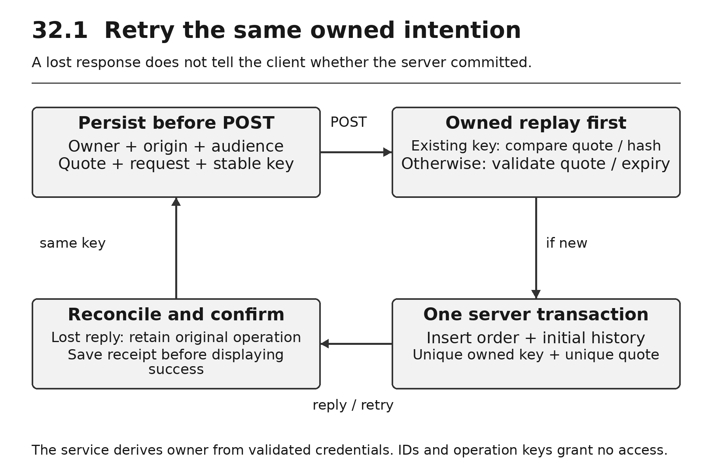

# Chapter 32
# Quotes, Orders, and Customer Ownership

A customer requests a three-minute anniversary song. The phone displays a teaching quote and the customer accepts it. The service writes the order, but the connection fails before the phone receives its reply. The customer opens the app again and presses Retry. A reliable workflow returns the original accepted request rather than creating another one, charging again or announcing that the expired quote erased an earlier success.

A second customer may use the same tablet. Their account must not inherit the first person's story, pending operation or receipt. Hiding a button cannot establish that boundary: the service must derive ownership from a validated credential and apply it to every record lookup.

This chapter opens Part VII with an opt-in quote/order lab. It extends the earlier saved song draft without overwriting that draft or attaching Chapter 31's transient references. The new acceptance is a durable teaching request. Payment, real production authorization and private delivery are later boundaries.

## What You'll Learn

1. Recalculate and validate a quote on the server while preserving its immutable price snapshot.
2. Derive customer ownership from validated issuer and subject rather than posted account fields.
3. Bind an operation key to an owned quote and canonical request across duplicate attempts.
4. Commit order creation and versioned history in one SQLite transaction.
5. Persist a client acceptance before HTTP and reconcile an uncertain result after restart.
6. Separate accepted requests, controlled state fixtures, verified payment and native evidence.

**Prerequisites:** Chapters 15–16, 18–19 and 22–26. Use the repository's pinned SDK and verification record. Run the portable and API projects on a development machine; the native page additionally requires a configured identity provider, dedicated API scopes and reachable HTTPS service. Use synthetic names, email addresses and stories only.

**What you will build:** three protected HTTP operations, a persistent teaching store, owner/resource-partitioned client reconciliation and a native order lab. The service is disabled by default. No card collection, payment assertion, customer status-update route or attachment upload is supplied.

## 32.1 Give each promise a precise name

The earlier form owns a local draft. Its displayed estimate is useful feedback, but a modified client could post any amount. The new server accepts only the requested song specification, validates it and calculates its own teaching price. A quote records that canonical request, its hash, a pricing-policy version, USD minor units and a 15-minute server expiry.

Acceptance creates one owned order from that stored quote. The order copies the quote's request and price rather than consulting today's calculator again. Changing a future price policy must not rewrite what an earlier customer reviewed. The sample uses the historical website-snapshot calculator under a lab-prefixed version; its amounts are teaching fixtures, not live offers.

The initial order state is Accepted, version 1. Here Accepted means that the server recorded the request and its first history entry atomically. It does not mean paid, contracted for real work, in production or delivered. Displaying this distinction matters more than choosing an optimistic success color.

| Record | What it establishes |
| --- | --- |
| Local draft | An editable installation-local song specification |
| Server quote | An owned, expiring canonical specification and immutable teaching amount |
| Pending operation | The client's durable intention to accept one quote with one key |
| Accepted order | One committed server request with a versioned history |
| Confirmed receipt | The client's durably saved observation of that owned order |

An operation key is not an access credential. A quote ID is not a bearer capability. Knowledge of either identifier does not permit another account to read or accept the record.

## 32.2 Derive ownership at the authenticated boundary

The commerce policies require a validated JWT, one bounded subject, one HTTPS issuer and the dedicated scope appropriate to the operation. The existing middleware validates signature, issuer, audience and lifetime. Endpoint code then derives `OrderOwner` from the resulting claims. Neither DTO contains an owner field.

Use the pair issuer/subject because a subject is stable within its issuer's namespace. An email address can change or collide across identity systems. The database predicates include both owner components for quote acceptance, order replay and customer reads. A foreign record and an unknown record return the same unavailable result.

The three routes are deliberately small:

| Method and path | Required scope |
| --- | --- |
| POST /api/v1/commerce/quotes | orders:write |
| POST /api/v1/commerce/orders | orders:write |
| GET /api/v1/commerce/orders/{id} | orders:read |

The quote DTO contains Request. The acceptance DTO contains QuoteId, OperationKey and Request. Strict JSON rejects unknown fields such as owner, totalMinor, state or paid. The body reader also rejects case-insensitive duplicate object properties, excessive nesting and bodies larger than 16 KiB. These controls complement domain validation; a syntactically small request can still have invalid song length or contact data.

Every commerce response carries no-store, including denied/error responses. A coarse process-local budget allows 20 operations per minute with no queue. It bounds this teaching service but does not provide distributed protection or fair per-customer capacity. Hosting and operational policy return in Chapter 35.

## 32.3 Normalize before calculating and comparing

`OrderContract.Normalize` rejects null fields, unsupported control characters and specifications that fail the existing request rules. It then uses `ForReview` to trim the request and clear vocal notes for an instrumental song. Client and service both understand this canonical representation, but the server remains authoritative.

The fingerprint is SHA-256 over a version label and the canonical JSON. Including request-v1 separates this meaning from a future canonicalization format. The hash detects a changed specification; it is not a signature, encryption mechanism or anonymization guarantee. Stories remain plaintext in the teaching database.

The server calculator returns a positive integer amount in minor units. USD 179.00 is represented as 17900, avoiding binary floating-point money calculations. The existing calculator uses decimal arithmetic and its documented rounding before conversion. This USD-only contract must not be generalized by assuming every currency has two decimal places.

The quote transaction also checks retained-row capacity: 100 quotes per owner and 1000 globally. Expired and accepted quotes still count. There is no automatic cleanup job in this chapter, so a lab that reaches capacity needs an explicit development reset or a later retention policy. Do not delete unresolved evidence casually to make a capacity error disappear.

## 32.4 Make acceptance one transaction

The server begins an immediate SQLite transaction. This is more than an in-process lock: separate connections must serialize their writes through SQLite. A short timeout handles ordinary contention; an eventual timeout remains an uncertain client outcome that needs reconciliation.

First the store looks up an order by validated owner and operation key. If it exists, the quote ID and canonical request hash must match. An exact retry returns that order's current version. Reusing the key for another quote or request is a conflict.

Only when no owned replay exists does the service inspect the owned quote, compare the request hash and enforce expiry. That ordering is essential. A quote that expired after a successful acceptance cannot invalidate the already committed order. Conversely, expiry rejects a quote that was never accepted.



The database adds two independent uniqueness constraints. Owner plus operation key allows one semantic attempt per account; unique quote_id prevents two different keys from creating two orders from the same quote. Two accounts may use the same key without sharing a request because each key belongs to its owner partition.

```csharp
using var tx = db.BeginTransaction(deferred: false);
// Look for an owned replay before checking quote expiry.
// Load the owned quote; compare its canonical request.
// Reject expired or already-used quotes.
insertOrder.ExecuteNonQuery();
AddHistory(order.Id, 1, order.State, tx);
tx.Commit();
```

This is the source's transaction sequence, shortened to emphasize the boundary. SQL values are parameters. If history insertion fails, disposal rolls back the order insert too. The tests install a failing history trigger to demonstrate that there is no half-accepted request. A uniqueness constraint supports correctness, but it cannot substitute for the owner checks or the application-level comparison that explains a retry.

Do not call this exactly-once networking. Requests and responses can repeat or disappear. The service supplies one durable acceptance per owned operation/quote under its database contract, and the client can ask for the result again.

## 32.5 Save the intention before sending

Generating a new key on every tap would defeat replay. Keeping the key only in a page field would fail after process death. `PendingOrderDatabase.Begin` therefore writes the quote and a generated key to SQLite before the coordinator can send an acceptance request.

The partition includes issuer, subject, API origin and audience. An account using a different API resource must not accidentally resume an operation against it. The journal stores no token. It retains one last operation/receipt per partition, with a maximum of 16 partitions; a new request cannot replace an unresolved one. A later full order collection belongs to Chapter 34.

```csharp
ct.ThrowIfCancellationRequested();
var account = Account(lease);
pending.Begin(account, quote); // Durable before POST.
return ResumeAsync(lease, ct);
```

If local persistence fails, no acceptance HTTP request is sent. If the server commits and the response disappears, the saved row remains unresolved. Reopening the client database and signing into the same account permits Retry to send the original quote, request and key. The server can then return the original order even after quote expiry.

A successful HTTP response still is not the final local step. The coordinator validates the binding to the original quote/key and saves the receipt before reporting confirmation to the UI. Local storage failure leaves a recoverable pending operation. The database rejects a decreasing version, a different order ID or contradictory same-version receipt.

## 32.6 Preserve uncertainty honestly

Not every error proves that an order was never accepted. A timeout can occur after commit. A malformed retry can receive a bad-request response even though an earlier well-formed attempt succeeded. Clearing the saved key on any error would lose the only convenient way to reconcile that uncertainty.

This implementation recognizes only three definitive rejection codes for an unresolved acceptance: ExpiredQuote, ChangedRequest and Unavailable. In the server protocol these are produced only after the owned replay lookup found no matching accepted operation. The client records such a rejection rather than silently deleting it, and a new quote may replace the completed attempt.

Generic invalid-request errors, transport failures, unknown codes, key conflicts and quote-used conflicts retain the pending operation. They need investigation or reconciliation, not an automatic fresh submission. The client reads error responses within 8 KiB and successful responses within 32 KiB, ignores raw server messages and validates IDs, request hash, money shape, version and state before trusting a receipt.

A confirmed operation uses GET for later refresh. Its saved receipt cannot be downgraded into a rejection by an error. The lab exposes explicit Retry/refresh; it does not submit automatically on startup or invent a background retry schedule.

## 32.7 Fence identity changes around HTTP

`AcquireOwnedAsync` obtains a credential lease and captures its validated issuer/subject under the session gate. The order client checks that lease before and after HTTP work. A response from an earlier session cannot publish into a new account's screen.

Sign-out cancels current UI work and clears the displayed quote. It retains the original owner's journal for later reconciliation. That is intentional durability, not physical deletion: local records are plaintext synthetic data, and sign-out is not an export/deletion workflow. Composing these records with Chapter 25's privacy lifecycle remains future integration work.

Suppose account A sends acceptance, signs out and account B signs in before the reply arrives. The server may already have committed A's request. A's local pending row remains available to A later; B's partition contains neither that operation nor its receipt. The session fence prevents A's late reply from appearing as B's success.

The native page serializes its own commands and cancels on actual Shell departure or window destruction. It does not cancel merely because the sign-in browser obscures the page. Cancellation can stop local waiting, but it cannot reverse a server transaction that already committed. Retry is how the app learns the durable outcome.

## 32.8 Constrain the state machine

The teaching graph permits Accepted to move to InProduction or Canceled; InProduction moves to ReadyForReview; ReadyForReview moves back to InProduction or forward to Delivered. Delivered and Canceled are terminal. Every transition supplies an expected version and appends history in the same transaction as the state update.

A stale version is a conflict even if the proposed transition would otherwise be legal. The caller must reload the current record and reconsider its action. This prevents a delayed editor from overwriting a later decision without noticing.

`AdvanceForLab` is a trusted in-process fixture used by controlled tests. There is no customer HTTP status/payment update endpoint and no administrative UI here. The fixture's simulated InProduction transition is not permission to start paid work. Chapter 33 must establish verified payment evidence and the real production authorization rule before connecting such a transition to a live workflow.

History records version, state and timestamp. It is not yet a complete administrative audit trail with actor, rationale and external event evidence. At this Chapter 32 checkpoint, the store has no high-availability, verified-backup or migration workflow. Chapter 35 later adds an explicit commerce schema and isolated backup/restore rehearsal. High availability and complete production recovery remain separate work. Keep the fixture's convenient API separate from the production interface those responsibilities require.

## 32.9 Guided Lab: accept, interrupt and reconcile

1. Run the portable suite and the API suite. Locate the two-connection duplicate tests, failed-history rollback test, owner-isolation cases and lost-reply/restart test. Identify which boundaries use real SQLite and which use a simulated HTTP handler.
2. Inspect `docs/commerce-lab.md`. Configure the existing validated JWT authority/audience and grant orders:read plus orders:write to the development native client. Set Commerce__Enabled=true for a disposable synthetic server. Choose a writable Commerce__Database path; never point this lab at customer data.
3. Configure the native app's fixed HTTPS API origin and identity settings. Set EnableOrderLabScopes=true only after the dedicated grants exist. Confirm that merely enabling a client flag cannot grant server permission.
4. Open Quote and order lab. Request the synthetic sample, or explicitly send the saved synthetic draft. Verify the canonical fields, teaching amount and expiry before acceptance. The earlier draft remains unchanged; attachments are not uploaded.
5. Accept once, then retry/refresh. Inspect one owned server order and one initial history row. Try the same key with a changed request in the test fixture and observe conflict rather than a second order.
6. Run the deterministic lost-reply test: commit server acceptance, fail the response, close/reopen both databases, advance beyond quote expiry and retry the original key. The returned order ID must match and history must still contain one acceptance.
7. Test two accounts. B must not read A's order or accept A's quote. Sign out A while a response is delayed; B must not see A's receipt. Sign back into A to reconcile its original pending operation.
8. Use only the controlled fixture to advance versions. Check a stale expected version, an illegal transition and a terminal-state change. Record native identity/TLS, device restart and local storage outcomes separately from the deterministic tests.

Do not disable certificate validation to make a phone reach a loopback development server. A device's localhost is the device, and a native identity callback is not exercised by an in-process API test. Mark unexecuted rows pending rather than carrying compilation evidence into them.

## 32.10 Troubleshooting

**The routes return 404.** Commerce is disabled by default. Check server configuration before treating every 404 as an ownership failure. The API tests separately prove default absence and enabled owner-scoped behavior.

**Sign-in works but quoting returns 403.** Existing preview scopes do not grant order writes. Inspect the dedicated grants and issued access-token scopes without copying tokens into logs or screenshots.

**Retry reports uncertainty.** Keep the pending operation. Check account/resource partition, credential expiry, connectivity, server availability and the exact protocol code. Do not generate a new key as a generic error-recovery step.

**A quote is expired after reconnecting.** If it was never accepted, request a fresh quote. If acceptance may have committed, retry the original operation first; the server checks replay before expiry.

**The amount changed.** Distinguish a new quote from an existing snapshot. Accepted orders retain their quoted amount and pricing version; refreshing an order does not recalculate it.

**The store is full or locked.** Retained historical quotes count toward lab limits. A lock timeout needs bounded investigation and reconciliation. Do not erase evidence or increase limits without an explicit retention/operational design.

## Chapter Summary

An owned quote turns a validated draft into an expiring server-calculated snapshot. Acceptance binds that snapshot to a stable operation key and commits an order plus versioned history in one SQLite transaction. The server derives ownership from validated issuer and subject, checks replay before expiry and rejects attempts to reuse a quote or change a keyed request. The client saves its operation before HTTP, persists confirmation before displaying success and retains uncertainty after lost replies. Account/resource partitions and session leases prevent a late result from becoming another customer's receipt. Controlled fixture transitions exercise optimistic versions without exposing customer state changes. Accepted remains a teaching request, not paid work. Native identity/device behavior, privacy lifecycle, verified payment and production operations remain separate integration evidence.

## Exercises

**Worked exercise — expiry after a lost reply.** At 12:05 the server accepts quote Q under key K; the reply disappears. Q expires at 12:15. At 12:30 the client retries Q/K with the same canonical request. Should it fail expiry? No. The owned key lookup returns the existing order before the unaccepted-quote expiry check. A new key would lose that precise replay and encounter quote reuse or expiry instead.

**Independent exercise — rejection classification.** Explain why InvalidRequest cannot safely clear a pending acceptance. Add a regression scenario where a valid first attempt commits and a malformed later attempt fails. Preserve the original key for reconciliation.

**Independent exercise — complete customer history.** Design pagination and owner filtering for a collection of orders. Keep list authorization on the server, bound retained client state and specify how stale list results are fenced during sign-out. Do not replace the current last-operation journal with an unbounded cache.

**Independent exercise — production transition evidence.** Specify the verified event, actor authorization, expected version and audit fields required before real InProduction. Identify how duplicate payment events and delayed administrative actions should interact without trusting a posted paid flag.

## References and Source Walkthrough

Read `Commerce/OrderContracts.cs`, `SqliteOrderStore.cs`, `PendingOrderDatabase.cs`, `OrderApiClient.cs` and `OrderAttemptCoordinator.cs`, then the API's `CommerceEndpoints` and native `OrderLabPage`. Compare `CommerceTests` with `CommerceApiTests`: the latter use actual signed JWT middleware and the production HTTP client against an in-process server, while the former control transaction failures and lost replies precisely.

Primary references: Microsoft.Data.Sqlite transactions at https://learn.microsoft.com/en-us/dotnet/standard/data/sqlite/transactions; ASP.NET Core minimal API security at https://learn.microsoft.com/en-us/aspnet/core/fundamentals/minimal-apis/security; HTTP semantics at https://www.rfc-editor.org/rfc/rfc9110.html. The operation key is this application's explicit POST protocol; HTTP POST itself does not promise idempotency.
