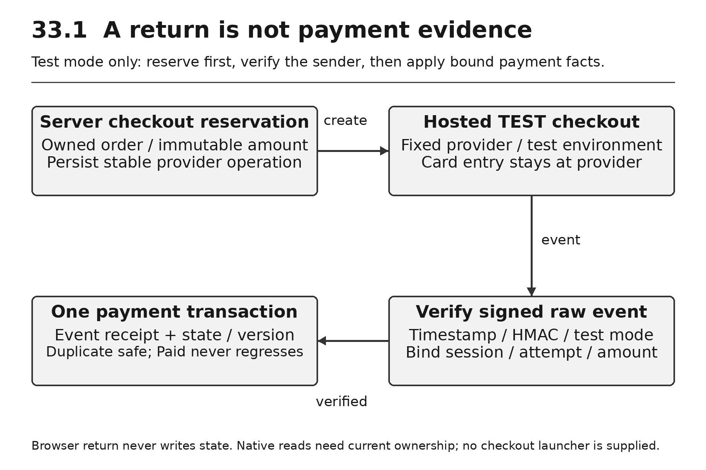

# Chapter 33
# Payment Boundaries and Verified Events

The anniversary-song customer accepts a quote and opens hosted test checkout from a developer browser. They finish the provider's test form, but the browser closes before showing a success page. A minute later, someone visits the return URL with `paid=true` added to its query string. Which action should change the order's payment state?

Neither browser action supplies payment evidence. The service needs an authenticated provider event, bound to its own persisted attempt and amount. A return page is navigation. A signature establishes the sender and exact delivered bytes; the database still has to decide whether that event belongs to this request and whether it has already been applied.

This chapter adds a Stripe test-mode adapter and signed-event lab. The native page reads owned TEST status without launching checkout. Automated tests use simulated provider responses; an actual hosted sandbox run remains a separate acceptance step.

## What You'll Learn

1. Create hosted test sessions from server-owned amounts without accepting card or paid fields.
2. Persist a provider operation before the network call and recover an uncertain creation reply.
3. Verify a bounded raw webhook body and fresh delivery signature before interpreting its JSON.
4. Commit event receipts and payment transitions atomically across duplicates and reordering.
5. Keep browser returns, test payment, order production and storefront eligibility distinct.
6. Plan provider-sandbox acceptance and identify the financial lifecycle still outside this lab.

**Prerequisites:** Chapters 23, 26 and 32, synthetic orders and the pinned toolchain. Automated checks need no credentials. Hosted acceptance needs a Stripe sandbox/test account, test key, correct webhook secret, trusted HTTPS and the recorded API contract. Never use real card data.

**What you will build:** durable server checkout reservations, a test-only provider adapter, a verified webhook endpoint, an owned payment-status read and controlled production-gate tests. The implementation rejects live keys and only maps payment routes in Development when commerce and payments are explicitly enabled. It does not deploy checkout, charge real money or implement refunds/disputes.

## 33.1 Decide what the payment boundary may promise

A hosted checkout page keeps card entry at the payment provider. Our API accepts no card body and sends no story or contact email to create the session. It supplies a generic synthetic product description and the immutable USD amount from the accepted order. The provider may collect its own test contact fields during hosted checkout.

This reduces what the application handles, but does not establish a compliance certification or remove operational responsibilities. Secrets, checkout links, receipts and provider configuration still need protection. The returned hosted URL is a private capability; do not paste it into public diagnostics or attach it to another account's screen.

An owned test receipt has its own state and version. Creating means a durable reservation exists but the session is not yet confirmed locally. Pending means the session is attached but paid evidence has not been applied. Failed and Expired record supported negative events. Paid records verified successful test evidence; ReviewRequired prevents a paid-after-cancellation result from silently starting work.

Order state remains separate. Receiving Paid does not automatically move Accepted to InProduction, send an email or release a file. That separation prevents a payment integration from acquiring hidden fulfillment side effects.

## 33.2 Review the mobile distribution decision first

The app concerns custom music, which can involve creative labor and a downloadable digital result. Those facts do not automatically make it a physical-service or real-time person-to-person exception. Classify the actual product, where it is consumed, the storefront and region, and any applicable program before choosing a mobile checkout method.

The official rules checked on November 16, 2026 distinguish digital purchases from specified exceptions; some alternative billing/link arrangements require eligible regions and program participation. A browser button alone does not establish that an external checkout flow is permitted. The reference worksheet links the current Apple and Google sources rather than presenting a timeless blanket exemption.

Accordingly, the mobile lab adds a Refresh server test-payment status action and no checkout-launch action. The hosted checkout exercise runs from a separately configured developer desktop/browser workflow. This teaches the backend boundary while leaving a concrete storefront decision and review as release work.

Record that decision before a public implementation: product/delivery description, consumption location, storefront/region, selected billing path, relevant rule/program and dated review evidence. Recheck at release; this chapter does not grant store approval.

## 33.3 Reserve a stable server operation

The checkout POST identifies an owned accepted order in its route and accepts an empty body. The server derives owner from the validated issuer/subject and requires orders:write. The caller cannot supply amount, currency, account, return URL or payment state.

Before contacting Stripe, `ReserveTestCheckout` persists one reservation for the order. It captures an attempt ID, provider/account scope, amount/currency, creation time and fixed HTTPS return origin. Retrying the same order returns that reservation; changing account or return-origin configuration blocks automatic reuse.

The provider idempotency key comes from the persisted attempt ID. Generating it only after an HTTP error, or using a new key on every retry, could create another session. The client order-acceptance key from Chapter 32 and this server-to-provider key belong to different operations and must not be confused.

```csharp
var reservation = store.ReserveTestCheckout(owner, orderId,
    provider.Scope, provider.ReturnOrigin);
var session = await provider.CreateAsync(reservation, ct);
return store.AttachTestSession(reservation, session);
```

The actual coordinator first returns an already attached receipt and checks the unresolved retry age. Provider I/O occurs outside a database transaction. Keeping a SQLite writer open while a remote checkout service responds would hold a scarce local resource across an unpredictable delay.

A crash can happen after the provider creates a session but before local attachment. The server remains Creating and can retry with the same reserved key and parameters. Because the provider's API-v1 idempotency keys can be pruned after at least 24 hours, automatic retries stop at 23 hours. A still-unresolved attempt then needs operator reconciliation; the service does not invent a replacement key.

## 33.4 Constrain the provider adapter

`StripeTestCheckoutProvider` supports one direct account, one-time payment mode, card test checkout and USD. It rejects a live key before making a request. It first verifies the configured account ID through the provider account endpoint, then creates the checkout session at the fixed API origin with an explicit API-version header.

The request uses one line item whose amount equals the whole immutable order total. Quantity is one because the order calculator already accounted for the requested song quantity. Multiplying by the order quantity again would overstate the total. No client-supplied discount, tax, shipping or alternate return target enters this contract.

The response must identify a test checkout session and match the attempt, order metadata, currency and amount. Its hosted URL must use HTTPS at checkout.stripe.com, without user information or an unexpected port. A look-alike hostname fails. The adapter disables redirects so a credential-bearing request cannot follow an arbitrary redirect.

One linked cancellation deadline bounds the entire account/session operation, including response bodies. JSON bodies are limited to 64 KiB and bounded depth; duplicate fields fail. Provider errors are summarized without forwarding raw bodies or credentials. A network error preserves the durable reservation and says nothing about whether the provider committed.

The adapter is intentionally narrow, not a general Stripe SDK replacement. It pins the documented 2026-10-28.endive contract, validates the fields it relies on and supplies test coverage for account, amount, destination and environment mismatches. Production would need a maintained integration strategy, fuller lifecycle support and an operational upgrade policy.



## 33.5 Verify bytes before parsing meaning

The webhook endpoint does not require a customer JWT. A provider cannot sign in as the customer, and customer authentication would not prove the provider sent an event. Instead, the endpoint requires a bounded Stripe-Signature header and verifies the exact delivered body using its configured endpoint secret.

The supported signature input is the delivery timestamp, a period and the original bytes. Parsing and reserializing JSON first would change whitespace, escaping or line endings and invalidate that relationship. The verifier accepts a matching v1 signature using constant-time comparison and rejects deliveries more than 300 seconds in the past or future.

```csharp
raw.CopyTo(material.AsSpan(prefix.Length));
var expected = HMACSHA256.HashData(secret, material);
matched |= CryptographicOperations.FixedTimeEquals(
    expected, supplied);
```

The abbreviated excerpt follows the source's timestamp/header checks. It does not show a general-purpose signature protocol. Multiple v1 entries are supported, allowing a matching signature during overlapping provider signing. The service currently configures one active endpoint secret; coordinated rotation, clock synchronization and recovery remain operational responsibilities.

The independent fixture was generated with Python HMAC over a formatted JSON body. Windows CI initially converted its line endings during Git checkout and correctly failed verification. A Git attribute now preserves those exact bytes. The lesson is the protocol boundary: normalize source text where useful, but do not normalize an authenticated message before verifying it.

After signature verification, bounded JSON processing rejects duplicate object properties and excessive nesting. It requires test mode, a direct-account event, a recognized checkout-session shape and matching local identifiers. Connected-account events are outside this contract. A valid signature alone does not establish that the event belongs to the correct order or amount.

## 33.6 Apply supported facts, not optimistic names

The handler supports checkout.session.completed, checkout.session.async_payment_succeeded, checkout.session.async_payment_failed and checkout.session.expired. A completed event whose payment_status is unpaid remains Pending. Paid requires the expected successful status and a payment-intent reference.

The store compares provider/account scope, session ID, attempt ID, order ID, integer amount and currency with its reservation. A mismatch is not repaired by overwriting local price or ownership. It requires reconciliation. If a webhook arrives before session attachment, the service returns a retryable failure rather than acknowledging an unbound event as processed.

| Observation | Stored result |
| --- | --- |
| Completed, unpaid | Pending; no production permission |
| Verified supported success | Paid, unless cancellation requires review |
| Failure or expiry before success | Failed or Expired |
| Late unpaid/failure/expiry after Paid | Preserve Paid |
| Paid after order cancellation | ReviewRequired |
| Same event ID with changed payment facts | Conflict; investigate |

A supported successful event can arrive after a failure, so the state policy permits convergence to Paid. A later negative event cannot erase earlier paid evidence. Different payment references for an already paid session conflict rather than silently replacing its evidence.

Unsupported signed event types are acknowledged without changing state. That includes financial lifecycle work not implemented here. Do not interpret an HTTP 200 for an unsupported refund/dispute event as proof that a refund or dispute was reconciled. Configure only supported events for this lab and add a complete lifecycle before any real-money service.

## 33.7 Commit event receipt and state together

A signature timestamp limits captured-delivery reuse, but providers legitimately redeliver events. The store therefore retains a durable key of provider/account scope plus event ID, together with a fingerprint of the verified payment facts. These records survive process restart.

An identical event returns the current receipt without repeating a transition. Reusing the same event ID for different payment facts is a conflict. A different event ID that reports the same already-paid outcome also produces no second state change. Both event identity and the business transition matter.

```csharp
using var tx = db.BeginTransaction(deferred: false);
// Verify reservation, session, amount and prior event facts.
insertEventReceipt.ExecuteNonQuery();
updatePaymentState.ExecuteNonQuery();
tx.Commit();
```

The real source updates state only when its transition policy changes the current result. Event insertion and that update share one immediate transaction. Tests force the payment update to fail, then remove the synthetic failure and redeliver: because the event receipt rolled back too, retry can apply the payment successfully.

A global 10000-event cap bounds retained lab records. There is no automatic eviction. Deleting event receipts merely to regain capacity could remove replay evidence while provider retries remain possible. Chapter 35 must connect retention, backup/restore and recovery to actual operational requirements.

This is not an exactly-once delivery claim. Deliveries can repeat, fail and arrive out of order. The implementation makes its supported state effect idempotent under a durable database contract. Email, file publication and other future effects need their own durable work records and retry policies.

## 33.8 Reconcile without inventing financial certainty

GET test-payment requires orders:read and an owned order lookup. It returns the current stored observation; it does not query a provider balance on every refresh. Its private checkout URL is returned only while Pending, and all commerce responses are no-store.

The native action uses the accepted request from the current account/resource partition, acquires a current session lease and checks that lease around HTTP. It displays TEST payment state and version. It neither opens the hosted URL nor interprets a navigation callback as a receipt. Leaving the route clears the display.

The fixed return/cancel pages accept no payment authority and perform no database writes. Adding paid=true or a fabricated session ID to their query strings changes nothing. Closing a browser also does not prove cancellation at the provider. A successful late event can arrive after the customer has left.

`StartProductionForPaymentLab` is a controlled in-process fixture: it requires Paid, an Accepted order and the expected order version in one transaction. A paid-after-cancellation result remains blocked for review. This is not a real administrative authorization service. Chapter 32's older graph-only `AdvanceForLab` remains a separate fixture and must never become a production bypass.

The lab does not implement refunds, disputes, partial capture, multiple currencies, payment replacement, reconciliation sweeps or a full ledger. Its test environment cannot authorize real work. Before real use, define those lifecycle and authorization responsibilities explicitly rather than renaming a test flag to production.

## 33.9 Guided Lab: return, verify, replay and recover

1. Run portable and API checks from the repository. Inspect the independent Python vector, raw-byte tamper/skew tests, two-connection duplicate test and forced state-update rollback. Separate real SQLite evidence from simulated provider responses.
2. Accept a synthetic server order through Chapter 32. Use the test API integration to reserve/create a session and apply a signed synthetic event. Verify one owned Paid receipt, a stable payment version and an order still in Accepted.
3. Visit the fixed return and cancel pages with forged paid/session query fields. Verify no payment change. Try a checkout body containing amount, paid or returnUrl; the empty-body contract must reject it before contacting the provider.
4. Deliver completed/unpaid, then a distinct async-success event, then a late failure. Observe Pending, Paid and preserved Paid. Reuse an event ID with changed facts and observe reconciliation failure.
5. Force a provider creation reply to fail after its simulated commit. Retry the same order and inspect the same reserved key. Reopen storage and confirm unresolved evidence survives. Advance the clock beyond 23 hours and verify no new provider POST occurs automatically.
6. Test account B against A's checkout and payment read. An unavailable response must reveal neither A's story nor its hosted URL. Native session switching, TLS and UI clearing still need device observations.
7. If a provider sandbox is configured, follow `docs/payment-lab.md` for test keys, account ID, API contract, local CLI forwarding and the actual signing secret. Complete only a hosted TEST payment with the provider's documented test details; record the resulting signed event and owned server receipt.
8. Cancel a separate test order before its verified successful payment arrives. Confirm ReviewRequired and a blocked production fixture. Plan the operator action rather than automatically refunding or starting work.

No provider credentials are supplied with the book. Until step 7 is actually executed, the hosted provider result stays pending. A passing CI test proves the tested contract, not a real Stripe sandbox transaction, device callback or store-approved checkout journey.

## 33.10 Troubleshooting

**Every signature fails.** Confirm the secret belongs to the actual sender/destination, particularly a local CLI listener versus a dashboard endpoint. Preserve raw bytes, inspect clock skew and never log the secret or full private body.

**A webhook returns 503.** Check session attachment, account scope, amount/identifier binding, retained event capacity and event-ID conflicts. Preserve the provider's retry path and investigate; do not change it to 200 merely to silence retries.

**The browser showed success but payment is Pending.** Wait for and inspect verified events, then refresh the owned record. The return page is not payment evidence, and a completed/unpaid event does not establish Paid.

**An attempt stays Creating after a restart.** Retry its original server operation within the bounded creation window. Beyond that window, reconcile with the provider rather than creating a fresh key that might produce another session.

**Paid does not start production.** That is expected. The test receipt and production order are separate; the controlled gate also needs the right state/version. Real administrative permission and fulfillment are not supplied by a hosted payment page.

## Chapter Summary

Hosted checkout moves test card entry to the provider while the server retains authority over amount, owner and operation identity. A durable reservation precedes provider I/O, and uncertain creation retries reuse its key within a bounded window. Raw-body signature and timestamp checks precede JSON interpretation; identifiers, environment and price must still match local evidence. Event receipts and payment transitions commit together, making supported duplicate and out-of-order deliveries safe to reconcile. Browser returns never mark a request paid. The mobile lab reads owned TEST status without launching checkout, while controlled production checks require paid evidence and the expected order version. Real provider execution, storefront eligibility, refunds/disputes, operational recovery and native behavior remain separately documented integration work.

## Exercises

**Worked exercise — failure after a paid event.** A verified success changes payment version 2 from Pending to Paid at version 3. A distinct delayed failure event arrives. Should version become 4 with Failed? No. The event receipt is retained, but the monotonic paid-evidence rule preserves Paid/version 3. This does not mean that a later genuine refund or dispute can be ignored; those require separately implemented lifecycle semantics.

**Independent exercise — provider reconciliation sweep.** Design an authenticated server-side recovery process for Creating/Pending attempts with missed events. Bound its reads, preserve original operation identity and define which provider facts can change state. Include a crash after provider creation but before local attachment.

**Independent exercise — transactional fulfillment.** Add a durable outbox entry when the supported payment state first becomes Paid. Make a simulated worker safe across repeated delivery and crash after an external action. Do not send real emails or publish files in the exercise.

**Independent exercise — storefront decision record.** Classify a custom song that is downloadable and playable in-app for specific storefronts/regions. Identify required billing/program choices from current official rules and keep approval pending until reviewed. Do not assume that creative labor alone determines the payment exception.

## References and Source Walkthrough

Read `Payments/TestCheckoutCoordinator.cs`, `StripeTestCheckoutProvider.cs`, `StripeTestEventVerifier.cs`, `PaymentContracts.cs` and `Commerce/SqliteOrderStore.Payments.cs`, followed by API `TestPaymentEndpoints`, `PaymentTests` and `TestPaymentApiTests`. `eng/generate_payment_fixture.py` records the original byte-level signature vector; the Git attribute preserves it on Windows.

Primary references, checked November 16, 2026: https://docs.stripe.com/api/checkout/sessions/create; https://docs.stripe.com/api/idempotent_requests; https://docs.stripe.com/webhooks; https://docs.stripe.com/testing; https://developer.apple.com/app-store/review/guidelines/#payments; https://support.google.com/googleplay/android-developer/answer/9858738. Recheck provider contracts and storefront rules before release.
