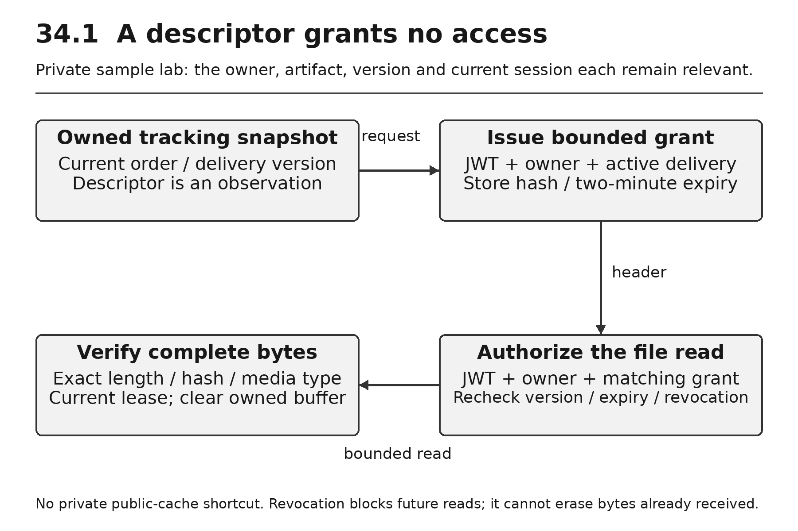

# Chapter 34
# Order Tracking, Revisions, and Delivery

The anniversary customer sees that their song is ready for review. They request an invented lyric adjustment, but the connection fails after the service saves it. When they return, the production team has already published another review. Retrying must find the original revision receipt without sending the order backward or creating another request.

Later, a delivery notice appears. The customer knows its delivery ID, but someone else using the tablet may know that ID too. A useful tracking page must explain the current state, preserve outstanding work and obtain fresh authorization before reading the audio. A notification, an old descriptor or a copied identifier cannot substitute for ownership.

This chapter builds owned tracking snapshots, durable revision requests, in-app notices and a protected sample-file journey. Its controlled service fixtures use verified TEST payment evidence from Chapter 33. They do not authorize real production. The native lab fetches and verifies a small original WAV in memory; private playback, offline storage and live push remain separate integration work.

## What You'll Learn

1. Page owned order summaries and read coherent bounded history snapshots.
2. Persist revision intentions before HTTP and replay them across lost replies and later versions.
3. Commit revision, state, history and content-free notices in one transaction.
4. Bind short-lived delivery grants to owner, artifact and current order version.
5. Recheck authorization and verify complete file bytes without a public-cache shortcut.
6. Handle sign-out, revocation and lifecycle uncertainty without claiming remote erasure.

**Prerequisites:** Chapters 23, 29–30 and 32–33. Use synthetic requests, notes and contact data, the pinned toolchain and a disposable Development database. Automated checks require no live identity or payment account. Native acceptance additionally requires the configured SDK identity, dedicated order scopes and trusted HTTPS access.

**What you will build:** an owned order list/history page, durable revision coordinator, controlled publication fixtures, in-app notices and two-stage private-file access. Fulfillment routes are disabled by default and map only in Development with explicit commerce/fulfillment opt-ins. There is no customer publication endpoint, administrative UI, customer upload or private offline player.

## 34.1 Read a history rather than inventing progress

The server already records versioned state changes. Tracking should expose that evidence instead of inferring progress from elapsed time, a payment page or a local optimistic label. An Accepted request can remain Accepted after a paid test event because payment and production are separate records.

`ListOrders` returns at most 20 summaries for the validated owner. Summaries contain identifier, state, version and creation time; they omit the story, contact fields and revision notes. The next cursor is a canonical generated ID, not a SQL fragment or arbitrary filter expression.

Pages use ascending ID keysets. They are live pages rather than a frozen multi-page collection: a newly inserted random ID before the current cursor may only appear after refreshing the first page. State can also change between pages. The UI therefore treats a list row as a selection hint and loads current tracking before a revision or delivery action.

`TrackOrder` reads the owned order, history, revision receipts, delivery descriptor and notices inside one SQLite read transaction. Those records must describe the same database snapshot. Reading them through unrelated requests could combine version 5's order with version 4's history and create a misleading picture.

The snapshot is bounded: at most 100 history entries, 10 revisions, one current delivery and 100 notices. Over-cap history fails visibly instead of looking complete while hiding older evidence. The controlled publication/revision paths enforce those budgets. Legacy graph fixtures are not a substitute for production retention or migration policy.

## 34.2 Keep ownership at every resource boundary

The endpoint policy validates authentication and the required orders:read or orders:write scope. The store then includes validated issuer and subject in the order lookup. Possessing an order ID does not prove ownership, and knowing a delivery ID grants no additional right.

A foreign order and an unknown order are both unavailable. Revision, history and delivery queries first establish the owned parent relationship. The code never trusts a posted account field or accepts an arbitrary file path. Strict JSON rejects extra authority fields, duplicate properties and oversized bodies.

| Operation under /api/v1/commerce | Required authority |
| --- | --- |
| GET /orders and /orders/{id}/tracking | Current credential, orders:read and owned lookup |
| POST /orders/{id}/revisions | orders:write, owner and valid expected version/state |
| POST /orders/{id}/deliveries/{delivery}/grant | orders:read, owner and active current delivery |
| GET /orders/{id}/deliveries/{delivery}/content | Current credential, owner and matching unexpired grant |

All commerce responses use no-store. That directive does not physically erase application buffers or revoke a previously received file. The native page clears its own visible state when selection, account or route changes; the server independently authorizes each new request.

## 34.3 A revision is a new durable operation

A revision note does not edit the immutable original request or quoted amount. It records a specific requested adjustment against a reviewed order version. The lab accepts a nonempty trimmed note of at most 1000 UTF-16 characters and rejects unsupported control characters.

A new revision requires ReadyForReview, the exact expected order version and verified TEST Paid state. The operation then returns the order to InProduction, advances its version and records the note. This is a controlled teaching workflow, not a promise that unlimited real revisions are included in a commercial purchase.

Before writing, the store looks up the owned order and operation key. Matching base version and canonical note return the original immutable receipt even if a later review has already been published. Reusing the key for different facts is a conflict.

```csharp
var replay = RevisionByKey(orderId, command.OperationKey, tx);
if (replay is not null)
{
    // Compare original base version and canonical note.
    tx.Commit();
    return replay;
}
```

Only a new operation proceeds to current version/state checks. As with order acceptance, that ordering prevents a successful earlier request from becoming an apparent failure merely because the service moved on.

The write transaction inserts the revision, changes state/version, appends history and inserts a notice. A test forces notice insertion to fail and proves that the revision and state changes roll back too. Another uses two independent SQLite connections to show that duplicate requests converge on one receipt.

## 34.4 Preserve the revision before the network call

`PendingRevisionDatabase` owns one last operation per account/resource/order. The partition includes issuer, subject, API origin, audience and order ID. It stores the canonical note, expected version and generated key before any revision POST. It does not store tokens or delivery grants.

```csharp
journal.Begin(api.Account(lease), orderId, version, note);
return ResumeAsync(orderId, lease, ct);
```

An unresolved operation cannot be replaced with a different note just because its reply is missing. Retry sends the saved operation. A successful receipt is validated and committed locally before the coordinator reports confirmation. The server receipt describes the earlier applied version; it is not permission to overwrite a newer tracking snapshot.

Consider the opening example. Review version 3 accepts revision K, producing version 4/InProduction. Its reply disappears. A later review produces version 5/ReadyForReview. Retrying K returns the original version-4 receipt. The page then refreshes tracking to learn version 5, rather than moving the current order backward.

Only explicit post-replay VersionConflict, InvalidTransition and Unavailable outcomes can complete an unresolved local attempt as rejected in this lab. Generic bad input, key conflict, capacity, network failure and unknown responses retain the key for reconciliation. Do not silently create another revision as generic recovery.

The journal is plaintext synthetic storage, bounded to 64 account/resource/order rows. Unsubmitted editor text is not durable and is cleared on selection/departure. Sign-out retains submitted pending work under its original partition; privacy export/deletion integration for these records remains separate work.

## 34.5 Publish through a controlled service boundary

The customer may request a revision but cannot declare its own work ready or delivered. `PublishReviewForLab` and `PublishDeliveryForLab` are trusted in-process fixtures with expected-version, state and TEST payment checks. No administrative or customer publication HTTP endpoint is exposed.

Publication advances state/history and writes a content-free notice in the same transaction. Delivery publication also inserts an immutable descriptor. Exact fixture replay returns the same descriptor; it cannot create another artifact or undo a later revocation.

| Action | Result in the controlled lab |
| --- | --- |
| Paid production fixture | Accepted becomes InProduction |
| Publish review | InProduction becomes ReadyForReview; append notice |
| Owned revision | ReadyForReview becomes InProduction; save note/receipt |
| Publish delivery | ReadyForReview becomes Delivered; save descriptor/notice |
| Revoke delivery | Keep Delivered, advance version/history and mark unavailable |

A revocation can change availability without changing the historical fact that a delivery was published. The resulting history includes the same Delivered state at a newer version, while the DeliveryRevoked notice explains the change. Readers must not assume that every version increment changes the state name.

Notices contain generated ID, kind, order version and time. They contain no revision text, story, token or download URL. The page sees them on an explicit owned refresh. They are durable in-app observations, not evidence that an email, local notification or APNs/FCM message reached a device.

A future outbox can distribute a generic hint through Chapter 30's notification boundary. The receiver would still refresh owned state. Message acknowledgment, provider retries and live delivery require separate evidence; a notice row alone proves none of them.

## 34.6 Obtain a short-lived read grant

The delivery descriptor identifies an artifact, its version, media type, length and SHA-256. It does not authorize access. The client must ask the owned API for a grant tied to the current order version and active delivery.

The server generates 32 random bytes, encoded as 64 lowercase hexadecimal characters. It stores only the grant's SHA-256 hash plus delivery, owner, order version and two-minute expiry. Four active grants per delivery and 1000 globally bound the lab. Issuing a new grant removes expired rows; exact expiry rejects access.

The grant travels in the X-Delivery-Grant header, not a URL query string. Every content read also requires a valid JWT, orders:read and the same owner. Copying the grant to another account or delivery does not make it usable. Keeping credentials out of URLs reduces accidental propagation through copied links and URL-oriented diagnostics.



The content endpoint rechecks Delivered state, TEST paid evidence, current order/delivery version, revocation and grant expiry. A stale version must be refreshed rather than forced through a cached descriptor. A revoked delivery cannot obtain a new grant, and existing grants cease to authorize future requests.

The sample does not make the grant a public bearer URL or expose a static private-file directory. It accepts only generated order/delivery IDs and serves one validated embedded fixture. No caller controls a filesystem path, storage key or arbitrary remote origin.

## 34.7 Verify a complete representation without public caching

Chapter 29's public downloader explicitly rejects private delivery descriptors. Do not bypass that rule by labeling a customer artifact public because it happens to use HTTPS. Private persistence needs a separate owner, protection, retention, sign-out and deletion design.

This lab deliberately performs a complete small read into memory. It rejects Range requests, supports no background resume and creates no native file, share copy or offline cache. The endpoint returns a fixed filename, audio/wav and nosniff; the client requires the expected status and representation.

The whole fetch has one 20-second budget across grant issuance and content read. JSON is bounded at 256 KiB, errors at 8 KiB and revision requests at 16 KiB. Audio is bounded by its exact trusted teaching descriptor. Redirects are disabled, so a credential-bearing request cannot follow an arbitrary destination.

```csharp
if (bytes.LongLength != delivery.Length ||
    Convert.ToHexString(SHA256.HashData(bytes))
        .ToLowerInvariant() != delivery.Sha256)
{
    CryptographicOperations.ZeroMemory(bytes);
    throw new InvalidDataException("Delivery integrity failed.");
}
```

After verification, a current-session check precedes returning the owned buffer. `VerifiedDelivery.Dispose` clears that buffer. This is a useful lifetime boundary, not proof of physical erasure: transport, serializer, managed-memory and OS copies may still exist. A server cannot retract bytes that it already returned.

The fixture is an original three-second 16-kHz mono PCM tone generated by `eng/generate_private_delivery.py`. The API validates its 96044-byte length and hash at mapping. It is a known public-source teaching artifact, not a secret customer recording. Access tests establish route policy; they do not make these published sample bytes confidential.

The native page reports verified bytes and clears its owned array after the action. It does not claim listening, native decoding or private offline playback. Composing an authenticated artifact with the earlier player requires a separate private-storage/player lifetime design and device acceptance, rather than a public media-URL shortcut.

## 34.8 Keep late work out of a new account or selection

`TrackingApiClient` captures an owned session lease, checks it around HTTP and fixes the configured API origin. The page checks the lease again before publishing a list, snapshot, receipt or verified-byte result. A successful response from an obsolete session must not become the new customer's screen.

Selecting another order cancels current work and clears detail/editor state. Actual Shell departure or window destruction clears the list, notes, history and status. The sign-in browser obscuring the page is a different lifecycle event and does not itself imply route departure.

Sign-out cancels visible work and clears the view while preserving original-owner pending revisions. Cancellation cannot reverse a committed server transaction. A controlled test delays the reply after revision commit, signs out and proves that the old operation remains pending for its original account rather than publishing under another one.

File authorization is evaluated when a request starts. Expiry or revocation during an already authorized response cannot retroactively erase that response. The client's session fence prevents obsolete UI publication, but is not continuous server reauthorization or a rights-management guarantee. Future streaming and offline designs must state their own boundaries precisely.

## 34.9 Guided Lab: review, revise and retrieve

1. Run the portable/API suites and inspect FulfillmentTests and FulfillmentApiTests. Identify actual temporary SQLite, real signed JWT middleware, the production client and the simulated HTTP loss. Payment/production/publication steps remain controlled service fixtures.
2. Enable Commerce and Fulfillment in Development using `docs/fulfillment-lab.md`. Configure dedicated scopes and trusted HTTPS for native testing. The default server exposes no fulfillment routes and starts no automatic fixture administrator. The supplied local FulfillmentLab console can seed a review for your configured development account; its smoke mode runs with an isolated temporary database.
3. Create a synthetic quote and accept it through the actual API. Apply verified synthetic TEST payment evidence, enter production through the paid fixture and publish a review. Load owned summaries, then the current history snapshot.
4. Submit one invented revision at version 3. Verify one immutable receipt, version 4/InProduction, history and RevisionRequested notice. Publish review version 5. Retry the original key/note and confirm the original receipt without another revision.
5. Run the lost-reply test with client/server databases reopened. Then test local persistence failure: no revision HTTP call should occur. Switch accounts or leave while a reply is delayed; the old result must not publish into the new scope.
6. Publish a delivery through the controlled fixture. Confirm Delivered and the content-free notice in one snapshot. Fetch the original WAV through the production client, verify RIFF bytes/length/hash and dispose its buffer.
7. Try anonymous, foreign-owner, missing-grant, wrong-delivery and forged-query requests. Advance to exact grant expiry, obtain a fresh grant and test revocation. None of the failed requests may return sample-file bytes.
8. Complete native list/selection, keyboard, large-text/screen-reader, route/window, sign-out and TLS observations separately. Record file verification independently of listening. Keep unexecuted Android/iOS/provider rows pending.

The deterministic journey establishes request-to-delivered-sample behavior under a controlled service contract. It is not a deployed customer/admin workflow, real paid commission or completed native listening session. Preserve that distinction when adapting the lab to actual Gnazzo's World customers.

## 34.10 Troubleshooting

**The order list is empty.** Confirm the current issuer/subject and server database. Earlier local form submissions are not owned service orders, and another account's records must remain absent.

**A revision reports a version conflict.** Refresh tracking. If the prior reply was uncertain, retry the saved operation first; its matching receipt is checked before later version rules. Do not generate a fresh key to hide ambiguity.

**The receipt shows an older version than tracking.** That can be correct. The receipt describes the revision's applied version; current tracking may contain a later review. Keep the records' meanings separate.

**The delivery descriptor exists but access is unavailable.** Check current owner, credential, version, paid evidence, grant expiry and revocation. A descriptor or notice is not permission. Four active grants can also exhaust the small lab budget until expiry.

**The hash or media type fails.** Discard the candidate. Do not publish partial bytes or cache the representation as public. Investigate descriptor authority and actual response before retrying.

**Revocation did not remove an already received copy.** Revocation blocks new authorized reads. It does not erase another process's memory, a receiver's copy or previously played audio. Do not report physical deletion from an availability flag.

## Chapter Summary

Owned tracking combines bounded history, revisions, delivery metadata and notices in one database snapshot. Revision intentions are saved before HTTP and replayed by their original key, while immutable receipts remain distinct from newer order versions. Controlled publication commits state, history, descriptor and content-free notice atomically. A delivery ID grants no access: a short-lived hashed grant remains bound to the current owner, artifact and version, and every read also needs an authenticated credential. The client verifies complete bytes and its session before reporting success, without using the public cache. Sign-out clears visible state but preserves original-owner pending work. Revocation blocks future reads, not copies already received. Native listening, real administration, provider notifications and operational privacy/recovery remain separate integration work.

## Exercises

**Worked exercise — a revision receipt is not current state.** Version 3 accepts key K and records revision version 4. Another review advances the order to version 5. A lost-reply retry of K returns the original receipt at version 4. Should the page replace its version-5 snapshot with that receipt? No. It records confirmation of K and refreshes tracking independently. The server has one revision, not two competing current states.

**Independent exercise — private playback workspace.** Design per-owner storage, bounded verified publication, player lifetime, cache eviction, sign-out cleanup and process recovery for a private delivery. Preserve Chapter 29's public-cache rejection and distinguish logical invalidation from physical erasure. Test native decoding/listening separately.

**Independent exercise — notification outbox.** Add an atomic delivery-notice outbox entry. Make a simulated worker safe across duplicate processing and a crash after sending. Carry a generic hint and require an owned read after activation. Use simulated messages only.

**Independent exercise — delivery replacement.** Extend the controlled service with versioned artifact replacement and migration of active grants. Specify which earlier descriptors remain visible, how stale accesses fail and how outstanding customer revisions are reconciled. Include a read already authorized when replacement occurs.

## References and Source Walkthrough

Read `Commerce/SqliteOrderStore.Fulfillment.cs`, `Fulfillment/TrackingContracts.cs`, `PendingRevisionDatabase.cs`, `RevisionCoordinator.cs` and `TrackingApiClient.cs`, then API `FulfillmentEndpoints` and native `OrderTrackingLabPage`. The runnable `tools/GnazzosWorld.FulfillmentLab` supplies an isolated smoke journey and explicitly enabled local fixture commands. Compare the API journey's actual HTTP/client path with the portable lost-reply handler and its real reopened databases.

Primary references: ASP.NET Core resource-based authorization at https://learn.microsoft.com/en-us/aspnet/core/security/authorization/resource-based; Microsoft.Data.Sqlite transactions at https://learn.microsoft.com/en-us/dotnet/standard/data/sqlite/transactions. Authorization policy and resource ownership are separate checks; SQLite transaction evidence is separate from native/provider behavior.
