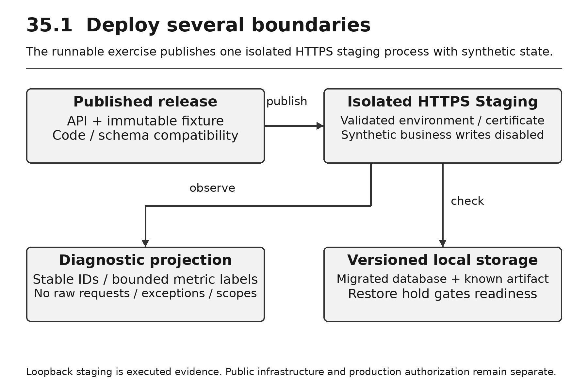
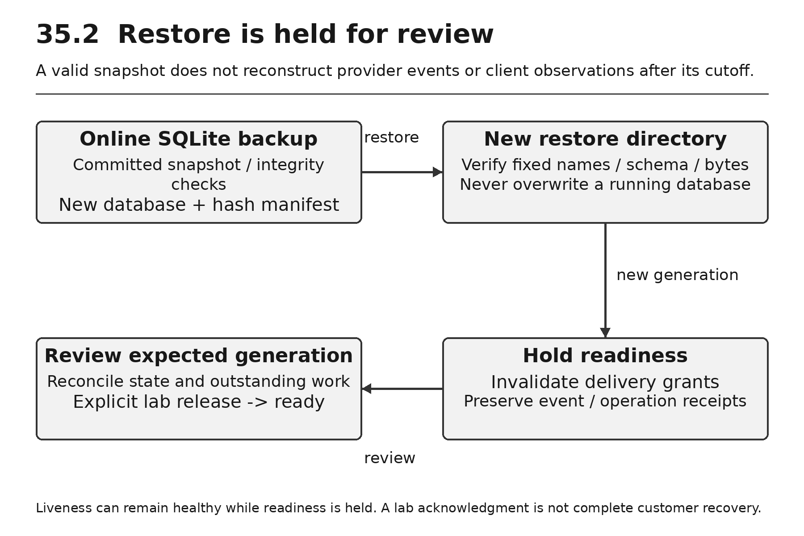

# Chapter 35
# Hosting, Diagnostics, and Operating the Small Backend

The anniversary request is delivered in the lab. The next morning, an operator restores yesterday's database and starts the API again. Its process responds, but the restored state no longer matches the latest customer observations. An old delivery grant might still be within its lifetime, and a payment event may arrive again. A green process-health response does not answer whether this service is ready for traffic.

Meanwhile, a developer wants enough diagnostic information to explain a failed request. Logging the entire URL, exception, scope or HTTP body would also copy stories, email addresses, checkout links or credentials into another data system. Useful operations require a deliberate evidence contract, not merely more output.

This chapter closes Part VII with a runnable published HTTPS staging/recovery drill, explicit schema maintenance, safe diagnostic projections and a native local-consent lab. The staging process runs on loopback with synthetic data and disabled business-write labs. Public cloud provisioning, production traffic and real customer recovery remain separate deployment decisions.

## What You'll Learn

1. Publish an isolated staging artifact and separate its code, configuration, credentials and state.
2. Distinguish liveness, dependency readiness and explicit restore review.
3. Migrate a known schema and verify online backups without replacing a running database.
4. Correlate structured logs, low-cardinality metrics and sampled traces without copying private content.
5. Plan managed/native crash reporting, consent, retention and provider-specific privacy tests.
6. Bound newsletter integration and prepare an operational recovery/cost worksheet.

**Prerequisites:** Chapters 18, 23, 26 and 32–34. Use the pinned SDK, synthetic records and a disposable workspace. The published-process runner needs the .NET runtime, a loopback port and local certificate/file access. It needs no provider account or mobile workload. Native observations and remote telemetry setup require separate platform/provider configuration.

**What you will build:** schema version 1, a local backup/restore operator, an HTTPS Staging process, readiness hold/release, a safe controlled-failure trace, a consent-controlled local diagnostic buffer and a newsletter confirmation port. None of these samples provisions public infrastructure, sends real mail, initializes a remote crash SDK or authorizes production commerce.

## 35.1 Separate the deployment's authorities

A published DLL is only one part of a running service. The process also needs an environment, trusted HTTPS configuration, an identity authority/audience when protected operations are used, persistent data and an artifact inventory. The person or automation able to change each resource has different authority.

The lab publishes the API to an output directory and runs that actual artifact in a child process. Its environment is Staging, its address is loopback HTTPS and its database is a restored copy in another temporary directory. The original WAV is a separately validated release fixture. The process never serves that directory through a public static-file mapping.

The Operations profile accepts Development or isolated Staging and rejects Production. Outside Development it also rejects enabled synthetic commerce, checkout or fulfillment write labs. Publishing the earlier teaching code does not transform a locally manufactured TEST paid event into real commercial authority.

| Resource | Operational responsibility |
| --- | --- |
| Published API and immutable fixture | Reproducible build, release identity and integrity |
| Environment/configuration | Explicit flags, paths, origin and version compatibility |
| Private credentials | Restricted delivery, rotation and access; no source-code secrets |
| Database and real artifacts | Durable storage, backup inventory and recovery owners |
| Diagnostic sinks | Approved fields, access, budgets, retention and deletion |

The runner creates an ephemeral localhost certificate and pins that exact certificate for its fixed loopback client. It still checks the expected host and rejects other TLS errors and redirects. It installs no machine-wide root and enables no global validation bypass. This narrow test arrangement is not a public certificate-renewal strategy.

For a real deployment, decide host binding, firewall, public DNS, certificate renewal, trusted proxy/forwarded-header policy, persistent volumes and operator access. A single-file SQLite teaching service also needs an explicit writer/replica topology. Starting several replicas with unrelated local disks would create several histories rather than one durable service.



## 35.2 Treat configuration as validated startup input

Operations requires absolute database and artifact-directory paths and an integer trace percentage between zero and 100. Secrets and private keys are supplied to the child process at runtime, not embedded in the repository or safe evidence file. The runner copies only a small environment allowlist before adding its explicit staging settings.

Set ASPNETCORE_ENVIRONMENT and DOTNET_ENVIRONMENT consistently in the exercise. The host's bootstrap behavior and environment-variable precedence matter; a launch profile or inherited variable can otherwise select an unintended environment. The published runner does not depend on an IDE's Development profile.

Service registration must also respect when configuration becomes final. The integration tests add settings through the test host. Reading an opt-in flag too early during registration initially omitted operations services even though the final application configuration enabled them. Lazy registration and final configuration checks now use the same settings in the test and published hosts.

That correction is a useful deployment lesson: validate the configuration actually used by the built host, and test layered configuration rather than only one convenient environment. A feature flag should not leave half its services registered and the other half mapped.

The default API still has no operations endpoints. When the profile is enabled, it maps liveness/readiness and, only with a separate explicit flag, a bounded controlled-failure probe. The probe is a private staging diagnostic tool, not a public production fault-injection interface.

## 35.3 Liveness is not readiness

The existing /health fixture remains available. Operations adds /health/live for process responsiveness and /health/ready for the specific local dependencies this profile needs. Both return generic status with no-store; neither returns database paths, exception text, secrets or customer records.

Readiness opens the migrated database read-only, checks its schema/maintenance state and verifies the known artifact's bytes. A missing or changed artifact, an unmigrated database or an unresolved restore hold returns not_ready. This does not test a payment provider, email delivery, actual customer ownership journey or every future storage dependency.

After restore, liveness must remain 200 while readiness remains 503. The operator then reviews the restored state and releases the exact restore generation through a local maintenance method. The same running process must subsequently return ready. A process restart is not itself the acknowledgment.

Public hosting systems often probe readiness to decide where to send traffic. Keep such probes on an appropriate private network and use generic results. Their cadence still consumes database/file I/O; readiness should not run a full historical integrity scan or expose an unbounded diagnostic query on every request.

A green readiness result establishes the defined checks only. It cannot certify that external payment facts were reconciled after a point-in-time restore or that a backed-up private artifact still exists somewhere else. Those are operator procedures and additional dependencies to implement.

## 35.4 Make the first operations migration explicit

Earlier development databases used the commerce tables without an operations schema version. The new operator treats that complete known table set as version 0. The explicit migration adds migration and maintenance records together and sets SQLite user_version to 1.

```csharp
using var tx = db.BeginTransaction(deferred: false);
// Validate the known legacy table set first.
// Create migration/maintenance records and initial generation.
// Set PRAGMA user_version=1 in this same transaction.
tx.Commit();
```

Initialization requires a new database file; it never overwrites an existing one. Migration validates the expected table set and rejects unrelated or newer databases. Repeating the supported migration is safe. The ordinary store also refuses an unsupported future version before its CREATE statements run.

The test suite preserves an existing order snapshot through migration and verifies that a future-version rejection leaves database bytes unchanged. Another test supplies an unrelated SQLite file and confirms that it does not quietly acquire commerce tables through the migration operator.

This is a small, explicit version-0-to-1 migration, not a general migration engine or a guarantee of reversible future changes. Later data transformations need their own transaction, compatibility tests and failure strategy. Pin code and schema together; do not assume that an old binary can safely open a newer database during rollback.

Production migration also needs quiescing/locking policy, a tested pre-change backup, duration/capacity estimates and a documented operator. The lab's local command has direct database authority. It is deliberately not exposed as an unauthenticated HTTP maintenance endpoint.

## 35.5 Back up a database, not a convenient live filename

Copying the main file while SQLite is active can miss committed WAL content or capture an incoherent representation. The operator uses SqliteConnection.BackupDatabase, validates the resulting database and writes a manifest before publishing the new backup directory.

```csharp
using var source = Open(sourcePath, readOnly: true);
using var target = new SqliteConnection(
    new SqliteConnectionStringBuilder
    { DataSource = destination, Pooling = false,
      DefaultTimeout = 2 }.ToString());
target.Open();
source.BackupDatabase(target);
// Close, check schema/relationships and hash the backup bytes.
```

The excerpt shows the native backup boundary; the complete implementation uses a newly owned staging directory. It publishes database plus manifest by renaming that directory into a new destination. Existing backup directories are never overwritten, and failures clean only the operator's own temporary directory.

Tests enable WAL, leave the writer store open, back up one committed order and then add another order. The restored snapshot must contain the first and omit the later second order. That proves more than comparing a copied filename with the still-running source.

The manifest records format version, database version, length, SHA-256 and time. It contains no source path or customer fields. Verification checks the bytes, expected schema, SQLite quick_check and foreign-key consistency. It does not prove every business invariant or authenticate an attacker who replaces both database and manifest.

The lab limits database files to 64 MiB and uses a short busy timeout. BackupDatabase is synchronous and can block writers; its native work and filesystem I/O do not become a hard wall-clock guarantee because a command has a timeout. Measure the window and quiesce a larger workload when required.

Real backups require protected storage, encryption and key custody, off-site/independent copies, retention and restoration rehearsals. The examples are plaintext synthetic backups. Do not upload databases, raw logs or private artifacts into public CI merely because the automated run succeeded.

## 35.6 Restore into a new directory and hold traffic

Restore verifies the fixed database/manifest names and checks the copied bytes again before publishing a new directory. It never swaps a file beneath the running process. A test confirms that an existing target directory and its marker file remain unchanged.

The restored database gets a fresh generation and restore_pending=1. Delivery-grant rows are removed, because a previously issued short-lived grant should not regain authority merely because an earlier database image was restored. Orders, history, revisions and payment-event receipts remain intact.

Keep replay evidence. Deleting an old provider event or operation receipt can make a legitimate retry look new. The published staging drill applies the original verified TEST payment event after restore and confirms that it remains a replay rather than creating another payment state change.

The restore can nevertheless move business history backward relative to a provider or client. An event delivered after the backup may have been applied before the outage, and an installation may retain a newer confirmed order version. Hold writers, compare external facts and reconcile outstanding operations before a real cutover. Do not erase client journals to hide a version conflict.

The local release-restored command requires the expected new generation. A wrong or already released generation fails. In the lab this acknowledges the controlled review; it is not evidence that all real financial/customer state has been reconciled. Production traffic cutover and rollback require an independently reviewed procedure.

Define recovery point and recovery time objectives in concrete terms: how much accepted work may be missing, how long recovery may take, who decides traffic is safe, and which provider/customer obligations remain. Test those objectives under realistic size and failure conditions, rather than treating a valid backup hash as the entire recovery plan.

The known WAV is an immutable release artifact. Real uploaded blobs need a protected versioned inventory, checksums, keys and coordinated recovery. A database snapshot that references missing audio is not a complete delivery backup.



## 35.7 Design log records as data contracts

ILogger categories answer which component emitted an event. Stable event IDs answer what kind of event it was. Structured templates preserve named fields for queries. None of those mechanisms automatically removes private values placed into a message, exception or scope.

The operations projection emits event 3501 with generated OperationId, bounded Area/Outcome, status class and duration bucket. Event 3502 correlates an allowed trace projection with that operation. The earlier event 2601 remains a typed owned-read decision. There is no note, email, full URL, order ID, token or exception field.

```csharp
logger.LogInformation(
    new EventId(3501, "OperationCompleted"),
    "Operation {OperationId} {Area} {Outcome} " +
        "{StatusClass} {DurationBucket}",
    operation, area, outcome, status / 100, bucket);
```

Use a generated server operation ID as the primary support correlation. The sample ignores a caller's X-Correlation-Id rather than reflecting arbitrary input into logs. Standard W3C trace context can still propagate bounded trace identifiers, but correlation is not authentication or an immutable audit identity.

Inherited scopes are a subtle data sink. Framework scopes can contain a request path even when our own message template is safe. Operations mode disables scope serialization in its JSON console projection and restricts logger categories. It suppresses ordinary framework request/authentication/exception output that may contain URLs or arbitrary exception messages.

That suppression removes detail too. Diagnosis needs controlled reproduction, safe failure classifications, release/symbol information and protected break-glass procedures. A general dump or raw exception upload is not automatically permitted because an operator wants more context.

## 35.8 Separate metrics from traces and audit evidence

The custom Meter records completed operations and a duration histogram. Its tags are only the bounded area and outcome sets. An operation ID, customer ID or URL must not become a metric label: that would create an unbounded series inventory, cost and another private-data index.

The ActivitySource surrounds the operation and marks server failures. Its local listener projects only explicit operation/trace/enum facts. It does not serialize Activity, baggage, inherited tags, scopes or exception objects. The controlled failure is always sampled so the exercise has deterministic evidence; ordinary traces use the configured head percentage.

```csharp
var tags = new TagList
{
    { "area", area }, { "outcome", outcome }
};
completed.Add(1, tags);
duration.Record(ms, tags);
```

Completion logs and metrics are distinct from sampled traces. A missing trace may reflect sampling rather than a missing request. Head sampling cannot know every later failure; a production tail-sampling strategy needs collector buffering, limits, cost and privacy policy of its own.

The selected maintained server path is .NET's ILogger, Meter and ActivitySource with OpenTelemetry collection/export when a backend is configured. The runnable lab keeps its projection local and configures no remote account. Adding automatic ASP.NET/HttpClient instrumentation or an OTLP exporter expands the data contract and requires another redaction/credential/queue review.

A safe custom span does not prove that every built-in source, exporter or collector is safe. Review URL/peer fields, baggage, resource attributes and error recording. Likewise, stable operational event IDs do not create a tamper-resistant financial ledger or replace customer/order history.

## 35.9 Trace a controlled failure across real HTTPS

The staging runner sends private canaries in a query, headers and body. Its controlled endpoint throws an exception containing another private marker. The endpoint has a small body bound and shared rate budget; the handler returns a generic 503 with the generated operation ID.

The test requires that ID in the response and matching 3501/3502 events in actual captured process output. It also checks that the raw output contains none of the canaries, old grant or certificate password. Only an allowlisted evidence summary is written; the raw capture, database and certificate are not uploaded.

This is an end-to-end diagnostic trace through a published HTTPS process, not only a fake logger assertion. The API tests separately inspect structured fields and metric tags, while the portable tests exercise schema, backup and consent contracts. Each layer supplies different evidence.

The process must remain live afterward. A caught controlled failure is not a fatal server crash, native abort, out-of-memory event or OS termination. Those failure modes may bypass middleware and require isolated deployment tests, protected dump handling and a recovery supervisor.

## 35.10 Give mobile diagnostics their own consent boundary

The native Diagnostics and consent lab defaults off and stores a separate installation-local consent choice. Its in-memory queue retains at most 20 events: generated ID, typed area/fault and time. Record accepts no free text or Exception, so a private exception message cannot enter through that API.

Turning collection off clears this local buffer. Leaving the page clears its visible records. The sample exports nothing over the network and initializes no crash SDK. Local collection consent is not blanket permission for remote diagnostics or marketing, and clearing a managed buffer is not physical erasure of all copies.

Managed handled failures, unhandled managed faults and native crashes need different tests. A catch block can record a safe typed storage failure. A native abort or startup crash may be captured before that managed UI exists. Release symbols, offline SDK storage, retry after restart and actual platform payloads must be reviewed separately.

Sentry.Maui is the maintained mobile crash-reporting candidate selected from current official documentation. Its documentation describes managed/native reporting and additional breadcrumbs/session/device context. Quickstart diagnostic options are not a privacy policy. Before enabling an SDK, review collection timing, messages, requests, breadcrumbs, attachments/screenshots, identifiers and client-side scrubbing/dropping.

Keep default PII off unless a specific reviewed need justifies it. Test native crash payload handling independently of managed hooks, and verify the pinned SDK against the actual MAUI/OS build. No DSN, remote export or actual device crash result is supplied here. This preserves a useful source example without pretending that an unconfigured provider has been exercised.

Server fatal crashes and dumps deserve the same discipline. They may contain database pages, token strings or arbitrary memory outside the allowlisted logger. Restrict who can collect them, where they can be stored, how long they remain and whether they may leave the environment.

## 35.11 Bound the newsletter adapter separately

A song-request email address is contact information for that request, not automatic newsletter consent. NewsletterBoundary requires a separate explicit action, validated bounded address, consent version and stable operation key. It asks an INewsletterGateway for confirmation within a ten-second caller budget.

The result is PendingConfirmation, Rejected or Unconfirmed. Pending is not subscribed, and a timeout cannot prove that the provider did nothing. Retain the original operation identity when reconciling uncertainty; do not repeatedly send confirmation requests with fresh keys.

No real provider or outgoing message is configured. A concrete gateway must enforce fixed trusted HTTPS, request/response bounds, redirects, secret handling, provider replay semantics, double opt-in, suppression and unsubscribe. The included tests prove that missing consent or invalid input never calls the gateway and that network uncertainty does not become a subscription claim.

This is a small service boundary with a narrow purpose. Do not attach it implicitly to checkout, recovery, diagnostics consent or order acceptance because those flows happen to contain an address.

## 35.12 Guided Lab: publish, restore and diagnose

1. Run portable and API suites. Identify real WAL/online-backup tests, future-schema rejection, new-directory restore, consent bounds, structured diagnostic fields and low-cardinality metric assertions. Distinguish provider doubles from actual process/TLS evidence.
2. Follow `docs/operations-lab.md` to publish the API and build OperationsLab. Run staging-smoke with the published DLL, original WAV and a new evidence path. Inspect only its public-safe result, not credentials or raw private diagnostic capture.
3. Verify the actual process is Staging with business-write labs disabled. The runner's loopback certificate pin is deliberately narrow; do not replace it with an always-true callback or copy it into a public client.
4. Observe that restored liveness is 200 while readiness is held at 503. Confirm that the expected generation is reviewed/released and readiness becomes 200. A wrong generation must fail.
5. Verify restored order/history, repeated TEST paid event and invalidated old grant. Inspect a tampered backup and an existing restore target: neither may be published over the target. Retain replay evidence while considering external reconciliation.
6. Follow the generated operation ID from generic 503 response to completion/trace events. Confirm the private canaries are absent from actual captured output. Then check that the process remains live; do not label this a fatal-crash test.
7. Open the native local-consent page. Collection starts off; simulated recoverable events appear only after opt-in, stay bounded and clear on opt-out. Record native UI/lifecycle observations separately from Android compilation.
8. Fill in the operational worksheet for a future hosted environment: storage topology, secrets, TLS/proxy ownership, RPO/RTO, artifact backup, retention, access, monitoring, budgets and provider reconciliation. Keep real provisioning and unexecuted device/provider checks explicit.

## 35.13 Diagnostics and cost troubleshooting

**The process is live but not ready.** Check the explicit migration, restore hold, configured artifact and its hash using protected operator access. Do not expose paths or raw database errors through the health response.

**A newer database is rejected.** Match the supported release/schema and follow the recovery procedure. Do not lower user_version or run an older binary merely to bypass the guard.

**A failed request has no sampled trace.** Search by generated operation ID in the completion record and inspect sampling configuration. Avoid adding customer IDs or full URLs to metric labels as a shortcut.

**A private marker appears in diagnostics.** Stop or restrict that export, preserve a sanitized defect report and inspect the complete provider/scope pipeline. Structured templates do not sanitize arbitrary values. Retest the actual sink after any exporter or filter change.

**A restore reintroduces disagreement.** Hold traffic and reconcile provider/client facts. A checksum proves snapshot bytes, not that all subsequent real events were reconstructed.

Budget compute/concurrency, database/artifact storage, backup copies, private egress, provider retries and telemetry ingestion/retention. Bound queues and labels, measure release-like load and set alerts before raising limits. Lab quotas and timings are not production capacity or cloud-price evidence; check the selected region/provider's current terms before provisioning.

## Chapter Summary

Operating a backend requires separate authority over releases, configuration, credentials, state and diagnostics. The lab publishes an isolated HTTPS Staging process, migrates a known schema, verifies online backups and restores into a new held directory. Old delivery grants are invalidated while operation/payment replay evidence is preserved. Liveness remains distinct from readiness and explicit recovery review. Allowlisted ILogger fields, bounded metric labels and sampled ActivitySource projections correlate a controlled failure without copying private request or exception content. Local mobile diagnostics require separate consent and do not imply remote crash reporting. Newsletter confirmation also needs its own consent and stable operation identity. Real hosting, fatal-crash/provider evidence, protected retention and complete customer recovery remain explicit operational responsibilities.

## Exercises

**Worked exercise — restored paid-event replay.** A paid event was applied before the backup. The restored database still contains its event receipt. The provider redelivers the same event after restart. Should recovery delete old receipts so the new delivery can be processed cleanly? No. Those receipts are replay evidence. The matching event remains idempotent, while events after the backup require separate reconciliation. Neither a valid backup hash nor a green process-health response resolves that later history.

**Independent exercise — operational schema version 2.** Add a small migration with forward-version refusal, preserved legacy data, transaction failure injection and a tested backup/restore path. Define which earlier binaries may open the resulting schema and how a failed deployment is recovered.

**Independent exercise — remote exporter review.** Choose a current OpenTelemetry backend or mobile crash SDK. Pin its version, enumerate emitted fields, configure scrubbing/consent/queue/retention and test synthetic canaries in the real exported payload. Keep native fatal-crash evidence separate from managed handled errors.

**Independent exercise — coordinated artifact recovery.** Extend the manifest with a versioned private-blob inventory and trusted integrity metadata. Rehearse a missing artifact, stale key and provider event delivered after the database snapshot. Specify who may release the recovered service and what customers should be told.

## References and Source Walkthrough

Read `Operations/CommerceMaintenance.cs`, `SafeDiagnosticBuffer.cs` and `NewsletterBoundary.cs`; API `OperationsSettings`, `OperationTelemetry` and `OperationsEndpoints`; and `tools/GnazzosWorld.OperationsLab`. Compare portable schema/recovery tests, API projection tests and the published HTTPS operations workflow's evidence. `DiagnosticsLabPage` demonstrates local consent only.

Primary references checked November 16, 2026: SQLite online backup at https://learn.microsoft.com/en-us/dotnet/standard/data/sqlite/backup; .NET observability at https://learn.microsoft.com/en-us/dotnet/core/diagnostics/observability-with-otel; distributed tracing instrumentation at https://learn.microsoft.com/en-us/dotnet/core/diagnostics/distributed-tracing-instrumentation-walkthroughs; ASP.NET Core environments at https://learn.microsoft.com/en-us/aspnet/core/fundamentals/environments; Sentry.Maui at https://docs.sentry.io/platforms/dotnet/guides/maui/ and its sensitive-data guidance at https://docs.sentry.io/platforms/dotnet/guides/maui/data-management/sensitive-data/.
