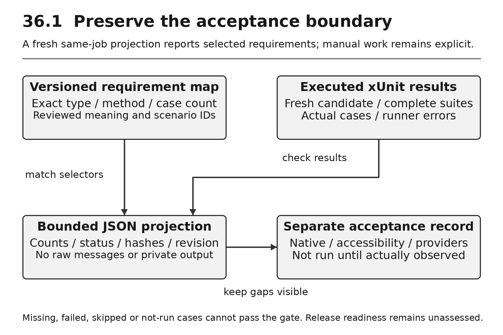

# Chapter 36
# Testing the Complete Application

The anniversary order looks healthy in every individual lab. Acceptance is replay-safe, a signed TEST event changes payment state, and private delivery rejects a foreign account. Yet a customer can still encounter a failure between those pieces. The service might commit while the phone loses the reply. The client may then restart, the order may advance, and the recovered operation must still describe the same request rather than create another one.

The next question is not how many tests exist. It is which claim each result supports, which boundaries the test actually crossed, and what remains unobserved. A passing API fixture does not establish a successful MFA challenge on an iPhone. A screenshot of a delivered sample does not prove that another account was denied. Both observations can be useful when their scope and candidate are clear.

This chapter adds a composed recovery journey and a machine-readable acceptance projection. It also consolidates the separate device/provider work instead of allowing that work to disappear behind a green suite. No live customer, provider account or public deployment is needed for the automated lab.

## What You'll Learn

1. Organize portable, integration, contract, process and UI evidence around explicit acceptance claims.
2. Compose actual clients, durable journals and API behavior around a committed-but-unseen response.
3. Generate traceable requirement results from executed cases without treating missing or skipped work as success.
4. Design isolated fixtures and a risk-based device/accessibility/provider matrix.
5. Investigate failures and preserve reproducible evidence for a release decision.

**Prerequisites:** Chapters 5, 18, 21, 23–26 and 32–35. Begin with the Chapter 36 source recorded in the companion's `docs/verification.md`. Use SDK 11.0.100, the pinned xunit.v3 4.0.0 executable projects and Python 3.12. The automated runner requires no mobile workload. Native/provider observations require separately configured devices, test accounts and environments.

**What you will build:** two composed lost-reply cases, a six-requirement automated regression spine, a safe evidence JSON report and a separate manual acceptance matrix. The report deliberately leaves release readiness unassessed; Chapter 37 and the release chapters add evidence that these suites cannot supply.

## 36.1 Write the claim before selecting the suite

A useful acceptance claim contains a trigger, an observable result and an authority boundary. For example: after the service accepts an operation but its successful response is lost, a reconstructed client must reconcile the saved operation under its original account and observe one accepted order. This is stronger than “the submit button works” and more specific than “the application is reliable.”

Separate the claim from the mechanism used to test it. A test can invoke a domain method directly, send HTTP through TestServer, start a published Kestrel process, or operate a deployed MAUI page. Those mechanisms provide different evidence even when they exercise some of the same source.

| Evidence layer | What it can establish | Important remaining boundary |
| --- | --- | --- |
| Portable rule/unit | Validation, state transitions, ownership guards and controlled-clock decisions | Native composition and real infrastructure |
| Real-file integration | Transactions, reopen, migration and durable replay under test conditions | Device filesystem/native runtime and OS termination |
| In-process HTTP contract | Routing, serialization, bearer validation and client/API agreement | Sockets, TLS, proxy and public hosting |
| Published-process check | Actual artifact startup, listener/TLS and configured dependencies | Native UI, external providers and real deployment topology |
| UI/device acceptance | Observable interaction on the named package/device | Other devices, provider states and future releases |

These are overlapping views, not a competition for the largest end-to-end test. Keep narrow checks for precise failures and add composed journeys where independently correct components can disagree. The new journey concentrates on persistence, uncertainty and versioned recovery; it does not duplicate every malformed-input case from earlier chapters.

Coverage percentages measure executed code under a chosen instrumentation policy. They do not measure whether an assertion is meaningful, whether all relevant states were explored, or whether a native callback/provider configuration worked. A high percentage can coexist with a missing ownership assertion. Review critical decisions and realistic failure modes before setting a numerical coverage target.

## 36.2 Build a traceable regression spine

The companion's `eng/acceptance/plan.json` maps stable requirement IDs to exact test type/method selectors and expected case counts. Six requirements form a deliberately small spine: order recovery, invalid-token authorization, synchronization replay, resumed media transfer, restore review and diagnostic privacy. The full portable and API suites must also remain clean.

A method selector is a maintained link, not magical proof of the requirement. Reviewers must still read the test's setup, injected services and assertions. If a method changes meaning without changing its name, a report cannot discover that editorial defect automatically. Put the plan, test and requirement explanation in the same review.

The two order-recovery theory rows share a method but inject different failures. Their expected count is two. Removing one row must not quietly leave the requirement green. Conversely, adding a meaningful row requires a deliberate plan update after reviewing its behavior. A count is a guard against accidental disappearance, not a substitute for semantic case identity.

The generated report includes source revision, run ID, input hashes, bounded suite counts, static selectors and requirement results. Manual rows are always not_run, and release_readiness is always unassessed. The script has no switch that turns an Android compile into a native acceptance result.



## 36.3 Put the fault after the actual commit

Open `tests/GnazzosWorld.Api.Tests/AcceptanceJourneyTests.cs`. The theory starts a unique temporary workspace, real server SQLite file, real client journals and the existing test host. The host validates signed bearer tokens using an ephemeral test signing key and static fixture metadata. The application clients send their normal serialized requests through the actual ASP.NET pipeline using TestServer's handler.

The injected DropCommittedReply handler wraps that transport. It does not return a manufactured successful receipt or replace the order store. It waits for the real endpoint to return success, disposes that response and throws a synthetic transport exception for one exact POST path.

```csharp
var response = await base.SendAsync(request, ct);
if (enabled && !Dropped &&
    request.Method == HttpMethod.Post &&
    request.RequestUri!.AbsolutePath == path &&
    response.IsSuccessStatusCode)
{
    Dropped = true;
    response.Dispose();
    throw new HttpRequestException(
        "Synthetic lost committed reply.");
}
return response;
```

The complete class derives from DelegatingHandler and owns the trusted inner handler. The path and enabled flag are test configuration. This excerpt shows why placement matters: a failure before sending proves retry after no commit, whereas this failure creates a real disagreement between durable server state and the client's last observation.

Assert that Dropped became true. Without that assertion, a route typo could make the test pass along an ordinary happy path. Also assert that the uncertain client has no confirmed receipt while the server already has exactly one order and one acceptance-history entry. The test must establish the uncertainty it claims to recover.

This handler models one transport failure deterministically. It does not reproduce radio behavior, TCP packet loss, an Android process kill or an operating-system connectivity event. Those belong in other layers; the synthetic injection makes this particular transaction boundary reliable to investigate.

## 36.4 Reconstruct the client instead of reusing its answer

In the acceptance-loss row, OrderAttemptCoordinator saves its operation before sending and then observes the injected exception. Dispose the first OrderApiClient and PendingOrderDatabase. Construct a new client, reopen the same client file and call ResumeAsync under the same owned lease.

The coordinator must use the stored operation key. The server returns the original order, and the journal confirms that receipt. Assert the original order ID and operation key, the confirmed persisted receipt, one server order and one acceptance history entry. A test that checks only a 200 response could miss a duplicate order.

The second theory row leaves acceptance ordinary and injects loss at the revision boundary. Both rows then continue through a checkout-provider double and a locally signed TEST event delivered twice through the real webhook endpoint. The assertions require paid state without creating duplicate payment effects. Production/review transitions use the existing trusted local fixture methods; no customer's bearer token becomes administrative authority.

The revision journal is reopened after its committed response is lost. Before replay, the fixture publishes the next review version. The original revision's expected version is now stale, but its saved operation key identifies a committed operation. Replay must return the original applied-version receipt before treating that old expectation as a new-write conflict.

```csharp
store.PublishReviewForLab(orderId, 4);
using var api = new TrackingApiClient(
    session, host.Server.CreateHandler());
using var journal = new PendingRevisionDatabase(revisionPath);
var receipt = await new RevisionCoordinator(api, journal)
    .ResumeAsync(orderId, lease, Ct);
Assert.Equal(4, receipt.AppliedVersion);
```

This is an excerpt from the complete test, where orderId, session, host, revisionPath and lease have already been established. The receipt describes version 4 even though current order state has advanced. That distinction connects the earlier replay policy to a realistic multi-step workflow.

## 36.5 Finish the journey and test the other account

After synthetic delivery, dispose the original host and store. Reopen the same server database under a new host and construct a new session/client. No in-memory order receipt from the first host should be necessary to read the delivered state.

The test requires version 6 with six coherent history entries, one revision, delivered state and the original acceptance identity. TrackingApiClient obtains a grant and reads the private sample through the actual owned content route. It checks the complete original WAV's length and SHA-256. This is byte verification, not listening or an offline private cache.

Then use another valid fixture subject. Its owned tracking request must return 404, and its local acceptance-journal partition must be empty. The original account's confirmed operation must remain available. Authentication alone does not justify access to another customer's story; the negative assertion belongs in the acceptance journey as well as the focused authorization suite.

The composed test crosses real client serialization, journal persistence, bearer middleware, route composition, server transactions and private-byte verification. Its provider double, ephemeral identity metadata, trusted graph transitions and in-process transport remain explicit substitutions. Chapter 35's separate workflow supplies actual published-process HTTPS evidence. Do not rename this TestServer journey as a full device-to-hosted-provider test.

## 36.6 Make evidence generation fail closed

The Python standard-library reporter reads bounded xUnit XML. It accepts the documented result vocabulary Pass, Fail, Skip and NotRun, checks summary counts against actual cases, rejects duplicate per-run case IDs and refuses environmental runner errors. It rejects DTD/entity declarations and unsupported schema versions rather than guessing their meaning. Display names are human-readable and need not be unique; the parser uses the documented per-run case IDs to reject duplicate records. Type/method metadata is optional in the XML, but a missing required selector still cannot satisfy its mapped requirement. The first real report run exposed this distinction and corrected overly strict identity/metadata assumptions.

For every plan row, the reporter finds exact type/method matches and requires the expected count with all rows passed. A missing selector or changed count produces not_satisfied. A failure anywhere in either complete suite fails the automated gate, even if that case is not part of the six-requirement spine.

```python
observed = suites[row['suite']]['methods'].get(
    row['method'], [])
status = (
    'automated_pass'
    if len(observed) == row['cases']
    and all(r == 'Pass' for r in observed)
    else 'not_satisfied'
)
```

The surrounding implementation validates the versioned plan before this projection. Notice the explicit length condition: all([]) is true in Python. Checking only whether all observed cases passed would accidentally turn an absent test into success.

Malformed input, impossible summary totals, an existing output file or a runner/environment error produces exit 2 with no new acceptance claim. A valid unsatisfied report produces exit 1. A satisfied automated gate produces exit 0 while leaving manual rows unexecuted and release readiness unassessed. The reporter's 18 focused checks include missing selectors, changed theory counts, skipped/not-run cases, duplicate identities, environment errors and private-output exclusion.

These are tests of an evidence boundary that can mislead a release decision. They are not extra application features or a reason to count Python checks as C# domain cases. Keep their totals separate.

## 36.7 Bind artifacts to the candidate without copying private output

The acceptance workflow builds and runs both suites in one fresh job. It passes xUnit's executable -xml switch after the dotnet-run argument separator and then projects those exact input files. The workflow supplies its checked-out source SHA and run ID. It uploads only acceptance-report.json, with seven-day retention.

Raw XML can contain captured output, exception messages, stack traces, test parameters and machine paths. The safe report excludes those free-text fields and raw display names. It retains static requirement/method selectors, bounded status/count fields and input SHA-256. Raw results stay in the job's temporary workspace. Tests in a public repository must use synthetic data because separate runner console logs can still expose failures; a safe JSON projection cannot sanitize another output channel.

Input hashes make later comparison possible for an operator holding the original files. They are not signatures, independent provenance or proof that arbitrary XML came from the declared source. Same-job creation and the trusted workflow establish the association here. A downloaded report with an edited revision field is not trustworthy merely because it contains a plausible hash.

For a signed release candidate, extend the record with package hash, build configuration, dependency lock/build identity, API/schema environment and install state. Reusing yesterday's results for a changed package requires an explicit assessment, not an invisible substitution. Chapter 38 and Chapter 39 will develop platform release evidence.

## 36.8 Control data, time and parallelism

Each composed case has a generated private temporary root and disposes clients, responses, journals, hosts and stores before removal. The fixture does not use a shared database, current-account singleton, fixed port or process-global mutable clock. Parallel tests must not change another case's authority or timing.

Deterministic does not mean every generated value must be a constant. An isolated GUID is appropriate for an operation or directory; assertions compare relationships rather than predicting its bytes. The new journey uses current UTC for short-lived JWT, webhook and grant validity, while focused expiry tests control clocks explicitly. Its sequence needs no arbitrary sleep. A slow or misconfigured runner may still reveal a timing/environment defect; preserve that result rather than claiming absolute temporal determinism.

Use completion signals to arrange concurrency boundaries. For example, signal that a provider request reached a controlled handler before signing out, then release the reply and assert that the old generation cannot publish. Sleeping for 500 milliseconds does not prove that ordering. Existing session/offline tests provide narrower examples; a single giant acceptance test should not own every race schedule.

For live integrations, provision isolated test users, tenant configuration, sandbox accounts and cleanup scopes. A test double can answer “what does our coordinator do when refresh fails?” It cannot establish that the provider issues the intended audience, callback or MFA behavior. Never run destructive account cleanup against a shared person's account because its display name resembles a fixture.

## 36.9 Plan the device and accessibility matrix

A complete native claim names the package and environment. Record source/build hash, app/API/schema versions, device model, OS, installation or upgrade state, locale, text scale, assistive mode, network transition, timestamp, steps, expected/actual behavior, evidence reference and defect link. Use pass, fail, blocked and not_run honestly. Blocked describes a missing prerequisite; it is not a successful observation.

Start with a risk-based set: an Android phone, an Android tablet or emulator around the adaptive threshold, an iPhone and an iPad. These are proposed slots until a real model/OS/build is recorded. Add supported-OS extremes and significant capability differences. Cross selected high-risk journeys with large text, screen readers, keyboard/focus, localization and narrow/wide layouts; do not multiply every axis blindly and then leave an impossible matrix mostly empty.

Accessibility acceptance includes useful names, error association, focus after navigation, status announcements, reachable controls, text expansion and coherent reading order. An element being present in the automation tree does not prove a person can understand or activate it. TalkBack and VoiceOver need separate observations; platform behavior is not interchangeable.

For future UI automation, prefer stable AutomationId values and observable conditions over localized text and fixed delays. Current official MAUI Appium guidance separates platform drivers and host prerequisites. No Appium driver, deployed candidate or successful UI session is configured here. A sample selector is not an executed UI test, and an automation identifier does not replace a semantic label.

## 36.10 Test offline, identity and provider behavior honestly

The manual plan names six remaining areas: native journey, accessibility, OS offline recovery, live MFA/recovery, hosted TEST payment and iOS release. These rows remain not_run in generated reports. Use the existing device and feature worksheets to carry out concrete observations in a protected environment.

For offline recovery, distinguish airplane mode, DNS failure, a rejected server response, a response lost after commit, background suspension and actual process termination. They leave different evidence. Verify the original operation survives, the UI explains uncertainty, no private result appears after an account switch, and retry does not invent a new intent. Reopening a SQLite file in CI establishes durable behavior under that test; it does not prove mobile lifecycle integration.

For MFA and recovery, configure an isolated provider tenant and named synthetic accounts. Observe enrollment/challenge, browser cancellation, callback, required reauthentication, recovery and token invalidation against the actual provider settings. A locally manufactured JWT cannot demonstrate those browser/server policies. Keep recovery codes and screenshots containing credentials outside public artifacts.

For hosted TEST payments, use the provider's test environment and verified event delivery. Observe closed browser, duplicate/redelivered event, delayed status and owner refresh. The checkout adapter double in the composed journey supplies no hosted-provider observation. TEST evidence also does not settle real-money eligibility, refunds, disputes, tax or store policy; those remain separate commercial/release responsibilities.

## 36.11 Investigate failures without erasing them

A failure record should answer: which candidate, which environment, what input/state, what boundary, what expected observation and what actually happened? Preserve the first failure, a safe reproduction and a defect link. Then record the corrected revision and relevant rerun. Do not replace the evidence with an unexplained later green screenshot.

A deterministic regression needs a fix. Repeatedly running the same assertion until it happens to pass hides uncertainty. An external environment problem may justify a bounded retry, but retain its original outcome and reason. Distinguish an unavailable provider, an application timeout policy and an incorrect assertion; their corrective actions differ.

Quarantine requires an owner, reason, issue, expiry and visible acceptance gap. The current reporter deliberately fails Skip and NotRun rather than counting quarantine as completion. If a future system supports separate nonblocking experiments, keep them outside the required gate by reviewed policy; do not silently weaken required customer behavior.

| Symptom | Diagnostic check | Corrective action |
| --- | --- | --- |
| Green suite, missing acceptance row | Exact method selector and expected theory count | Review removed/renamed behavior; update test and plan together |
| Report rejects results | Schema, duplicate identities, environmental errors and summary totals | Inspect private raw XML; never edit totals to manufacture agreement |
| Recovery test never saw uncertainty | Dropped flag, absent client receipt and committed server row | Inject after real success and assert the fault fired |
| Runner rejects XML arguments | Pinned executable runner and argument separator | Use the documented xUnit switch; avoid unrelated VSTest options |
| UI automation passes but focus fails | Named package, semantic tree and assistive interaction | Fix focus/announcements and rerun the actual device scenario |
| Existing output blocks a new run | Candidate workspace and evidence ownership | Choose a fresh directory; retain earlier results under their revision |

## 36.12 Guided Lab: evaluate the regression spine

1. Read complete-application-testing.md and identify the actual components and substituted boundaries in AcceptanceJourneyTests. Predict where each theory row loses its response and which journal must remain unresolved.
2. Run the reporter checks, build both C# projects and execute the suites with fresh XML outputs. Follow the exact commands in the worksheet. Stop after failures; do not recycle an old report.
3. Read the two journey rows. Confirm the injected fault fired, reconstruction used the saved operation identity, revision replay survived a newer review and private bytes remained owner-bound after server reopen.
4. Generate acceptance-report.json using the tested revision and local run ID 0. Require all six mapped requirements satisfied and complete suites clean. Inspect the unchanged not_run manual rows and unassessed release readiness.
5. In a disposable copy, rename one selector or increase its expected theory count. Regenerate to a new file and require a failing automated gate. Restore the plan. This demonstrates that a missing test cannot be called coverage.
6. Inspect report.py and its tests for empty-match, Skip/NotRun, runner error, duplicate identity and output-redaction handling. Keep failure output private; the machine-readable result is an evidence contract too.
7. Fill one proposed device/provider run record with prerequisites and expected observations. Leave actual result not_run until the named candidate/environment has been exercised. Do not invent a device, screenshot or provider result to complete the table.
8. Link the separate published HTTPS operations run and Android compile evidence from verification.md. Explain which claims each supports and which release checks remain. Carry the open observations into Chapter 37's measurement/accessibility work.

## Chapter Summary

Whole-application testing connects explicit customer claims to the boundaries each check actually exercises. The composed anniversary journey uses real clients, durable journals, bearer middleware and SQLite while deliberately losing a response after commit. Reconstruction must recover the original acceptance or revision, preserve versioned history and retain account-bound private access. A versioned requirement map and fresh xUnit results generate bounded evidence; missing cases, changed theory counts, failures, skips and runner errors cannot become success. Same-job provenance and safe artifact projection matter because raw results can contain private output. Native interaction, accessibility, OS recovery, live MFA and hosted payments require separate named observations. A passing automated gate supports investigation and regression control; release readiness also depends on those remaining records and the identified candidate.

## Exercises

**Worked exercise — the empty match.** A required method was renamed, but every test that ran passed. The report code uses all(r == 'Pass' for r in observed) without checking the length. Should the requirement pass? No. The absent selector produces an empty list, and all([]) is true. Require the exact reviewed case count before accepting the row. Keep a regression test that removes the selector and expects not_satisfied.

**Independent exercise — cancel and switch.** Extend the composed journey with a controlled in-flight response, local sign-out and another account's session. Use a completion signal, not a sleep. Assert the old result cannot publish and the original account's pending intent remains recoverable.

**Independent exercise — semantic case identities.** Extend the plan to require explicit theory labels as well as counts. Reject a run that replaces one scenario with another while keeping the same total. Preserve safe output and explain which test-framework identity is stable across builds.

**Independent exercise — native run record.** Choose one named Android device and the exact candidate package. Plan an offline/restart and large-text/screen-reader scenario with expected observations, cleanup and protected evidence. Execute only with configured prerequisites; distinguish blocked and not_run from pass.

## References and Source Walkthrough

Read tests/GnazzosWorld.Api.Tests/AcceptanceJourneyTests.cs; eng/acceptance/plan.json, report.py and test_report.py; .github/workflows/acceptance.yml; and docs/complete-application-testing.md. Existing focused suites retain the full regression surface. The selected plan is not a complete release checklist.

Primary references checked November 16, 2026: xUnit XML schema/results at https://xunit.net/docs/format-xml-v2; pinned executable runner changes at https://xunit.net/releases/v3/4.0.0; ASP.NET integration testing at https://learn.microsoft.com/en-us/aspnet/core/testing/integration-testing; official MAUI Appium guidance at https://github.com/dotnet/docs-maui/blob/main/docs/deployment/ui-testing.md. Recheck platform driver/tool prerequisites when implementing native automation; this chapter does not claim a configured Appium run.
