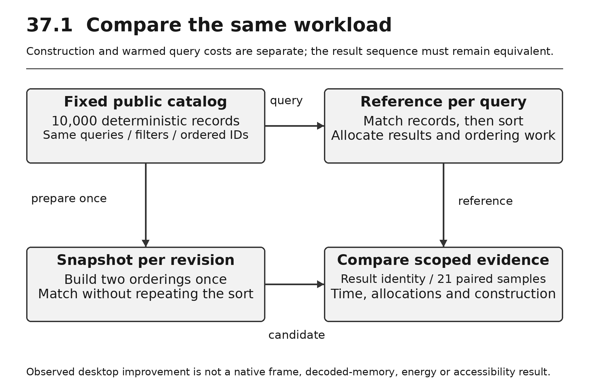
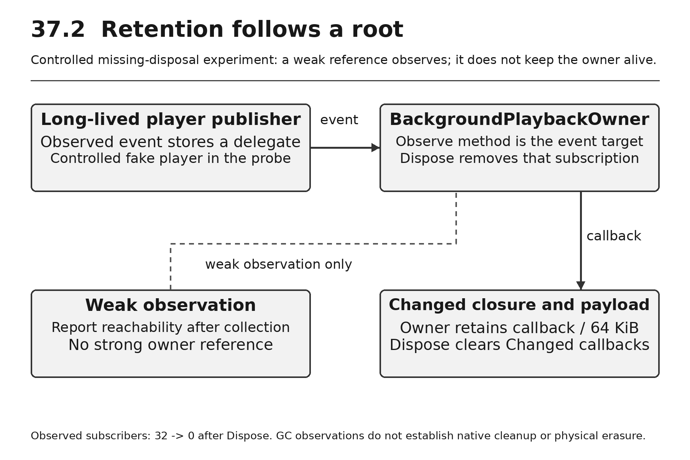

# Chapter 37
# Performance, Reliability, and Accessibility Review

A reader opens Gnazzo's World to find an anniversary song. The five-item catalog responds quickly, but ten thousand records and oversized covers expose different costs. Search allocations, screen-reader focus and native decoding each need their own investigation; a desktop result cannot settle them all.

One encouraging stopwatch result is not enough. Identify the candidate and workload, explain what the timing includes, and preserve correctness, recovery and accessibility. Dropped operations, clipped large text or abandoned page resources can invalidate an otherwise faster candidate.

This chapter provides actual Release desktop search/API measurements, a controlled retention experiment and a native stress page. Named Android/iOS startup, scrolling, image-memory, energy and accessibility observations remain unexecuted in a separate device-review record.

## What You'll Learn

1. Define comparable startup, search, memory, network and frame-timing measurements.
2. Investigate repeated sorting with a bounded snapshot and interpret its measured costs and tradeoffs.
3. Diagnose event-root retention and distinguish allocation, reachability, native resources and physical erasure.
4. Exercise large catalogs and image variants while preserving viewport, UI ownership and accessibility.
5. Plan Release profiling, runtime/trim/AOT review and a defensible device acceptance report.

**Prerequisites:** Chapters 10–11, 13, 21, 27–29 and 35–36. Use the Chapter 37 source recorded in `docs/verification.md`, SDK 11.0.100 and the pinned MAUI 11.0.10 project. The desktop measurement lab requires the .NET runtime and a local loopback port, not a mobile workload or provider account. Physical-device and Apple profiling require separately configured hardware/toolchains.

**What you will build:** a 10,000-record public catalog, a search snapshot, original image variants, a native stress page and a Release measurement report, plus a device/accessibility record that preserves unexecuted results.

## 37.1 Define the experiment before the optimization

Begin with a concrete question: does repeatedly sorting a stable catalog materially affect the search work? The existing CatalogSearch.Find filters and orders its matches on every query. For a five-item bundled catalog that is a reasonable design. A ten-thousand-record workload exposes costs that the original fixture could not reveal.

Hold the workload constant. The generated fixture has stable unique IDs, reverse input order, repeated titles/date keys, sixteen creators, all three content kinds, unknown dates, accents and long multilingual titles. The same versioned data is used in the reference and candidate paths. This is public synthetic metadata, not a customer's story or an expanded production API import.

The five timed queries include a broad match, accent-insensitive matches, Japanese text and no-match. Validate each complete ordered ID sequence before timing. Faster code that changes ties, drops an unknown release date or mishandles accents has not preserved the feature. The portable tests additionally compare kinds, creators, favorites, empty input and selection behavior.

A useful experiment names its scope. Here the search is synchronous managed work on one desktop thread. The API measurement launches an actual published child process and reads its public fixture over loopback HTTP. Neither executes a native scrolling gesture, decodes an image on a phone or observes a screen reader.

## 37.2 Separate startup, steady work and user-visible latency

Startup has several boundaries: process creation, framework initialization, first frame and first useful interaction. A fresh process does not imply a cold filesystem/OS cache. First install, upgrade, terminated-process launch and warm foreground return are distinct scenarios. Record the start/end events and cache policy before comparing their numbers.

The runner measures process creation to the first successful API health response, with a 100 ms polling interval. That includes hosting and observation delay. It does not measure launcher-to-first-frame on MAUI, nor does a health response prove that the catalog screen is interactive. Keep the label with the number.

Steady search samples receive three paired warmups. Twenty-one subsequent pairs alternate which implementation runs first. That reduces one systematic order bias, but it cannot make a shared virtual machine thermally or computationally identical across samples. Record distributions and outliers, not only the fastest loop.

The report uses median and nearest-rank p95. With twenty-one observations, the p95 is the twentieth ordered sample; it is not a reliable population tail estimate for real customers. More observations, representative load and repeated runs may be necessary before setting an operational service objective.

Choose an acceptance budget from the user experience and target devices, then measure whether the candidate meets it. Do not turn this chapter's CI median into a universal millisecond test threshold. Correctness tests should remain deterministic; a noisy shared runner is useful for an investigation, not a substitute for a controlled benchmark host.

## 37.3 Make ordering belong to the catalog revision

CatalogSearchSnapshot copies trusted immutable record references and creates two orderings: title and newest first. Each query filters the selected ordering without sorting it again. CatalogSearch.Filter contains the shared validation, accent-aware matching and kind/creator/favorites intersection.

```csharp
public IReadOnlyList<CatalogItem> Find(
    string? query, ContentKind? kind = null,
    string? creatorId = null,
    CatalogSort sort = CatalogSort.Title,
    IReadOnlySet<string>? favoriteIds = null)
    => CatalogSearch.Filter(
        sort == CatalogSort.NewestFirst ? newest : title,
        query, kind, creatorId, sort, favoriteIds).ToArray();
```

This is the query portion of the complete class in Core/Catalog. The constructor creates private arrays and exposes a read-only Items wrapper. A returned query array is caller-owned; changing it cannot mutate the private index. CatalogItem's searchable values are immutable, but this is a reference snapshot, not a deep clone of every possible nested object.

Build a new snapshot when the catalog revision changes. A hidden mutable source would invalidate the ordering. The view model now establishes one stable snapshot and avoids constructing a redundant first result before ReloadFavorites rebuilds. Selection still resolves against current results; filtering away the selected item clears its detail and command availability.

The retained cost is bounded by catalog size and two orderings. It does not grow with every search term as an unbounded query cache would. Two arrays of ten thousand references alone are approximately 160,000 bytes on an eight-byte-reference runtime, excluding headers, records and other owners. That arithmetic is not a retained-heap measurement. Construction and transient allocations have their own costs.



## 37.4 Read the actual before/after result

The observed run used source c82eff270ec50c3ef4916c4401576ba1b893b1a9, SDK 11.0.100, .NET 11.0.0 and Windows 10.0.26100, X64 with four logical processors on a GitHub-hosted shared VM. Workflow 43876553256 preserves the safe report; the companion also retains its full sample JSON under docs/reviews with that original run identity.

| Metric, five-query batch | Reference filter/sort | Reused snapshot |
| --- | --- | --- |
| Median of 21 samples | 107.7073 ms | 93.4096 ms |
| Nearest-rank p95 | 128.6835 ms | 121.0163 ms |
| Median current-thread allocated bytes | 633,032 | 140,896 |

The allocation reduction is about 77.74 percent. The median time reduction is about 13.27 percent in this observation, a modest change with overlapping variable samples. Do not describe it as an established mobile frame-rate improvement. A single matched desktop run does not establish repeatability on physical devices.

First snapshot construction separately took 28.8451 ms and allocated 1,196,968 bytes, including first-use/JIT work. Those costs are excluded from warmed query batches, not eliminated. A one-off search on a small changing catalog may not justify maintaining both orderings. Repeated queries on a stable large catalog amortize construction differently; measure that workload before choosing the design.

Matching remains linear and accent-insensitive. Removing sorting does not remove the cost of scanning title/creator text or building a result array. The next investigation should collect a CPU trace, identify the remaining hot paths and compare the actual query distribution. Blindly adding another cache could consume memory without addressing the dominant work.

The same run's published API reached its first health response in 614.9966 ms. Twenty-one warmed sequential catalog HTTP/body reads had median 0.3119 ms, p95 0.3419 ms and a 2,731-byte response body. This is a five-record public fixture on loopback, not the 10,000-record native fixture. It excludes TLS/WAN conditions, concurrency, customer authorization journeys and real provider latency.

## 37.5 Measure allocations without calling them retained memory

The synchronous search helper uses Stopwatch and GC.GetAllocatedBytesForCurrentThread around the same action. There is no await inside the measured region, so work cannot resume on a different thread while those allocation counters are compared.

```csharp
var bytes = GC.GetAllocatedBytesForCurrentThread();
var start = Stopwatch.GetTimestamp();
var count = action();
var elapsed = Stopwatch.GetElapsedTime(start)
    .TotalMilliseconds;
var allocated = GC.GetAllocatedBytesForCurrentThread() - bytes;
```

The surrounding helper records GC collection counts, result counts and every sample. Counting results consumes the operation's output; equality is checked outside timing. Both implementations pay their matching/result work inside the measured action. The reporter does not serialize arbitrary request data, exception text or process logs into its artifact.

Allocated bytes are cumulative managed allocations on that thread during the action. They are not process working set, live managed heap, peak RSS, native image buffers or GPU memory. GC collection counts also describe the process during that interval and may include unrelated work. State these limits whenever quoting a number.

The search loop does not force collection between samples. Forced GC changes the experiment and should not become a production response to scrolling pressure. The separate retention diagnostic deliberately collects to investigate reachability; that is a different question with a different protocol.

## 37.6 Follow the event root in a retention investigation

A managed cycle does not automatically leak. A page, its child button and a delegate back to the page can all become unreachable together. A long-lived event publisher is different: its delegate can keep an otherwise abandoned owner alive, and that owner can retain callbacks, buffers or native wrappers.

RetentionMeasurements uses the existing BackgroundPlaybackOwner, a controlled player publisher and thirty-two owners. Each owner has a Changed closure retaining an invented 64 KiB payload. The diagnostic intentionally omits disposal, drops direct owner references and performs full collections. The observed weak-owner count remains thirty-two because the publisher's Observed delegates still provide a root path.

The existing Dispose implementation stops/releases its session, unsubscribes Observe and clears Changed. After explicit disposal, the publisher has zero subscribers and the observed weak-owner count is zero in this run. The experiment requires the deterministic subscription counts, not a universal GC timing guarantee. NoInlining boundaries reduce accidental JIT-local retention in this particular probe.

```csharp
pending?.Cancel();
StopNativeAndClose();
player.Observed -= Observe;
disposed = true;
Changed = null;
```

This excerpt is from BackgroundPlaybackOwner.Dispose, which also guards repeated disposal. The experiment demonstrates the consequence of omitting its established cleanup contract. It is not evidence that a deployed native page has leaked, and it adds no forced collection to the application.



Inspect page Window/Shell hooks, dispatcher timers, media handlers, streams and cancellation sources for a matching ownership boundary. OnDisappearing can mean temporary navigation or actual relinquishment depending on the feature; disposal must follow that feature's policy. Chapter 28 permits explicit background playback while still requiring final release on departure. Unsubscribing everything at every transient event can break useful behavior just as missing cleanup can retain it.

A collected weak reference does not prove physical erasure of private media, tokens or every native copy. A smaller managed heap does not prove lower GPU memory. Follow the actual ownership graph and inspect native resources with the platform tools before calling a memory defect fixed.

## 37.7 Keep the collection viewport finite

Open the new Catalog performance lab from Home and explicitly load the generated fixture. The page's CollectionView occupies a star row in a finite Grid. Its controls have a separate bounded ScrollView; the list is not inside that ScrollView. This preserves a meaningful viewport for the native control to virtualize.

UI virtualization and data virtualization are separate. Even if only visible rows have native views, all ten thousand metadata records and the search orderings remain in managed memory. Incremental loading/paging would address another resource boundary. This fixture does not expand the server document's size limits or automatically turn the main catalog into a large remote data source.

The stress page counts template constructions so a developer can inspect suspicious growth during a fixed gesture. That cumulative count is not the number of live cells or a frame-rate measurement. View reuse, handler behavior, prefetching and binding updates can differ by platform. Do not write a test that labels virtualization successful solely because this counter is below an arbitrary value.

Rows contain long variable-height text. A fixed row height or MeasureFirstItem shortcut might reduce measurement work while clipping large text or a translated title. Compare layouts under the actual font/locale settings before making that trade. The current main catalog/card already uses compiled XAML bindings, while the programmatic stress card assigns typed values when its context changes.

## 37.8 Compare image pixels, not only PNG bytes

The two original procedural fixtures depict the same pattern at 1200 by 1400 and 96 by 112 pixels. They are packaged as raw MauiAsset resources so that the image build pipeline does not pre-resize both variants. Their encoded lengths and SHA-256 values are checked by the desktop runner; the generator is included in eng.

| Variant | Encoded PNG | One width × height × 4 RGBA plane |
| --- | --- | --- |
| Full image | 13,263 bytes | 6,720,000 bytes |
| Thumbnail | 7,112 bytes | 43,008 bytes |

The plane ratio is 156.25, while the encoded-file ratio is only about 1.86. A highly compressible image can be small on disk and large after decoding. The plane formula is an estimate, not an observed native allocation: stride, pixel format, downsampling, cached copies, intermediate buffers and GPU resources change actual memory.

The stress row displays either variant within the same small visual area. The native image pipeline may downsample or cache it; do not assume one full bitmap per row. Measure peak and settled memory, decode CPU and scrolling on the same device with each mode. Count source requests and retained buffers separately from the declared image dimensions.

The stream source creates a new read-only MemoryStream for each image request. Returning one previously consumed or disposed stream would confuse an image reload with a cache optimization. The encoded array remains reachable while its source/template needs it. Leaving the page clears the list source, template and snapshot; actual native reclamation still requires observation.

A real remote-image cache also needs bounded size, revision-aware keys, eviction, failure behavior and an explicit public/private distinction. Earlier private delivery bytes must not enter the anonymous public cache because a thumbnail experiment made reuse convenient.

## 37.9 Keep CPU work and result publication under different rules

The main bundled browser still has five records. Its synchronous rebuilding behavior is not evidence that an arbitrary large search belongs on the UI thread. The dedicated stress page prepares its snapshot and searches on a worker task, then publishes through its UI continuation only if the page is visible and the generation remains current.

```csharp
var result = await Task.Run(() => data.Find(text));
if (visible && own == generation &&
    ReferenceEquals(snapshot, data))
{
    list.ItemsSource = result;
    status.Text = $"{result.Count} synthetic matches.";
}
```

The complete method catches and reports a safe unconfirmed result. Reload, new query and departure invalidate old generations. Leaving also cancels pending input/load work. Cancellation or fencing can prevent obsolete publication without stopping CPU work that has already begun. Bound the dataset and avoid scheduling an unlimited queue of searches.

Do not update CollectionView's ItemsSource from a worker thread. Do not block the UI with .Result or a synchronous wait to make a background operation appear sequential. Conversely, Task.Run is not a universal fix: dispatch overhead can dominate a tiny operation, and native UI work must remain on its owning thread. Measure the complete interaction after deciding which computation can be separated safely.

A background calculation can still hurt battery or contend with decoding. Link reliability policy to performance: bound retries and concurrency, retain durable intentions where needed, and keep typed failure/cleanup outcomes visible. Chapter 35's diagnostic projection helps correlate a controlled failure, but a raw memory dump is a much broader private-data artifact.

## 37.10 Measure network, download and energy costs separately

An API response duration includes more than server execution when measured at the client. Separate DNS/connect/TLS, queueing, server work, body transfer, parsing and UI publication when the tools permit. Measure cache hit, cache miss, timeout and retry cases independently. The local five-record HTTP sample cannot establish WAN tails or a production capacity limit.

For downloads, record accepted body bytes, attempted/retried bytes, range offsets, validator changes and cache reuse. A resumed transfer may reduce repeated payload but still trigger radio wake-ups and server requests. A verified cache hit can avoid the request entirely, while stale private content must still obey ownership and revocation policy.

Body bytes multiplied by request count gives a payload accounting baseline, not the wire total or provider invoice. Headers, TLS, compression, retries, connection reuse, CDN policy and billing units matter. Record the actual environment's counters before translating a byte count into a cost estimate.

Battery depends on CPU, decoding, radio state, wake-ups, brightness, thermal throttling and the workload duration. Compare the same named device under controlled charging/network/brightness conditions using platform energy tools. A desktop allocation reduction is not a measured battery saving. Keep the report's battery/wire row not_run until that experiment exists.

## 37.11 Review accessibility as part of the performance decision

The companion's device/accessibility review records source inspection separately from runtime observations. Declared palette calculations exceed 4.5:1 for the five inspected text/background pairs: about 15.65:1 for light-theme text, 14.97:1 for the dark theme, 13.40:1 and 8.71:1 for selected content, and 8.04:1 for white button text on the accent. These are arithmetic results from App.xaml, not screenshots of every control state.

Use unrounded values for a threshold decision. Disabled, focused, high-contrast, overlaid and platform-rendered states still need review. A good declared color pair cannot compensate for clipped labels, missing focus or an action identified only by color. The W3C contrast guidance supplies a useful criterion, not a complete native accessibility assessment.

On TalkBack and VoiceOver, inspect reading order, meaningful names, search/error association, status announcements, selection and focus after navigation. An AutomationId helps a test locate a control; it is not necessarily the name a person hears. Avoid announcing every recycled row or keystroke and overwhelming the interaction. Verify announcements under the actual screen reader rather than assuming a method call was heard.

Test large text, keyboard occlusion, English/Spanish interface expansion, the fixture's multilingual titles, reduced motion and narrow/tablet layouts. The stress page's English instructional text is a laboratory surface, not completed product localization. Decorative images are excluded from reading, and labels inherit automatic font scaling; their actual behavior remains a device observation.

The review disposition is incomplete. It lists expected observations, candidate/environment fields and not_run rows for Android/iPhone/iPad, scroll timing, native memory, energy, focus, large text and signed-package regression. A fast desktop report does not close any of those rows. Carry a discovered accessibility defect into the same candidate decision as a crash or data-loss defect.

## 37.12 Profile the actual .NET 11 deployment model

Current official .NET 11 mobile guidance uses CoreCLR and rejects UseMonoRuntime=true. NativeAOT is an opt-in publishing alternative; Android support is experimental. Do not copy a .NET 10 Mono setting into this pinned project or assume that a desktop runtime describes every mobile deployment. Record the actual SDK, workload, runtime and compilation settings with the package.

Use Release builds for representative measurement and record whether a debugger/profiler is attached. Diagnostic builds and traces have overhead; profiler-off candidate runs and diagnostic investigations answer different questions. The official MAUI profiling guide describes dotnet-trace and dotnet-dsrouter workflows, with platform-specific port/suspend/listen settings.

For an independently configured physical Android device, the worksheet supplies a collector command and a net11.0-android deployment with DiagnosticSuspend=true. Start the collector first, then deploy in another terminal. Startup suspension captures initialization; use a nonsuspended setup for runtime/heap investigation. The commands are preparation, not an executed phone result in this chapter.

Keep diagnostic endpoints local or device-forwarded and protect traces/dumps under the Chapter 35 access/retention policy. Native and managed memory views differ; correlate CPU samples, allocation stacks, GC pauses and native resources before attributing a long frame to one cause. Do not upload arbitrary dumps as public CI artifacts.

Trimming and AOT require compatibility work, not only flags. The current AccountPage/SongRequestPage still contain string-path bindings, and draft storage/portable clients use reflection-based JSON. Third-party auth/media dependencies need review too. Prefer typed/compiled bindings and generated serialization where required, resolve trim/AOT diagnostics, publish the actual target and test its installed behavior. No full-trim, NativeAOT or iOS acceptance is claimed here.

## 37.13 Guided Lab: investigate and record the candidate

1. Run the portable/API suites and review PerformanceTests. Identify which assertions preserve search, selection and snapshot ownership rather than measuring elapsed time.
2. Follow docs/performance-review.md to publish the API, build the Release runner and choose a new evidence path. Use the tested source revision and local run ID 0. Run without a debugger.
3. Inspect all twenty-one paired samples, construction cost, allocated bytes and GC observations. Reproduce the ordered-result check. Explain why a modest time change and large allocation reduction can coexist.
4. Follow the retention experiment's publisher-to-owner-to-closure path. Compare deterministic subscriber counts with observed weak counts. Do not add forced GC to the app or label the experiment an actual native leak.
5. Open the native performance lab on a configured candidate/device. Record its real model/OS/hash before collecting results. Compare image modes, fixed gestures, large text and layout widths; template count alone cannot pass virtualization.
6. Prepare or capture the appropriate Release trace. Separate first-use/JIT, matching/sorting, result publication and native decoding. Record tools/settings/overhead and protect trace content.
7. Complete one named-device performance/accessibility record using the review template. Leave unavailable startup, energy, screen-reader and provider observations not_run or blocked with a reason. Retain failures and corrected-revision links.
8. Re-evaluate correctness, memory, accessibility and operational limits together. Do not approve a release from the fastest sample. Carry the actual candidate and open constraints into Android signing and publication work.

## Troubleshooting

| Symptom | Check | Corrective action |
| --- | --- | --- |
| Allocations improve but time remains high | Query distribution, matching CPU and full sample spread | Collect a trace before introducing another cache |
| Candidate looks faster only after warmup | Construction, first-use/JIT and cache policy | Report startup and warmed costs separately |
| Working set stays high after leaving | Managed roots, native/GPU/cache ownership and like-for-like state | Inspect owner/handler paths; do not force GC as a product fix |
| List grows or stops scrolling | Finite viewport and nesting/layout choice | Keep the CollectionView outside an unbounded scrolling parent |
| Large text clips after row optimization | Actual font/locale, row sizing and focus | Restore flexible measurement and retest the device |
| Old search overwrites newer state | Generation/visibility checks and thread ownership | Fence completion and publish on the UI context |
| AOT publish produces warnings | Bindings, JSON/reflection and dependency compatibility | Resolve diagnostics and verify the published target |

## Chapter Summary

Performance review begins with a defined workload, candidate and measurement boundary. The Release lab compares equivalent catalog searches, records construction separately and shows a modest timing change with a larger allocation reduction. Allocated bytes, retained objects, native images and working set describe different resources. A controlled missing-disposal experiment exposes a publisher-to-owner retention path without claiming a deployed native leak. The stress page supplies large metadata and image variants while preserving viewport, background-computation and current-result rules. Native startup, frame timing, decoded memory, energy and accessibility still require named-device observations. Source palette checks and compiled bindings help, but cannot replace focus, large-text and screen-reader review. Runtime, trimming and AOT settings also need published-target evidence before a release decision.

## Exercises

**Worked exercise — a small PNG.** The full image is only 13,263 encoded bytes. Does that mean ten visible copies require roughly 130 KiB of image memory? No. One 1200 × 1400 × 4 plane is 6,720,000 bytes before other buffers. Native downsampling/cache reuse may change actual memory, so measure it. Encoded size, displayed size and decoded/native ownership are different facts.

**Independent exercise — construction-aware workload.** Extend the runner with small catalogs, changing revisions and both sort orders. Record warmed construction separately from first-use cost. Find where snapshot reuse is useful without asserting a universal crossover from one CI run.

**Independent exercise — retained native view.** On a named test device, capture a load/search/leave investigation. Identify an actual root/handler/cache path and a controlled fix, preserve the failure trace and compare the same candidate conditions. Keep managed reachability and native resources separate.

**Independent exercise — accessible scrolling.** Compare two image modes at large text with TalkBack or VoiceOver and a fixed gesture protocol. Record frame/memory observations plus reading/focus behavior. Reject a change that gains speed by hiding content or clipping actions.

## References and Source Walkthrough

Read Core/Catalog/CatalogSearchSnapshot.cs and CatalogSearch.cs; Performance/PerformanceCatalogFixture.cs; CatalogBrowserViewModel; App/Pages/PerformanceLabPage.cs; tests/PerformanceTests.cs; tools/GnazzosWorld.PerformanceLab; and eng/generate-performance-images.py. See docs/performance-review.md and docs/reviews/ch37-device-accessibility-review.md for exact commands, source/runtime observations and remaining work.

Primary references checked November 16, 2026: MAUI performance at https://learn.microsoft.com/en-us/dotnet/maui/deployment/performance; profiling at https://learn.microsoft.com/en-us/dotnet/maui/fundamentals/profiling; .NET 11 runtime change at https://learn.microsoft.com/en-us/dotnet/core/compatibility/maui/11/mobile-runtime-replacement and https://learn.microsoft.com/en-us/dotnet/maui/deployment/runtimes-compilation?view=net-maui-11.0; collection viewport guidance at https://learn.microsoft.com/en-us/dotnet/maui/user-interface/controls/collectionview/populate-data; trimming and NativeAOT at https://learn.microsoft.com/en-us/dotnet/maui/deployment/trimming and https://learn.microsoft.com/en-us/dotnet/maui/deployment/nativeaot; accessibility at https://learn.microsoft.com/en-us/dotnet/maui/fundamentals/accessibility; contrast at https://www.w3.org/WAI/WCAG22/Understanding/contrast-minimum.html. Select the .NET 11 material and recheck target/tool settings before profiling or publishing.
