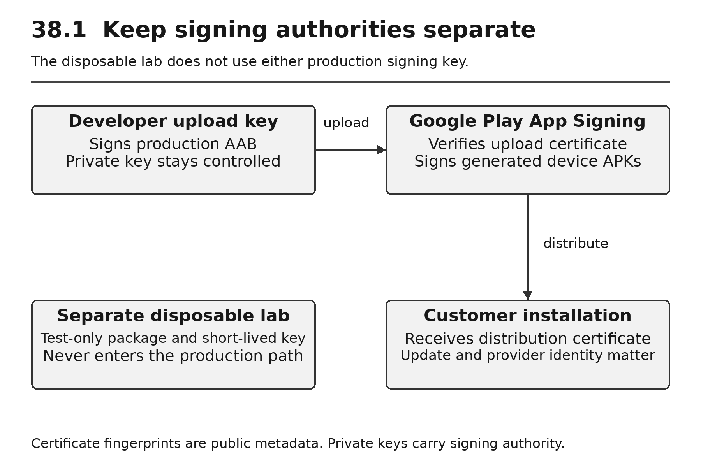
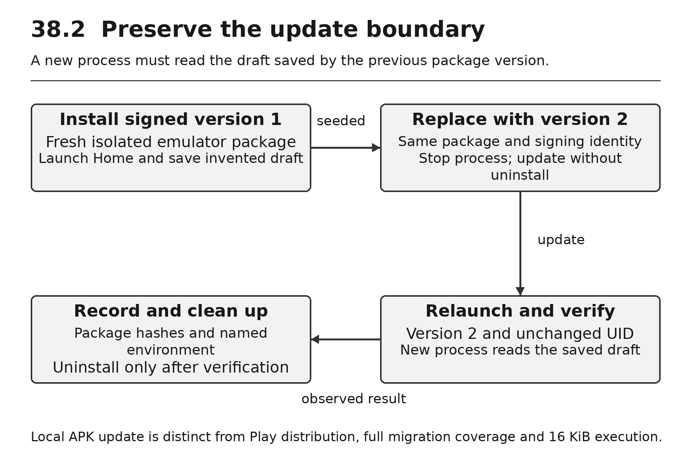

# Chapter 38
# Android Signing and Google Play Release

The anniversary request has survived a lost response and a server restart in earlier labs. Now consider a different interruption: the customer installs an application update while an unfinished request is saved on the phone. An Android Debug build does not establish that the signed update will install, preserve that draft, or still open the catalog.

Release engineering connects source to an artifact that Android can identify and update. Google Play adds a second boundary: the bundle you upload is used to generate device packages signed for distribution. Preparing those artifacts is concrete engineering work; deciding that the whole product is ready also requires the outstanding account, payment, privacy, accessibility and device evidence.

## What You'll Learn

1. Distinguish package identity, version codes, upload keys and app-signing keys.
2. Publish isolated signed Release APKs and an Android App Bundle from Windows.
3. Inspect actual signatures, manifests and native-library alignment.
4. Rehearse installation and a data-preserving update on a fresh emulator.
5. Prepare Google Play testing, declarations, reviewer access and rollout evidence.

**Prerequisites:** Chapters 3, 19, 25 and 35-37; the companion's pinned Windows SDK/workload/JDK; Python 3.12; Android build tools and an emulator. Use the source revision recorded for this lab in docs/verification.md. The exercise generates a short-lived, disposable signer and invented data. No Play account, production key or repository secret is required.

**What you build:** Two signed x86-64 Release APK versions and an arm64 bundle under an isolated package ID, plus package and upgrade evidence. These test-only artifacts cannot serve as the production submission. Store preparation is a documented procedure; store upload and public release are separate operations.

## 38.1 Define the identity before generating an artifact

A title is what the customer sees. A package identifier is part of Android's identity for the installed application. A version code orders updates. A display version gives people a readable release name. Changing the title is different from changing the package identifier: a new identifier creates a separate installed application with a separate storage boundary.

The ordinary project in src/GnazzosWorld.App/GnazzosWorld.App.csproj declares com.johngnazzo.gnazzosworld, display version 0.1.0 and application version 1. Readers must choose an identifier they control for their own public application. Copying the tutorial identifier is useful only within an explicitly isolated exercise.

| Setting | Meaning | Release consequence |
| --- | --- | --- |
| ApplicationId | Installed package identity | Keep the intended identity stable across updates |
| ApplicationVersion | Integer version code | Allocate a new eligible code for a new uploaded version |
| ApplicationDisplayVersion | Customer-facing version | Record it with the source and package digest |
| SupportedOSPlatformVersion | Minimum supported OS | Decide the oldest device the app will accept |
| Target SDK in final manifest | Android behavior and submission target | Inspect the built artifact rather than inferring from the minimum |
| Signing certificate | Cryptographic signing identity | Verify the intended certificate and update relationship |

Our lab uses com.johngnazzo.gnazzosworld.releaselab. Versions 1 and 2 share a disposable certificate, which permits an ordinary package update. Each run creates a new signer, so packages from different runs are not interchangeable. Begin with a fresh emulator; the runner refuses to overwrite an existing installation of this lab package.

The lab's minimum is API 26. Its audit requires a target of at least API 36; the actual target is read from the output. As checked November 16, 2026, Android's official target guidance requires API 36 or later for new phone/tablet apps and updates starting August 31, 2026. Different device categories have exceptions. Recheck the current requirement when creating a release; a remembered deadline is not a build setting.

## 38.2 Separate the three signing relationships

A Debug key supports development. A disposable lab key supports this rehearsal. Neither is your production upload identity. For Play App Signing, the upload key signs the bundle submitted to Google, and Google uses the app-signing key to sign delivered APKs. The two certificates may differ by design.

This difference matters to services that bind behavior to package and certificate, including verified HTTPS links and some provider/API registrations. Record the appropriate fingerprint for the distribution path being tested. A locally signed APK test cannot verify that a Play-installed application has the correct service registration.



A certificate fingerprint is public identification metadata. The private key is signing authority. Hashing a certificate does not hide or secure its private key, and a public fingerprint in an evidence report does not enable signing. Keep those concepts distinct when deciding what a CI artifact may contain.

For a real upload key, use a controlled signing environment, store the keystore and its recovery information separately from the source, and practice restoring access through the approved process. Do not create a fresh upload key every time CI runs. Play permits an upload-key reset under its process; that is different from replacing the certificate expected by an existing non-Play installation.

The exercise deliberately reverses the retention policy: its two-day certificate and private material are discarded after one run. That makes the fixture reproducible without leaving a permanent publisher credential in a public repository. It also means the lab packages are unsuitable for maintaining an installed customer application.

## 38.3 Follow the complete Windows publishing script

Open eng/android-release-lab/Build-ReleaseLab.ps1. The script owns one temporary directory, a generated manifest directory and a new output directory. It refuses to reuse an existing output destination, so stale packages cannot accidentally satisfy a new run.

The procedure has six steps:

1. Resolve the repository, JDK and Android SDK paths. Create an owned temporary directory with a unique name. Keep the output separate from the temporary private material.
2. Generate a random secret and a PKCS12 keypair using keytool. The certificate identifies an invented tutorial organization and expires after two days. This is not a recommended production certificate lifetime.
3. Write separate password files for the store-password and key-password readers. Both contain the same PKCS12 secret. Separate files avoid a reader consuming the first line before another option reads it.
4. Copy the existing Android manifest into an owned generated path and set android:testOnly to true. Preserve the other declared permissions and backup policy.
5. Publish version-1 and version-2 x86-64 APKs and a version-2 arm64 AAB, all in Release with the isolated ID and signer. Require exactly one signed artifact in each explicit destination.
6. Export only the certificate's SHA-256 digest with the packages. In finally, remove the password environment variable and the owned temporary key, password files and generated manifest.

The complete script passes file references to MSBuild rather than printing a password value. The important fragment is:

```powershell
'-p:AndroidKeyStore=true' `
"-p:AndroidSigningKeyStore=$store" `
'-p:AndroidSigningKeyAlias=disposable' `
"-p:AndroidSigningKeyPass=file:$keySecretPath" `
"-p:AndroidSigningStorePass=file:$storeSecretPath"
```

These variables are established by the full script; this fragment is not a standalone command. Use file-based secrets for the documented AAB signing path as well as APKs. A secret reference avoids placing the secret value in a command, but does not protect a password file from other processes with equivalent access. The disposable exercise runs on a fresh hosted job and never uploads the private directory.

From a configured Windows checkout, run:

```powershell
python -m unittest discover `
  -s eng/android-release-lab -p test_audit.py
./eng/android-release-lab/Build-ReleaseLab.ps1 `
  -Output artifacts/android-release-lab
```

Successful publication reports that the disposable packages were created. The directory contains v1.apk, v2.apk, v2.aab and expected-signer.txt. Publication alone has not run the independent audit. A failure can leave a partial public output directory; inspect it and choose a new output destination for the next attempt. Do not combine it with artifacts from another signer or run.

The project adds a conditional compile symbol only for GnazzoAndroidReleaseLab=true. A build target rejects that mode unless the configuration is Release, the target is net11.0-android, the isolated ID matches and explicit signing is enabled. The exported probe activity is compiled only behind that symbol and also checks the package ID and testOnly flag at runtime. Ordinary application builds do not contain the probe. This prevents a tutorial convenience from becoming an unreviewed customer-data interface.

## 38.4 Audit what Android will receive

A file named Signed is a convention, not evidence. eng/android-release-lab/audit.py invokes the actual verification tools against each output. It does not decide whether Google Play will approve the product.

For an APK, apksigner verify checks its signature; the audit then checks the reported certificate against the separately exported digest. It also requires exactly one signer. Recent tools can label the certificate V3.0 Signer rather than Signer #1. The parser accepts these known labels while still rejecting an unexpected certificate, missing identity or multiple signers. Matching a public-key digest instead of the certificate digest is not equivalent.

This was an observed failure during the lab's development. Publishing completed, but the first audit expected only the older numbered label and found zero certificates. The diagnostic output showed the actual certificate matched the expected digest. The correction broadened the supported label syntax and added regression cases; it did not remove certificate verification or accept arbitrary output.

For the AAB, jarsigner verifies the archive, keytool reads the embedded certificate and bundletool validates its structure. The audit inspects the dumped bundle manifest for the ID, version, SDK values, testOnly flag, backup policy and isolated probe. Signing an AAB is not the same operation as signing an APK; use the appropriate tool for each artifact.

| Check | What it establishes | What still needs another observation |
| --- | --- | --- |
| Signature and certificate | This package has the expected disposable signer | Production upload authorization and Play's distribution certificate |
| Manifest identity and version | The built package carries the expected values | Store eligibility, declarations and reviewer access |
| Native-library inspection | Included supported ELF libraries pass the alignment checks | Execution on the target device and page-size configuration |
| Package digest | Later steps can detect different bytes | Authenticity of an independently supplied evidence report |
| Bundle validation | Bundletool accepts the archive structure | Play processing and the generated device APK set |

The manifest starts from the app's existing policy, including allowBackup=false. That setting is not an account-deletion implementation, a physical-erasure guarantee or a complete assessment of every device-transfer behavior. Review the intended backup/transfer rules with the platform guidance and the personal data actually stored.

## 38.5 Treat native alignment as a separate compatibility question

A C# application can include native runtime and dependency libraries without the author writing C++. Inspect the package rather than concluding that managed source makes native compatibility irrelevant.

The audit enumerates supported arm64-v8a and x86_64 .so files, reads their ELF64 little-endian program headers and checks load-segment alignment and offset/address congruence for 16 KiB pages. It rejects malformed/truncated headers and an image without load segments. The APK receives a separate zipalign check. ELF alignment and APK ZIP alignment are different properties; passing one cannot substitute for the other.

The official 16 KB guidance checked for this chapter calls for support on Google Play's applicable 64-bit devices and identifies a February 1, 2027 update restriction. Policies and enforcement notices change; confirm the current page and the specific Console result before releasing. Do not equate a static audit with running on a 16 KiB device.

Our bundle contains arm64 libraries; the installation exercise uses an x86-64 emulator. The emulator report records getconf PAGESIZE. If it returns 4096, the report retains runtime16k=not_run, even when all packaged library checks pass. A separate named 16 KiB environment must exercise launch, storage, playback and dependencies before claiming that runtime boundary has been tested.

Run audit.py with the actual SDK/JDK, pinned bundletool and source/run identifiers. The workflow is the complete reproducible invocation. It pins bundletool 1.18.3 and verifies its download digest before use; silently taking an unversioned latest tool would weaken reproducibility.

## 38.6 Rehearse installation and update without erasing evidence

The install test is in eng/android-release-lab/smoke.py. It operates only on one emulator selected through adb -e and refuses to continue if the disposable package is already present. It verifies package hashes against the freshly generated package report before installing anything.

The observed sequence it requires is:

1. Confirm an emulator, x86-64 ABI, supported API level and reported page size.
2. Install v1.apk with the explicit test-only allowance and read the installed version and UID.
3. Launch the actual app's Home screen and wait for its native accessibility-tree text.
4. Invoke the isolated probe to save and read back an invented SongRequest through FileRequestDraftStore.
5. Force-stop the process, then update with v2.apk using replacement installation. Do not uninstall between versions.
6. Require version 2 and the same package UID. Relaunch Home, then start a new probe instance and verify the persisted draft.
7. Write a bounded upgrade report. Finally uninstall only the disposable lab package and remove its temporary UI-tree file.



The synthetic draft uses release@example.test and an invented story. It is not a real customer record. The exported probe is appropriate only inside this restricted fixture; a production app must not expose an unauthenticated operation that writes or reads personal drafts.

The important update command is adb install -r -t, not uninstall followed by install. Reinstalling after uninstall would test a fresh storage boundary and conceal the very recovery failure the exercise is meant to detect. Increasing the version without saving data first would also leave the persistence claim untested.

A passing result means a specific signed test package launched, saved one synthetic draft, updated and preserved that draft on the named emulator. It does not establish every SQLite migration, account transition, notification grant, background-media behavior or physical-device recovery. Chapter 19's schema tests and Chapter 36's complete journeys remain necessary.

## 38.7 Read the CI evidence without widening its scope

.github/workflows/android-release-lab.yml has two jobs. The Windows package job installs the pinned toolchain, runs the audit's Python tests, creates and verifies the three signed artifacts, then transfers only the public packages and bounded evidence. The Ubuntu upgrade job starts a fresh API-35 Google APIs x86-64 emulator and performs the installation exercise. Seven-day artifact retention is appropriate for disposable reports; record necessary safe observations before expiry.

Permissions are contents:read and no production signing secret is configured. The workflow never contacts Play Console. Its lab manifest remains testOnly, so the bundle is not a public release candidate. No diagnostic binary logs, customer stores or keystore files belong in uploaded artifacts.

The package job's success cannot imply that the upgrade job passed. Likewise, a skipped upgrade job is not a successful test. Read both conclusions and their exact source revision. The companion verification record holds the executed results; a procedure written in this chapter remains an expectation until that record contains an observation.

The initial Release publishing runs completed but failed the older certificate-output parser; installation was skipped. The corrected parser has ten local Python tests covering valid formats and rejected boundaries. The full corrected signing/installation workflow must produce its own evidence. Previous Debug compilation and portable C# results remain valid for their recorded revisions, but cannot stand in for this run.

## 38.8 Prepare a real candidate as a separate build profile

After the rehearsal, prepare a separate reviewed production profile. Do not rename the disposable bundle and upload it. Remove the lab mode, use the intended package ID and maintained upload key, allocate the release version and build the actual supported architectures. Confirm that testOnly and ReleaseProbeActivity are absent from the final merged artifact.

Keep trimming and optimization settings explicit. A successful Debug build does not exercise Release trimming or prove that reflection-based JSON, string-path bindings, identity libraries and media dependencies survive every optimization. Do not disable optimization merely to hide a failure; reproduce it, identify the required supported annotations/settings or dependency change, and retest the exact candidate.

For Gnazzo's World, the teaching labs deliberately expose unfinished integration. Provider identity, payment authorization, customer lifecycle and remote service configuration must be completed and tested before offering those features to customers. A public catalog-only scope would need its own intentional configuration and accurate listing; merely leaving broken account buttons visible is not that scope decision.

A useful candidate record includes source SHA, clean build/toolchain information, package digest, package ID, version, target/minimum SDK, architecture list, certificate fingerprints and matching service configuration. Record the backend/API/schema environment too. A store package cannot make a development-only backend into a dependable service.

## 38.9 Walk through Google Play preparation

Use the developer account that will own the application and complete its required verification. Create the app entry, select its distribution and audience settings deliberately, then prepare the actual store listing and policy declarations. The following work refers to the production candidate, not our disposable package.

First, complete the public identity: title, description, icon, feature graphic, genuine phone/tablet screenshots, support contact and working privacy-policy URL. Explain the features customers can actually use. Use device captures of the identified candidate; an illustration or a screenshot of a different build cannot prove that its interface is usable.

Second, review App content: content rating, target audience, advertising declaration, restricted access, permissions and applicable foreground-service declarations. A media-playback service needs to match the behavior and purpose declared. Answer from the final merged manifest and runtime behavior, including third-party SDKs, rather than from the project's original intent.

Third, build the data inventory. Identify transmitted account data, custom-song stories, attachments, order records, diagnostics and provider metadata; separate local-only fields from transfers. Evaluate collection, sharing, purposes, retention, encryption and deletion using Google's current definitions. A provider doing the work does not make its data handling disappear from the review. The source-color report or privacy-safe log fixture from earlier chapters is useful evidence for its boundary, not a complete Data safety declaration.

Fourth, implement account deletion end to end where account creation is offered. Google's guidance requires an in-app deletion path and a web resource for deletion requests. Chapter 25's isolated lifecycle fixture explains the state machine but does not delete a real hosted identity or all downstream records. Provide understandable retention exceptions and ensure the actual provider, application stores, orders and backups follow the documented policy.

Fifth, give reviewers a reliable route into restricted features. Arrange a dedicated test account, valid access instructions and a provider-supported review method compatible with the MFA design. Do not disable authorization globally or require the reviewer to obtain a transient code from your personal phone. Verify the complete instructions from a clean installation and ensure the test backend remains available during review.

Finally, upload the signed production AAB through the current Console process, inspect processing warnings and verify the package/version and app-signing certificate shown there. A local bundletool validation does not predict every store policy result. Correct a rejection against its specific evidence and preserve the release record.

The custom-song purchase flow also needs an explicit current policy assessment for the content sold and the markets served. A TEST checkout example is not permission to bypass a store's payment requirements. Keep that determination and any implemented purchase path with the reviewed production scope.

## 38.10 Use test tracks before rollout

Start with the appropriate internal test track and a named tester list. Install through Play so the actual distribution signer, generated package set, provider registration and upgrade path are exercised. A locally installed lab APK and a Play-installed app can have different certificates; uninstalling to work around that mismatch would destroy a meaningful update test.

If the account is a personal developer account created after November 13, 2023, current Google guidance calls for a closed test with at least twelve testers continuously opted in for fourteen days before applying for production access. Internal testing does not replace that account-specific requirement. Check the current account's Console requirements; do not promise public release solely because an internal installation succeeded.

Define scenarios that reproduce the book's promises: browsing with no account, sign-in/MFA and recovery, a saved draft across an update, interrupted submission reconciliation, denied permissions, downloaded-media recovery, large text, TalkBack and tablet layout. Match their results to the exact Play candidate and service environment.

Before rollout, assign an owner for release monitoring and support. If the track offers staged rollout, use it with clear stop criteria such as new startup crashes, failed account access or corrupted drafts. Halting a rollout limits further exposure; it does not automatically downgrade installed devices or restore data already changed by a migration. A corrective binary normally needs a new version code and compatible forward recovery. Chapter 40 develops this operational plan.

## Guided Lab: identify the update evidence

1. Start from the recorded lab source, review the script's isolated ID and confirm no production credentials are needed.
2. Run the ten audit regression tests and publish into a fresh directory.
3. Run the complete package audit using the workflow's pinned tools. Keep the source revision and package hashes together.
4. On a fresh emulator, run smoke.py with that directory. Expect Home launch, version 1, a seeded synthetic draft, version 2, the same UID and a verified draft.
5. Read package-evidence.json and upgrade-evidence.json. Check the actual ABI, API level, page size, source and run identity.
6. Find the fields still marked not_run. Explain why a passing static alignment check has not executed a 16 KiB runtime.
7. Review the workflow cleanup. Confirm only the disposable package is removed and no production signer was uploaded.
8. Write a candidate disposition: the rehearsal boundary has passed only when observed; public submission remains separate.

### Worked reasoning

Suppose v2 installs and Home opens, but the draft check fails. Package verification narrows the investigation: the new process is reading the intended package's storage, not a new package ID. Inspect FileRequestDraftStore, its path/serialization contract and the evidence that v1 actually seeded the value. Do not repair the experiment by uninstalling or reseeding under v2; either would erase the failing boundary.

Suppose instead the API-35 emulator reports a 4096-byte page size. State that the test exercised a 4 KiB runtime. The native libraries can still pass static 16 KiB alignment, but the runtime row remains unexecuted. The honest report is more useful than merging two different compatibility questions into one green checkbox.

## Troubleshooting

### Package and signing failures

| Symptom | Diagnostic check | Corrective action |
| --- | --- | --- |
| APK verifies but certificate parser fails | Compare supported signer labels and public certificate digest | Update the bounded parser and regression tests; keep expected identity checks |
| Signing reports a password read failure | Check separate file references, encoding and JDK/tool behavior | Use the complete script and owned first-line password files; never print secrets |
| Bundle missing from output | Inspect explicit format, publish result and signed-file count | Stop on the actual failed step; use a fresh destination |
| Update rejected as incompatible | Compare package ID and signing certificate from both packages | Reuse same-run fixture packages; do not uninstall to claim update success |
| Home launch fails only in Release | Capture an appropriate local diagnostic and inspect trimming/dependencies | Fix the specific candidate; repeat signed-package checks |
| Audit finds a 4 KiB native library | Identify the exact dependency and ABI | Update/rebuild with supported tools, then repeat package and runtime checks |

### Distribution and account failures

| Symptom | Diagnostic check | Corrective action |
| --- | --- | --- |
| Play rejects target or version | Inspect final manifest and previously uploaded codes | Correct the build profile and allocate an eligible new version |
| Login fails only after Play install | Compare distribution certificate, links and provider registration | Configure the actual distribution identity and retest through the track |
| Reviewer cannot pass MFA | Reproduce supplied instructions from a clean test account | Provide a supported review route while preserving normal authorization |

## Chapter Summary

Android release preparation ties a stable package identity and increasing version code to a specific signed artifact. The upload key used for a Play bundle and the app-signing key used for distributed packages have different jobs. Our disposable rehearsal keeps both production authorities outside the exercise while demonstrating Windows Release publishing, independent certificate and manifest checks, native alignment inspection and an installation/update protocol. The update must preserve a seeded draft across a new process; uninstalling between versions would avoid that boundary. Static alignment, emulator execution, Play distribution and real-device behavior remain distinct observations. A public release additionally needs accurate store declarations, working account deletion, reviewer access and tested service configuration. The next chapter follows the corresponding iOS process and explains the Mac, Xcode and signing requirements that remain beyond a Windows-only build.

## Independent Exercises

1. Add a controlled regression proving that a package with a public-key digest but no certificate digest cannot satisfy the signer audit. Explain the distinction before changing the parser.
2. Design an upgrade matrix covering the last two supported storage schemas and an interrupted migration. Specify what data is seeded and which recovery outcomes establish success.
3. Extend the evidence record for a named 16 KiB environment. Keep static library checks and executed runtime scenarios separate, and document what remains untested.
4. Prepare a release-review worksheet for the actual production scope, including provider SDK data, account deletion, payment classification, reviewer access and stop criteria. Do not submit the disposable bundle.

## Official References

Checked November 16, 2026. Recheck before submission; policy dates are not permanent build constants.

- Microsoft, Android command-line publishing: https://learn.microsoft.com/dotnet/maui/android/deployment/publish-cli
- Android, signing keys and Play App Signing: https://developer.android.com/studio/publish/app-signing
- Android, target API requirement: https://developer.android.com/google/play/requirements/target-sdk
- Android, 16 KB page-size compatibility: https://developer.android.com/guide/practices/page-sizes
- Google Play, app preparation and reviewer access: https://support.google.com/googleplay/android-developer/answer/9859455
- Google Play, Data safety declarations: https://support.google.com/googleplay/android-developer/answer/10787469
- Google Play, account deletion: https://support.google.com/googleplay/android-developer/answer/13327111
- Google Play, personal-account testing: https://support.google.com/googleplay/android-developer/answer/14151465
- Companion: eng/android-release-lab, .github/workflows/android-release-lab.yml and docs/verification.md. Full scripts include setup, bounds, cleanup and error handling omitted from short listings.

## Editorial index terms

Android App Bundle; APK; app signing; upload key; certificate fingerprint; version code; testOnly; ReleaseProbeActivity; package identity; apksigner; jarsigner; bundletool; ELF alignment; 16 KiB pages; install/upgrade; Play App Signing; Data safety; account deletion; MFA reviewer access; internal testing; closed testing; staged rollout.
