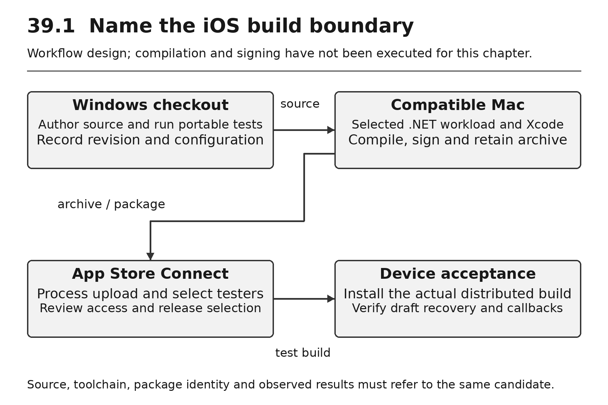
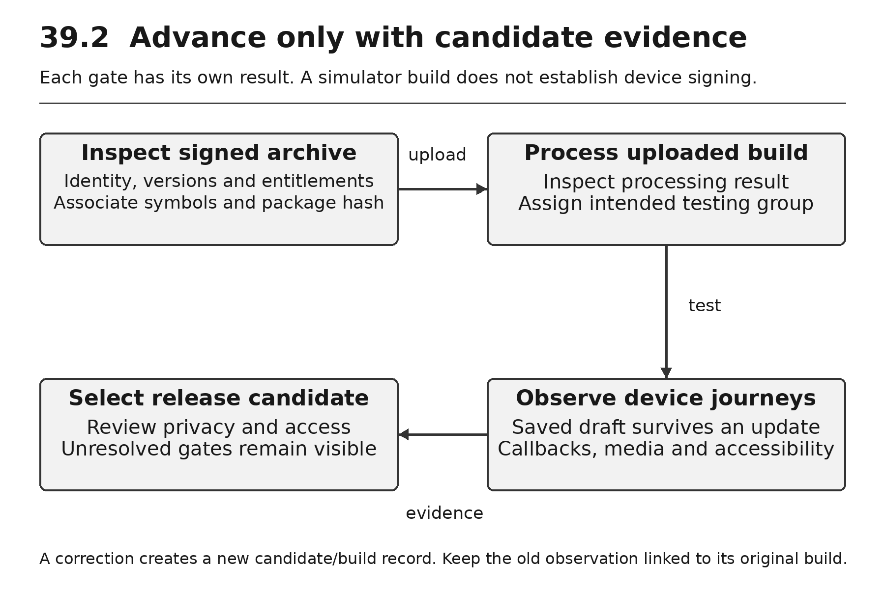

# Chapter 39
# iOS Signing and App Store Release from Windows

A customer saves the anniversary request on an iPhone, follows a notification, and later installs an update. The desired result resembles Chapter 38's Android scenario, but the route to the package changes. Apple tooling builds and signs the iOS application on a Mac. Provisioning connects an application identity, a team, permitted capabilities and a distribution channel. App Store Connect then processes the uploaded build before testers or customers receive it.

A Windows-centered workflow can still use Windows for editing, portable tests and much of the investigation. The important engineering decision is to make the Mac boundary reproducible. The same source revision must produce the intended bundle, and the evidence must identify what was actually compiled, installed and observed.

## What You'll Learn

1. Separate Windows authoring, Mac compilation, device provisioning and store distribution.
2. Select compatible .NET, workload, Xcode and macOS versions.
3. Trace bundle identity, capabilities and signing through source and packaged output.
4. Prepare a signed archive, TestFlight evaluation and an update-recovery experiment.
5. Assemble privacy, reviewer-access and release evidence without overstating readiness.

**Prerequisites:** Chapters 3, 19, 22-25, 28, 30-31 and 36-38; the companion repository; a compatible Mac for native commands; an iPhone/iPad for device checks. Distribution additionally requires the publisher's appropriate Apple Developer Program access and signing assets. Use only a team and application identifier you control.

**What you build:** An iOS candidate worksheet and a repeatable compilation/signing procedure. The complete companion lab is docs/ios-release-lab.md, with docs/reviews/ch39-ios-release-review.md retaining the current source findings. Native commands below are procedures awaiting execution. This chapter does not yet deliver the outline's signed, verified iOS candidate; that acceptance gate remains open.

## 39.1 Draw the build boundary before buying equipment

There are four distinct work locations. The Windows checkout contains authored source and runs portable checks. A Mac has the Apple tools, selected SDK and access to signing identities. A test device runs the resulting application under its actual operating-system policies. App Store Connect processes builds and coordinates testing and publication. Passing a check in one location does not establish the behavior of the others.

For example, a simulator may reveal clipped text and a broken callback. It does not use the same device package or provisioning path as a physical iPhone. An archive can be correctly signed while its authentication callback is unusable. A processed TestFlight build can still lose an unsaved edit or fail when VoiceOver changes focus.



Begin with a dedicated exercise checkout at a recorded revision. On both machines run git rev-parse HEAD and git status --short. Record intentional configuration differences. Copying a project folder by hand without retaining its source identity makes later failure analysis harder: an investigator cannot tell whether the compiler, a local change or a different dependency caused the difference.

A remote build also introduces trust and availability. The Mac needs enough disk space for Xcode, workloads, simulator runtimes and intermediates. Its operating system must support the chosen Xcode. A supported remote connection needs network reachability and controlled user access. Do not open broad Internet access merely to make a local build convenient.

## 39.2 Resolve a toolchain, not four independent latest versions

Read global.json before installing anything. The current companion requests .NET SDK 11.0.100 with latestPatch roll-forward. That pins an SDK feature band; it does not by itself pin a MAUI workload set, Xcode selection, NuGet resolution or simulator runtime.

The November 16 source review found a concrete candidate combination in Microsoft's platform release notes: SDK 11.0.100, workload set 11.0.100.1 and iOS pack 27.2.11039 require Xcode 27.2. Apple's Xcode table lists macOS Tahoe 26.6 or later for that Xcode. The platform release page instead says macOS 16.6+, an inconsistent host requirement. Use Apple's Xcode table to plan the host and retain this discrepancy in the review record; neither page constitutes an executed build of this application.

Apple's upload floor is a separate question. Its requirement effective April 28, 2026 specifies Xcode 26 or later and the relevant 26-or-later SDK. A toolchain can exceed that floor while still being incompatible with the installed .NET workload. Recheck both requirements at release. Do not equate a submission SDK with the minimum operating system on which the app can run.

On the selected Mac, inspect the environment before changing it:

```bash
dotnet --version
dotnet --info
dotnet workload --info
xcode-select -p
xcodebuild -version
xcrun --sdk iphoneos --show-sdk-version
sw_vers -productVersion
uname -m
```

The output should identify one coherent toolchain and the Mac architecture. A command-line-tools directory is not a complete Xcode installation. When multiple Xcodes exist, select the required installation through Xcode's Locations settings or a deliberately configured developer directory. Complete its first-launch setup before diagnosing a .NET compiler error.

In a dedicated lab environment, the documented candidate workload installation is:

```bash
dotnet workload install maui-ios --version 11.0.100.1
```

Run this only after confirming that dotnet --version resolves the intended SDK and reviewing the current platform release instructions. Workload installation changes the host; record the resulting workload inventory. Do not silently upgrade the established Android environment to chase an iOS requirement. The command has not been executed for this chapter.

## 39.3 Make iOS project evaluation explicit

Open src/GnazzosWorld.App/GnazzosWorld.App.csproj. Its initial TargetFrameworks is net11.0-android. A condition adds net11.0-ios only on macOS. Consequently, selecting -f net11.0-ios on Windows is not enough to establish that the outer project evaluation includes iOS.

For this exercise, supply TargetFrameworks explicitly to the one app project. This avoids changing the ordinary Android default and explains why the command differs from a generic tutorial. On an Apple-silicon Mac, the first unsigned simulator compilation procedure is:

```bash
dotnet build \
  src/GnazzosWorld.App/GnazzosWorld.App.csproj \
  -c Debug -f net11.0-ios \
  -p:TargetFrameworks=net11.0-ios \
  -p:RuntimeIdentifier=iossimulator-arm64 \
  -p:EnableCodeSigning=false
```

On a supported Intel Mac, select the matching simulator architecture instead. A device build uses ios-arm64; that identifier is not the simulator architecture merely because both machines contain Arm processors. Scope the command to the MAUI app project rather than publishing every project in a solution.

A successful compile would establish that this target and dependency graph compile with the recorded tools. It would not establish a launch. Select an installed simulator and follow the current MAUI launch procedure, then record the runtime, device profile, visible Home screen and any exception. For Xcode 27, review the platform's scene-lifecycle requirement and the MAUI version's implementation before treating an old AppDelegate callback as sufficient. This source has a MauiUIApplicationDelegate and no explicit scene manifest in its checked-in Info.plist; generated output and actual launch still need examination.

The existing application has substantial networking, storage, identity and media dependencies. Their Android success cannot settle iOS linking, initialization or callback behavior. Diagnose a failing target at the first meaningful error. Removing a library to make a sample compile changes the candidate and requires a new source/evidence record.

## 39.4 Map source declarations to actual capabilities

The project declares com.johngnazzo.gnazzosworld, display version 0.1.0 and build version 1. They are teaching defaults. The publisher chooses an identifier under the intended team and keeps it consistent across project evaluation, portal registration, provisioning and the App Store Connect record. A new bundle identifier is not an update to the existing installed app.

| Source or configuration | Current teaching role | Candidate inspection |
| --- | --- | --- |
| ApplicationId and version properties | Bundle identity and versions | Inspect final Info.plist values |
| Platforms/iOS/Info.plist | Device families, URLs and purpose strings | Inspect merged packaged declarations |
| UIBackgroundModes: audio | Planned background playback | Test authorized audio interruption/recovery |
| CFBundleURLTypes | Identity and content-link schemes | Test allowed callbacks and rejected routes |
| AppDelegate.cs | Notification delegate and URL handoff | Verify actual platform lifecycle dispatch |
| Entitlements/profile | Publisher-approved capabilities | Compare signed values and permitted values |
| PrivacyInfo.xcprivacy files | Privacy manifests where applicable | Inventory app and embedded SDK output |

The checked-in Info.plist includes English/Spanish localization declarations, iPhone/iPad families, two URL schemes, audio background mode and photo-library purpose strings. The source review found no checked-in Entitlements.plist or PrivacyInfo.xcprivacy under Platforms/iOS. That is a source finding, not proof that dependency-generated output lacks a manifest or that no entitlement is needed. Inspect the artifact and the selected features before making either claim.

The photo strings currently describe a synthetic attachment lab. A public candidate needs truthful, user-facing explanations tied to its actual picker behavior. Do not add a microphone purpose string merely because an audio player exists. Conversely, declaring a purpose string does not grant access, demonstrate that denial works or prove that a feature uses the narrowest available API.

For an associated-domain universal link, a custom URL scheme is insufficient. The application entitlement, team capability and web-host association must agree. Push delivery similarly needs its own provisioned and backend path. The current local-notification exercise does not establish remote push registration.

## 39.5 Understand certificates and provisioning

A certificate identifies a public key and its permitted signing context. Signing requires the corresponding private key. A certificate imported without that private key can appear in a list while remaining unusable for signing. The provisioning profile links the intended application and team to the allowed distribution context and entitlements.

Choose the channel before creating assets. Development device testing, ad-hoc distribution and App Store distribution have different provisioning purposes. A store-distribution package is not a generic file that can be installed directly on any connected phone. Register test devices where the chosen development or ad-hoc path requires them.

A controlled manual preparation sequence is:

1. Confirm the publisher team and the person's role before creating identifiers or signing assets.
2. Register the intended explicit bundle identifier and enable only required capabilities.
3. Prepare a signing identity through the team's approved process; keep the private key controlled.
4. Create or select a profile for the exact application, certificate and distribution channel.
5. Install the identity/profile on the build Mac using the supported tools. Inspect validity and expiry.
6. Record public identity metadata in the candidate worksheet. Keep private keys, passwords and device lists out of public evidence.

This book does not create a publisher account or signing asset on the reader's behalf. The steps become executable only when the reader supplies the appropriate controlled environment. An isolated simulator lab can proceed without a distribution identity.

Do not use a production signer as the default identity of a shared build machine. If a dedicated temporary keychain is used, document its ownership, access controls and cleanup. Deleting an exercise keychain is different from revoking a team certificate that other builds still need. Never perform the latter as routine lab cleanup.

## 39.6 Publish locally on the Mac, then introduce remote build

First establish the Mac path. In its terminal, assign the exact installed identity name and profile name to the two variables below. They are public selectors, not the private key or its password. The placeholders deliberately require the reader to supply their own configuration.

```bash
signing_identity='YOUR INSTALLED DISTRIBUTION IDENTITY'
provisioning_profile='YOUR APP STORE PROFILE'
dotnet publish \
  src/GnazzosWorld.App/GnazzosWorld.App.csproj \
  -c Release -f net11.0-ios \
  -p:TargetFrameworks=net11.0-ios \
  -p:RuntimeIdentifier=ios-arm64 \
  -p:ArchiveOnBuild=true \
  "-p:CodesignKey=$signing_identity" \
  "-p:CodesignProvision=$provisioning_profile"
```

This is an unexecuted candidate procedure. A valid result requires successful compilation, signing and archive/package generation. Read the actual build output to locate the archive and IPA; do not select an older file left by a previous attempt. Preserve the archive and matching symbols for diagnosis under controlled retention. Inspect final bundle ID, versions, SDK, deployment target and signed entitlements.

After the Mac path works, configure Visual Studio's supported Pair to Mac workflow from Windows. Authenticate through the supported pairing interface, confirm the host identity, and establish the saved SSH-key route. Do not place a Mac login password in a public project or a copied command. Microsoft's command-line documentation describes saved-key access when ServerPassword is omitted.

A Windows remote invocation additionally supplies ServerAddress, ServerUser, TcpPort and the documented _DotNetRootRemoteDirectory. Its current Visual Studio 2026 cache location is beneath the Mac user's Library/Caches/maui/PairToMac/SDKs/dotnet directory. Confirm the real installation instead of guessing the path. Include the explicit iOS TargetFrameworks override and ios-arm64 device runtime used above. These are remote-build inputs; they do not move Xcode onto Windows.

The companion lab explains this parameter map rather than embedding a fake address or an inline secret. Native Mac publication and Windows remote publication remain separate pending rows. A success on one path must not be relabeled as a test of the other.

## 39.7 Inspect the candidate before uploading it

On the Mac, set app_bundle to the actual application bundle inside the archive. These commands inspect that bundle without uploading anything:

```bash
app_bundle='/actual/archive/path/Products/Applications/App.app'
plutil -p "$app_bundle/Info.plist"
codesign --verify --strict --verbose=2 "$app_bundle"
codesign -d --entitlements :- "$app_bundle"
```

Inspect the embedded provisioning profile separately with Apple's supported tooling. Compare its team/application scope and permitted entitlements with the final signature. Entitlement comparison is about permitted values, not indiscriminate text equality: a profile can permit a pattern or additional capabilities that the app does not request. Inspect embedded frameworks and extensions where present. A top-level signature result alone is not a complete product review.

Record the IPA's SHA-256 digest and its exact source/toolchain. A digest lets another investigator compare bytes; it does not independently attest that the source produced them. Keep the package, archive, symbols and run record associated so a later crash can be investigated against the right build.

If an entitlement or URL callback changes, revisit provider configuration and the device scenario. Editing only a display label does not repair a mismatched registered callback. Removing an entitlement until signing passes may disable the feature the chapter is supposed to deliver.

## 39.8 TestFlight is a distribution experiment

Create the App Store Connect record with the intended bundle identifier and platform. Supply truthful metadata and answer export-compliance questions for the actual encryption use. Upload through a currently supported Apple route, such as the appropriate Xcode distribution workflow or Transporter. Wait for processing and inspect its result. Upload completion and processing acceptance are separate observations.

TestFlight distinguishes internal testers with suitable App Store Connect access from external groups. External testing can require beta review. Apple currently describes a 90-day testing window for a build; record the actual expiration and refresh the candidate before a long review period ends. This is a maintenance input, not a reason to assume an old installed beta remains an available release vehicle.



Run the anniversary scenario with invented content. Save the first draft and confirm success. End the process, reopen and verify the last confirmed save. Install the next eligible build through the intended testing path without deleting the app. Reopen the same draft and confirm its identity and content. Keep the bundle identifier and intended team context stable. Record both build numbers, device/OS and observed outcome.

Add callback cancellation, denied permission, media interruption and account-switch cases. On an iPad, inspect rotation, split layouts and large text. On an iPhone, use the keyboard and VoiceOver through the complete form. These cases extend the Chapter 36 evidence matrix; they are not satisfied by a Home-screen screenshot.

Deleting an app between builds invalidates the normal update-preservation experiment. Keychain behavior also deserves separate attention: do not assume reinstall erases every credential. Verify sign-out, expiry, account ownership and recovery under the selected identity provider and storage design.

## 39.9 Make review access reproduce the product

Prepare a dedicated review account with invented records and only the permissions needed to inspect the declared features. Explain navigation and any required setup in the review notes. Verify the credentials and the backend shortly before submission. An account whose MFA requires the author's personal phone is not a dependable review path.

Keep reviewer access consistent with the product's identity policy. Use a provider-supported, documented review or demo approach appropriate to the submitted features, and describe it accurately to Apple. Do not add a hidden bypass or disable MFA for every customer to make review easier. Where enrollment or recovery is part of the product, retain separate evidence for those journeys.

Keep public catalog browsing usable without an account when it has no account-specific purpose. The account-deletion fixture from Chapter 25 does not delete a real hosted identity or all associated customer data. A public account-creation candidate requires the corresponding actual lifecycle implementation, including clear in-app initiation of deletion and a truthful explanation of retained records. Revisit Apple's current rules before submission.

Similarly, a working external checkout URL does not settle whether the proposed custom-song purchase flow is permitted in each storefront and product category. Review the current rules against what is sold, delivered and consumed. Retain the Chapter 33 fixture boundaries until the actual channel and payment integration have been implemented and assessed.

Privacy declarations must follow an inventory of application and dependency behavior. Compare the packaged manifests, required-reason API use, permission purpose strings, actual data collection, backend retention and App Store privacy answers. Do not copy another app's declarations. An empty telemetry configuration does not prove an embedded SDK collects nothing.

Screenshots should show the actual candidate on the represented phone/tablet layout. A conceptual figure belongs in this book; it cannot stand in for a genuine runtime capture in the store listing. Remove synthetic customer details that could be mistaken for real private information and keep review accounts separate from business accounts.

## Guided Lab: prepare a candidate without inventing a pass

1. Open docs/reviews/ch39-ios-release-review.md and copy its pending matrix into a private working record.
2. Record the current source revision, SDK request and project identity. Verify the iOS source files named in Section 39.4.
3. Resolve the supported Xcode/workload/host combination from the linked primary sources. Record the macOS wording discrepancy and the selected host requirement.
4. On a compatible Mac, inventory tools and attempt the explicit simulator build. Save the first meaningful failure or actual build result with its source identity.
5. If compilation succeeds, launch the selected simulator and record actual Home and callback behavior. Keep device signing pending.
6. With the appropriate signing environment, prepare the controlled archive and inspect it. Associate package hash, versions and symbols.
7. Run processing and device/update checks only when their prerequisites exist. Keep each unexecuted row pending.
8. Compare the evidence with the proposed release. Name the next unresolved gate and its owner before approving any distribution.

**Worked result:** Suppose the simulator build succeeds and Home opens, but no distribution private key is installed. Mark simulator compilation and the named launch observation passed. Archive signing, TestFlight processing, physical-device update and public release remain pending. Importing a certificate without its private key does not close the signing gate. The next task is to prepare the controlled signing identity/profile, not to change the worksheet to say iOS tested.

Now suppose a signed archive exists, but version 2 was installed only after uninstalling version 1. Signing evidence remains useful; update preservation is still unobserved. Repeat the experiment without uninstalling, using a saved invented draft and recorded versions. This distinction protects a customer promise rather than merely satisfying paperwork.

## Troubleshooting

| Symptom | Diagnostic check | Corrective action |
| --- | --- | --- |
| Windows rejects the iOS target | Inspect evaluated TargetFrameworks | Supply the explicit iOS override for this lab |
| Apple SDK mismatch | Compare pack release notes with selected Xcode | Select the documented compatible tools |
| Xcode tools cannot initialize | Check developer directory and first launch | Complete full Xcode setup on the Mac |
| Signing identity appears but fails | Check usable private key and profile scope | Prepare the correct controlled identity/profile |
| Build succeeds, launch fails | Inspect device crash and scene configuration | Fix the lifecycle/dependency issue at a new source revision |
| Callback never returns | Compare scheme, provider registration and dispatch | Correct all participating configurations |
| Update loses draft | Check uninstall history, bundle ID and storage | Repeat a genuine update, then investigate persistence |
| Reviewer cannot sign in | Reproduce review access on another device | Repair supported access and clarify review notes |
| Privacy processing rejects output | Inspect packaged manifests and dependencies | Correct actual declarations and rebuild |

## Verification status

The current work inspected project XML, iOS source declarations and primary documentation. It adds a chapter, authored diagrams and a companion release lab. No application C# changed. No new portable-suite result is claimed for these documentation changes.

Simulator compilation and launch, device signing, archive verification, Windows remote publication, TestFlight processing, physical-device acceptance and App Store submission have not been executed for this chapter. The outline's signed-candidate outcome remains incomplete. Chapter 38's Android evidence retains its own identity and scope.

## Chapter Summary

An iOS release begins with a reproducible relationship between source, the Mac toolchain, application identity and signing authority. Windows remains a useful authoring environment, while Xcode compilation and signing require the Mac. Simulator compilation, signed archives, store processing and device acceptance answer different questions. Preserve that distinction in the candidate record, especially when a failure blocks a later stage. Inspect generated configuration as well as source, test callbacks and customer recovery on real devices, and keep privacy and review access consistent with the implemented product. The anniversary draft should survive an actual update, not an uninstall followed by a fresh installation. Chapter 40 connects these platform-specific gates to release automation, edition checkpoints and long-term maintenance.

## Independent Extensions

1. Design a two-build TestFlight draft-recovery experiment. Specify the versions, invented data, interruption and evidence that distinguish an update from a reinstall.
2. Trace one identity callback from provider registration through source configuration and actual platform dispatch. Include cancellation and rejected-route outcomes.
3. Audit one embedded dependency's privacy and initialization requirements. Separate source findings, packaged declarations and device observations.

## References

Primary sources checked November 16, 2026. Versioned examples require revalidation against the actual installed toolchain.

- .NET Apple platform release: https://github.com/dotnet/macios/releases/tag/dotnet-11.0.1xx-xcode27.2.11039
- Apple Xcode requirements: https://developer.apple.com/xcode/system-requirements
- Apple submission requirements: https://developer.apple.com/news/upcoming-requirements/
- Microsoft Pair to Mac: https://learn.microsoft.com/dotnet/maui/ios/pair-to-mac
- Microsoft CLI publication: https://learn.microsoft.com/dotnet/maui/ios/deployment/publish-cli
- Apple upload procedure: https://developer.apple.com/help/app-store-connect/manage-builds/upload-builds/
- Apple TestFlight overview: https://developer.apple.com/help/app-store-connect/test-a-beta-version/testflight-overview/
- Apple review guidelines: https://developer.apple.com/app-store/review/guidelines/
- Apple account deletion: https://developer.apple.com/support/offering-account-deletion-in-your-app/

## Editorial index terms

App Store Connect; archive; bundle identifier; certificate; codesign; entitlements; iOS; iPadOS; keychain; Pair to Mac; privacy manifest; provisioning profile; scene lifecycle; signing identity; simulator; TestFlight; Xcode.
