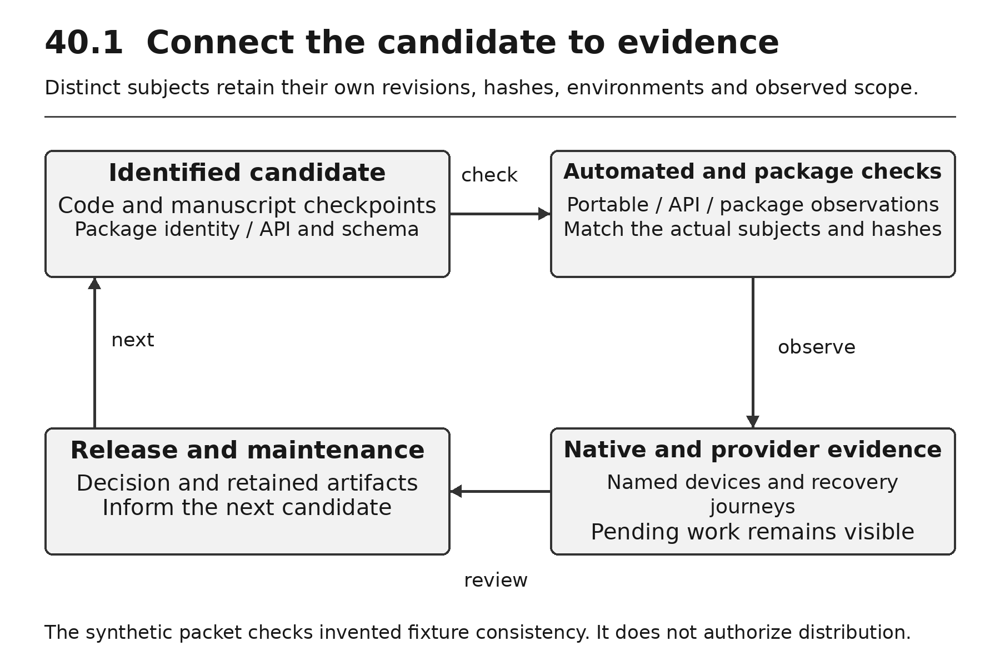
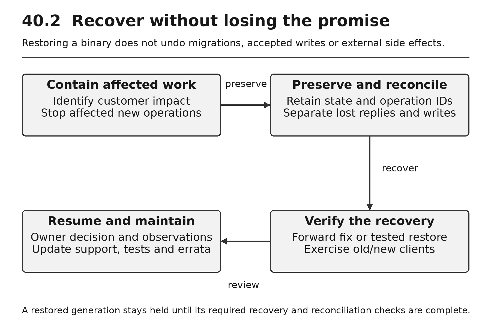

# Chapter 40
# Automated Releases and Long-Term Maintenance

The anniversary request has reached its most ordinary test: next month, the customer opens the application again. The app may have updated. The server may have been restored. A certificate may have expired, a provider may have changed a requirement, or a dependency may have received a security fix. The customer still expects to find the right draft and understand the order's state.

A release process exists to preserve those expectations through change. Automation makes repeated checks affordable. It also makes a mistaken assumption repeatable. If a workflow combines yesterday's package with today's test report, a green result can describe a system that never existed. Our final chapter connects source, artifacts, evidence, release decisions and maintenance responsibilities without hiding the remaining native and provider work.

## What You'll Learn

1. Relate manuscript checkpoints, code revisions, packages and test evidence.
2. Run a bounded release-packet rehearsal that rejects changed candidate bytes.
3. Separate regression automation from signing and distribution authority.
4. Plan compatible app, API and database updates with explicit recovery limits.
5. Maintain dependencies, diagnostics, support and matching reader resources.

**Prerequisites:** Chapters 19-21, 25, 33-39; Git; Python 3.12; the companion repository. The new rehearsal needs no .NET installation, signing key, store account or customer data. Earlier C# and platform workflows retain their own documented prerequisites.

**What you build:** A runnable synthetic packet exercise, failure/restoration experiment and maintenance worksheet. Start at companion source 22489d1906110ebf4925aa6b2a2b04c0b2833130. Complete files are eng/release-rehearsal/packet.py, demo.py and test_packet.py. The exercise uses invented bytes and declared fixture receipts. It is not an app publisher or an independent attestation service.

## 40.1 Define what a release contains

A mobile release is more than one version number. The customer installs a signed client. That client uses an API contract and may retain a local database, pending operations and media checkpoints. The server stores durable state and trusts external identity/payment systems. The book describes a particular source milestone rather than every future version of that system.

A useful candidate record identifies those relationships before anyone starts distribution. Use immutable source revisions for the manuscript and code, distinct package identities and versions for each platform, and the relevant API/schema environment. Keep the evidence's original source and run identifiers. A comment saying unchanged is helpful context, but a later build cannot inherit an earlier pass merely because its author expects the code to be equivalent.

| Identity | What it answers | What it does not establish |
| --- | --- | --- |
| Code revision | Which tracked source was selected? | Exact restored dependencies or package bytes |
| Manuscript revision | Which instruction was reviewed? | That every native exercise has executed |
| Package hash | Are these the same bytes? | Who built them or whether they are correct |
| Package ID and build version | Which installed app/update is intended? | Compatible persistent data |
| Test/run identity | Which check produced this observation? | All other acceptance gates |
| API/schema version | Which server/data contract is intended? | Safe rollback after every write |

The Chapter 38 package and corrected smoke harness illustrate a legitimate difference. The package candidate remains b15607e; the harness is 698aa3d. The immutable-candidate workflow checked the downloaded APK hashes before the later emulator observation. Keeping both identities is more accurate than rewriting the package report to the harness revision.

The new synthetic exercise deliberately uses a simpler rule: all four fixture receipts must name the same code revision and the same invented artifact hash. That makes a mismatch easy to discover. A real pipeline needs a dependency graph with distinct subjects for source tests, built packages and deployment observations. Do not apply the synthetic same-hash rule to unrelated real artifacts or relabel earlier evidence to make it fit.



## 40.2 Inventory the automation that already exists

Open .github/workflows in the companion. core.yml compiles and executes portable tests on Windows. api.yml builds and runs API checks and the local listener smoke. android.yml compiles the native target. acceptance.yml projects same-job machine-readable suite results. operations.yml exercises the published loopback HTTPS restoration drill. performance.yml retains a scoped investigation. The Android release and immutable-upgrade workflows add their own package and emulator evidence.

These jobs have different triggers and inputs. A documentation-only commit need not run the same matrix as a changed authorization rule, but it must not be described as newly passing every job. Read the paths filter before expecting a result. If a workflow has not run at the chosen revision, record that fact. If a required artifact has expired, either retrieve a legitimately retained copy with verified identity or rebuild the affected candidate and repeat its downstream checks.

The acceptance report from Chapter 36 is particularly useful because its automated gate and manual rows coexist. It records selected executable requirements while retaining native journeys, accessibility, OS recovery, live MFA, hosted payment and iOS release as unexecuted manual work. An aggregator that simply turns every upstream green job into release ready would destroy that distinction.

Our new release-rehearsal.yml is manual-dispatch only. It checks Python boundaries and creates synthetic receipts; it does not execute the C# suites or publish a package. Its manifest argument travels through an environment variable to a quoted shell argument rather than being interpolated as executable shell text. The job requests read access to repository contents and uploads only the bounded synthetic packet.

## 40.3 Implement the packet boundary

The packet tool reads a new, flat fixture directory. candidate.json selects an exact code revision, manuscript revision, invented candidate.bin digest and four receipt filenames. Each receipt identifies one fixed gate: portable, api, android-package or android-update. The profile must be synthetic-rehearsal. Neither the profile nor the declared pass values describe a real test run.

The complete reader in packet.py enforces a 64 KiB limit per file, rejects duplicate JSON keys and accepts only the fields it expects. It refuses symlink inputs, absolute filenames and parent traversal. A fixed filename mapping prevents the api row from quietly selecting the portable receipt. These constraints make the exercise manageable; they do not turn a shared, attacker-writable directory into a security boundary. Use an owned workspace and controlled producer.

Two checks express the candidate relationship:

```python
require(plan['code_revision'] == code_revision
        and plan['manuscript_revision'] == manuscript_revision)
digest = hashlib.sha256(
    bounded(owned_file(root, artifact['file']))).hexdigest()
require(digest == artifact['sha256'])
```

The first compares the plan with the caller's selected revisions. The second hashes the bytes actually present. Later, each receipt must refer to that code revision and digest. A caller-supplied revision remains metadata: this program does not fetch GitHub or verify which checkout produced the bytes. A controlled workflow supplies the checked-out revision; an independently verified provenance mechanism would add a different kind of evidence.

Reject malformed input before opening an output file. A valid report uses exclusive creation, so a repeated invocation cannot silently replace an earlier observation. The CLI prints fixed rejection text without echoing input JSON, a private path or a raw exception. Unknown fields are rejected rather than copied to the public report.

The result retains two explicit limits:

```python
'distribution': 'blocked',
'release_readiness': 'unassessed'
```

These are constants of this teaching tool. Even matching synthetic receipts cannot authorize a real store operation. Real manual acceptance needs its own reviewed observations and an appropriate release decision; changing these constants is not an implementation of that process.

## 40.4 Run the rehearsal and break the candidate

Use the dedicated source checkpoint or a later documented revision with the same rehearsal implementation. From the companion repository root, PowerShell can capture the code revision and run the exercise. Set manuscriptRevision to the actual manuscript checkpoint you intend to record; the published local observation below used the full dcd2f9b revision recorded in docs/reviews/ch40-release-review.md.

```powershell
$codeRevision = git rev-parse HEAD
$manuscriptRevision = 'YOUR FORTY-CHARACTER MANUSCRIPT SHA'
python -m unittest discover `
  -s eng/release-rehearsal -p test_packet.py
python eng/release-rehearsal/demo.py `
  --output artifacts/my-release-rehearsal `
  --revision $codeRevision `
  --manuscript-revision $manuscriptRevision
```

Replace the placeholder before running the demo. Use a destination that does not exist. The program creates only its new output tree and refuses to reuse an existing one. On macOS/Linux, use the equivalent shell variable assignment and continuation syntax. No platform build tools are required for this exercise.

The demo performs five operations:

1. Create invented candidate bytes and four clearly labeled synthetic receipts in a new fixture directory.
2. Validate their selected identities and hashes, then create synthetic-packet.json.
3. Alter the actual candidate bytes without rewriting the receipts.
4. Require the validator to reject the changed artifact.
5. Restore the original owned fixture bytes and validate again, while retaining all manual gates as not_run.

The expected console result is:

```text
Synthetic packet: pass; distribution: blocked.
Changed candidate bytes rejected as expected.
Restored synthetic fixture validates; all manual gates remain not_run.
```

This exact success/failure/restoration path ran locally at source 22489d1. All 17 Python boundary tests passed, with no skipped cases on this Linux host. They cover stale revisions, mismatched bytes, cross-candidate receipts, swapped/missing gates, failed/status errors, duplicate keys, unexpected fields, traversal, symlinks, bounded reads, malformed/missing input, existing output and a profile that tries to claim production.

The retained report is docs/reviews/ch40-synthetic-packet.json. It contains only fixed gate labels, selected source metadata, hashes and statuses. Its four declared passes are generated fixtures, not newly executed C# or Android results. The workflow definition has not run on GitHub because the current commits have not been published.

## 40.5 Add distribution authority deliberately

The existing tutorial workflows need only the permissions required for their checks. A future signing job needs controlled access to a private key or platform-specific signing service. A store upload needs another authority. Keep those permissions out of untrusted change execution and give each job only the access its operation requires.

GitHub environments can restrict branches/tags, require review and limit access to environment secrets, subject to the repository's available features and configuration. Merely naming an environment in YAML is not evidence that an administrator configured protection. Record the actual settings when introducing a real distribution job, and rehearse denied or missing approval as a normal outcome.

Workflow dependencies are build inputs too. Current GitHub guidance describes workflow dependency lockfiles, including transitive actions, and full-commit references for reusable workflows. Where lockfiles are not adopted, reviewed full-length action SHAs improve stability over movable tags. The companion currently uses version tags for several actions and does not introduce a dependency lockfile here. That remains maintenance work, not an implied completed control.

A signing failure should leave the candidate unreleased. A successful signing job should not automatically invent missing device or provider acceptance. Before making distribution executable, decide which exact artifact is promoted, how its identity is checked, where signing material lives, who owns the decision and how the result is retained. Avoid rebuilding different bytes after a reviewer has approved one candidate unless the process explicitly returns the new candidate to the required checks.

Do not place signing passwords, private profiles, raw customer databases or diagnostic dumps in a broad artifact upload. Whitelist the files intended for retention. A public-safe report and a controlled archive/symbol set have different audiences and lifetimes. The sample workflows' short artifact retention is suitable for experiments; a publisher needs a deliberate policy for released packages, symbols and support evidence.

## 40.6 Plan compatibility across mixed versions

Mobile updates reach devices at different times. A customer can use an older client while the server runs newer code. Offline work can return after a contract changes. A safe rollout therefore names the combinations it intends to support instead of assuming all clients update together.

For an additive API field, define how older clients handle its presence and newer clients handle its absence. For a breaking required field, consider a versioned contract or staged transition. Retain tests for supported old request shapes. Do not quietly convert a transport failure into a destructive local reset.

The companion's SQLite migrations, operation keys and restored-generation review supply concrete starting points. A local migration must preserve the customer's confirmed draft. A durable order retry must reuse its original operation identity after uncertainty. A restored server must retain the payment replay and ownership boundaries described in Chapters 33-35. Each rule needs the appropriate storage/process/native evidence.

| Change | Compatibility question | Useful rehearsal |
| --- | --- | --- |
| Local schema migration | Can a saved old draft open after update? | Seed old data, upgrade without uninstall, inspect recovery |
| API contract addition | Do supported older clients still work? | Run old-shaped requests against the new server |
| Pricing snapshot | Which rules govern an existing quote? | Retry the original request/version around expiry |
| Identity callback change | Can installed clients complete or cancel sign-in? | Exercise each supported client/provider registration |
| Server restoration | Which generation may serve customer work? | Restore to a new location, review, then explicitly release |
| Delivery revocation | Does access stop at the intended boundary? | Test old grants and cached/private-data behavior separately |

A matrix does not need dozens of speculative versions. Choose the supported window and explain why. Keep an older client while a staged rollout is active, retain its representative request contracts, and record which newer server revision was actually exercised. Unsupported combinations need a deliberate user outcome rather than an exception that discards local work.

## 40.7 Distinguish rollback from forward recovery

An old binary does not undo a database migration, refund a payment or recall a downloaded file. Restoring a database snapshot can remove later accepted writes. Returning an app to an earlier version may not be possible through the intended distribution path or may leave data the older code cannot interpret.

Plan an incident response around the resource at risk. If a new checkout path duplicates an operation, stop initiating new affected work and reconcile the durable operation identities. If a local migration loses a field, preserve the affected storage before attempting repair. If an API change rejects older clients, a server compatibility fix may be safer than asking every customer to reinstall.

Chapter 35's restore drill intentionally holds a recovered generation until explicit review. That is a useful pattern: restoration and permission to resume customer work are different transitions. Extend the incident record with the selected backup, observed recovery, unresolved writes and decision owner. A backup that has never been restored is an untested recovery input.



A release owner should also define stopping conditions. A spike in failed submissions needs a different response from a cosmetic label defect. Use rates with suitable denominators, bounded observations and actual customer impact. Chapter 37's desktop search timing is useful performance evidence under its named conditions; it is not a production latency threshold or an energy measurement.

## 40.8 Maintain the dependency and diagnostic boundaries

A servicing update can improve reliability while changing trimming behavior, initialization, callback handling or workload requirements. Review direct and transitive dependencies together. Restore and build the affected targets, rerun meaningful portable/API regressions and revisit native journeys touched by the change.

For the book's .NET generation, Microsoft's documented package inventory command can include advisory information and transitive dependencies:

```powershell
dotnet package list `
  --project src/GnazzosWorld.App/GnazzosWorld.App.csproj `
  --include-transitive --vulnerable --format json
```

Run this in the configured development environment; it may need restore, feeds and advisory access. No fresh advisory scan ran in this chapter. A clean known-advisory result does not prove the application has no vulnerabilities. Record the scan date, source and resolution, then evaluate the impact of a change rather than updating every version without investigation.

Likewise, do not enable a different runtime, full trimming or NativeAOT merely to make an artifact smaller. The actual publication target and dependencies must support the selected mode. Repeat relevant Release/package/native checks after changing it. A simulator success cannot settle a device-specific linker or runtime path.

Diagnostics need continuing ownership. Keep structured public-safe fields separate from raw crashes, private paths and request content. Associate symbols with the exact released build. When support reports a fault, collect only the information needed to reproduce it through the supported channel. Consent and retention decisions from Chapter 35 still apply after release; a new SDK does not inherit permission to export additional customer data automatically.

## 40.9 Keep the book and companion useful

A reader needs a stable starting point and a correction path. Maintain a source map from chapter to verified commit, with the toolchain and known limits at that milestone. Earlier Part I readers should not be forced onto the full later application to follow a first-page listing.

The companion already retains historical milestones. Add chapter or edition tags only when their intended source and verification are known. Matching tag names in two repositories are useful navigation, but the edition record should also retain both exact commits. Do not move a published tag to conceal an erratum; issue a new correction checkpoint and explain the change.

An erratum should identify the affected edition/chapter, symptom, corrected instruction or source, verification and remaining scope. For example, a corrected Xcode path is different from a broken provider callback. The latter may require a new candidate and device evidence. Keep security-sensitive details out of a public issue until the responsible maintenance process has assessed them.

Use a maintenance worksheet with roles that a real publisher can assign:

| Role | Responsibility | Evidence to retain |
| --- | --- | --- |
| Release owner | Select candidate, acceptance gates and rollout decision | Named decision and unresolved scope |
| App maintainer | Workloads, signing renewal and device regressions | Toolchain inventory, package and device records |
| API/data maintainer | Contracts, backups, restore and write reconciliation | Migration/restore observations and compatibility window |
| Identity/payment owner | Provider changes, access and event reconciliation | Supported recovery and sandbox/live records |
| Support/privacy owner | Incident intake, consent and retention | Bounded case record and disposition |
| Editorial maintainer | Chapter map, errata and edition references | Corrected manuscript/code checkpoints |

One person can fill several roles in a small project. The point is to make responsibility actionable: who notices an expiring profile, who decides a recovery is sufficient, and who updates the reader's instructions? The worksheet does not appoint an unconsulted person or create a service commitment.

## Guided Lab: explain a stopped release

1. Run the Python boundary suite and demo in a new owned directory. Read the generated packet before changing it.
2. Confirm that code/manuscript metadata matches your selected checkpoints and that the candidate hash corresponds to the actual invented bytes.
3. Alter candidate.bin without updating evidence. Run packet.py directly to a new output destination and observe rejection.
4. Restore the original bytes. Change one receipt status to fail and rerun. A structurally valid packet now has synthetic_gate fail; distribution remains blocked.
5. Describe why neither restoring bytes nor changing a declared fixture status establishes a real device pass.
6. Choose one pending real acceptance gate and identify its prerequisites, owner role and observation needed to close it.
7. Add one compatibility incident to the maintenance worksheet. Define containment, preserved state, recovery verification and permission to resume.

**Worked reasoning:** Suppose the Android fixture receipts match but the iOS archive has not been built. The synthetic rehearsal passes its narrow consistency rule. iOS remains not_run and release readiness remains unassessed. Copying a pass value into the manual row would not create an archive, validate a signature or exercise an iPhone. The next real step is Chapter 39's compatible-Mac preparation and native verification.

Suppose instead the package is unchanged but the API begins rejecting an older client's saved operation. A client package rollback is not the first demonstrated repair. Preserve the operation key and accepted server state, reproduce the old contract, and investigate a compatible server correction. Verification must establish that retry/reconciliation yields one intended result rather than merely making the error message disappear.

## Troubleshooting

| Symptom | Diagnostic check | Corrective action |
| --- | --- | --- |
| Synthetic packet rejects a candidate | Compare selected revisions and actual digest | Restore the intended fixture or generate a new candidate record |
| Repeated run refuses output | Check whether destination already exists | Retain the old observation and choose a new path |
| A required workflow has no run | Inspect trigger and path filters | Run the appropriate verified workflow when publication is available |
| Downloaded artifact is unavailable | Inspect retention and original run identity | Rebuild/reverify or retrieve a legitimately retained exact copy |
| Signing succeeds, device flow fails | Compare package/build and named journey | Fix the feature and repeat affected candidate checks |
| Restored backend serves stale grants | Check generation hold/release and replay state | Preserve evidence and repeat controlled recovery review |
| Old client fails after server update | Reproduce supported old contract and saved operation | Restore compatibility without duplicating customer work |
| Diagnostic export contains private content | Inspect actual fields, SDK configuration and consent | Stop the affected export and correct collection/retention |

## Verification status

The new executable work is a synthetic Python packet rehearsal with 17 passing local boundary tests and an observed changed-byte rejection/restoration path. Its output retains code 22489d1 and manuscript dcd2f9b as the exact selected execution checkpoints. Later chapter/documentation commits are not relabeled as that run.

No application C# changed. No fresh C#, Android, API, iOS, store or live-provider result is claimed for this chapter. The manual-dispatch workflow is authored but unexecuted. Existing Android signing/update and HTTPS recovery observations remain useful under their original revisions and limits. Production distribution, the iOS candidate and complete physical-device/provider/privacy acceptance remain pending. All forty planned chapters now have drafts; publication completeness still requires the outstanding technical acceptance and book-production work.

## Chapter Summary

A maintainable release connects identified source, artifacts and evidence to an explicit decision. Automation should preserve that relationship and stop when a required subject or observation is missing. The synthetic packet lab demonstrates candidate-byte checks, stale-evidence rejection and retained manual gaps without pretending to publish an app. Real distribution adds controlled signing, platform acceptance and the publisher's decision. Long-term support then requires compatible API and data changes, verified restoration, deliberate dependency servicing and bounded diagnostics. Keep each observation attached to its original candidate, preserve customer state during incidents, and distinguish a forward repair from an unsafe rollback. Stable chapter checkpoints and honest errata extend the same discipline to readers. The application and the book remain useful when the next change can be understood, tested and recovered deliberately.

## Independent Extensions

1. Design a real evidence graph with separate subjects for source tests, an Android package and its upgrade harness. Explain how you would verify the links without rewriting old receipts.
2. Write an incident worksheet for a duplicate payment notification after restoration. Include operation identity, containment, reconciliation and proof that resuming work is safe.
3. Propose a two-repository edition map. Identify the exact commits, toolchain, errata channel and incomplete native checks that a reader must see.

## References

Primary sources checked November 17, 2026. Platform and service settings require revalidation when the actual release workflow is configured.

- GitHub environments: https://docs.github.com/en/actions/reference/workflows-and-actions/deployments-and-environments
- GitHub workflow dependency lockfiles: https://docs.github.com/en/actions/concepts/security/workflow-dependency-lockfiles
- GitHub secure workflow use: https://docs.github.com/en/actions/reference/security/secure-use
- Microsoft package inventory: https://learn.microsoft.com/en-us/dotnet/core/tools/dotnet-package-list
- Microsoft MAUI runtimes: https://learn.microsoft.com/en-us/dotnet/maui/deployment/runtimes-compilation
- Microsoft MAUI trimming: https://learn.microsoft.com/en-us/dotnet/maui/deployment/trimming

## Editorial index terms

artifact retention; candidate; compatibility; dependency servicing; edition; environments; errata; evidence; forward recovery; GitHub Actions; maintenance; provenance; release gate; rollback; schema migration; signing authority; workflow dependency lockfile.
