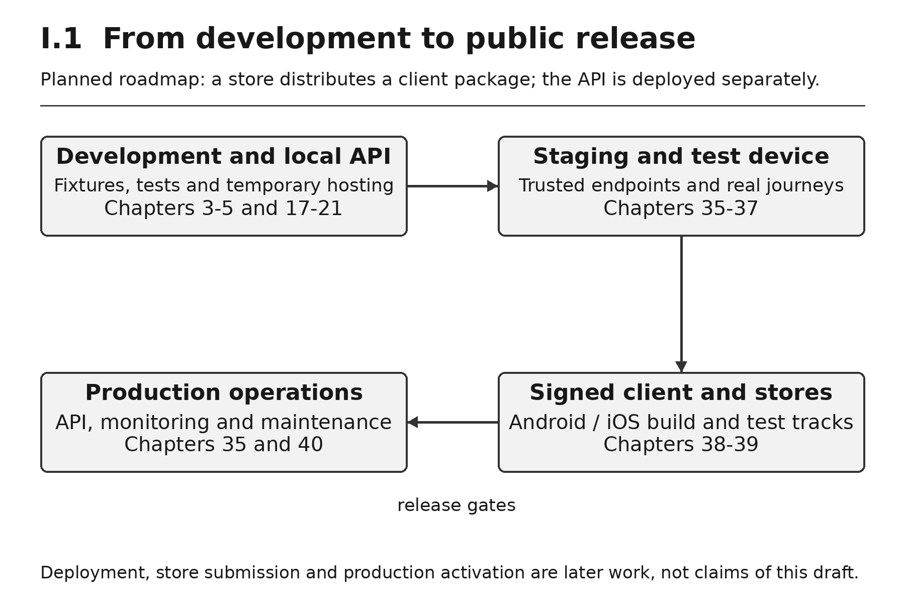

# Introduction
## From a Website to an Application People Can Rely On

Imagine a listener finding Northern Lights on the website, saving it in the mobile app, and returning to it later. Imagine a reader browsing books on a tablet with larger text enabled. Imagine a customer halfway through a custom-song request when a phone call arrives. These are small, ordinary experiences. They require several parts of the software to cooperate, and those parts must continue to cooperate when a device changes state or a network request fails.

This book follows that work from the first project through release preparation. Our application, provisionally named Gnazzo's World, brings together books, music, podcasts, and custom-song requests drawn from johngnazzo.com. We will keep public discovery simple and add accounts where they enable personal features: saved favorites, bookmarks, listening progress, and access to a customer's own requests and deliveries.

The website is a source of content and requirements. Its HTML pages and JavaScript are not a native project we can simply recompile. We will identify the information those pages express, give it a consistent model, and decide how a phone or tablet should present it. Some content can live in bundled fixtures initially. Other content eventually comes from a small service. Personal information requires a different access boundary from a public song title.

## The knowledge you bring

Desktop and web development provide a valuable starting point. You already understand state, separation of concerns, user input, and errors. Dependency injection can keep a feature independent of a concrete service. Asynchronous code can allow work to complete without blocking the interface. Tests can protect a pricing rule against accidental change.

On mobile devices, the operating environment changes the decisions around those techniques. A process can leave the foreground while work is unfinished. A connection can be available while the intended server is unreachable. A permission can be refused. A keyboard can occupy much of the screen. A user can increase text size enough to expose assumptions hidden in a fixed layout.

We will build on your existing knowledge while giving those mobile concerns full explanations. You should not need to guess what an application lifecycle event means or infer how a signing certificate relates to an app-store package from a sequence of unexplained screenshots.

## What the finished application will do

The public experience begins with a home screen, artists, songs, books, and podcasts. Search and filters help people find something specific. Detail views add descriptions and relevant actions. Sharing a content link should take another person to a meaningful destination rather than a dead end.

Personal features add local persistence first, then account synchronization. A favorite should remain a favorite after a restart. Listening progress should belong to the appropriate account. Signing out should not accidentally expose one customer's data to another person who signs in on the same device.

Authorized audio introduces playback controls, a queue, persisted position, interruptions, background behavior, and downloads. Those chapters use distributable sample media and make platform-specific work explicit. Opening Spotify and playing a file through our own player are different operations with different requirements.

The custom-song service supplies a more demanding interaction. A customer chooses a length and style, describes an occasion, and saves a draft. Pricing rules must be understandable and testable. Submission must tolerate repeated taps and uncertain network outcomes. When a payment integration is added, a trusted server event establishes payment state; returning to a screen labeled success does not establish it.

We will keep the backend modest. Its job is to serve the mobile application's needs: public content, authorized personal data, validated requests, and reliable order/delivery state. We will avoid turning the book into a general backend-development survey, while explaining every service boundary the app depends on.

## The technology choices

C# 15 is our implementation language, .NET 11 supplies the platform libraries and tooling, and .NET MAUI 11 provides the cross-platform application framework. XAML expresses the main interface. The manuscript will explain how those layers relate instead of treating their names as interchangeable.

The first portable project targets net11.0. It contains catalog models, validation, search, and example business rules. It does not depend on a page, a device, or an authentication tenant. That separation makes the code fast to exercise and useful from both a mobile client and a small service where appropriate.

The application project depends on that portable core and adds views and platform adapters. Native behavior remains visible behind clear interfaces. A shared abstraction for playback can describe the operations our feature needs while Android and iOS still have their own setup and system interactions.

Tool versions are part of the example. The companion repository pins an SDK feature band and records package versions and verification results. A newer major release is a reason to review compatibility, not proof that every workload and package should be updated blindly. Before publication we will recheck the complete toolchain and explain any supported differences from the original development baseline.

## Accounts and multifactor authentication

Authentication establishes who is using the app; authorization decides what that identity may access. The distinction becomes concrete when an order detail page asks a server for a customer's files. Hiding another customer's order from a list does not protect the corresponding endpoint.

We will use a managed identity provider and a supported native-client flow. The mobile application is distributed to users and cannot hold a private client secret securely merely by compiling it. Token handling, browser callbacks, session expiry, and sign-out will be explained alongside the user experience they support.

MFA coverage includes enrollment and challenge as well as factor replacement, recovery, and lost-device scenarios. Local biometric unlocking has a different purpose from account MFA. We will test and describe both at the boundary where they actually operate, without presenting a simulated screen as evidence that an identity system is secure.

## Verification throughout the book

We begin with tests that have clear expected outcomes. A malformed catalog should be rejected. A search should handle case and accented titles consistently. A second song's discount should apply to that song, not accidentally to the whole order. These are small enough to inspect closely and important enough to deserve automated checks.

Later tests cover database migrations, canceled network requests, synchronization conflicts, unauthorized access, duplicate payment events, and interrupted delivery. Tests run at the appropriate boundary. A database migration should be exercised against a database, while an account recovery process also needs provider and device verification.

Accessibility is likewise continuous work. Semantic headings, meaningful labels, text resizing, and focus behavior begin with the first real screens. A final review catches regressions and assesses the whole journey; it should not be the first time someone attempts to navigate the app with a screen reader.

## Reading toward public release

A complete development example needs more than a successful debug build. We will address release configuration, signing, platform requirements, store metadata, privacy declarations, and support. Current storefront rules must be reviewed while preparing the release procedures and again before an actual submission. The procedures in Chapters 38-39 do not imply that every platform or store gate has executed. This matters especially for a business that mixes public catalogs, digital media, and custom services.

After release, devices, dependencies, and services continue to change. We will close with versioned data, update strategies, diagnostics, and a release process that distinguishes test results from decisions requiring a person. The goal is to leave you able to explain, change, and maintain what you have built.

The client and backend have separate release paths. A store package contains the app; it does not deploy the ASP.NET Core API. Chapters 35-37 establish staging, operational checks and release-quality evidence. Chapters 38-40 cover platform distribution and maintenance. Treat the figure as the destination of the book, not the present deployment state.

Part I starts by examining the mobile development landscape, defining the application, and preparing the tools. You will then run the first screen and establish the portable tests that support the rest of the book.

## Source and verification notes

Microsoft's .NET 11 announcement and SDK download documentation establish the proposed language/SDK baseline. MAUI's own support policy and release documentation must be consulted separately from the general .NET lifecycle. See the official links in planning/book-outline.md. Device-specific statements will be verified against the exact supported Android/iOS versions used for the finished examples.

