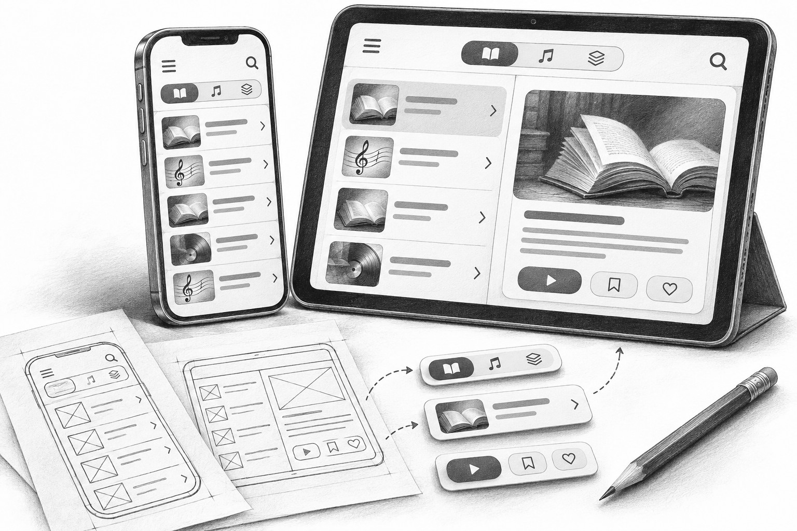

# Part II
# Building a Native Interface

The first screen established a path from bundled records to native controls. This Part turns that screen into a small navigable application whose state can be exercised without constructing a page. The changes belong together: a selection needs an identity, a detail destination needs a contract, and a wider layout must preserve the meaning of that selection.

Chapter 6 explains XAML objects, measurement, layout, resources, and styles through the home and catalog pages. Chapter 7 moves query, filtering, selection, and command behavior into portable view models. Chapter 8 introduces Shell destinations, validated detail parameters, Back behavior, and the distinction between navigation and restored state.

Chapter 9 extracts reusable catalog and detail views and explains the image, collection, and scrolling boundaries they introduce. Chapter 10 establishes theme resources, accessible interaction requirements, and English/Spanish string resources. Chapter 11 adapts the same browser to available width and explains what phones, tablets, and foldable configurations still require from device testing.

The companion implementation uses the bundled catalog. It does not add a live backend or pretend that local data has remote loading states. It does add genuine presentation behavior, tests, and a native build path. Provider integration, downloads, and authenticated links remain in their planned later chapters.

Part I source is preserved at the commit documented in docs/milestones.md. Main now evolves into the Part II application, so its startup differs intentionally from the earlier NavigationPage example. Follow the recorded milestone when retracing the first five chapters.

At the end of this Part, readers should be able to explain how a binding obtains its source, what changes when a user searches or selects a record, how a detail page receives its ID, and why width alone does not establish a complete device experience. Passing tests and compilation are recorded separately from launch, screen-reader, keyboard, and resizing checks.
