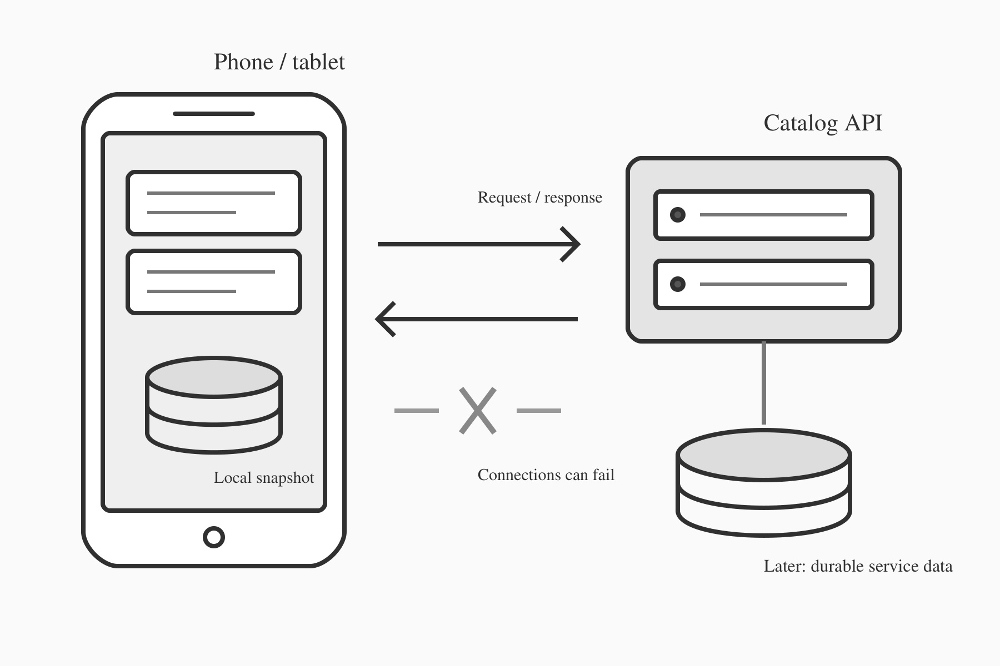

# Part IV
# Data, Connectivity, and a Small Backend

Parts I–III built a native interface over bundled content and a simulated customer workflow. That arrangement was useful: it let us test meaning and interaction without a network service. The next step is to introduce the network as a fallible dependency and give stored data an explicit life beyond one process.

A successful request does not guarantee a usable response. A server can return a login page instead of JSON, an old client can misunderstand new data, and a response can disappear after a service completes its work. A phone can also switch networks while the application is reading a body. These are ordinary operating conditions, not exceptional product requirements to add at the end.

This Part develops those boundaries in five chapters. Chapter 17 introduces a GET-only catalog client with cancellation, a total deadline, bounded reads and selective retry. Its native networking lab uses an explicitly simulated HTTP transport; it does not contact a deployed service or replace the main catalog. Chapter 18 will build the companion ASP.NET Core API and establish local development networking. Chapter 19 will choose storage mechanisms and introduce migrations. Chapter 20 will develop offline operation and restart-safe pending work under mobile background restrictions. Chapter 21 will define synchronization and conflict resolution against a controlled local user context.

Keep public catalog information separate from customer records. Public metadata can often be refreshed anonymously. A request story, contact address, bookmark or order belongs to a different data boundary. This Part does not turn the Chapter 16 demo into a public unauthenticated customer API. Real identity and ownership enforcement follow in Part V before the production customer workflow is assembled.

Our verification also becomes more layered. Portable handler tests isolate the HTTP contract. API integration tests will exercise a real local service. Temporary databases will establish migration and transaction behavior. Device checks will examine local-PC reachability, interruption, storage and process restart. Each answers a different question; none should borrow another layer's result as its own evidence.

The objective is a predictable application when data is slow, stale, missing, duplicated or temporarily unreachable. A fast connection is a pleasant case within that design, rather than an assumption on which the design depends.
