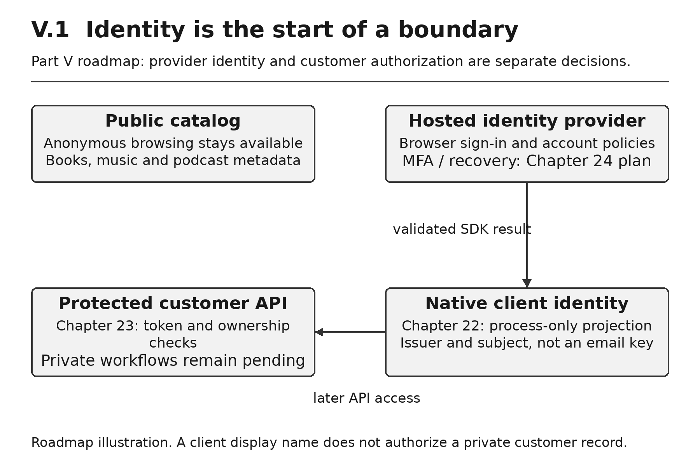

# Part V
# Identity, MFA, and Account Security

A listener can discover Minnesota Bob without an account. A customer returning to a private anniversary-song draft needs more than a familiar display name. The application must establish who signed in, which service can verify that identity, what the customer may access, and how recovery works when a phone or authentication factor is lost.

Part IV deliberately used a simulated context to exercise synchronization before introducing provider configuration. That label is no longer sufficient for customer data. In this Part we replace assumptions about identity with explicit provider, device and server boundaries. A browser success, a local profile, an accepted access token and an authorized record are related decisions with different evidence.

Chapter 22 introduces native-app sign-in with a managed provider and a maintained SDK. It preserves anonymous browsing, explains the browser return path, and distinguishes compiled integration from an observed provider round trip. Chapter 23 handles sessions, secure storage and independent API authorization. Chapter 24 develops provider-supported MFA and recovery, including their actual configuration and device checks. Chapter 25 addresses privacy, sign-out, export and deletion. Chapter 26 reviews threats and tests the account boundary against realistic misuse.

Keep the customer's story in view. Someone requesting a song may supply names, family relationships and personal memories. A dependable design should not turn those details into diagnostic logs, attach them to the wrong account, or promise that a local button revoked every remote session. Each chapter explains what has been implemented and which checks remain before private customer workflows can be enabled.

The diagram is a roadmap, not a claim that all five chapters are complete. Use the verification record with the matching source revision. Native screenshots, provider enrollment and recovery observations must come from the actual tested workflow; authored illustrations cannot establish those outcomes.
