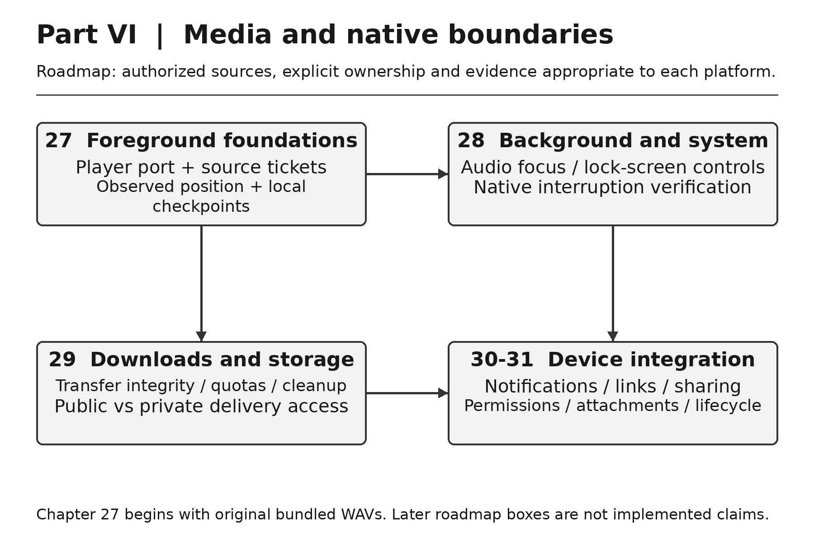

# Part VI
# Media and Native Device Experiences

A listener finds Minnesota Bob in Gnazzo's World and chooses something to hear. A useful player must do more than respond to a Play button. It must distinguish an opened source from audible playback, remember a confirmed position, handle an unavailable item and release the old native player when the listener leaves. Later it must cooperate with the operating system while the screen is locked or another audio source takes control.

Part V established a way to reason about identity, owned state and evidence. Apply the same discipline to media. A Spotify or Apple Music page is not a distributable audio file. A native compilation is not a listening test. A successful seek request is not proof that a device reached the requested position. An account label is not permission to download a customer's private delivery.

Chapter 27 begins with original bundled timing fixtures and an explicit foreground-only lab. It develops an audio-service boundary, source-generation ownership, play/pause/seek controls and local absolute-time checkpoints. Chapter 28 adds background playback and system controls. Chapter 29 handles downloads and storage integrity. Chapters 30 and 31 address notifications, links, sharing, attachments and native capabilities.

The first media sample is deliberately independent of live customer services. Its checkpoints are anonymous to the installation and do not migrate the earlier reading-progress, account-workspace or synchronization records. Later integration must decide which listening state belongs to an account and what happens on sign-out, consent withdrawal and deletion.

Keep the actual listener in view: someone may use a large text size, pause after a phone call, share a tablet or return after the operating system ends the process. The chapters name the observed native behavior and the durable promise separately. Architecture diagrams describe the design; screenshots and listening results must come from actual device runs.
