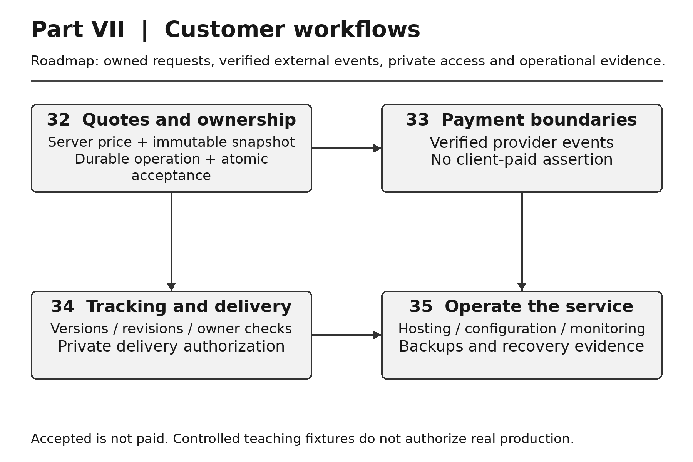

# Part VII
# Customer Workflows and Order Delivery

A customer has written an anniversary story and reviewed an estimate. Turning that draft into a durable relationship with Gnazzo's World changes the system. A phone can lose a reply after the service commits, taps can race and an account can change while acceptance is in flight. The application must explain what happened without inventing another order or exposing someone else's request.

Chapter 32 introduces server-calculated quotes, immutable price snapshots, authenticated ownership and transactional acceptance. The client saves an operation before sending, so an uncertain reply can be reconciled under its original account. Accepted describes a recorded teaching request; it does not assert payment or real production.

Chapter 33 adds payment boundaries and verified external events. Chapter 34 develops versioned tracking, revision exchanges and private delivery. Chapter 35 examines hosting, monitoring, backups and recovery. Each boundary needs its own evidence.
