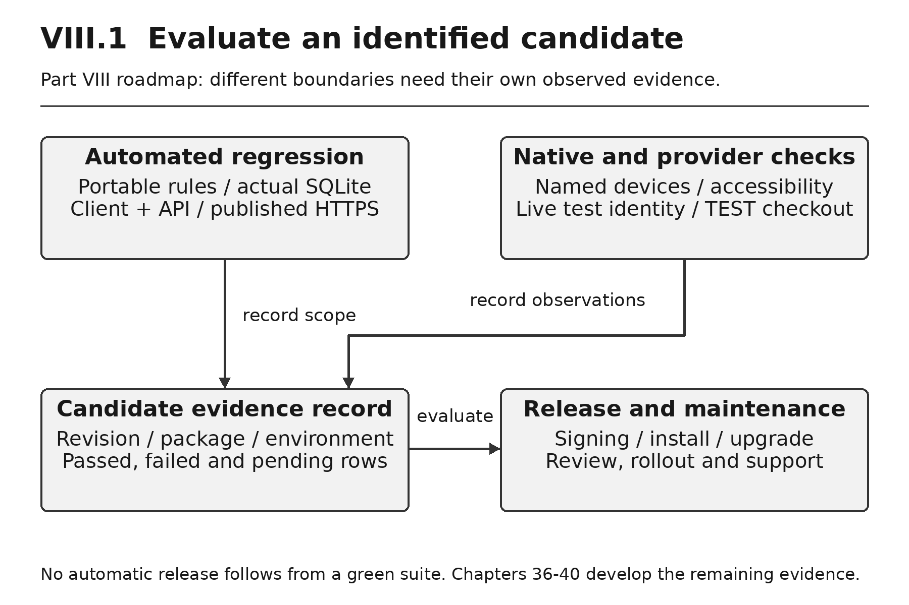

# Part VIII
# Verification, Publication, and Maintenance

The anniversary request has crossed a great many boundaries: a reviewed draft, a quoted price, an accepted operation, a TEST payment event, a revision and a private sample delivery. Each chapter established a particular piece of evidence. None of those results alone says that a customer can complete the journey on an actual phone, return after an interruption and understand what happened.

This final Part turns the growing application into a candidate that can be evaluated, distributed and maintained. Chapter 36 organizes acceptance evidence across the system. Chapter 37 investigates performance, reliability and accessibility under named conditions. Chapters 38 and 39 prepare Android and iOS release candidates, signing and store requirements. Chapter 40 closes the loop with versioning, support, operational maintenance and future evolution.

A release decision needs an identifiable candidate. Source revision, dependencies, build configuration, app package, API/schema environment and test records must describe the same intended system. A passing Debug build of yesterday's source cannot silently stand in for today's signed package. Likewise, a provider double cannot certify a hosted login or payment environment, and an emulator cannot establish every physical-device behavior.

We will keep useful automated checks and honest gaps together. Repeatable portable rules and API tests make regressions inexpensive to locate. Real process/TLS checks establish another boundary. Native interaction, assistive technology, external providers, signing and install/upgrade each need their own observations. The work remains practical: runnable suites, explicit fixtures, failure reproduction, evidence tables and release procedures with clear owners.

These chapters do not turn the teaching fixtures into production commerce or publish a store listing automatically. Public accounts, real business authority, final policy declarations, production services and credentials require concrete configuration and review. The goal is a repeatable path from an identified candidate to justified release and maintenance decisions. Remaining unexecuted work belongs in that record, where the next developer can see it.
